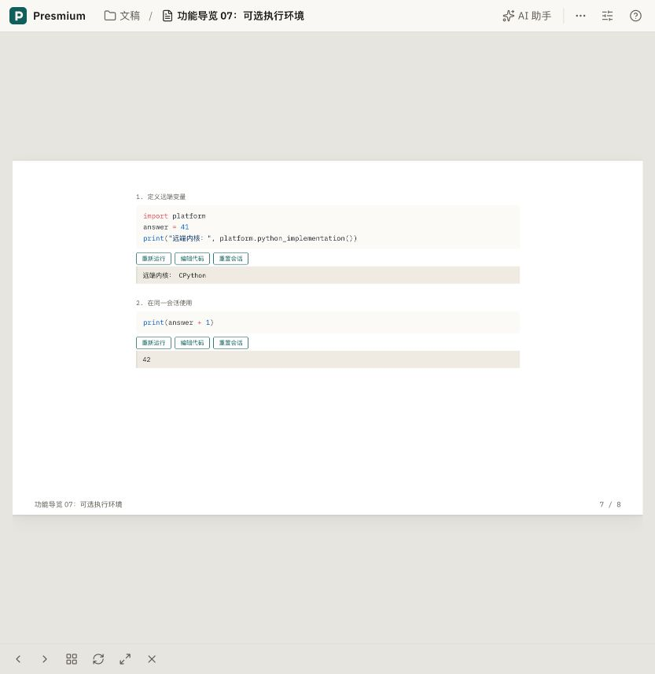

# 云端执行环境与编译线程测量

2026-10-30，在 `ssh team` 的真实 Linux 部署中验证。源码基线为 `7a73e5d0168fb95dfeacb800c1ddf1cbe3745162`。本轮修改仅补充 Studio 镜像的 Python 内核及默认 `lab` 连接配置，没有运行测试套件或新增测试。

本记录对应当天第一轮修复。之后已实现并部署按 IR 声明启动 Hub 环境，后续结果及最终镜像见 [声明式环境验收](../cloud-hub-environments-2026-10-30.md)；下文的镜像与未实现项保留为当轮历史状态。

## 执行环境故障与修复

原 Studio 镜像没有安装 `ipykernel`，`jupyter kernelspec list` 为空；Studio 子进程也没有 `PRESMIUM_ENV_LAB_URL` 与对应服务器令牌。导览 07 声明了 `lab`，但无法连接。

镜像现在安装 `ipykernel==6.30.1` 并注册 `python3`。Jupyter 扩展启动 Studio 时，默认把 `lab` 指向当前用户的 single-user server，服务器令牌仅传入服务端子进程。显式提供的外部环境地址与令牌组合保留。两处源码改动经过独立代码审查；Python 语法解析、镜像真实构建、部署及浏览器执行通过。

| 导览 07 能力 | 实际结果 |
| --- | --- |
| Jupyter Python | 第一个代码块输出 `远端内核：CPython` 并定义变量，第二个代码块在同一命名会话输出 `42` |
| 重置命名会话 | 点击重置后，Jupyter API 的内核数量为 0 |
| 终端 | 连接成功，执行 `printf 'PRESMIUM_TERMINAL_OK\n'` 得到真实输出；离开页面后 API 的终端数量为 0 |
| WASI | C、C++、Ruby、SQLite 分别得到 `C:42`、`C++:42`、`Ruby:42`、`42` |
| WebGPU WGSL | 输出 `[11,22,33,44]`，适配器为 `apple metal-3`，计算发生在客户端浏览器 |
| jax-js | 实际设备 `webgpu`，矩阵乘法输出 `[[19,22],[43,50]]` |
| Python → WebGPU | 真实 Pyodide 异步桥接输出 `[11,22,33,44]`；同步能力探测返回 True，未单独执行同步桥接 |
| 导出 Docker 环境 | 浏览器真实下载 `presmium-env-hello.zip`；解压核对含 `.devcontainer/devcontainer.json`、当前 `hello.py`、`README.md`，镜像定义为 `python:3.12-slim` |
| Docker 运行 | 当前部署没有 Docker 服务，页面显示不可用且运行按钮禁用；未把该项记为执行成功 |

验收使用 Codex 浏览器控制工具操作 Chromium；截图保存在本目录。首次导出等待没有取得下载结果，改为独立页面重新验证后，取得文件并核对内容，未据此修改导出逻辑。用户正在使用的 Studio 与终端在独立下载验证时保持原状。

其它证据：[终端](terminal-connected.png)、[WASI 四种语言](wasi-four-languages.png)、[WebGPU](webgpu-actual.png)、[jax-js](jax-webgpu.png)、[Python 桥接](python-webgpu.png)。

## CPU 与线程对比

原运行容器实际限制为 2 CPU、4 GiB，相关原生线程预算为 1。历史 CPU 限流计数非零，但单次空闲采样没有限流，不能据此认定每次打开文稿都受限。部署现已调整为 4 CPU、4 GiB，并核对实际 cgroup 配额为 `400000 / 100000`。

用原 Studio 镜像 `presmium-cloud-studio:7a73e5d0` 创建独立容器、独立卷，关闭网络，使用公开的 `guide-steps` 文稿（8 节）。每轮复制相同源码，以真实 `Compiler.compile()` 加 `build(..., { to: ['web'] })` 测量；每轮启动新 Node 进程并使用独立查看器缓存目录，随后在同一进程中重复一次。没有使用当前用户的工作区或模型配置。

共 16 轮，前 4 轮为探索与工具链预热，不纳入下表；其余每种配置 3 轮。线程设置同时控制 V8 后台线程池与 `GOMAXPROCS`、Rayon、OpenMP、OpenBLAS，libuv 保持 4。轮次交错，完整原始数据在 [thread-results.json](thread-results.json)。

| CPU / 原生线程预算 | IR 编译中位数 | 冷查看器/网页构建中位数（范围） | 同进程热编译与构建中位数 |
| --- | --- | --- | --- |
| 2 / 1 | 268 ms | 9085 ms（5372–16948） | 106 ms |
| 4 / 1 | 282 ms | 4205 ms（4045–6046） | 100 ms |
| 4 / 2 | 273 ms | 4480 ms（3497–24967） | 94 ms |
| 4 / 4 | 278 ms | 4614 ms（3100–4823） | 129 ms |

这组数据中，IR 编译约 0.27 秒，较大的开销来自首次查看器/网页打包；缓存复用的影响显著。增加 CPU 配额的样本中位数改善，但同为 4 CPU 时增加线程没有稳定、单调的收益。样本少且存在明显离群值，不能据此给出稳定加速倍数。

“冷”只指本轮没有查看器/产物缓存，宿主文件缓存和工具链缓存可能已经预热；构建耗时不含模块导入时间（原始数据另有 `importMs`）。这是静态网页构建的对比，不是 Studio 打开文稿的完整端到端测量，也没有证明浏览器动画帧率改善。浏览器里的动画与 WebGPU 使用客户端设备。

全部 16 轮源码 SHA-256 不变，实际编译/构建错误数均为 0。后 8 轮附有最大 RSS，前 8 轮没有，不比较完整内存结果。临时测量容器与卷已经删除。复现消费者见 [thread-bench.mjs](thread-bench.mjs)；容器中的源码位置为 `/opt/presmium`，私有输出根为 `/work/<轮次>`。

## 本次部署记录

- Compose 项目：`presmium-cloud-hub-verification`；部署目录：`/data/projects/ops/workspace/presmium/.presmium/cloud-hub-verification/source`。
- 新 Studio 镜像：`presmium-cloud-studio:7a73e5d0-env1`，摘要 `sha256:0780a4475981f973b886d4bc33b0bdbb0f1689083a7d41eaf456df05219b793a`。
- 运营者覆盖文件 `deploy/cloud/compose.studio-env.yaml` 把 Hub 的 `CLOUD_STUDIO_IMAGE` 指向上述镜像；维护该验证实例时，Compose 命令需与基础文件及 `compose.loopback.yaml` 一起带上该覆盖文件，直到常规镜像标签包含修复。
- 当前用户 Studio 已采用新镜像及 4 CPU / 4 GiB，复用原有用户卷。Hub、控制台、Keycloak、数据库健康检查通过。
- 当前仅连接用户现有的 Jupyter 服务器。按文稿声明选择环境并启动 Hub 服务器尚未实现，`auth: 'hub'` 仍是保留契约。

未验证：Docker 容器执行、任意环境镜像启动、按环境启动 Hub 命名服务器、独立同步 GPU 桥接、其他浏览器、公网 HTTPS，以及用户文稿打开耗时的完整端到端改善。没有运行 `pnpm test`、`pnpm verify` 或完整 e2e。
