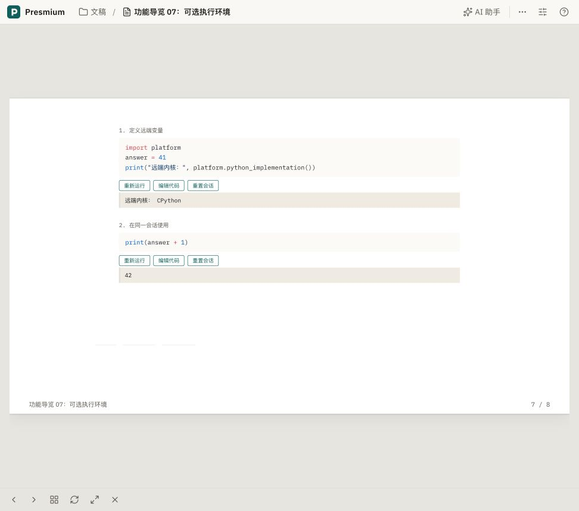

# 文稿声明并按需启动 JupyterHub 环境

2026-10-30，在 `ssh team` 的现有回环部署 `presmium-cloud-hub-verification` 中完成真实验证。源码基线 `7a73e5d0168fb95dfeacb800c1ddf1cbe3745162`，加本次工作区修改。没有新增测试或运行测试套件。

## 实现

IR 在 `metadata.execute.environments.lab` 声明：

```json
{
  "kind": "jupyter",
  "auth": "hub",
  "profile": "python",
  "kernel": "python3",
  "languages": ["python"]
}
```

代码块继续使用 `execution.executor: "presmium.env.lab"`，相同 `execution.session` 共享内核。浏览器在显式运行或打开终端时调用已有插件的准备路由，服务端用当前用户的限定权限令牌启动或复用 `env-python`，等待 ready 后挂载已有的 HTTP/WebSocket 代理。准备响应只包含启动时间作为代次，不含连接凭据。环境重启后客户端重建内核池。源码热修改时，旧规格的在途请求不能覆盖新代理。

Hub 映射运营者提供的规格，默认 `python` 使用当前 Studio 镜像中的 Python 内核，以 `PRESMIUM_RUNTIME_ONLY=1` 运行，不启动另一份 Studio。环境卷独立于作者的 Studio 卷。默认 1 CPU、1 GiB，每用户最多 3 个命名环境。现有 idle culler 停止环境并删除 Hub 的命名服务器记录，数据卷保留。部署配置与自定义规格见 [部署说明](../cloud-deployment.md#文稿中的-jupyter-环境)。

## 实际结果

| 路径 | 验证结果 |
| --- | --- |
| 阅读与编译 | 升级后的用户打开文稿与预览，Hub 的命名服务器列表仍为空；点击运行后才出现 `env-python` |
| 首次启动与并发 | 一次性用户的两个并发准备请求均返回 200，同一启动代次，合计 4157 ms；实际只有一个环境容器 |
| 内核执行 | 通过真实 Studio 代理执行 Python，输出 `CPython` 与环境容器主机名；同一内核第二次执行输出 `42` |
| 浏览器点击运行 | 导览 07 中点击第一个代码块自动启动环境，第二个代码块输出 `42`；不是预录结果 |
| 资源与卷 | 实际 Docker CPU 配额 `100000/100000`、内存 `1073741824`、只读根系统；唯一 `/work` 挂载为该用户该环境的独立卷 |
| 跨用户隔离 | 一次性用户的 Studio 令牌访问当前用户 Studio 返回 403；环境自身令牌访问同一用户的 Studio 也返回 403 |
| 空闲回收 | 调用相同的官方 idle culler，把验证窗口缩为 2 秒、检查间隔 1 秒，禁用默认服务器回收；命名环境停止且 Hub 记录消失，当前用户 Studio 仍 ready。先确认只有一次性用户拥有命名环境，再运行此验证 |
| 回收后再运行 | 准备请求返回 200，新代次，耗时 6178 ms；验证使用同一环境卷 |
| 浏览器停止后恢复 | 停止当前用户的 `env-python`，同一放映页面重新运行第一个代码块后再次输出 `CPython`，第二个代码块仍能得到 `42` |
| 真实终端 | 同一声明环境成功打开终端，执行 `printf 'HUB_RUNTIME_OK\n'` 得到真实输出；离开终端页后 API 中终端数量为 0 |
| 未知规格 | 独立文稿声明 `missing-profile`，实际准备路由返回 422 / `hub-profile-unavailable`；代码块与终端都显示目录中的规格不可用提示，没有降为网络错误 |
| 启动中关闭页面 | 浏览器点击运行显示“正在运行…”后立即关闭该临时页面；随后确认请求已受理、环境 ready，但内核数量为 0，没有继续创建无人使用的内核 |
| 视觉检查 | 失败状态在亮色与暗色、1280×900 与 390×844 四种组合下检查，沿用既有放映画布缩放和公共控件；检查后恢复窗口尺寸 |

命名代码会话在同一文稿的页面间保留，直到重置会话或关闭文稿；因此离开终端页时，只断言终端归零，不将仍存在的命名代码内核记为泄漏。另一次关闭整个临时文稿页面的验证确认没有遗留内核。



其它截图：[真实终端](cloud-hub-environments-2026-10-30/hub-terminal.png)、[未知规格终端诊断](cloud-hub-environments-2026-10-30/unknown-profile-terminal.png)、[亮色桌面](cloud-hub-environments-2026-10-30/error-light-wide.png)、[暗色桌面](cloud-hub-environments-2026-10-30/error-dark-wide.png)、[亮色窄屏](cloud-hub-environments-2026-10-30/error-light-narrow.png)、[暗色窄屏](cloud-hub-environments-2026-10-30/error-dark-narrow.png)。

## 部署与检查

- Studio：`presmium-cloud-studio:7a73e5d0-hubenv3`，镜像摘要 `sha256:49bb360b9528849ca3ab18f866e3f6e7861624ede7faaf7b49e1f383741eda8c`。
- Hub：`presmium-cloud-hub:7a73e5d0-hubenv1`，镜像摘要 `sha256:db3a76aab2dfc206311b36e241e2a40af13dfbcc34a06d0e71d7d11152435157`。
- 验证部署的 `deploy/cloud/compose.studio-env.yaml` 指定上述镜像；维护该实例时继续与基础文件和 `compose.loopback.yaml` 一起使用，直到常规发布镜像包含此修改。
- 当前用户 Studio 已使用最终镜像，保持 4 CPU、4 GiB，并复用原数据卷。升级前 UI 明确显示“已保存”，只修改导览 07 的环境声明与两段过时说明，原稿在用户状态目录留有备份。未读取或修改模型密钥与 AI 会话。
- 升级当前 Studio 时曾遇到旧容器名称尚占用的启动冲突；确认旧容器已完成删除后重新启动成功，没有删除用户卷。
- 一次性 Hub 用户 `hub-env-check-20261030`、其 Studio/环境容器与两块专用验证卷已清理；当前用户的临时失败诊断文稿也已清理。
- Python 语法解析、真实镜像构建、类型检查（1416 个文件）、分层检查、技能检查及 diff 空白检查通过。该插件 i18n 严格检查的目录项为 0；仍报告 4 处原有错误字面量提示，未把它们算作本次新增目录问题。
- 独立代码审查 APPROVE。修正了审查发现的页面销毁竞态、终端错误二次映射与旧规格覆盖新连接三个问题。移除了仅断言 `auth: hub` 为保留功能的过时测试断言，没有新增或运行测试。

未验证：自定义第三方镜像、GPU 环境、其它浏览器、多节点部署、公网 HTTPS、真实 30 分钟等待与所有静态导出格式。空闲回收验证使用相同工具和真实 Hub API，仅缩短了时间窗口。Docker 开发容器执行仍未启用；本次实现的是 Hub 管理的 Jupyter 环境。
