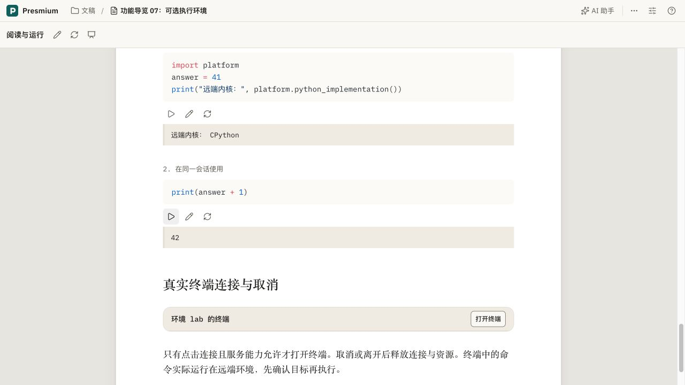

# 正文阅读运行与代码图标按钮

2026-10-30，在 team 的真实 Studio 与 Chromium 中验证；没有新增测试，没有运行测试套件。

## 行为与边界

代码块的运行、编辑、还原和重置会话改用 host 的 `PmIconButton`，复用既有 Compact、loading、选中、焦点及 Tooltip 能力。删除查看器中私有按钮描边、内距、颜色和禁用透明度覆盖，业务 CSS 只排列按钮组。运行时动作名称稳定，公共 loading 防止重复提交。复用已有 Figma IconButton 变体，没有新增公共控件或私有视觉变体。

Studio 文稿工具栏新增眼睛图标“阅读与运行”。它使用完整的正文查看器，所有代码块共用该文稿的执行器与命名会话，执行不要求进入 PPT。原生编辑器保持挂载以保留状态，阅读时只读，返回编辑后恢复。阅读页中“编辑代码”修改本次运行的输入，正式文稿仍在原生编辑器中保存；本次没有把执行器嵌进 BlockNote 的可编辑代码节点。

阅读复用已有的确切保存版本准备流程、预览池和共享事件连接。一个显式观察者使阅读时使用已有的可选 IR 订阅，退出后清理，不添加独立事件流。重新加载会先准备当前版本，再重建预览帧。

## 实际验证

| 操作 | 结果 |
| --- | --- |
| 打开正文运行 | 点击文稿工具栏“阅读与运行”，主区域以正文排版显示完整讲义，外层仍为 Studio，没有进入幻灯片画布 |
| 图标与提示 | 代码按钮没有可见文本，每个按钮含一个 SVG；桌面实测 30×30，名称分别为运行/重新运行、编辑代码、重置会话；Tab 到编辑按钮时显示“编辑代码”提示和焦点轮廓 |
| 共享会话 | 导览 07 的第一个 Python 代码块定义 `answer = 41` 并输出 `CPython`，第二个代码块输出 `42` |
| 编辑图标 | 点击铅笔进入已有 CodeMirror，图标变为勾选，名称“完成编辑”且 `aria-pressed=true`；完成后恢复代码展示 |
| 返回编辑 | 点击“返回编辑”后原生编辑器 `contenteditable=true`，工具栏恢复，保存状态为“已保存”；未对用户文稿插入测试文字 |
| 阅读 → 放映 → 编辑 | 从阅读工具栏进入放映，代码操作仍为图标；结束放映后返回原生编辑，编辑器仍可编辑 |
| 会话清理 | 离开正文运行进入放映但不执行时，实际 Jupyter API 返回内核数量 0 |
| 重新加载 | 点击“重新加载”后预览帧地址代次变化，代码状态重新初始化；重新运行两段代码再次得到 `42`，API 确认只有当前使用的一个命名内核 |
| 亮暗与窄屏 | 检查亮色、暗色与 390×844 窄屏的四种组合；正文和按钮正常排版，代码在窄屏换行。完成后恢复原浅色及窗口尺寸 |

四种组合：[亮色桌面及键盘提示](document-reading-icons-2026-10-30/reading-light-wide.png)、[暗色桌面](document-reading-icons-2026-10-30/reading-dark-wide.png)、[亮色窄屏](document-reading-icons-2026-10-30/reading-light-narrow.png)、[暗色窄屏](document-reading-icons-2026-10-30/reading-dark-narrow.png)。

## 部署与检查

已部署 `presmium-cloud-studio:7a73e5d0-doc-run2`，摘要 `sha256:a40a9a0133590a6bfaff78e9e12efaf1a4b630dcf7cfbba8da566ea75b82f240`；验证实例的 `compose.studio-env.yaml` 已更新。沿用原用户卷、4 CPU / 4 GiB Studio 和现有 Hub 环境配置，没有读取或修改模型密钥与 AI 会话。

真实镜像构建、类型检查（1416 个文件）、令牌检查（49 份样式）、分层、技能及 diff 空白检查通过。workbench 与 viewer 的 i18n 严格检查目录项均为 0，分别仍有 4 与 1 处原有错误字面量提示。独立代码审查 APPROVE；未运行测试套件。未验证其它浏览器、触屏指针模拟、各类语言执行器的全量回归或阅读模式下所有浏览器 MCP 操作。
