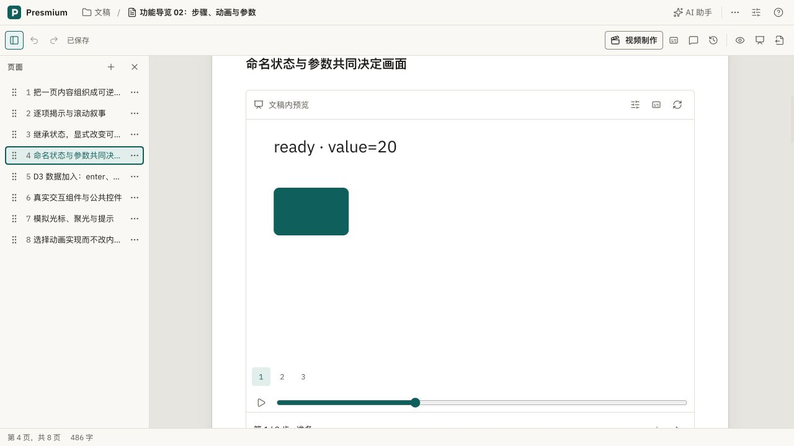

# 云端文稿内预览首次加载

2026-10-30，在 `ssh team` 的现有回环部署上测量。源码基线 `70ffb601`，本次改动尚未提交。Studio 最终镜像 `presmium-cloud-studio:70ffb601-preview3`，镜像 ID `sha256:3bf2e5bc16034b59bd3579f6260b35263b11fbb0890d21fced5c9cdc179b3cbb`。保留用户卷，Studio 配额仍为 4 CPU、4 GiB；Docker 的 CPU quota/period 为 400000/100000。

## 观察与判断

作者看到编辑正文里的“文稿内预览”第一次显示慢。定位分成三个候选原因：服务器编译或构建慢、浏览器下载与初始化慢、预加载窗口没有完成显示握手。

旧日志中，`guide-content` 编译 544 ms，查看器准备从 04:31:26.004 UTC 等到 04:31:44.350 UTC，约 18.35 秒。已有缓存的 `guide-steps` 查看器准备仅 1–39 ms。因此不能把所有等待归因于 CPU 线程，也不能用地址就绪时间代表画面可用。

另外，旧 Studio 入口即使请求 gzip，也原样传输 23 个首屏脚本，共 1,081,580 字节。正文里刚好落在可见区域下方的 `semantic-scene` 还真实出现过显示超时：无 console error，30 秒后失败，滚到该段重试后 3,153 ms 就绪。这支持“屏外预取被墙钟显示超时误判”，不证明所有等待都来自浏览器动画帧暂停。

## 改动

- Studio 镜像构建时打包全部 16 个官方 addon 的通用查看器，登记路径与包名两种插件别名。浏览器只加载当前文稿配置的插件。`PRESMIUM_VIEWER_SEED` 指向镜像只读缓存；核心与所需插件指纹匹配后，原子复制到用户缓存。自定义插件及源码变化继续正常构建，文稿代码包仍按当前工程校验。
- Hub 入口仅对查看器资源、文稿代码包、工作台插件包和静态资源启用 zstd/gzip，流式接口不参与压缩。使用 [Caddy 的路径正则匹配器](https://caddyserver.com/docs/caddyfile/matchers#path_regexp) 覆盖多层资源路径；实际适配与验证通过。
- 内容块仍在邻近视口时预加载；显示握手的 30 秒超时只在内容视口实际可见且标签页在前台时计时。离开视口、后台、切换源与卸载会清除计时器。

## 测量

`viewer-bench.mjs` 在同一镜像的独立容器中交替运行 cold/seed，各 3 次。每次用户缓存为空，4 CPU、4 GiB，原生线程 1，禁用网络。仅测通用查看器准备，不含文稿编译、文稿代码包、传输和绘制。原始数据见 `results.json`。

| 轮次 | 冷构建 | 镜像缓存复制 |
| --- | ---: | ---: |
| 1 | 15,576 ms | 238 ms |
| 2 | 3,491 ms | 29 ms |
| 3 | 3,276 ms | 30 ms |

首轮与镜像增量构建/导出有重叠，不以它代表稳定速度；此共享服务器没有隔离其它任务。三次中位数为 3,491 ms 与 30 ms。冷构建是所需 11 插件，种子是官方插件全集，因此两者的打包字节不要求相同。复制后的主脚本与对应种子文件散列一致。包名别名另测 32 ms 命中；改变核心或插件指纹都拒绝命中。

`wire-bench.py` 使用当前用户服务器令牌，通过现有认证入口读取真实脚本；凭据仅在内存中使用，不输出、不保存。

| 部署 | 脚本数 | 未压缩 | 请求 gzip 的实际传输 |
| --- | ---: | ---: | ---: |
| 旧版 | 23 | 1,081,580 B | 1,081,580 B |
| 新版 | 23 | 1,091,767 B | 349,798 B |

新版本两种传输解码后内容完全相同，全部 200。新增别名使未压缩脚本略增；相比旧版实际传输减少约 68%。同机回环传输约 0.13–0.16 秒，不能用它推断公网体验。

真实 Studio 重启后首次 `guide-steps` 编译 1,748 ms，预览准备 683 ms，后续 1–2 ms；此前慢的 `guide-content` 首次编译 1,008 ms，查看器准备 22 ms，未再触发整套查看器构建。浏览器在已有服务缓存时点击打开到动画 ready 仍记录到 3,102 ms，包含自动化调用开销，尚未达到 100 ms 目标；没有把复制时间当作完整打开时间。

## 真实运行验证

- 1280×650 视口下，内容预览顶端 640，父滚动视口底部约 624，保持屏外 loading 58,350 ms，没有失败；点击该段导航后 301 ms 自动 ready，没有点击重试。
- 正文动画参数前进 55 → 90，回退到 55，实际 SVG 参数一致；退出后仍可编辑。
- `guide-content` 的阅读查看器就绪；`guide-steps` 正常进入放映，`.pm-slide` 真实可见，退出恢复正文预览。
- 阅读视图真实连接远端 Jupyter，第一块输出 CPython，第二块共享变量输出 42，覆盖入口更新后的实际内核 WebSocket 连接。
- 亮色、暗色的桌面和 390×844 窄屏均查看，预览可见；恢复亮色与默认窗口大小。截图在本目录。
- 升级前后三份验证文稿的源文件 SHA-256 一致。用户卷、模型配置和账号保留；独立性能容器以 `--rm` 退出，无额外常驻验证服务。
- 类型检查 1,416 文件、分层检查、技能检查、差异空白检查通过；独立审查 APPROVE。未新增测试，未运行测试套件、完整示例构建或完整 e2e。

附加边界：直接通过 Hub 访问旧查看器 SSE 地址时，identity/gzip 两组均在 8 秒内没有收到响应头，不能将该端点验收为实时可用。此行为不构成本次压缩前后差异；Studio 使用现有共享事件 WebSocket，本文没有改写 SSE 代理，也没有把直接 SSE 探测算作通过。

## 2026-10-31 提交前复核

拉取远端到 `8e78a5af` 后，在本机 Node.js 22.23.2 上复核；本节不是上面云端测量的重跑。

- 用 `prebuild-viewer.mjs` 实际构建全部 16 个官方 addon 的路径与包名别名，32 个登记项构建成功，耗时 1,543 ms。
- 动画插件按路径与包名分别向空缓存复制，各 3 次，耗时分别为 103/52/51 ms 与 52/52/50 ms。入口脚本、样式与预加载文件均与种子 SHA-256 一致；每次改变核心或插件指纹均拒绝命中。这只验证缓存准备，不代表完整预览打开耗时。
- 启动隔离的真实 Studio，用 Chromium 打开步骤导览的 `semantic-scene` 正文预览；亮色、暗色各在 1280×700 与 390×844 下均达到 `ready`，未捕获 `pageerror`。未修改原示例文稿，验证后关闭浏览器与服务。
- 类型检查通过（1,430 文件），分层、技能、差异空白与预构建脚本语法检查通过；独立代码审查未发现阻塞或主要问题。未运行测试套件、全量示例构建或 e2e；本次未重建云端 Docker 镜像，也未重复先前的屏外等待与网络压缩测量。
