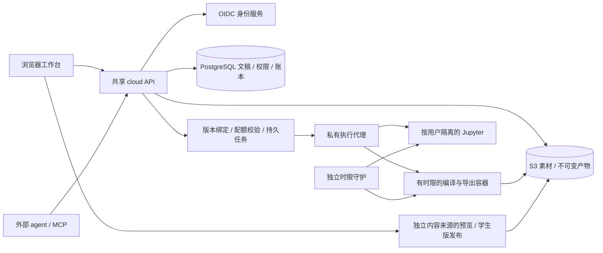

# RFC：Presmium 云端空间、计费与执行

状态：账号、空间、持久文稿、MCP 与隔离执行已实现；当前正在按“全部非 AI 功能免费、编辑器复用 Studio”的边界复验。旧版报价与收费任务的验收记录保留作历史证据，不能作为新免费流程已完成的结论。云端 AI 尚未接入，购买服务端与入口均禁用，即使配置 Stripe 密钥也不能销售无对应 AI 服务的商品。需求见 `packages/cloud/project-index.yaml`，逐路径证据见 [本轮记录](benchmarks/cloud-journeys-2026-10-29.md)。

## 1. 产品边界与验收目标

在开源工具链之上新增独立的 `@lincyaw/cloud` 应用。作者通过浏览器注册、登录，拥有个人或组织空间，邀请协作者，使用原生文稿编辑器或远程 MCP，查看历史、预览和发布产物。编辑、预览、放映、导出、MCP 基础操作和代码运行环境均免费；仅未来已接入的 AI 功能可计费。运行代码、持久内核、终端、编译和导出有明确的执行归属和资源限制。

交付包含可在 Linux 上部署的真实服务及操作界面、数据库迁移、执行镜像、配置、健康检查、备份与升级说明。支付和外部模型需要运营者配置真实凭据；没有配置时明确不可用，不伪造支付成功、模型输出或执行结果。部署验证、外部服务验证与尚未验证的范围分别记录。

本地 `presmium serve`、`presmium studio` 和静态产物继续独立可用。云账号、套餐和支付逻辑不进入 kernel、compiler 或 viewer。`lecture.json` 的 TeachingDocument 仍是唯一内容模型，运行快照仍由 compiler 派生。

## 2. 服务与信任边界

| 服务 | 职责 | 持久状态与权限 |
| --- | --- | --- |
| 身份提供方 | OIDC 登录、自助注册、密码恢复、验证邮件、MFA | 默认部署 Keycloak；可接符合 OIDC 的外部身份服务 |
| cloud API | 空间、成员、文稿事务、MCP 授权、配额与任务准入 | Postgres；不加载租户插件，不执行用户代码 |
| cloud Web | 空间控制台与既有 workbench 的宿主适配 | 使用公开 Pm 控件与 workbench 入口；无第二正文模型 |
| 文稿存储 | 规范化 JSON 版本、工程文件清单、当前版本指针 | 版本和回执原子提交；相同 API 为 Web 与 MCP 服务 |
| 对象存储 | 素材、工程文件与不可变构建产物 | S3 兼容，默认可自部署；私有对象经授权读取 |
| 执行代理 | 调度固定 profile，核对租约，创建、停止和回收环境 | 与独立 watchdog 持有容器控制权限；运行在受信任的执行节点 |
| 独立 watchdog | 从容器外核对真实启动时刻并强制终止超时容器 | 不持有账号、数据库或支付凭据；只处理本实例标签 |
| 任务容器 | 编译、依赖、插件、导出、一次性代码执行 | 仅收到自己的输入版本与输出位置；没有平台数据库、支付或 Docker 凭据 |
| 交互环境 | Jupyter 内核、终端与持久运行会话 | 每个授权使用者独立环境；空闲回收，持久卷保留 |
| TLS/内容入口 | 公开 API、实时连接、私有预览与发布 | 作者登录域与用户内容域分开；内部服务不公开端口 |

初期是模块化 Node 应用和独立执行进程，不按模块拆大量微服务。轻请求可水平扩容或迁往 FaaS。工作区、项目和账号都不是一台常驻机器；只有活跃的交互执行会话需要租约和驻留资源。

## 3. 身份、授权与操作

浏览器使用 OIDC authorization code + PKCE、state、nonce，经服务端会话保持登录；会话只保存随机 ID 的哈希，cookie HttpOnly、SameSite，公网 HTTPS 下 Secure。注册由身份提供方负责。身份唯一键为 issuer + subject，不以未经验证的 email 自动合并账号。

每个请求在服务端查询空间成员角色。owner 管理成员和服务连接；editor 可修改内容；reader 可读取允许分享的内容并使用普通预览与导出。运行私有代码环境、通过 MCP 主动执行和管理凭据需要独立能力。旧 spend scope 只为兼容保留，免费操作不要求它，界面不再提供新的 spend 授权。成员撤销后新请求立即拒绝，已有实时连接和运行租约也必须按策略结束。

外部 MCP 支持可撤销、到期、绑定空间与能力的访问令牌；数据库只保存令牌哈希。OIDC bearer 验证 issuer、audience、expiry，并发布 protected-resource metadata。只有实际配置并验证了客户端授权流程，才宣称支持该客户端的一键 OAuth。租户不能通过参数指定 member、role、billing account 或平台确认状态。

云控制台提供登录注册、空间切换、成员邀请与撤销、文稿与历史、连接 MCP、实际存储用量、AI 服务可用情况、私有代码环境的启动/停止/删除。MCP 使用同一应用服务，不另写文件修改、授权或扣费逻辑。

## 4. 文稿、版本与协作

Postgres 持有文稿当前版本和不可变版本记录，规范化 TeachingDocument 可直接保存为 JSON。工程文件与素材以内容键保存，对象清单属于同一文稿版本。执行前从明确版本物化到临时工程，执行容器不会反向成为另一权威源。

保存携带基础版本与请求 ID；事务锁定文稿行，验证权限、版本、Schema、引用和工程路径，再提交新版本及回执。预检计划与结果回执必须跨进程重启存在。相同 ID 和相同请求返回已有结果；相同 ID 的不同请求拒绝。原生编辑、MCP 语义修改和文件事务共用该边界。

git 是导入导出和同步适配层。不得让数据库和一个可任意外写的 git 目录同时充当当前权威内容。历史恢复本身创建新版本，保留来源与执行者。

协作先提供成员共享、批注和版本冲突保护。原有 CAS 不等于同段实时合并；多人同时编辑的 OT/CRDT 需要与 canonical 文稿事务明确接缝，不能仅开启编辑器协作插件后持久化第二份正文。

编译绑定源版本、文件清单、依赖和 profile。连续修改合并并取消旧任务；旧结果不得覆盖新版本。预览明确显示当前文稿和运行快照的版本。预先打包的 viewer 与插件集合缓存复用，文字修改不重复构建公共外壳。

## 5. 免费功能、配额与 AI 计费

基础编辑、历史、预览、放映、导出、学生版发布、MCP 读写与文稿生成、Jupyter 环境均免费。免费仍需校验成员权限、磁盘配额、并发和运行时限；不能按预算不足拒绝免费操作。控制台显示实际资源存储与环境预留容量的分项。旧版非零计量与费用返还保留在独立历史区，不标成 AI 消费。

云端 AI 尚未接入。`capabilities.ai=false`，BillingService 即使收到 Stripe 配置仍保持 unavailable，Checkout、客户门户与 webhook 不创建供应商操作。现有 Stripe 适配保留但不是已销售产品；未来接入真实 AI 后需先定义商品、价格和用量规则，再完成真实支付验证。作者自己的外部 AI 助手通过 MCP 使用模型，模型费用由其所选供应商结算。

现有 admission 持久记录承载重试与调度。免费工作使用实际为 0 的 reserve/settle，旧 quote 接口仅兼容历史消费者；普通文稿走标准 workspace prepareJob，按不可变源版本与输出形态去重，不向作者索取报价确认。环境直接携带稳定 requestId 启动有限租约，网络失败后恢复同一请求。免费操作不要求 spend，不能因月度预算为 0 而失败。

## 6. 可执行后端

执行 profile 是运营者维护的目录：固定镜像、允许入口、CPU、内存、pids、磁盘、网络、最大时间。云端页面使用运营者默认环境，MCP 只能选择可用 profile，不能提交宿主挂载、Docker 参数或平台任意命令。

短任务有持久状态机 queued → starting → running → succeeded/failed/cancelled，支持租约、心跳、终止与崩溃恢复。按 immutable job ID 和容器 labels 对账；失去租约的旧执行者不能发布结果或再次结算。

Jupyter 环境有 stopped/starting/running/stopping/failed 的实际状态、generation、owner、profile、租约、空闲期限及计量起止。环境启动幂等，执行代理重启后从数据库与容器 inspect 恢复。kernel 的变量状态只存在于活跃环境中，停止前明确告知；文件持久卷与内核内存的生命周期不同。

交互环境提供真实 JupyterLab、kernel、富输出、中断、Contents 和 terminal 协议。环境 HTTP、WebSocket、Contents、kernel 和 terminal 的每个入口核对真实成员与环境 owner；不能拿同一个 Jupyter Server 的多个 kernels 当作不同租户的隔离。用户脚本和预览页面不获得云登录 cookie。空间所有者可停止和删除成员遗留的环境以收回资源与存储，不能借此浏览或执行别人的内核。将文稿内的 `addon-exec-jupyter` 环境名绑定到云端交互环境属于后续适配；当前公开课程使用静态产物，不自动为匿名读者启动执行后端。

磁盘使用固定 XFS 项目配额槽，按保存环境的容量与对象存储合计核对部署配额。固定 seccomp 策略保留 Docker 默认白名单并禁止改变项目编号及继承属性的 ioctl；初始化逐槽实际验证绕过、字节和 inode 越限。缺失挂载、配额、策略或清单时拒绝执行。停止保留文件，明确删除环境后才释放持久槽位。

## 7. Linux 部署

提供 Compose 的 API、Postgres、Keycloak、S3 存储、执行代理、入口代理和执行镜像；可将数据库、对象存储、身份服务及执行节点替换成外部服务。镜像和关键依赖固定版本，数据库有版本化迁移，服务 SIGTERM 能停止准入并释放租约。

公开端口只属于 TLS 入口；数据库、容器 API、执行环境和对象管理端口默认只在内部网络。开发用 HTTP 仅显式允许 loopback，不能把开发认证带入公网配置。启动检查必需密钥、issuer、公网地址、内容域及执行配置，缺失时直接给出可操作错误。

运维文档覆盖首次启动、创建运营者、开启注册/邮件、配置套餐、执行 profile、健康与就绪检查、日志、备份恢复、升级回滚和空闲回收。默认不包含真实支付/模型密钥，部署不能以假成功页面代替服务验证。

## 8. 实施顺序与验收证据

1. 设计和需求登记；独立身份、空间权限、持久数据库与迁移。
2. 免费任务准入、持久幂等与资源配额；AI 服务缺失时的购买禁用。
3. 文稿持久事务、工程存储、MCP 与原生工作台宿主。
4. Linux 执行代理、编译导出与 Jupyter 环境；真实运行和授权拒绝验证。
5. 控制台、完整部署、备份恢复与性能记录；独立审查和按需求完成审计。

遵守仓库验证规则：不写新测试、不运行测试套件；通过真实服务、HTTP/MCP 操作、浏览器四种主题/尺寸、实际执行与轻量结构检查验证。未连接真实支付、OIDC、Linux Docker 或模型的环节分别保持未验证，不能用类型检查支持整个产品已完成的结论。
