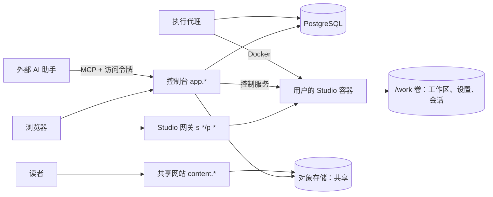

# RFC：Presmium 云端

状态：实验性。每个用户一个完整的 Presmium Studio 容器、共享与创建副本、MCP 接入已实现并在本机回环部署中验证；公网 HTTPS 部署、配额磁盘池与多节点未验证。部署步骤见 [部署说明](cloud-deployment.md)，需求与证据见 `packages/cloud/project-index.yaml`。

## 1. 定位

云端是浏览器中的 Presmium Studio：注册登录之后，作者得到与本机 `presmium studio` 相同的全部功能，包括 AI 助手、文稿编辑、预览、放映、讲授制作、配音、诊断与导出。云端不另写一套编辑器或文稿存储，而是为每个用户运行一个真正的 Studio。

云端是单用户产品，不做多人协作：一个账号一个空间，空间里是一个工作区。作者之间通过共享链接交换文稿，读者可以把共享的文稿创建为自己空间中的副本。

AI 助手使用作者自己的模型服务：在 Studio 的“设置 → 模型”中填写 API Key，保存在作者自己的卷上。云端不代售模型用量，没有计费。

本地的 `presmium serve`、`presmium studio` 与静态产物照常独立可用；云端只依赖它们的公开命令行与接口。

## 2. 服务

| 服务 | 职责 | 状态与权限 |
| --- | --- | --- |
| 身份提供方 | OIDC 注册、登录、找回密码、邮箱验证 | 默认部署 Keycloak |
| 控制台（`presmium-cloud serve`） | 登录会话、Studio 的启停意图、文稿列表、共享、访问令牌、MCP 转发、Studio 网关 | PostgreSQL；没有 Docker 权限，不执行用户代码 |
| 执行代理（`presmium-cloud runner`） | 让每个 Studio 的容器符合数据库中的意图：创建、启动、停止、回收 | 唯一持有 Docker 的服务；租约保证多副本不重复操作 |
| 看门狗（`presmium-cloud watchdog`） | 从容器之外强制执行每次运行的最长时限 | 只连接 Docker |
| Studio 容器 | 一个用户的完整 Studio（DeepSeek Harness 与工作区服务）与一个控制服务 | 只读根文件系统、去掉全部能力、固定 seccomp、CPU/内存/进程数上限；可写的只有 `/work` 卷与 `/tmp` |
| 对象存储 | 共享文稿的源文件归档与网站 | S3 兼容 |
| 入口（Caddy） | TLS 与按主机名转发 | |

## 3. Studio 容器

镜像 `deploy/cloud/studio/Dockerfile` 在构建时装好全部工具链（与本仓库源码相同）与 Chromium。入口 `deploy/cloud/studio/entry.mjs`：

1. 卷 `/work` 中有 `space`（作者的工作区，一个 git 仓库）、`state`（DeepSeek Harness 的会话、模型设置与 API Key）、`cache`、`home`、`config`。新空间第一次启动时是示例工作区，与本机第一次运行 `pnpm studio` 相同；git 的作者身份取账号的名称与邮箱。
2. 运行 `presmium studio /work/space --host <容器地址> --public-url <Studio 主机> --preview-url <预览主机>`。Studio 退出时容器随之结束。
3. 在容器地址的 3090 端口提供控制服务，只接受该 Studio 的控制令牌：就绪状态（DeepSeek Harness 的启动令牌、工作区服务与 MCP 的地址和访问令牌）、文稿列表、共享快照、导入副本。对工作区文件的读写都在这里以作者的非特权用户进行，持有 Docker 的进程不接触作者的文件。

控制令牌、公开地址等 `PRESMIUM_CLOUD_*` 变量只留在入口进程中，不传给 Studio 及其子进程。

## 4. 网关与浏览器访问

每个 Studio 有两个主机名：`s-<slug>.<Studio 域>` 是 DeepSeek Harness 与工作台，`p-<slug>.<Studio 域>` 是工作区服务（预览 iframe 与导出产物）。两者是不同的来源，也与控制台、共享网站和其他用户的 Studio 不同源。

1. 作者在控制台点“打开 Studio”。控制台确认 Studio 在运行，为两个主机各签发一张 60 秒的一次性票据，经预览主机、Studio 主机依次跳转。
2. 每个主机用票据换取自己的仅主机（host-only）、HttpOnly 的网关 cookie，有效 12 小时，绑定账号、空间、Studio 的代次与控制台的登录会话；退出控制台登录后立即失效（缓存至多 10 秒）。
3. 最后跳到 `/?token=<启动令牌>`，由 DeepSeek Harness 换成它自己的会话 cookie。打开某份文稿时附加 `#presmium?document=…&id=…`。
4. 之后每个请求与 WebSocket 都先核对网关 cookie，再原样（保留 `Host`）转发到容器；网关 cookie 本身不转发给容器。没有有效 cookie 的页面请求回到控制台重新登录。

DeepSeek Harness 以 `--public-url` 与 `--trusted-host` 接受该主机；工作区服务以 `--public-url` 信任预览主机，并用它给出预览与产物的地址（见 `docs/design-dsh.md` 的反向代理一节）。

一段时间（默认 30 分钟）没有请求、也没有打开的 WebSocket 时，执行代理停止容器；单次运行最长 12 小时，由看门狗强制。停止只删除容器，卷保留。下次打开时启动新代次，旧代次的网关 cookie 全部失效。

## 5. 共享与创建副本

- **共享**：作者在控制台的文稿列表中点“共享”。控制台记录一条共享（随机的 22 字符链接），在作者的 Studio 中生成快照：`git archive` 该文稿目录在 HEAD 的内容，并用编译器把它构建为网站（基础路径 `/p/<链接>/`）。两者存入对象存储。读者在 `/s/<链接>` 看到标题、共享者与内容源上的网站。快照之后的修改不改变它，作者可以再次共享，也可以删除链接。
- **创建副本**：登录的读者在共享页点“创建副本”。控制台确保读者的 Studio 在运行，把源文件归档交给读者 Studio 的控制服务：解包到临时目录，删除一切链接与非普通文件，放到工作区顶层一个不重名的目录中并提交（`Fork: <标题>`），然后打开这份文稿。
- 副本中的代码会在读者自己的 Studio 中运行，与在本机克隆别人的仓库相同；共享页明确提示这一点。

## 6. MCP 接入

控制台的 `/mcp` 接受空间的访问令牌（`pmc_` 开头，数据库只存散列，可设到期、可撤销，令牌所有者必须仍拥有该空间），需要时启动 Studio，然后把请求转发给 Studio 中工作区服务的 `/mcp`。外部 AI 助手因此与 Studio 内的 AI 助手使用同一套工具与同一个工作区。

## 7. 数据与存储

PostgreSQL 只保存账号、登录会话、空间、Studio 的状态、网关票据与会话、访问令牌、共享记录与磁盘池分配。文稿只在各自 Studio 的卷中，以 git 历史保存版本。

正式部署中，每个 Studio 的卷是 XFS 项目配额磁盘池中的一个 slot，容量等于 `studio-profile.json` 的 `diskBytes`；没有真实配额时执行代理拒绝启动。`CLOUD_STORAGE_UNENFORCED=true` 改用普通目录，只在回环验证中允许。

## 8. 安全边界

- 控制台不持有 Docker；执行代理不接收浏览器请求，也不读写作者的文件。
- Studio 容器之间网络隔离：每个 Studio 一个独立的 bridge 网络，只有执行代理与控制台加入。Studio 可以访问互联网（模型服务需要）。
- Studio 容器内的作者代码能读到同一用户的 API Key 与控制令牌：这与本机 Studio 相同，控制令牌只能操作该用户自己的 Studio。
- 同一 Studio 域下的不同用户是同站（same-site）的；网关 cookie 为仅主机，非 GET 请求由 DeepSeek Harness 与工作区服务各自的 `Origin` 检查保护。正式部署建议把 Studio 域放在独立的注册域名下。

## 9. 验证

遵守仓库的验证规则：不写新测试、不运行测试套件；通过真实部署、浏览器中的完整路径（注册、打开 Studio、编辑、AI 设置、预览、共享、另一个账号创建副本、MCP）、亮色与暗色、宽屏与窄屏检查验证。结果写在 `docs/benchmarks/` 的记录与 `packages/cloud/project-index.yaml` 中，未验证的范围分别列出。
