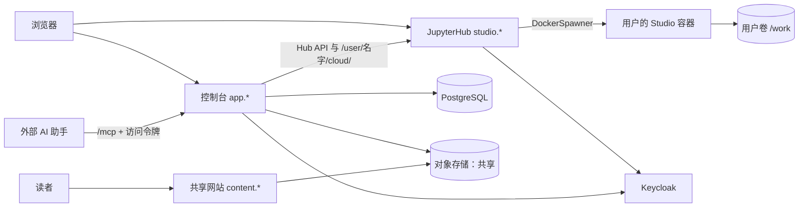

# RFC：Presmium 云端

状态：实验性。基于 JupyterHub 的每用户 Studio、共享与创建副本、MCP 接入已实现，并在本机回环部署中验证；公网 HTTPS、磁盘配额与多节点未验证。部署步骤见 [部署说明](cloud-deployment.md)，需求与证据见 `packages/cloud/project-index.yaml`。

## 1. 定位

云端是浏览器中的 Presmium Studio：注册登录之后，作者得到与本机 `presmium studio` 相同的全部功能，包括 AI 助手、文稿编辑、预览、放映、讲授制作、配音、诊断与导出。云端不另写编辑器或文稿存储，而是为每个用户运行一个真正的 Studio。

云端是单用户产品，不做多人协作：一个账号一个工作区。作者之间通过共享链接交换文稿，读者可以把共享的文稿创建为自己的副本。AI 助手使用作者自己的模型服务，在 Studio 的“设置 → 模型”中填写 API Key，保存在作者自己的卷上；云端不代售模型用量。

调度、登录到 Studio、路由与空闲回收用现成的 JupyterHub，不自己实现。本地的 `presmium serve`、`presmium studio` 与静态产物照常独立可用；云端只依赖它们的公开命令行与接口。

## 2. 服务

| 服务 | 职责 |
| --- | --- |
| Keycloak | OIDC 注册、登录、找回密码、邮箱验证；控制台与 JupyterHub 是同一 realm 的两个客户端，登录一次即可 |
| JupyterHub（`deploy/cloud/hub`） | 用 Keycloak 登录 Studio；DockerSpawner 为每个用户启动一个 Studio 容器并挂上其卷；把 `/user/<名字>/` 路由到它；`jupyterhub-idle-culler` 停止空闲的 Studio。唯一持有 Docker 的服务 |
| Studio 容器（`deploy/cloud/studio`） | JupyterHub 的 single-user server，里面是完整的 Studio、工作区服务与云端的控制服务 |
| 控制台（`presmium-cloud serve`） | 共享、创建副本、访问令牌、MCP 转发、共享网站，以及 Studio 的状态与入口；作为 JupyterHub 的 service，用自己的令牌访问 Hub API 与各用户的服务器 |
| PostgreSQL | 控制台的账号、登录会话、访问令牌与共享记录；不保存文稿 |
| 对象存储 | 共享文稿的源文件归档与网站（S3 兼容） |
| Caddy | TLS 与按主机名转发：控制台、身份、共享内容、JupyterHub 四个来源 |

用户在两边用同一个名字：JupyterHub 的用户名是 OIDC 的 `sub`，控制台也按它找到用户的服务器。

## 3. Studio 容器

镜像在构建时装好全部工具链与 Chromium，再加上 JupyterHub 的 single-user server 与 jupyter-server-proxy。服务器启动时，扩展 `presmium_hub.py`：

1. 准备卷 `/work`：`space`（工作区，一个 git 仓库；新用户是示例工作区，与本机第一次运行 `pnpm studio` 相同）、`state`（DeepSeek Harness 的会话、模型设置与 API Key）、`cache`、`home`、`config`。git 的作者身份取 Keycloak 中的名字与邮箱。
2. 在回环端口上启动 `presmium studio /work/space --public-url <Hub>/user/<名字>/studio/ --preview-url <Hub>/user/<名字>/preview/ --preview-port …` 与控制服务 `control.mjs`。
3. jupyter-server-proxy 在 `/user/<名字>/` 下转发三者：`studio/`（去掉前缀，DeepSeek Harness 服务根路径）、`preview/`（保留路径，工作区服务在该路径下工作，见 `docs/design-dsh.md` 的反向代理一节）、`cloud/`（控制服务）。请求先经过 JupyterHub 的认证：只有该用户本人或持有 `access:servers` 的控制台能到达。
4. `/user/<名字>/presmium` 读 Studio 的状态文件，带启动令牌打开 Studio，可附 `document` 与 `id` 打开某份文稿。它返回一个由本来源自己发起跳转的页面，因为 DeepSeek Harness 的会话 cookie 是 `SameSite=Strict`。

控制服务提供文稿列表、共享快照、导入副本与 MCP 中转；对工作区文件的读写都在容器里以作者的普通用户进行。容器使用只读根文件系统、去掉全部 Linux capabilities、no-new-privileges，并限制内存、CPU 与进程数；`/tmp` 允许执行，因为 DeepSeek Harness 的原生模块从那里加载。

用户服务器包含 Python 内核。具名环境可通过 `auth: proxy` 连接已有服务器，也可通过 `auth: hub` 与运营者提供的 `profile` 在点击运行或打开终端时启动独立的 Hub 命名环境。同一用户相同规格复用，环境使用独立卷与资源限制，由 Hub 回收；服务器令牌不进入文稿与浏览器。配置与当前边界见 [部署说明的 Jupyter 环境](cloud-deployment.md#文稿中的-jupyter-环境)。

Studio 页面与它的预览在同一个来源（`studio.*/user/<名字>/`）。预览中文稿的代码因此可以以作者身份调用 Studio 的接口；这没有扩大风险，因为文稿的编译时代码本来就在作者的容器里以作者身份运行。只复制信任的文稿，共享页对此有提示。

## 4. 打开、停止与回收

- 控制台的“打开 Studio”链接到 `/hub/user-redirect/presmium`：JupyterHub 经 Keycloak 登录（已登录时无需再输入），需要时启动容器并显示进度，然后进入 Studio。
- 控制台从 Hub API 读取状态，并可停止 Studio。空闲（默认 30 分钟）时 idle culler 停止它；停止只删除容器，卷保留。
- 共享、创建副本与 MCP 调用时，控制台经 Hub API 启动用户的服务器并等待就绪，用户此前不必打开过 Studio。
- JupyterHub 重启或升级时不停止正在运行的 Studio（`cleanup_servers = False`）。

## 5. 共享与创建副本

- **共享**：作者在控制台的文稿列表中点“共享”。控制台记录一条共享（随机的 22 字符链接），在作者的 Studio 中生成快照：`git archive` 该文稿目录在 HEAD 的内容，并把它构建为网站（基础路径 `/p/<链接>/`），两者存入对象存储。读者在 `/s/<链接>` 看到标题、共享者与内容来源上的网站。快照之后的修改不改变它，作者可以再次共享或删除链接。
- **创建副本**：登录的读者点“创建副本”。控制台确保读者的 Studio 在运行，把源文件归档交给它的控制服务：解包、删除一切链接与非普通文件，放到工作区顶层一个不重名的目录中并提交（`Fork: <标题>`），然后打开这份文稿。

## 6. MCP 接入

控制台的 `/mcp` 接受用户的访问令牌（`pmc_` 开头，数据库只存散列，可设到期、可撤销），需要时启动该用户的 Studio，经 `/user/<名字>/cloud/mcp` 转发给控制服务，再由它带工作区服务自己的令牌转给 `/mcp`。外部 AI 助手因此与 Studio 内的 AI 助手使用同一套工具与同一个工作区。

## 7. 存储

文稿只在各用户的卷中，以 git 历史保存版本；控制台的数据库只有账号、令牌与共享记录。单机部署时卷是 Docker 命名卷，没有容量上限；需要配额时使用带配额的卷驱动，或改用 KubeSpawner 与带容量的存储类（Zero to JupyterHub）。

## 8. 验证

遵守仓库的验证规则：不写新测试、不运行测试套件；通过真实部署与浏览器中的完整路径验证（注册、打开 Studio、文稿与预览、共享、匿名阅读、另一个账号创建副本、MCP、停止后重新打开、跨用户访问被拒），并检查控制台的亮色与暗色、宽屏与窄屏。结果写在 `docs/benchmarks/` 的记录与 `packages/cloud/project-index.yaml` 中。
