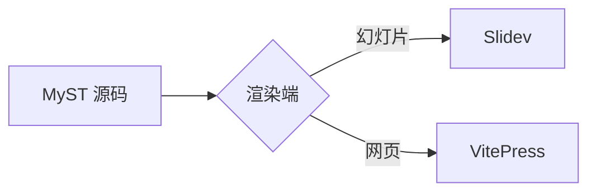
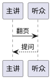

(content-diagrams)=
## 公式与流程图

:::{hints}
slides: { class: pm-content-diagrams, routeAlias: content-diagrams }
:::

公式用 `$…$` 与 `$$…$$` 书写，由 KaTeX 渲染。

:::{slide}
**公式**（KaTeX）：行内公式 $e^{i\pi} + 1 = 0$，块级公式

$$
\sum_{k=1}^{n} k = \frac{n(n+1)}{2}
$$
:::

`mermaid` 代码块由渲染端绘制为流程图。



(content-sequence)=
## 时序图

:::{hints}
slides: { class: pm-content-sequence, routeAlias: content-sequence }
:::

`plantuml` 代码块由富内容插件交给 PlantUML 服务（`presmium.content.plantUmlServer`）生成图片；发布插件在构建时把图片下载到文稿中，离线也能显示。



(content-mindmap)=
## 思维导图

:::{hints}
slides: { class: pm-content-mindmap, routeAlias: content-mindmap }
:::

````{markmap}
---
markmap:
  colorFreezeLevel: 2
---
# 富内容
## 公式
- 行内与块级
- KaTeX
## 图表
- Mermaid
- PlantUML
## 媒体
- 视频
- 音频
- 动图
## Web 组件
- 自定义元素
````

`{markmap}` 指令里写 Markdown 标题与列表，渲染为思维导图；指令开头的 `markmap` 一项是 markmap 的选项，高度可用 CSS 变量 `--pm-markmap-height` 调整。不能绘图的渲染端（例如 notebook）显示为嵌套列表。

(content-media)=
## 音视频与动图

:::{hints}
slides: { class: pm-content-media, routeAlias: content-media }
:::

```{video} @lincyaw/addon-content/media/clip.webm
:controls:
:muted:
:loop:
:width: 280
视频：controls 显示播放控制，width 设定尺寸
```

```{audio} @lincyaw/addon-content/media/tone.ogg
:controls:
音频：同样用 controls 显示播放控制
```

```{animation} @lincyaw/addon-content/media/spinner.gif
:still: @lincyaw/addon-content/media/spinner.png
:width: 96
:height: 96
:alt: 旋转的加载动画
动图：减少动态效果时换成静止图片
```

媒体指令的参数是相对源文件的路径或包路径，文件随构建一起发布。

(content-element)=
## Web 组件

:::{hints}
slides: { class: pm-content-element, routeAlias: content-element }
:::

:::{slide}
自定义元素直接写进页面，属性传入初值，每个元素保留自己的交互状态。
:::

<div class="pm-content-counters">
<presmium-demo-counter label="甲"></presmium-demo-counter>
<presmium-demo-counter label="乙" start="10"></presmium-demo-counter>
</div>

`presmium-demo-counter` 是用浏览器自己的接口写成的 Web 组件，由本目录的测试插件 `plugin` 注册。以 `presmium-` 开头的标签由浏览器当作自定义元素处理；其他第三方 Web 组件注册后同样可以嵌入。
