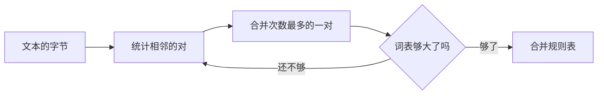

(heavy)=
# 重的幻灯片

:::{slide}
e2e/perf.spec.ts 的测试文稿：编辑器、流程图与思维导图的幻灯片上，按键到画面仍在 100 毫秒之内。
:::

(heavy-runner)=
## 现场运行

```{code} javascript
:run: live
const pairs = new Map()
for (const [a, b] of [['l', 'o'], ['o', 'w'], ['l', 'o']]) pairs.set(a + b, (pairs.get(a + b) ?? 0) + 1)
console.log([...pairs].sort((x, y) => y[1] - x[1])[0])
```

:::{slide}
:reveal:
运行之后再看下一步。
:::

(heavy-flow)=
## 流程图



:::{slide}
:reveal:
循环直到词表够大。
:::

(heavy-map)=
## 知识地图

````{markmap}
# BPE 分词
## 训练
- 统计相邻对
- 合并次数最多的一对
## 编码
- 从字节开始
- 按学到的先后合并
## 解码
- 查表拼接字节
````

:::{slide}
:reveal:
三个阶段各有各的规则。
:::
