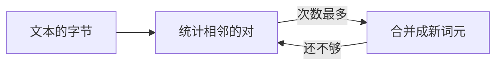

(cover)=
# 书卷样式

:::{slide}
**插件界面与幻灯片默认主题**：e2e/plugin-ui.spec.ts 的测试文稿
:::

封面之后是一章，每一节放一类插件组件。

(basics)=
# 合并的规则

:::{slide}
1. 每一轮合并哪一对
2. 小测验
3. 在浏览器里运行
:::

这一章的几节分别是讲解、测验、预测、运行面板、练习与课堂。

(merge)=
## 每一轮合并哪一对

:::{slide}
:reveal: items
- 统计相邻的每一对出现的次数
- 选出次数最多的一对，例如 `a a`
- 把它合并成一个新的词元
:::

```python
def get_stats(ids):
    counts = {}
    for pair in zip(ids, ids[1:]):
        counts[pair] = counts.get(pair, 0) + 1
    return counts
```

每一步显示一条，代码在幻灯片上不小于 18 px。

(emphasis)=
## 强调一行

```{code} python
:emphasize-lines: 3
# 统计之后，选出次数最多的一对
stats = get_stats([1, 2, 1, 2])
best = max(stats, key=stats.get)
print("best:", best, 256)
```

强调的一行之外，其余的行退为灰色，仍然清楚可读。

(quiz)=
## 小测验

```{quiz}
BPE 训练时，每一轮合并的是哪一对相邻词元？

- [ ] 文本中最先出现的一对
- [x] 出现次数最多的一对
- [ ] 出现次数最少的一对
```

(predict)=
## 先预测

:::{predict} 合并三轮之后，词表中有几个新词元？
:choices: 1, 2, 3
:::

:::{slide}
:reveal:
三个：每一轮新增一个词元。
:::

(run)=
## 在浏览器里运行

```{run-panel} python
:params: {num_merges: 2}
for i in range(num_merges):
    print("合并第", i + 1, "轮")
```

(trace)=
## 逐行执行

```{step-run} python
:steps: 3
a = 1
b = a + 1
print(b)
```

(exercise)=
## 动手：合并一对

````{exercise} python
补全函数 `merge(ids, pair, new_id)`。

```python
def merge(ids, pair, new_id):
    return ids
```

```python
assert merge([1, 2, 3], (1, 2), 9) == [9, 3]
```
````

(classroom)=
## 提问与反馈

```{question-box}
哪里还不清楚？
```

```{pulse} 你弄清楚了吗？
```

(stepper)=
## 分三步

:::{component} DemoStepper
:span: 3
steps: [统计, 选出, 合并]
:::

已经走过的步骤退为次要的颜色，仍然清楚可读。

(diagram)=
## 流程图



连线上的标签在明暗两套下都清楚可读。
