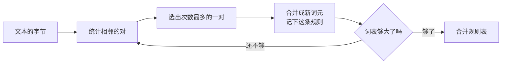

(idea)=
# BPE 的思路

:::{slide}
1. 反复合并最常见的一对
2. 手算一遍
3. 用公式描述
4. 小测验
:::

BPE 的规则只有一句话：反复找出出现次数最多的一对相邻词元，把它合并成一个新词元。这一章先看整个流程，再在一个小例子上手算几轮。

(idea-loop)=
## 反复合并最常见的一对



训练从文本的字节开始。每一轮先统计所有相邻的两个词元各出现了多少次，选出次数最多的一对，把文本中这一对的每一处出现都换成一个新词元，并记下“这一对合并成了哪个新词元”。然后在合并后的文本上开始下一轮。

每做一轮，词表就多一个词元。词表的大小事先定好，做够轮数就停下。训练得到的不是切好的文本，而是这张按先后排好的合并规则表：以后给任何新文本分词，都照着这张表来合并。

(idea-by-hand)=
## 手算一遍

:::{hints}
web: { layout: scrolly }
:::

:::{slide}
:reveal: items
- 开始：`a a a b d a a a b a c`，11 个词元
- 合并 `a a` 为 `Z`：`Z a b d Z a b a c`，9 个
- 合并 `Z a` 为 `Y`：`Y b d Y b a c`，7 个
- 合并 `Y b` 为 `X`：`X d X a c`，5 个
:::

我们在字符串 `aaabdaaabac` 上手算。为了看得清楚，这里把每个字母当作一个词元，新词元用大写字母表示。一开始共有 11 个词元。

第一轮：相邻的 `a a` 出现了 4 次（`aaa` 里有两处重叠的 `a a`），比其他任何一对都多。从左往右把它换成新词元 `Z`；`aaa` 只能合并前两个，第三个 `a` 留给后面，所以 11 个词元变成了 9 个。

第二轮：`Z a` 和 `a b` 都出现了 2 次，打成平手。我们约定选先出现的那一对，也就是 `Z a`，合并为 `Y`，它代表 `aaa`。

第三轮：`Y b` 出现 2 次，合并为 `X`，它代表 `aaab`。剩下的每一对都只出现一次，再合并也省不了多少，手算到这里为止。三轮合并让序列从 11 个词元缩短到 5 个，词表里多了 `Z`、`Y`、`X` 三个词元。

(idea-math)=
## 用公式描述

:::{slide}
$$
\begin{aligned}
\operatorname{count}(a, b) &= \bigl\lvert \{\, i : x_i = a,\ x_{i+1} = b \,\} \bigr\rvert && \text{相邻对出现的次数} \\[1ex]
(a^*, b^*) &= \operatorname*{arg\,max}_{(a,\, b)} \operatorname{count}(a, b) && \text{每一轮合并的一对} \\[1ex]
\lvert V \rvert &= 256 + k && \text{合并 } k \text{ 轮后的词表大小}
\end{aligned}
$$
:::

把刚才的做法写成公式。记当前的词元序列为 $x_1, x_2, \dots, x_n$。第一个式子数出相邻对 $(a, b)$ 在序列中出现的次数，第二个式子说每一轮选次数最多的一对 $(a^*, b^*)$；打成平手时取先出现的那一对。

第三个式子是词表的大小：词表从 256 个字节开始，每合并一轮多一个词元，所以合并 $k$ 轮之后，词表有 $256 + k$ 个词元。GPT-2 的词表有 50257 个词元：256 个字节、50000 条合并规则，再加一个表示文本结束的特殊词元。

词表越大，常见的词越可能整个成为一个词元，序列越短；但模型也要为每个词元学一组参数，所以词表大小需要权衡。衡量分词效果的一个简单指标是压缩率 $r = \text{字节数} / \text{词元数}$，手算的例子里 $r = 11 / 5 = 2.2$。

(idea-quiz)=
## 小测验

```{quiz}
BPE 训练时，每一轮合并的是哪一对相邻词元？

- [ ] 文本中最先出现的一对
- [x] 出现次数最多的一对
- [ ] 出现次数最少的一对
```

选好答案后提交，马上就能看到对错。在课堂上，老师可以开放作答，看看全班是怎么选的。
