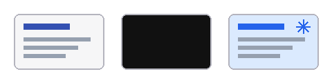

(stage-basics)=
## 讲台：基础内容

:::{hints}
slides: { class: pm-stage-basics }
:::

本章的内容都由渲染端直接呈现：标题、列表、表格、脚注与代码高亮。讲台插件只补充表格与脚注的样式。

:::{slide}
- 标题、列表与**强调**
- 表格与脚注[^keys]
- 语法高亮的代码

| 快捷键 | 作用 |
| --- | --- |
| `b` | 听众视图黑屏 |
| `f` | 冻结听众视图 |
| 绘图工具 | 圈画标注 |

[^keys]: 快捷键在演讲者视图和听众视图中都可用，状态同步到所有窗口；再按一次恢复。
:::

```ts
function toggleScreen(current, wanted) {
  return current === wanted ? 'live' : wanted
}
```

(stage-steps)=
## 讲台：步骤与画面

:::{hints}
slides: { class: pm-stage-steps }
:::

:::{slide}
:reveal: items
- **步骤备注**：讲解按步骤分段，演讲者视图只突出当前步骤
- **冻结画面**：`b` 让听众视图黑屏，`f` 让它停在当前画面
- **圈画标注**：标注保存在文稿目录的 `.presmium/drawings`，随文稿提交
:::

步骤备注：每一步对应一段讲解，演讲者视图突出当前步骤的那一段，其余段落变淡。

冻结画面：演讲者按 b 或 f，听众视图随即黑屏或冻结，演讲者视图右上角提示当前状态；再按一次恢复。

圈画标注：用导航栏的绘图工具标注，开发服务器把标注写入 .presmium/drawings，构建与导出都带上它们，也可以一键清除。


