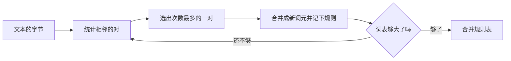

(advanced)=
# 第二章 进阶

:::{slide}
1. 步进组件
2. 步骤作用域
3. 执行面板与图表
4. 现场运行
:::

章首的讲解：第二章从一个章标题开始，这一段写在章标题之下、第一节之前。

(stepper)=
## 步进组件

:::{slide}
**步骤驱动**：状态由步骤推导
:::

:::{component} FixtureStepper
:span: 3
steps: [解析文稿, 启动插件, 渲染页面]
:::

步进组件有三个标签，占用三步。

第一步突出“解析文稿”。

第二步突出“启动插件”。

第三步突出“渲染页面”。

(steps)=
## 步骤作用域

组件的内部步骤从它所在块出现的那一步算起。

:::{slide}
:reveal:
**第一步**：先出现一段说明
:::

:::{slide}
:reveal:
**第二步**：步进组件随后出现
:::

:::{component} FixtureStepper
:span: 3
steps: [解析文稿, 启动插件, 渲染页面]
:::

步进组件在第 2 步出现。

第 3 步是它的第 1 个内部步骤。

第 4 步突出“启动插件”。

第 5 步突出“渲染页面”。

(panel)=
## 执行面板与图表

执行面板与图表都在浏览器中渲染：它们在页面加载之后才有高度。

```{run-panel} javascript
const words = ['low', 'lower', 'newest']
console.log(words.join(' '))
```



反复合并最常见的一对，直到词表够大。

排序的代价是 $O(n \log n)$，图表的文件名里有一个井号：

:::{only} web

:::

[一个写坏的锚点](#%E0%A4) 不影响页面。

(live-code)=
## 现场运行

```{code} javascript
:run: both
const squares = [1, 2, 3, 4, 5].map(n => n * n)
console.log('平方：', squares.join(', '))
console.log('合计：', squares.reduce((a, b) => a + b, 0))
```

这段代码在编译时运行，输出随代码显示；读者也可以在浏览器中重新运行它。

(wide-content)=
# 第三章 宽内容

(wide)=
## 宽代码与宽表格

:::{hints}
web: { layout: scrolly }
:::

```python
def merge(tokens, pair, new_id):
    out, i = [], 0
    while i < len(tokens):
        if tuple(tokens[i:i + 2]) == pair:
            out.append(new_id)
            i += 2
        else:
            out.append(tokens[i])
            i += 1
    return out
```

上屏一侧的代码按最宽的一行缩小字号，整段放得下。

```text
merges = {('l', 'o'): 256, ('lo', 'w'): 257, ('e', 'r'): 258, ('n', 'e'): 259, ('ne', 'w'): 260, ('w', 'i'): 261, ('d', 'e'): 262}
```

缩到下限仍放不下的一行可以横向滚动，边缘的阴影提示还有内容。

| 词 | 出现次数 | 初始切分 | 第一次合并 | 第二次合并 | 第三次合并 | 最终切分 |
|---|---|---|---|---|---|---|
| lower | 5 | l o w e r | lo w e r | low e r | low er | low er |
| newest | 6 | n e w e s t | n e w e s t | ne w e s t | new e s t | new est |

表格同样不被截断。
