(cs336-01-cover)=
# Lecture 01: Introduction and tokenization

Stanford CS336 · Language Modeling from Scratch · Spring 2026.


(cs336-01-section-001)=
## CS336: Language Models From Scratch (Spring 2026)

:::{slide}
:label: cs336-01-001-output-001
:at: 0

:::

:::{slide}
:label: cs336-01-001-output-002
:at: 1
...bringing you the 3rd offering of CS336.
:::

:::{slide}
:label: cs336-01-001-output-003
:at: 2
Lectures from 2nd offering (Spring 2025) are on [YouTube](https://www.youtube.com/playlist?list=PLoROMvodv4rOY23Y0BoGoBGgQ1zmU_MT_).
:::

:::{slide}
:label: cs336-01-001-output-004
:at: 3
What's new?
:::


(cs336-01-section-002)=
## CS336: Language Models From Scratch (Spring 2026)

:::{slide}
:label: cs336-01-002-output-001
:at: 0
- Same 'from scratch' philosophy
:::

:::{slide}
:label: cs336-01-002-output-002
:at: 1
- Prioritize high value-per-time concepts, don't lose the forest for the trees
:::

:::{slide}
:label: cs336-01-002-output-003
:at: 2
- More coverage of modern LM ingredients (mixture of experts, long-context, agents)
:::


(cs336-01-section-003)=
## Why did we make this course?

:::{slide}
:label: cs336-01-003-output-001
:at: 0
Problem: researchers are becoming **disconnected** from the underlying technology.
:::

:::{slide}
:label: cs336-01-003-output-002
:at: 1
- 2016: researchers implemented and trained their own models.
:::

:::{slide}
:label: cs336-01-003-output-003
:at: 2
- 2018: researchers downloaded models (e.g., BERT) and fine-tuned them.
:::

:::{slide}
:label: cs336-01-003-output-004
:at: 3
- Today: researchers prompt API models (e.g., GPT/Claude/Gemini).
:::


(cs336-01-section-004)=
## Why did we make this course?

:::{slide}
:label: cs336-01-004-output-001
:at: 0
Moving up levels of abstraction boosts productivity, but
:::

:::{slide}
:label: cs336-01-004-output-002
:at: 1
- These abstractions are leaky (in contrast to programming languages or operating systems).
:::

:::{slide}
:label: cs336-01-004-output-003
:at: 2
- There is still fundamental research to be done that requires tearing up the stack.
:::

:::{slide}
:label: cs336-01-004-output-004
:at: 3
**Full understanding** of this technology is necessary for **fundamental research**.
:::

:::{slide}
:label: cs336-01-004-output-005
:at: 4
Philosophy of this course: **understanding via building**.
:::


(cs336-01-section-005)=
## Why did we make this course?

:::{slide}
:label: cs336-01-005-output-001
:at: 0
But there's one small problem...
:::


(cs336-01-section-006)=
## The industrialization of language models

:::{slide}
:label: cs336-01-006-output-001
:at: 0

:::

:::{slide}
:label: cs336-01-006-output-002
:at: 1
Frontier models are really expensive:
:::

:::{slide}
:label: cs336-01-006-output-003
:at: 2
- 2023: GPT-4 supposedly cost $100M to train. 

[article](https://www.wired.com/story/openai-ceo-sam-altman-the-age-of-giant-ai-models-is-already-over/)
:::

:::{slide}
:label: cs336-01-006-output-004
:at: 3
- 2025: xAI builds cluster with 230K GPUs for training Grok. 

[article](https://x.com/elonmusk/status/1947701807389515912)
:::


(cs336-01-section-007)=
## The industrialization of language models

:::{slide}
:label: cs336-01-007-output-001
:at: 0
There are no public details on how frontier models are built.
:::

:::{slide}
:label: cs336-01-007-output-002
:at: 1
From the GPT-4 technical report 

[OpenAI+ 2023](https://arxiv.org/pdf/2303.08774.pdf)

:
:::

:::{slide}
:label: cs336-01-007-output-003
:at: 2
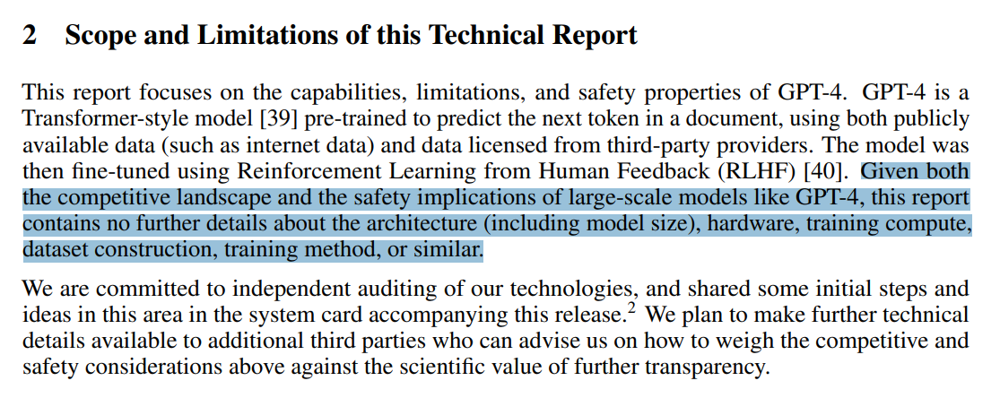
:::

:::{slide}
:label: cs336-01-007-output-004
:at: 3
Frontier models are out of reach for us.
:::

:::{slide}
:label: cs336-01-007-output-005
:at: 4
We could build small language models (<1B parameters), but this might not be representative of large language models.
:::


(cs336-01-section-008)=
## The industrialization of language models

:::{slide}
:label: cs336-01-008-output-001
:at: 0
Example 1: fraction of FLOPs spent in attention versus MLP changes with scale. 

[post](https://x.com/stephenroller/status/1579993017234382849)
:::

:::{slide}
:label: cs336-01-008-output-002
:at: 1
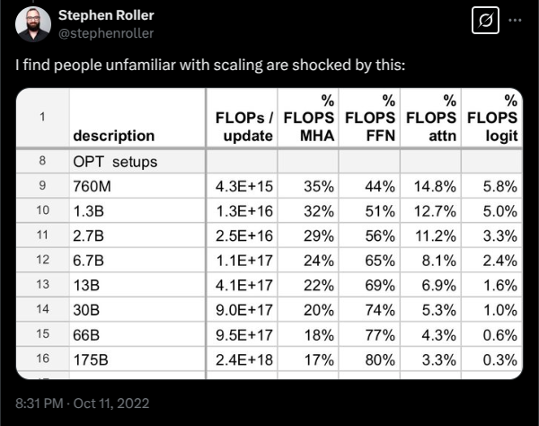
:::

:::{slide}
:label: cs336-01-008-output-003
:at: 2
Example 2: emergence of behavior with scale 

[Wei+ 2022](https://arxiv.org/pdf/2206.07682)
:::

:::{slide}
:label: cs336-01-008-output-004
:at: 3
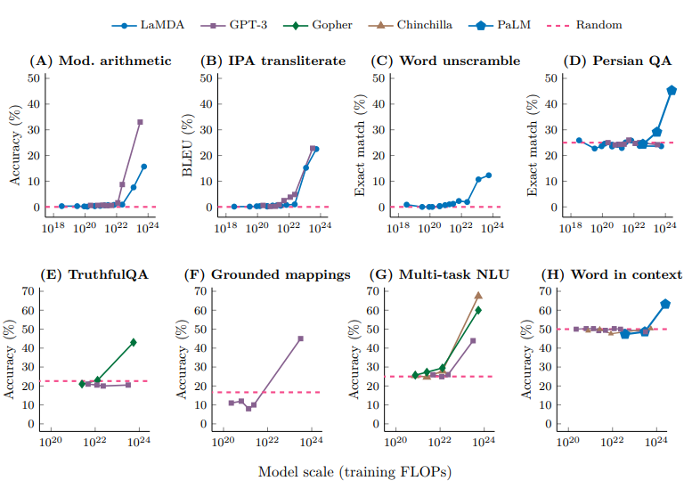
:::


(cs336-01-section-009)=
## What can we learn in this class that transfers to frontier models?

:::{slide}
:label: cs336-01-009-output-001
:at: 0
There are three types of knowledge:
:::

:::{slide}
:label: cs336-01-009-output-002
:at: 1
- **Mechanics**: how things work (what a Transformer is, how model parallelism works)
:::

:::{slide}
:label: cs336-01-009-output-003
:at: 2
- **Mindset**: squeezing the most out of the hardware, taking scaling seriously
:::

:::{slide}
:label: cs336-01-009-output-004
:at: 3
- **Intuitions**: which data and modeling decisions yield good accuracy
:::


(cs336-01-section-010)=
## What can we learn in this class that transfers to frontier models?

:::{slide}
:label: cs336-01-010-output-001
:at: 0
We can teach mechanics and mindset (these do transfer).
:::

:::{slide}
:label: cs336-01-010-output-002
:at: 1
We can only partially teach intuitions (do not necessarily transfer across scales).
:::


(cs336-01-section-011)=
## Intuitions? 🤷

:::{slide}
:label: cs336-01-011-output-001
:at: 0
Some design decisions are simply not (yet) justifiable and just come from experimentation.
:::

:::{slide}
:label: cs336-01-011-output-002
:at: 1
Example: Noam Shazeer paper that introduced SwiGLU 

[Shazeer 2020](https://arxiv.org/pdf/2002.05202.pdf)
:::

:::{slide}
:label: cs336-01-011-output-003
:at: 2
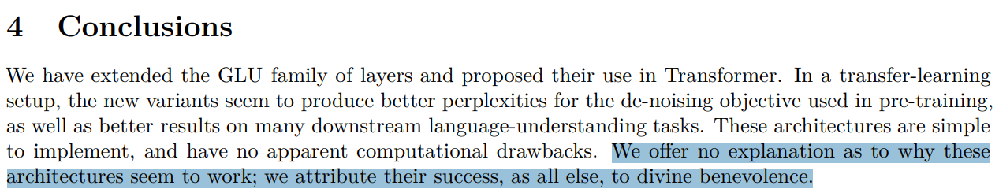
:::


(cs336-01-section-012)=
## The bitter lesson

:::{slide}
:label: cs336-01-012-output-001
:at: 0
Wrong interpretation: scale is all that matters, algorithms don't matter.
:::

:::{slide}
:label: cs336-01-012-output-002
:at: 1
Right interpretation: algorithms that scale are what matter.
:::


(cs336-01-section-013)=
## accuracy = efficiency x resources

:::{slide}
:label: cs336-01-013-output-001
:at: 0
In fact, efficiency is way more important at larger scales (can't afford to be wasteful).
:::

:::{slide}
:label: cs336-01-013-output-002
:at: 1
[Hernandez+ 2020](https://arxiv.org/abs/2005.04305)

 showed 44x algorithmic efficiency on ImageNet between 2012 and 2019.
:::

:::{slide}
:label: cs336-01-013-output-003
:at: 2
Framing: what is the best model one can build given a certain compute and data budget?
:::

:::{slide}
:label: cs336-01-013-output-004
:at: 3
In other words, **maximize efficiency**!
:::


(cs336-01-section-014)=
## Pre-neural (before 2010s)

:::{slide}
:label: cs336-01-014-output-001
:at: 0
- Language model to measure the entropy of English 

[Shannon 1950](https://www.princeton.edu/~wbialek/rome/refs/shannon_51.pdf)
:::

:::{slide}
:label: cs336-01-014-output-002
:at: 1
- N-gram language models (used in machine translation and speech recognition systems) 

[Brants+ 2007](https://aclanthology.org/D07-1090.pdf)
:::


(cs336-01-section-015)=
## Neural ingredients (2010s)

:::{slide}
:label: cs336-01-015-output-001
:at: 0
- Long-Short Term Memory (LSTM) 

[Hochreiter+ 1997](https://www.bioinf.jku.at/publications/older/2604.pdf)
:::

:::{slide}
:label: cs336-01-015-output-002
:at: 1
- First neural language model 

[Bengio+ 2003](https://www.jmlr.org/papers/volume3/bengio03a/bengio03a.pdf)
:::

:::{slide}
:label: cs336-01-015-output-003
:at: 2
- Sequence-to-sequence modeling (for machine translation) 

[Sutskever+ 2014](https://arxiv.org/pdf/1409.3215.pdf)
:::

:::{slide}
:label: cs336-01-015-output-004
:at: 3
- Adam optimizer 

[Kingma+ 2014](https://arxiv.org/pdf/1412.6980.pdf)
:::


(cs336-01-section-016)=
## Neural ingredients (2010s)

:::{slide}
:label: cs336-01-016-output-001
:at: 0
- Attention mechanism (for machine translation) 

[Bahdanau+ 2014](https://arxiv.org/pdf/1409.0473.pdf)
:::

:::{slide}
:label: cs336-01-016-output-002
:at: 1
- Transformer architecture (for machine translation) 

[Vaswani+ 2017](https://arxiv.org/pdf/1706.03762.pdf)
:::

:::{slide}
:label: cs336-01-016-output-003
:at: 2
- Mixture of experts 

[Shazeer+ 2017](https://arxiv.org/pdf/1701.06538.pdf)
:::

:::{slide}
:label: cs336-01-016-output-004
:at: 3
- Model parallelism 

[Huang+ 2018](https://arxiv.org/pdf/1811.06965.pdf)

[Rajbhandari+ 2019](https://arxiv.org/abs/1910.02054)

[Shoeybi+ 2019](https://arxiv.org/pdf/1909.08053.pdf)
:::


(cs336-01-section-017)=
## Early foundation models (late 2010s)

:::{slide}
:label: cs336-01-017-output-001
:at: 0
- ELMo: pretraining with LSTMs, fine-tuning improves downstream tasks 

[Peters+ 2018](https://arxiv.org/abs/1802.05365)
:::

:::{slide}
:label: cs336-01-017-output-002
:at: 1
- BERT: pretraining with Transformer, fine-tuning improves downstream tasks 

[Devlin+ 2018](https://arxiv.org/abs/1810.04805)
:::

:::{slide}
:label: cs336-01-017-output-003
:at: 2
- Google's T5 (11B): cast everything as text-to-text 

[Raffel+ 2019](https://arxiv.org/pdf/1910.10683.pdf)
:::


(cs336-01-section-018)=
## Embracing scaling

:::{slide}
:label: cs336-01-018-output-001
:at: 0
- OpenAI's GPT-2 (1.5B): fluent text, first signs of zero-shot 

[Radford+ 2019](https://cdn.openai.com/better-language-models/language_models_are_unsupervised_multitask_learners.pdf)
:::

:::{slide}
:label: cs336-01-018-output-002
:at: 1
- Scaling laws: provide hope / predictability for scaling 

[Kaplan+ 2020](https://arxiv.org/pdf/2001.08361.pdf)
:::

:::{slide}
:label: cs336-01-018-output-003
:at: 2
- OpenAI's GPT-3 (175B): in-context learning 

[Brown+ 2020](https://arxiv.org/pdf/2005.14165.pdf)
:::

:::{slide}
:label: cs336-01-018-output-004
:at: 3
- Google's PaLM (540B): massive scale, undertrained 

[Chowdhery+ 2022](https://arxiv.org/pdf/2204.02311.pdf)
:::


(cs336-01-section-019)=
## Embracing scaling

:::{slide}
:label: cs336-01-019-output-001
:at: 0
- DeepMind's Chinchilla (70B): compute-optimal scaling laws 

[Hoffmann+ 2022](https://arxiv.org/pdf/2203.15556.pdf)
:::


(cs336-01-section-020)=
## Open models

:::{slide}
:label: cs336-01-020-output-001
:at: 0
Early attempts (attempts to replicate GPT-3):
:::

:::{slide}
:label: cs336-01-020-output-002
:at: 1
- EleutherAI's open datasets (The Pile) and models (GPT-J) 

[Gao+ 2020](https://arxiv.org/pdf/2101.00027.pdf)

[Wang+ 2021](https://arankomatsuzaki.wordpress.com/2021/06/04/gpt-j/)
:::

:::{slide}
:label: cs336-01-020-output-003
:at: 2
- Meta's OPT (175B): GPT-3 replication, lots of hardware issues 

[Zhang+ 2022](https://arxiv.org/pdf/2205.01068.pdf)
:::

:::{slide}
:label: cs336-01-020-output-004
:at: 3
- Hugging Face / BigScience's BLOOM (176B): focused on data sourcing 

[Workshop+ 2022](https://arxiv.org/abs/2211.05100)
:::


(cs336-01-section-021)=
## Open models

:::{slide}
:label: cs336-01-021-output-001
:at: 0
Credible open-weight models (weights + paper):
:::

:::{slide}
:label: cs336-01-021-output-002
:at: 1
- Meta's Llama models 

[Touvron+ 2023](https://arxiv.org/pdf/2302.13971.pdf)

[Touvron+ 2023](https://arxiv.org/pdf/2307.09288.pdf)

[Grattafiori+ 2024](https://arxiv.org/abs/2407.21783)
:::

:::{slide}
:label: cs336-01-021-output-003
:at: 2
- Mistral's models 

[Jiang+ 2023](https://arxiv.org/pdf/2310.06825.pdf)

[Jiang+ 2024](https://arxiv.org/pdf/2401.04088.pdf)
:::

:::{slide}
:label: cs336-01-021-output-004
:at: 3
- DeepSeek's models 

[DeepSeek-AI+ 2024](https://arxiv.org/pdf/2401.02954.pdf)

[DeepSeek-AI+ 2024](https://arxiv.org/abs/2405.04434)

[DeepSeek-AI+ 2024](https://arxiv.org/pdf/2412.19437.pdf)

[DeepSeek-AI+ 2025](https://arxiv.org/pdf/2501.12948.pdf)

[DeepSeek-AI+ 2025](https://arxiv.org/abs/2512.02556)
:::

:::{slide}
:label: cs336-01-021-output-005
:at: 4
- Alibaba's Qwen models 

[Qwen+ 2024](https://arxiv.org/abs/2412.15115)

[Yang+ 2025](https://arxiv.org/abs/2505.09388)
:::


(cs336-01-section-022)=
## Open models

:::{slide}
:label: cs336-01-022-output-001
:at: 0
- Moonshot's Kimi models 

[Kimi Team 2025](https://arxiv.org/pdf/2501.12599.pdf)

[Kimi Team 2026](https://arxiv.org/abs/2602.02276)
:::

:::{slide}
:label: cs336-01-022-output-002
:at: 1
- Z.ai's GLM models 

[GLM-4.5 Team 2025](https://arxiv.org/abs/2508.06471)

[GLM-5-Team 2026](https://arxiv.org/abs/2602.15763)
:::

:::{slide}
:label: cs336-01-022-output-003
:at: 2
- Minimax's models 

[MiniMax M2.5](https://www.minimax.io/news/minimax-m25)
:::

:::{slide}
:label: cs336-01-022-output-004
:at: 3
- Xiaomi's MIMO models 

[Xiaomi MIMO v2](https://mimo.xiaomi.com/mimo-v2-pro)
:::

:::{slide}
:label: cs336-01-022-output-005
:at: 4
These models are approaching closed models (GPT, Claude, Gemini, etc.).
:::


(cs336-01-section-023)=
## Open models

:::{slide}
:label: cs336-01-023-output-001
:at: 0
Open-source models (weights + paper + code + data):
:::

:::{slide}
:label: cs336-01-023-output-002
:at: 1
- AI2's Olmo models 

[Groeneveld+ 2024](https://arxiv.org/pdf/2402.00838.pdf)

[Team OLMo 2024](https://arxiv.org/abs/2501.00656)

[Team Olmo 2025](https://arxiv.org/abs/2512.13961)
:::

:::{slide}
:label: cs336-01-023-output-003
:at: 2
- NVIDIA's Nemotron models 

[Parmar+ 2024](https://arxiv.org/pdf/2402.16819.pdf)

[NVIDIA+ 2025](https://arxiv.org/abs/2512.20856)
:::

:::{slide}
:label: cs336-01-023-output-004
:at: 3
- Marin's models (open development) 

[Marin 8B retro](https://marin.readthedocs.io/en/latest/reports/marin-8b-retro/)

[Marin 32B retro](https://marin.readthedocs.io/en/latest/reports/marin-32b-retro/)
:::

:::{slide}
:label: cs336-01-023-output-005
:at: 4
Openness is important for trust and innovation 

[Kapoor+ 2024](https://arxiv.org/abs/2403.07918)
:::


(cs336-01-section-024)=
## Open models

:::{slide}
:label: cs336-01-024-output-001
:at: 0
Ideas from open models enable us to teach CS336.
:::

:::{slide}
:label: cs336-01-024-output-002
:at: 1
What is a language model?
:::

:::{slide}
:label: cs336-01-024-output-003
:at: 2
- 2018 (BERT): something you fine-tune
:::

:::{slide}
:label: cs336-01-024-output-004
:at: 3
- 2020 (GPT-3): something you prompt
:::

:::{slide}
:label: cs336-01-024-output-005
:at: 4
- 2022 (ChatGPT): something you talk to 

[example conversation](https://huggingface.co/datasets/HuggingFaceTB/smoltalk/viewer/all/train?row=72&conversation-viewer=72)
:::


(cs336-01-section-025)=
## Open models

:::{slide}
:label: cs336-01-025-output-001
:at: 0
- 2026 (agents): something that acts autonomously 

[example trace](https://huggingface.co/datasets/nebius/SWE-rebench-openhands-trajectories/viewer/default/train?conversation-viewer=1)
:::

:::{slide}
:label: cs336-01-025-output-002
:at: 1
The fundamentals are the same (attention, kernels, optimization).
:::

:::{slide}
:label: cs336-01-025-output-003
:at: 2
The specs are different (longer context, inference efficiency matters even more).
:::

:::{slide}
:label: cs336-01-025-output-004
:at: 3
This is an *executable lecture*, a program whose execution delivers the content of a lecture.
:::

:::{slide}
:label: cs336-01-025-output-005
:at: 4
Executable lectures make it possible to:
:::


(cs336-01-section-026)=
## Open models

:::{slide}
:label: cs336-01-026-output-001
:at: 0
- view and run code (since everything is code!),
:::

:::{slide}
:label: cs336-01-026-values-002
:at: 1
:until: 2
| Variable | Value |
| --- | --- |
| `total` | 0 |
:::

:::{slide}
:label: cs336-01-026-values-003
:at: 2
:until: 3
| Variable | Value |
| --- | --- |
| `total` | 0 |
| `x` | 1 |
:::

:::{slide}
:label: cs336-01-026-values-004
:at: 3
:until: 4
| Variable | Value |
| --- | --- |
| `total` | 1 |
| `x` | 1 |
:::

:::{slide}
:label: cs336-01-026-values-005
:at: 4
| Variable | Value |
| --- | --- |
| `total` | 1 |
| `x` | 2 |
:::


(cs336-01-section-027)=
## Open models

:::{slide}
:label: cs336-01-027-values-001
:at: 0
:until: 1
| Variable | Value |
| --- | --- |
| `total` | 3 |
| `x` | 2 |
:::

:::{slide}
:label: cs336-01-027-values-002
:at: 1
:until: 2
| Variable | Value |
| --- | --- |
| `total` | 3 |
| `x` | 3 |
:::

:::{slide}
:label: cs336-01-027-values-003
:at: 2
:until: 4
| Variable | Value |
| --- | --- |
| `total` | 6 |
| `x` | 3 |
:::

:::{slide}
:label: cs336-01-027-output-004
:at: 3
- see the hierarchical structure of the lecture
:::


(cs336-01-section-028)=
## Open models

:::{slide}
:label: cs336-01-028-output-001
:at: 0
All information online: 

[course website](https://stanford-cs336.github.io/spring2026/)
:::

:::{slide}
:label: cs336-01-028-output-002
:at: 1
This is a 5-unit class.
:::

:::{slide}
:label: cs336-01-028-output-003
:at: 2
Comment from Spring 2024 course evaluation:
:::

:::{slide}
:label: cs336-01-028-output-004
:at: 3
> *The entire assignment was approximately the same amount of work as all 5 assignments from CS 224n plus the final project. And that's just the first homework assignment.*
:::


(cs336-01-section-029)=
## Why you should take this course

:::{slide}
:label: cs336-01-029-output-001
:at: 0
- You have an obsessive need to understand how things work.
:::

:::{slide}
:label: cs336-01-029-output-002
:at: 1
- You want to build up your research engineering muscles.
:::


(cs336-01-section-030)=
## Why you should not take this course

:::{slide}
:label: cs336-01-030-output-001
:at: 0
- You actually want to get research done this quarter. (Talk to your advisor.)
:::

:::{slide}
:label: cs336-01-030-output-002
:at: 1
- You are interested in learning about the hottest new techniques in AI (e.g., multimodality, RAG, etc.). (You should take a seminar class for that.)
:::

:::{slide}
:label: cs336-01-030-output-003
:at: 2
- You want to get good results on your own application domain. (You should just prompt or fine-tune an existing model.)
:::


(cs336-01-section-031)=
## How you can follow along at home

:::{slide}
:label: cs336-01-031-output-001
:at: 0
- All lecture materials and assignments will be posted online, so feel free to follow on your own.
:::

:::{slide}
:label: cs336-01-031-output-002
:at: 1
- Lectures are recorded via [CGOE](https://cgoe.stanford.edu/).
:::


(cs336-01-section-032)=
## Assignments

:::{slide}
:label: cs336-01-032-output-001
:at: 0
- 5 assignments (basics, systems, scaling laws, data, alignment).
:::

:::{slide}
:label: cs336-01-032-output-002
:at: 1
- No scaffolding code, but we provide unit tests and adapter interfaces to help you check correctness.
:::

:::{slide}
:label: cs336-01-032-output-003
:at: 2
- Implement locally to test for correctness, then run on cluster for benchmarking (accuracy and speed).
:::

:::{slide}
:label: cs336-01-032-output-004
:at: 3
- Leaderboard for some assignments (minimize perplexity given training budget).
:::


(cs336-01-section-033)=
## AI policy

:::{slide}
:label: cs336-01-033-output-001
:at: 0
- Coding agents can solve all the assignments, but you won't learn anything.
:::

:::{slide}
:label: cs336-01-033-output-002
:at: 1
- AI can be tremendously useful for answering questions and tutoring.
:::

:::{slide}
:label: cs336-01-033-output-003
:at: 2
- You must use our provided AGENTS.md file, which asks the AI to be pedagogically-minded.
:::

:::{slide}
:label: cs336-01-033-output-004
:at: 3
- Please read our [AI policy guide](https://docs.google.com/document/d/1SZAlExB1qAc9izHt54gwunNpjKE6wXb8Y7yA_e-baK8/edit?tab=t.0).
:::


(cs336-01-section-034)=
## Compute

:::{slide}
:label: cs336-01-034-output-001
:at: 0
- Thanks to [Modal](https://modal.com/) for providing compute. 🙏
:::

:::{slide}
:label: cs336-01-034-output-002
:at: 1
- Please read the [guide](https://docs.google.com/document/d/1cHE0iKVyXLJ3XpIs2XuXTmZ-HMmPk2hIPeCvy-AydMg/edit?tab=t.otis27tacaef) on how to access and use the compute.
:::

:::{slide}
:label: cs336-01-034-output-003
:at: 2
Goal: be able to train a basic language model
:::

:::{slide}
:label: cs336-01-034-output-004
:at: 3
Components: tokenization, model architecture, training
:::


(cs336-01-section-035)=
## Tokenization

:::{slide}
:label: cs336-01-035-output-001
:at: 0
What are the atoms that the model operates on?
:::

:::{slide}
:label: cs336-01-035-output-002
:at: 1
Formally: a tokenizer converts between raw inputs (bytes) and sequences of integers (tokens)
:::

:::{slide}
:label: cs336-01-035-output-003
:at: 2
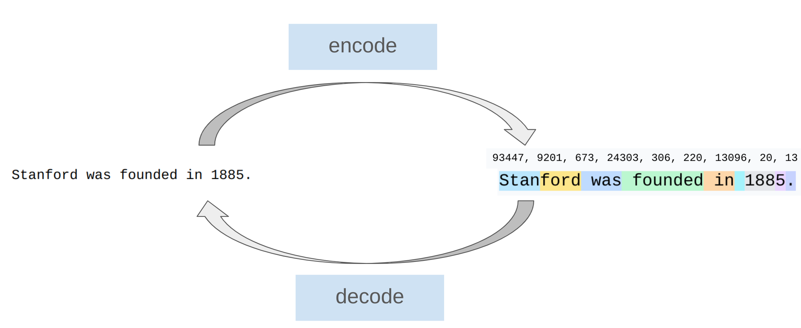
:::

:::{slide}
:label: cs336-01-035-output-004
:at: 3
Popular tokenizer: **Byte-Pair Encoding** (BPE) 

[Sennrich+ 2015](https://arxiv.org/abs/1508.07909)
:::


(cs336-01-section-036)=
## Tokenization

:::{slide}
:label: cs336-01-036-output-001
:at: 0
Intuition: break input into frequently-occuring chunks
:::

:::{slide}
:label: cs336-01-036-output-002
:at: 1
Efficiency lens
:::

:::{slide}
:label: cs336-01-036-output-003
:at: 2
- Reduce context length (1000 bytes → ~250 tokens)
:::

:::{slide}
:label: cs336-01-036-output-004
:at: 3
- Adaptive computation (more modeling capacity on interesting parts of input)
:::

:::{slide}
:label: cs336-01-036-output-005
:at: 4
The dream: tokenizer-free model architectures, which operate directly on bytes 

[Xue+ 2021](https://arxiv.org/abs/2105.13626)

[Yu+ 2023](https://arxiv.org/pdf/2305.07185.pdf)

[Pagnoni+ 2024](https://arxiv.org/abs/2412.09871)

[Deiseroth+ 2024](https://arxiv.org/abs/2406.19223)

[Hwang+ 2025](https://arxiv.org/abs/2507.07955)
:::


(cs336-01-section-037)=
## Tokenization

:::{slide}
:label: cs336-01-037-output-001
:at: 0
These are promising, but have not yet been scaled up to the frontier.
:::


(cs336-01-section-038)=
## Model architecture

:::{slide}
:label: cs336-01-038-output-001
:at: 0
Starting point: original Transformer 

[Vaswani+ 2017](https://arxiv.org/pdf/1706.03762.pdf)
:::

:::{slide}
:label: cs336-01-038-output-002
:at: 1
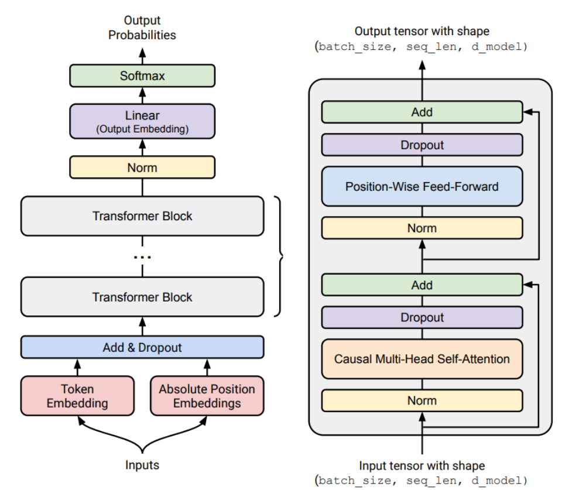
:::

:::{slide}
:label: cs336-01-038-output-003
:at: 2
Refinements:
:::

:::{slide}
:label: cs336-01-038-output-004
:at: 3
- Activation functions: ReLU, SwiGLU 

[Shazeer 2020](https://arxiv.org/pdf/2002.05202.pdf)
:::


(cs336-01-section-039)=
## Model architecture

:::{slide}
:label: cs336-01-039-output-001
:at: 0
- Positional encodings: sinusoidal, RoPE 

[Su+ 2021](https://arxiv.org/pdf/2104.09864.pdf)
:::

:::{slide}
:label: cs336-01-039-output-002
:at: 1
- Normalization: LayerNorm, RMSNorm, QK norm, pre-norm versus post-norm 

[Ba+ 2016](https://arxiv.org/pdf/1607.06450.pdf)

[Zhang+ 2019](https://arxiv.org/abs/1910.07467)

[Dehghani+ 2023](https://arxiv.org/abs/2302.05442)

[Xiong+ 2020](https://arxiv.org/pdf/2002.04745.pdf)
:::

:::{slide}
:label: cs336-01-039-output-003
:at: 2
- Attention: full, sparse/local attention, group-query attention (GQA), multi-head latent attention (MLA) 

[Child+ 2019](https://arxiv.org/pdf/1904.10509.pdf)

[Ainslie+ 2023](https://arxiv.org/pdf/2305.13245.pdf)

[DeepSeek-AI+ 2024](https://arxiv.org/abs/2405.04434)
:::

:::{slide}
:label: cs336-01-039-output-004
:at: 3
- Recurrence/state-space models/linear attention: Mamba, Gated DeltaNet 

[Katharopoulos+ 2020](https://arxiv.org/abs/2006.16236)

[Dao+ 2024](https://arxiv.org/abs/2405.21060)

[Yang+ 2024](https://arxiv.org/abs/2412.06464)

[Lahoti+ 2026](https://arxiv.org/abs/2603.15569)
:::

:::{slide}
:label: cs336-01-039-output-005
:at: 4
- MLP: dense, mixture of experts 

[Shazeer+ 2017](https://arxiv.org/pdf/1701.06538.pdf)

[Fedus+ 2021](https://arxiv.org/abs/2101.03961)
:::


(cs336-01-section-040)=
## Model architecture

:::{slide}
:label: cs336-01-040-output-001
:at: 0
- Shape (hidden dimension, depth, number of heads, number of experts)
:::


(cs336-01-section-041)=
## Training

:::{slide}
:label: cs336-01-041-output-001
:at: 0
How do you set the parameters of the model?
:::

:::{slide}
:label: cs336-01-041-output-002
:at: 1
- Loss function (e.g., multi-token prediction) 

[Gloeckle+ 2024](https://arxiv.org/abs/2404.19737)

[DeepSeek-AI+ 2024](https://arxiv.org/pdf/2412.19437.pdf)
:::

:::{slide}
:label: cs336-01-041-output-003
:at: 2
- Optimizer (e.g., AdamW, SOAP, Muon) 

[Kingma+ 2014](https://arxiv.org/pdf/1412.6980.pdf)

[Loshchilov+ 2017](https://arxiv.org/pdf/1711.05101.pdf)

[Vyas+ 2024](https://arxiv.org/abs/2409.11321)

[Keller 2024](https://kellerjordan.github.io/posts/muon/)
:::

:::{slide}
:label: cs336-01-041-output-004
:at: 3
- Initialization scale (e.g., Xavier init, muP) 

[Glorot+ 2010](https://proceedings.mlr.press/v9/glorot10a/glorot10a.pdf)

[Yang+ 2022](https://arxiv.org/abs/2203.03466)
:::


(cs336-01-section-042)=
## Training

:::{slide}
:label: cs336-01-042-output-001
:at: 0
- Learning rate schedule (e.g., cosine, WSD) 

[Loshchilov+ 2016](https://arxiv.org/pdf/1608.03983.pdf)

[Hu+ 2024](https://arxiv.org/pdf/2404.06395.pdf)
:::

:::{slide}
:label: cs336-01-042-output-002
:at: 1
- Regularization (e.g., dropout, weight decay)
:::

:::{slide}
:label: cs336-01-042-output-003
:at: 2
- Batch size (e.g., critical batch size) 

[McCandlish+ 2018](https://arxiv.org/pdf/1812.06162.pdf)
:::

:::{slide}
:label: cs336-01-042-output-004
:at: 3
- MoE specific: load balancing (e.g., aux-free) 

[Wang+ 2024](https://arxiv.org/abs/2408.15664)

[DeepSeek-AI+ 2024](https://arxiv.org/pdf/2412.19437.pdf)
:::


(cs336-01-section-043)=
## Assignment 1 (basics)

:::{slide}
:label: cs336-01-043-output-001
:at: 0
[GitHub](https://github.com/stanford-cs336/assignment1-basics)

[PDF](https://github.com/stanford-cs336/assignment1-basics/blob/main/cs336_spring2026_assignment1_basics.pdf)
:::

:::{slide}
:label: cs336-01-043-output-002
:at: 1
- Implement BPE tokenizer
:::

:::{slide}
:label: cs336-01-043-output-003
:at: 2
- Implement Transformer, cross-entropy loss, AdamW optimizer, training loop
:::

:::{slide}
:label: cs336-01-043-output-004
:at: 3
- Do resource accounting
:::


(cs336-01-section-044)=
## Assignment 1 (basics)

:::{slide}
:label: cs336-01-044-output-001
:at: 0
- Train on TinyStories and OpenWebText
:::

:::{slide}
:label: cs336-01-044-output-002
:at: 1
- Leaderboard: minimize OpenWebText perplexity given 45 minutes on a B200 

[last year's leaderboard](https://github.com/stanford-cs336/spring2025-assignment1-basics-leaderboard)
:::

:::{slide}
:label: cs336-01-044-output-003
:at: 2
High-level principle: everything is about balancing the following:
:::

:::{slide}
:label: cs336-01-044-output-004
:at: 3
- Expressivity (can represent complex dependencies in the data)
:::

:::{slide}
:label: cs336-01-044-output-005
:at: 4
- Stability (keep parameter and gradient norms in goldilocks zone)
:::


(cs336-01-section-045)=
## Assignment 1 (basics)

:::{slide}
:label: cs336-01-045-output-001
:at: 0
- Efficiency (runs fast on hardware, both training and inference)
:::

:::{slide}
:label: cs336-01-045-output-002
:at: 1
Goal: squeeze the most out of the hardware (GPU or TPU)
:::

:::{slide}
:label: cs336-01-045-output-003
:at: 2
Components: kernels, parallelism, inference
:::


(cs336-01-section-046)=
## Basics

:::{slide}
:label: cs336-01-046-output-001
:at: 0
- Resource accounting: memory and compute characteristics of a model
:::

:::{slide}
:label: cs336-01-046-values-002
:at: 1
| Variable | Value |
| --- | --- |
| `total_flops` | 4.2e+23 |
:::

:::{slide}
:label: cs336-01-046-output-003
:at: 2
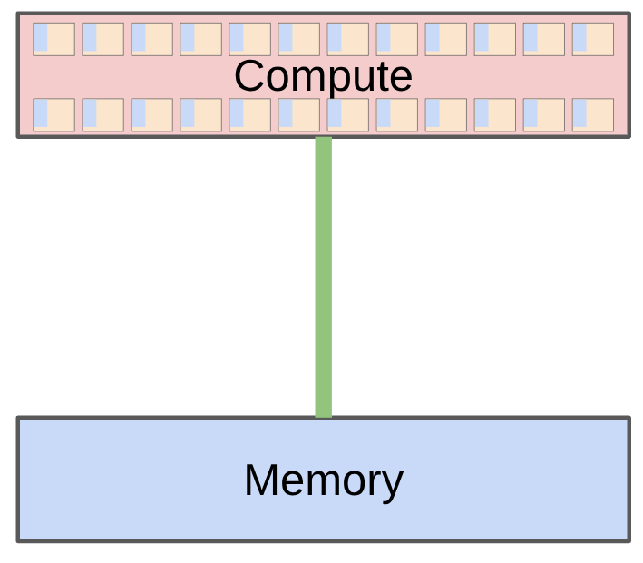
:::

:::{slide}
:label: cs336-01-046-output-004
:at: 3
- Model parameters must be moved from memory (HBM) to the compute (SMs)
:::


(cs336-01-section-047)=
## Basics

:::{slide}
:label: cs336-01-047-output-001
:at: 0
- Example: B200 can perform 2.25 PFLOP/sec (bf16) with 8TB/sec memory bandwidth
:::

:::{slide}
:label: cs336-01-047-values-002
:at: 0
| Variable | Value |
| --- | --- |
| `total_flops` | 4.2e+23 |
:::

:::{slide}
:label: cs336-01-047-output-003
:at: 1
- Roofline analysis: understand whether we're compute-bound or memory-bound
:::

:::{slide}
:label: cs336-01-047-output-004
:at: 2
- Benchmarking and profiling (nsight): see what happens in practice
:::

:::{slide}
:label: cs336-01-047-output-005
:at: 3
[DGX B200](https://docs.nvidia.com/dgx/dgxb200-user-guide/introduction-to-dgxb200.html):
:::

:::{slide}
:label: cs336-01-047-output-006
:at: 4
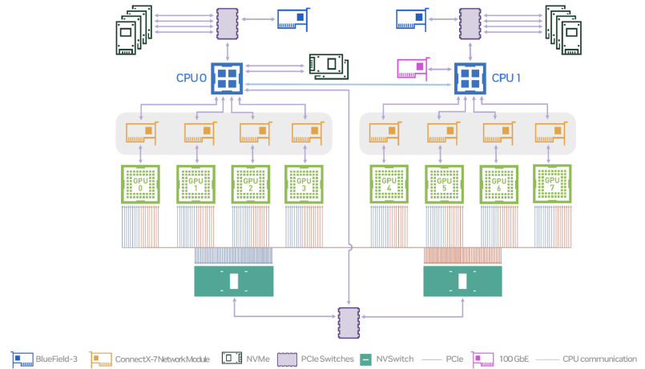
:::


(cs336-01-section-048)=
## Kernels

:::{slide}
:label: cs336-01-048-values-001
:at: 0
| Variable | Value |
| --- | --- |
| `total_flops` | 4.2e+23 |
:::

:::{slide}
:label: cs336-01-048-output-002
:at: 1
- Kernel is a function that runs on GPU
:::

:::{slide}
:label: cs336-01-048-output-003
:at: 2
- When using PyTorch, each primitive operation launches a standard kernel
:::

:::{slide}
:label: cs336-01-048-output-004
:at: 3
- Can write custom kernels to make GPUs go brrr
:::

:::{slide}
:label: cs336-01-048-output-005
:at: 4
- Principle: organize computation to minimize data movement
:::


(cs336-01-section-049)=
## Kernels

:::{slide}
:label: cs336-01-049-output-001
:at: 0
- Naive: read HBM; compute A; write HBM; read HBM; compute B; write HBM
:::

:::{slide}
:label: cs336-01-049-values-002
:at: 0
| Variable | Value |
| --- | --- |
| `total_flops` | 4.2e+23 |
:::

:::{slide}
:label: cs336-01-049-output-003
:at: 1
- Fused: read HBM; compute A and B; write HBM
:::

:::{slide}
:label: cs336-01-049-output-004
:at: 2
- Strategies: operator fusion (matmul + activation), tiling (FlashAttention)
:::

:::{slide}
:label: cs336-01-049-output-005
:at: 3
- Warp divergence, memory coalescing, bank conflicts, occupancy, bulk-async memory transfers
:::

:::{slide}
:label: cs336-01-049-output-006
:at: 4
- Write kernels in CUDA/**Triton**/CUTLASS/ThunderKittens
:::


(cs336-01-section-050)=
## Parallelism

:::{slide}
:label: cs336-01-050-values-001
:at: 0
| Variable | Value |
| --- | --- |
| `total_flops` | 4.2e+23 |
:::

:::{slide}
:label: cs336-01-050-output-002
:at: 1
- What if we have 1024 GPUs?
:::

:::{slide}
:label: cs336-01-050-output-003
:at: 2
- Data movement between GPUs is even slower, but same 'minimize data movement' principle holds
:::

:::{slide}
:label: cs336-01-050-output-004
:at: 3
- Use classic collective operations (e.g., gather, reduce, all-reduce)
:::

:::{slide}
:label: cs336-01-050-output-005
:at: 4
- Shard memory (parameters, activations, gradients, optimizer states) across GPUs
:::


(cs336-01-section-051)=
## Parallelism

:::{slide}
:label: cs336-01-051-output-001
:at: 0
- How to split computation: {data,tensor,pipeline,sequence,expert} parallelism
:::

:::{slide}
:label: cs336-01-051-values-002
:at: 0
| Variable | Value |
| --- | --- |
| `total_flops` | 4.2e+23 |
:::


(cs336-01-section-052)=
## Inference

:::{slide}
:label: cs336-01-052-values-001
:at: 0
| Variable | Value |
| --- | --- |
| `total_flops` | 4.2e+23 |
:::

:::{slide}
:label: cs336-01-052-output-002
:at: 1
Goal: generate tokens given a prompt (needed to actually use models!)
:::

:::{slide}
:label: cs336-01-052-output-003
:at: 2
Inference is also needed for reinforcement learning, test-time compute, evaluation
:::

:::{slide}
:label: cs336-01-052-output-004
:at: 3
Two phases: prefill and decode
:::

:::{slide}
:label: cs336-01-052-output-005
:at: 4
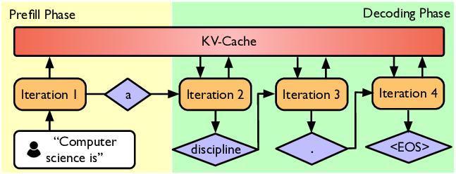
:::


(cs336-01-section-053)=
## Inference

:::{slide}
:label: cs336-01-053-output-001
:at: 0
- Prefill (similar to training): tokens are given, can process all at once (compute-bound)
:::

:::{slide}
:label: cs336-01-053-values-002
:at: 0
| Variable | Value |
| --- | --- |
| `total_flops` | 4.2e+23 |
:::

:::{slide}
:label: cs336-01-053-output-003
:at: 1
- Decode: need to generate one token at a time (memory-bound)
:::

:::{slide}
:label: cs336-01-053-output-004
:at: 2
Methods to speed up decoding:
:::

:::{slide}
:label: cs336-01-053-output-005
:at: 3
- Use cheaper model (via model pruning, quantization, distillation)
:::

:::{slide}
:label: cs336-01-053-output-006
:at: 4
- Speculative decoding: use a cheaper "draft" model to generate multiple tokens, then use the full model to score in parallel (exact decoding!)
:::


(cs336-01-section-054)=
## Inference

:::{slide}
:label: cs336-01-054-output-001
:at: 0
- Systems optimizations: fused kernels, continuous batching
:::

:::{slide}
:label: cs336-01-054-values-002
:at: 0
| Variable | Value |
| --- | --- |
| `total_flops` | 4.2e+23 |
:::


(cs336-01-section-055)=
## Assignment 2 (systems)

:::{slide}
:label: cs336-01-055-values-001
:at: 0
| Variable | Value |
| --- | --- |
| `total_flops` | 4.2e+23 |
:::

:::{slide}
:label: cs336-01-055-output-002
:at: 1
[GitHub](https://github.com/stanford-cs336/assignment2-systems)

[PDF from Spring 2025](https://github.com/stanford-cs336/assignment2-systems/blob/spring2025/cs336_spring2025_assignment2_systems.pdf)
:::

:::{slide}
:label: cs336-01-055-output-003
:at: 2
- Implement a fused RMSNorm kernel in Triton
:::

:::{slide}
:label: cs336-01-055-output-004
:at: 3
- Implement distributed data parallel training
:::

:::{slide}
:label: cs336-01-055-output-005
:at: 4
- Implement optimizer state sharding
:::


(cs336-01-section-056)=
## Assignment 2 (systems)

:::{slide}
:label: cs336-01-056-output-001
:at: 0
- Benchmark and profile the implementations
:::

:::{slide}
:label: cs336-01-056-values-002
:at: 0
:until: 4
| Variable | Value |
| --- | --- |
| `total_flops` | 4.2e+23 |
:::

:::{slide}
:label: cs336-01-056-output-003
:at: 1
Recommended book: [How to Scale Your Model](https://jax-ml.github.io/scaling-book/)
:::

:::{slide}
:label: cs336-01-056-output-004
:at: 2
- Nicely lays out how to approach systems for LLMs conceptually
:::

:::{slide}
:label: cs336-01-056-output-005
:at: 3
- From Google, so it foregrounds TPUs, but high-level concepts are similar
:::

:::{slide}
:label: cs336-01-056-output-006
:at: 5
Setting: if you had 1e25 FLOPs of compute, what hyperparameters would you use to train a good model?
:::


(cs336-01-section-057)=
## Assignment 2 (systems)

:::{slide}
:label: cs336-01-057-output-001
:at: 0
Too expensive to do hyperparameter tuning at full scale!
:::

:::{slide}
:label: cs336-01-057-output-002
:at: 1
Key conceptual shift: instead of a single scale, think of a **scaling recipe** (FLOPs → hyperparameters)
:::

:::{slide}
:label: cs336-01-057-output-003
:at: 2
For a scaling recipe:
:::

:::{slide}
:label: cs336-01-057-output-004
:at: 3
- Run experiments to compute the loss at various smaller scales (e.g., up to 1e24 FLOPs)
:::

:::{slide}
:label: cs336-01-057-output-005
:at: 4
- Fit a scaling law to predict the loss of the scaling recipe at the target scale (e.g., 1e25 FLOPs)
:::


(cs336-01-section-058)=
## Assignment 2 (systems)

:::{slide}
:label: cs336-01-058-output-001
:at: 0
Now you can:
:::

:::{slide}
:label: cs336-01-058-output-002
:at: 1
1. Optimize the scaling recipe targeting a larger scale using smaller scale experiments
:::

:::{slide}
:label: cs336-01-058-output-003
:at: 2
2. Predict the loss at the target scale before actually running the experiment!
:::

:::{slide}
:label: cs336-01-058-output-004
:at: 3
Scaling laws don't happen automatically, they require careful construction of a scaling recipe.
:::

:::{slide}
:label: cs336-01-058-output-005
:at: 4
Parameterize the model in a way to get **hyperparameter transfer** 

[Yang+ 2022](https://arxiv.org/abs/2203.03466)
:::


(cs336-01-section-059)=
## Assignment 2 (systems)

:::{slide}
:label: cs336-01-059-output-001
:at: 0
Predictability is at least as important as optimality!
:::

:::{slide}
:label: cs336-01-059-output-002
:at: 1
Question: given a FLOPs budget (C = 6 N D), use a bigger model (N) or train on more tokens (D)?
:::

:::{slide}
:label: cs336-01-059-output-003
:at: 2
Classic compute-optimal scaling laws: 

[Kaplan+ 2020](https://arxiv.org/pdf/2001.08361.pdf)

[Hoffmann+ 2022](https://arxiv.org/pdf/2203.15556.pdf)
:::

:::{slide}
:label: cs336-01-059-output-004
:at: 3
- ISOFLOP curves: for multiple small FLOPs budgets, find optimal N
:::

:::{slide}
:label: cs336-01-059-output-005
:at: 4
- Then fit a scaling law to extrapolate to large FLOPs budgets
:::


(cs336-01-section-060)=
## Assignment 2 (systems)

:::{slide}
:label: cs336-01-060-output-001
:at: 0
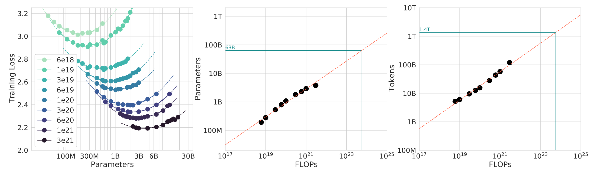
:::

:::{slide}
:label: cs336-01-060-output-002
:at: 1
TL;DR: D = 20 N is roughly optimal (e.g., 70B parameter model should be trained on ~1.4T tokens)
:::

:::{slide}
:label: cs336-01-060-output-003
:at: 2
Caveat: this doesn't take into account inference costs (want a smaller model)
:::

:::{slide}
:label: cs336-01-060-output-004
:at: 3
Live example from Marin 

[post](https://x.com/percyliang/status/2034367256277533100)
:::

:::{slide}
:label: cs336-01-060-output-005
:at: 4
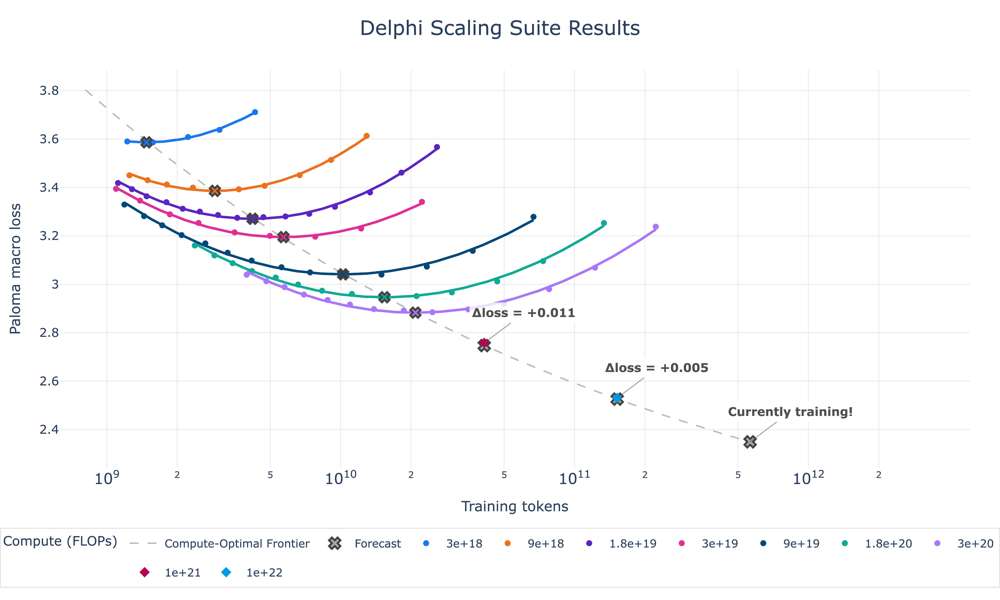
:::


(cs336-01-section-061)=
## Assignment 2 (systems)

:::{slide}
:label: cs336-01-061-output-001
:at: 0
Should be done training this week, should see how well we match the preregistered loss!
:::


(cs336-01-section-062)=
## Assignment 3 (scaling laws)

:::{slide}
:label: cs336-01-062-output-001
:at: 0
[GitHub](https://github.com/stanford-cs336/assignment3-scaling)

[PDF from Spring 2025](https://github.com/stanford-cs336/assignment3-scaling/blob/master/cs336_spring2025_assignment3_scaling.pdf)
:::

:::{slide}
:label: cs336-01-062-output-002
:at: 1
- We define a training API (hyperparameters → loss) based on previous runs
:::

:::{slide}
:label: cs336-01-062-output-003
:at: 2
- Submit "training jobs" (under a FLOPs budget) and gather data points
:::

:::{slide}
:label: cs336-01-062-output-004
:at: 3
- Fit scaling laws to the data points
:::


(cs336-01-section-063)=
## Assignment 3 (scaling laws)

:::{slide}
:label: cs336-01-063-output-001
:at: 0
- Submit extrapolated hyperparameters and loss predictions
:::

:::{slide}
:label: cs336-01-063-output-002
:at: 1
- Leaderboard: minimize loss given FLOPs budget
:::

:::{slide}
:label: cs336-01-063-output-003
:at: 2
Question: What capabilities do we want the model to have?
:::

:::{slide}
:label: cs336-01-063-output-004
:at: 3
Multilingual?  Good at conversation?  Agentic coding capabilities?
:::


(cs336-01-section-064)=
## Evaluation

:::{slide}
:label: cs336-01-064-output-001
:at: 0
What is the purpose of evaluation?
:::

:::{slide}
:label: cs336-01-064-output-002
:at: 1
1. Internal: guide model development (smoothness across scales, relative performance matters)
:::

:::{slide}
:label: cs336-01-064-output-003
:at: 2
2. External: measure absolute quality of a real use case (ecological validity matters)
:::

:::{slide}
:label: cs336-01-064-output-004
:at: 3
Examples of evaluations:
:::


(cs336-01-section-065)=
## Evaluation

:::{slide}
:label: cs336-01-065-output-001
:at: 0
1. Perplexity: ideally run on private documents not on Internet (avoid contamination)
:::

:::{slide}
:label: cs336-01-065-output-002
:at: 1
2. Advanced use cases: GPQA, HLE, SWE-Bench, Terminal-Bench
:::

:::{slide}
:label: cs336-01-065-output-003
:at: 2
LMs are general purpose, require a diverse set of evaluations!
:::


(cs336-01-section-066)=
## Data curation

:::{slide}
:label: cs336-01-066-output-001
:at: 0
- Data does not just fall from the sky.
:::

:::{slide}
:label: cs336-01-066-output-002
:at: 1
- Sources: webpages crawled from the Internet, books, arXiv papers, GitHub code, etc.
:::

:::{slide}
:label: cs336-01-066-output-003
:at: 2
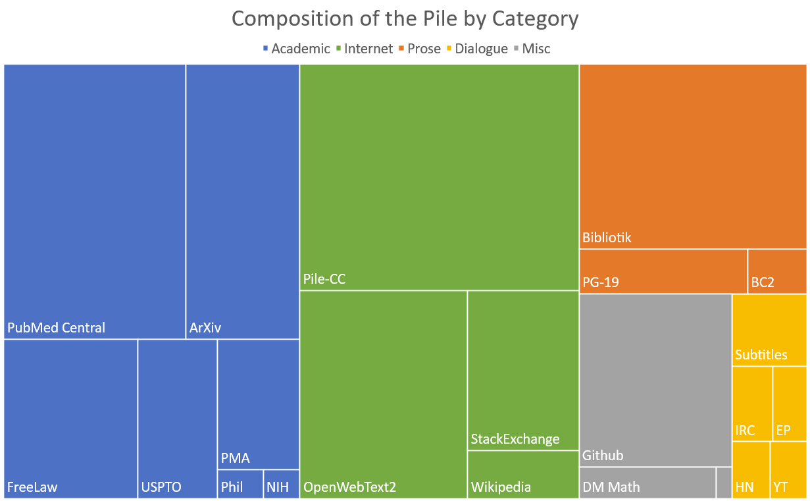
:::

:::{slide}
:label: cs336-01-066-output-004
:at: 3
- Appeal to fair use to train on copyright data? 

[Henderson+ 2023](https://arxiv.org/pdf/2303.15715.pdf)
:::


(cs336-01-section-067)=
## Data curation

:::{slide}
:label: cs336-01-067-output-001
:at: 0
- Might have to license data (e.g., Google with Reddit data) 

[article](https://www.reuters.com/technology/reddit-ai-content-licensing-deal-with-google-sources-say-2024-02-22/)
:::

:::{slide}
:label: cs336-01-067-output-002
:at: 1
- Raw data is HTML, PDF, directories (not text), requires processing
:::


(cs336-01-section-068)=
## Data processing

:::{slide}
:label: cs336-01-068-output-001
:at: 0
- Transformation: convert HTML/PDF to text (extract main content)
:::

:::{slide}
:label: cs336-01-068-output-002
:at: 1
- Filtering: keep high quality data, remove harmful content (via classifiers)
:::

:::{slide}
:label: cs336-01-068-output-003
:at: 2
- Deduplication: save compute, avoid memorization; use Bloom filters or MinHash
:::

:::{slide}
:label: cs336-01-068-output-004
:at: 3
- Data mixing: how much to upweight/downweight each source? 

[Liu+ 2024](https://arxiv.org/abs/2407.01492)

[Chen+ 2026](https://arxiv.org/abs/2602.12237)
:::


(cs336-01-section-069)=
## Data processing

:::{slide}
:label: cs336-01-069-output-001
:at: 0
- Rewriting / synthetic data: use LM to augment real data, more similar to downstream tasks 

[Maini+ 2024](https://arxiv.org/abs/2401.16380)
:::

:::{slide}
:label: cs336-01-069-output-002
:at: 1
Types of data:
:::

:::{slide}
:label: cs336-01-069-output-003
:at: 2
- Pretraining data: large and diverse
:::

:::{slide}
:label: cs336-01-069-output-004
:at: 3
- Mid-training data: high quality, including long-context
:::

:::{slide}
:label: cs336-01-069-output-005
:at: 4
- Post-training data: supervised fine-tuning (conversations, agentic traces with tool calling)
:::


(cs336-01-section-070)=
## Assignment 4 (data)

:::{slide}
:label: cs336-01-070-output-001
:at: 0
[GitHub](https://github.com/stanford-cs336/assignment4-data)

[PDF from Spring 2025](https://github.com/stanford-cs336/assignment4-data/blob/spring2025/cs336_spring2025_assignment4_data.pdf)
:::

:::{slide}
:label: cs336-01-070-output-002
:at: 1
- Convert Common Crawl HTML to text
:::

:::{slide}
:label: cs336-01-070-output-003
:at: 2
- Train classifiers to filter for quality and harmful content
:::

:::{slide}
:label: cs336-01-070-output-004
:at: 3
- Deduplication using MinHash
:::


(cs336-01-section-071)=
## Assignment 4 (data)

:::{slide}
:label: cs336-01-071-output-001
:at: 0
- Leaderboard: minimize perplexity given token budget
:::

:::{slide}
:label: cs336-01-071-output-002
:at: 1
So far, we have trained a model on full supervision (predict the next token).
:::

:::{slide}
:label: cs336-01-071-output-003
:at: 2
Now that the model should be reasonable, we can improve it further from **weak supervision**.
:::

:::{slide}
:label: cs336-01-071-output-004
:at: 3
Why weak supervision?  When it is easier to critique than to generate.
:::

:::{slide}
:label: cs336-01-071-output-005
:at: 4
Basic template:
:::


(cs336-01-section-072)=
## Assignment 4 (data)

:::{slide}
:label: cs336-01-072-output-001
:at: 0
1. Generate responses from the model.
:::

:::{slide}
:label: cs336-01-072-output-002
:at: 1
2. Score responses with a {human, verifier, LM judge}.
:::

:::{slide}
:label: cs336-01-072-output-003
:at: 2
3. Update the model to prefer better responses.
:::

:::{slide}
:label: cs336-01-072-output-004
:at: 3
Algorithms:
:::

:::{slide}
:label: cs336-01-072-output-005
:at: 4
- Proximal Policy Optimization (PPO) from reinforcement learning 

[Schulman+ 2017](https://arxiv.org/pdf/1707.06347.pdf)

[Ouyang+ 2022](https://arxiv.org/pdf/2203.02155.pdf)
:::


(cs336-01-section-073)=
## Assignment 4 (data)

:::{slide}
:label: cs336-01-073-output-001
:at: 0
- Direct Policy Optimization (DPO): for preference data, simpler 

[Rafailov+ 2023](https://arxiv.org/pdf/2305.18290.pdf)
:::

:::{slide}
:label: cs336-01-073-output-002
:at: 1
- Group Relative Preference Optimization (GRPO): remove value function 

[Shao+ 2024](https://arxiv.org/pdf/2402.03300.pdf)
:::

:::{slide}
:label: cs336-01-073-output-003
:at: 2
Challenges:
:::

:::{slide}
:label: cs336-01-073-output-004
:at: 3
- RL algorithms are unstable and hard to tune
:::

:::{slide}
:label: cs336-01-073-output-005
:at: 4
- At scale, this requires a lot of new infrastructure (inference with async rollouts)
:::


(cs336-01-section-074)=
## Assignment 4 (data)

:::{slide}
:label: cs336-01-074-output-001
:at: 0
- Constantly trading off systems efficiency and on-policyness
:::


(cs336-01-section-075)=
## Assignment 5 (alignment)

:::{slide}
:label: cs336-01-075-output-001
:at: 0
[GitHub](https://github.com/stanford-cs336/assignment5-alignment)

[PDF from Spring 2025](https://github.com/stanford-cs336/assignment5-alignment/blob/spring2025/cs336_spring2025_assignment5_alignment.pdf)
:::

:::{slide}
:label: cs336-01-075-output-002
:at: 1
- Implement Direct Preference Optimization (DPO)
:::

:::{slide}
:label: cs336-01-075-output-003
:at: 2
- Implement Group Relative Preference Optimization (GRPO)
:::

:::{slide}
:label: cs336-01-075-output-004
:at: 3
Remember it's all about **efficiency**:
:::


(cs336-01-section-076)=
## Assignment 5 (alignment)

:::{slide}
:label: cs336-01-076-output-001
:at: 0
- Resources: data + hardware (compute, memory, communication bandwidth)
:::

:::{slide}
:label: cs336-01-076-output-002
:at: 1
- How do you train the best model given a fixed set of resources?
:::

:::{slide}
:label: cs336-01-076-output-003
:at: 2
Today, we are compute-constrained, so design decisions will reflect squeezing the most out of given hardware.
:::

:::{slide}
:label: cs336-01-076-output-004
:at: 3
- Systems: clearly about efficiency
:::

:::{slide}
:label: cs336-01-076-output-005
:at: 4
- Tokenization: working with raw bytes is elegant, but compute-inefficient with today's model architectures
:::


(cs336-01-section-077)=
## Assignment 5 (alignment)

:::{slide}
:label: cs336-01-077-output-001
:at: 0
- Model architecture: many changes motivated by reducing memory or FLOPs (e.g., sharing KV caches, sliding window attention)
:::

:::{slide}
:label: cs336-01-077-output-002
:at: 1
- Data filtering: avoid wasting precious compute updating on bad / irrelevant data
:::

:::{slide}
:label: cs336-01-077-output-003
:at: 2
- Scaling laws: use less compute on smaller models to do hyperparameter tuning
:::

:::{slide}
:label: cs336-01-077-output-004
:at: 3
Tomorrow, we will become data-constrained...
:::

:::{slide}
:label: cs336-01-077-output-005
:at: 4
This unit was inspired by Andrej Karpathy's video on tokenization; check it out! 

[video](https://www.youtube.com/watch?v=zduSFxRajkE)
:::


(cs336-01-section-078)=
## Assignment 5 (alignment)

:::{slide}
:label: cs336-01-078-output-001
:at: 0
Raw text is generally represented as Unicode strings.
:::

:::{slide}
:label: cs336-01-078-output-002
:at: 1
A language model places a probability distribution over sequences of tokens (usually represented by integer indices).
:::

:::{slide}
:label: cs336-01-078-output-003
:at: 2
So we need a procedure that *encodes* strings into tokens.
:::

:::{slide}
:label: cs336-01-078-output-004
:at: 3
We also need a procedure that *decodes* tokens back into strings.
:::

:::{slide}
:label: cs336-01-078-output-005
:at: 4
A 

[Tokenizer](https://github.com/stanford-cs336/lectures/blob/de53a9f979a6ee35f7d13a5e1aadee5ea1afc58e/lecture_01.py#L256)

 is a class that implements the encode and decode methods.
:::


(cs336-01-section-079)=
## Assignment 5 (alignment)

:::{slide}
:label: cs336-01-079-output-001
:at: 0
To get a feel for how tokenizers work, play with this 

[interactive site](https://tiktokenizer.vercel.app/?encoder=gpt2)
:::


(cs336-01-section-080)=
## Observations

:::{slide}
:label: cs336-01-080-output-001
:at: 0
- A word and its preceding space are part of the same token (e.g., " world").
:::

:::{slide}
:label: cs336-01-080-output-002
:at: 1
- A word at the beginning and in the middle are represented differently (e.g., "hello hello").
:::

:::{slide}
:label: cs336-01-080-output-003
:at: 2
- Numbers are tokenized into every few digits.
:::

:::{slide}
:label: cs336-01-080-output-004
:at: 3
Here's the GPT-5 tokenizer from OpenAI (tiktoken) in action.
:::


(cs336-01-section-081)=
## Observations

:::{slide}
:label: cs336-01-081-values-001
:at: 0
:until: 2
| Variable | Value |
| --- | --- |
| `string` | Hello, 🌍! 你好! |
:::

:::{slide}
:label: cs336-01-081-output-002
:at: 1
Check that encode() and decode() roundtrip:
:::

:::{slide}
:label: cs336-01-081-values-003
:at: 2
:until: 3
| Variable | Value |
| --- | --- |
| `string` | Hello, 🌍! 你好! |

**`indices`**

```python
[13225, 11, 130321, 235, 0, 220, 177519, 0]
```

:::

:::{slide}
:label: cs336-01-081-values-004
:at: 3
| Variable | Value |
| --- | --- |
| `string` | Hello, 🌍! 你好! |
| `reconstructed_string` | Hello, 🌍! 你好! |

**`indices`**

```python
[13225, 11, 130321, 235, 0, 220, 177519, 0]
```

:::

:::{slide}
:label: cs336-01-081-output-005
:at: 4
Compression ratio: number of bytes per token
:::


(cs336-01-section-082)=
## Observations

:::{slide}
:label: cs336-01-082-values-001
:at: 0
:until: 1
| Variable | Value |
| --- | --- |
| `string` | Hello, 🌍! 你好! |

**`indices`**

```python
[13225, 11, 130321, 235, 0, 220, 177519, 0]
```

:::

:::{slide}
:label: cs336-01-082-values-002
:at: 1
:until: 2
| Variable | Value |
| --- | --- |
| `string` | Hello, 🌍! 你好! |
| `num_bytes` | 20 |

**`indices`**

```python
[13225, 11, 130321, 235, 0, 220, 177519, 0]
```

:::

:::{slide}
:label: cs336-01-082-values-003
:at: 2
:until: 3
| Variable | Value |
| --- | --- |
| `string` | Hello, 🌍! 你好! |
| `num_bytes` | 20 |
| `num_tokens` | 8 |

**`indices`**

```python
[13225, 11, 130321, 235, 0, 220, 177519, 0]
```

:::

:::{slide}
:label: cs336-01-082-values-004
:at: 3
| Variable | Value |
| --- | --- |
| `string` | Hello, 🌍! 你好! |
| `reconstructed_string` | Hello, 🌍! 你好! |
| `compression_ratio` | 2.5 |

**`indices`**

```python
[13225, 11, 130321, 235, 0, 220, 177519, 0]
```

:::

:::{slide}
:label: cs336-01-082-output-005
:at: 4
The larger the compression ratio, the shorter the sequence (good since attention is quadratic in sequence length).
:::


(cs336-01-section-083)=
## Observations

:::{slide}
:label: cs336-01-083-output-001
:at: 0
One could increase compression ratio by increasing **vocabulary size** (number of possible token values increases), leading to sparsity.
:::

:::{slide}
:label: cs336-01-083-values-002
:at: 0
:until: 1
| Variable | Value |
| --- | --- |
| `string` | Hello, 🌍! 你好! |
| `reconstructed_string` | Hello, 🌍! 你好! |
| `compression_ratio` | 2.5 |

**`indices`**

```python
[13225, 11, 130321, 235, 0, 220, 177519, 0]
```

:::

:::{slide}
:label: cs336-01-083-values-003
:at: 1
:until: 3
| Variable | Value |
| --- | --- |
| `string` | Hello, 🌍! 你好! |
| `reconstructed_string` | Hello, 🌍! 你好! |
| `compression_ratio` | 2.5 |
| `vocabulary_size` | 200019 |

**`indices`**

```python
[13225, 11, 130321, 235, 0, 220, 177519, 0]
```

:::

:::{slide}
:label: cs336-01-083-output-004
:at: 2
Let's take a look at the actual vocabulary: 

[vocab](https://github.com/stanford-cs336/lectures/blob/main/var/gpt5_tokenizer_vocab.txt)
:::

:::{slide}
:label: cs336-01-083-output-005
:at: 4
A Unicode string is a sequence of Unicode characters.
:::

:::{slide}
:label: cs336-01-083-output-006
:at: 5
Each character can be converted into a code point (integer) via `ord`.
:::


(cs336-01-section-084)=
## Observations

:::{slide}
:label: cs336-01-084-output-001
:at: 0
It can be converted back via `chr`.
:::

:::{slide}
:label: cs336-01-084-output-002
:at: 1
Now let's build a `Tokenizer` and make sure it round-trips:
:::

:::{slide}
:label: cs336-01-084-values-003
:at: 2
:until: 3
| Variable | Value |
| --- | --- |
| `string` | Hello, 🌍! 你好! |
:::

:::{slide}
:label: cs336-01-084-values-004
:at: 3
:until: 4
| Variable | Value |
| --- | --- |
| `string` | Hello, 🌍! 你好! |

**`indices`**

```python
[72, 101, 108, 108, 111, 44, 32, 127757, 33, 32, 20320, 22909, 33]
```

:::

:::{slide}
:label: cs336-01-084-values-005
:at: 4
| Variable | Value |
| --- | --- |
| `string` | Hello, 🌍! 你好! |
| `reconstructed_string` | Hello, 🌍! 你好! |

**`indices`**

```python
[72, 101, 108, 108, 111, 44, 32, 127757, 33, 32, 20320, 22909, 33]
```

:::


(cs336-01-section-085)=
## Observations

:::{slide}
:label: cs336-01-085-output-001
:at: 0
There are approximately 150K Unicode characters. 

[Wikipedia](https://en.wikipedia.org/wiki/List_of_Unicode_characters)
:::

:::{slide}
:label: cs336-01-085-values-002
:at: 0
:until: 1
| Variable | Value |
| --- | --- |
| `string` | Hello, 🌍! 你好! |
| `reconstructed_string` | Hello, 🌍! 你好! |

**`indices`**

```python
[72, 101, 108, 108, 111, 44, 32, 127757, 33, 32, 20320, 22909, 33]
```

:::

:::{slide}
:label: cs336-01-085-values-003
:at: 1
:until: 4
| Variable | Value |
| --- | --- |
| `string` | Hello, 🌍! 你好! |
| `reconstructed_string` | Hello, 🌍! 你好! |
| `vocabulary_size` | 127758 |

**`indices`**

```python
[72, 101, 108, 108, 111, 44, 32, 127757, 33, 32, 20320, 22909, 33]
```

:::

:::{slide}
:label: cs336-01-085-output-004
:at: 2
Problem 1: this is a very large vocabulary.
:::

:::{slide}
:label: cs336-01-085-output-005
:at: 3
Problem 2: many characters are quite rare (e.g., 🌍), which is inefficient use of the vocabulary.
:::

:::{slide}
:label: cs336-01-085-values-006
:at: 4
| Variable | Value |
| --- | --- |
| `string` | Hello, 🌍! 你好! |
| `reconstructed_string` | Hello, 🌍! 你好! |
| `vocabulary_size` | 127758 |
| `compression_ratio` | 1.5384615384615385 |

**`indices`**

```python
[72, 101, 108, 108, 111, 44, 32, 127757, 33, 32, 20320, 22909, 33]
```

:::


(cs336-01-section-086)=
## Observations

:::{slide}
:label: cs336-01-086-output-001
:at: 0
This tokenizer is the worst of both worlds (large vocabulary, low compression ratio).
:::

:::{slide}
:label: cs336-01-086-values-002
:at: 0
:until: 1
| Variable | Value |
| --- | --- |
| `string` | Hello, 🌍! 你好! |
| `reconstructed_string` | Hello, 🌍! 你好! |
| `vocabulary_size` | 127758 |
| `compression_ratio` | 1.5384615384615385 |

**`indices`**

```python
[72, 101, 108, 108, 111, 44, 32, 127757, 33, 32, 20320, 22909, 33]
```

:::

:::{slide}
:label: cs336-01-086-output-003
:at: 2
Unicode strings can be represented as a sequence of bytes, which can be represented by integers between 0 and 255.
:::

:::{slide}
:label: cs336-01-086-output-004
:at: 3
The most common Unicode encoding is 

[UTF-8](https://en.wikipedia.org/wiki/UTF-8)
:::

:::{slide}
:label: cs336-01-086-output-005
:at: 4
Some Unicode characters are represented by one byte:
:::

:::{slide}
:label: cs336-01-086-output-006
:at: 5
Others take multiple bytes:
:::


(cs336-01-section-087)=
## Observations

:::{slide}
:label: cs336-01-087-output-001
:at: 0
Now let's build a `Tokenizer` and make sure it round-trips:
:::

:::{slide}
:label: cs336-01-087-values-002
:at: 1
:until: 2
| Variable | Value |
| --- | --- |
| `string` | Hello, 🌍! 你好! |
:::

:::{slide}
:label: cs336-01-087-values-003
:at: 2
:until: 3
| Variable | Value |
| --- | --- |
| `string` | Hello, 🌍! 你好! |

**`indices`**

```python
[72, 101, 108, 108, 111, 44, 32, 240, 159, 140, 141, 33, 32, 228, 189, 160, 229, 165,
 189, 33]
```

:::

:::{slide}
:label: cs336-01-087-values-004
:at: 3
| Variable | Value |
| --- | --- |
| `string` | Hello, 🌍! 你好! |
| `reconstructed_string` | Hello, 🌍! 你好! |

**`indices`**

```python
[72, 101, 108, 108, 111, 44, 32, 240, 159, 140, 141, 33, 32, 228, 189, 160, 229, 165,
 189, 33]
```

:::

:::{slide}
:label: cs336-01-087-output-005
:at: 4
The vocabulary is nice and small: a byte can represent 256 values.
:::


(cs336-01-section-088)=
## Observations

:::{slide}
:label: cs336-01-088-values-001
:at: 0
:until: 2
| Variable | Value |
| --- | --- |
| `string` | Hello, 🌍! 你好! |
| `reconstructed_string` | Hello, 🌍! 你好! |
| `vocabulary_size` | 256 |

**`indices`**

```python
[72, 101, 108, 108, 111, 44, 32, 240, 159, 140, 141, 33, 32, 228, 189, 160, 229, 165,
 189, 33]
```

:::

:::{slide}
:label: cs336-01-088-output-002
:at: 1
What about the compression rate?
:::

:::{slide}
:label: cs336-01-088-values-003
:at: 2
:until: 5
| Variable | Value |
| --- | --- |
| `string` | Hello, 🌍! 你好! |
| `reconstructed_string` | Hello, 🌍! 你好! |
| `vocabulary_size` | 256 |
| `compression_ratio` | 1.0 |

**`indices`**

```python
[72, 101, 108, 108, 111, 44, 32, 240, 159, 140, 141, 33, 32, 228, 189, 160, 229, 165,
 189, 33]
```

:::

:::{slide}
:label: cs336-01-088-output-004
:at: 3
The compression ratio is terrible, which means the sequences will be too long.
:::

:::{slide}
:label: cs336-01-088-output-005
:at: 4
Given that the context length of a Transformer is limited (since attention is quadratic), this is not looking great...
:::


(cs336-01-section-089)=
## Observations

:::{slide}
:label: cs336-01-089-output-001
:at: 0
Another approach (closer to what was done classically in NLP) is to split strings into words.
:::

:::{slide}
:label: cs336-01-089-values-002
:at: 1
**`chunks`**

```python
['I', "'", 'll', ' ', 'say', ' ', 'supercalifragilisticexpialidocious', '!']
```

:::

:::{slide}
:label: cs336-01-089-output-003
:at: 2
This regular expression keeps all alphanumeric characters together (words).
:::

:::{slide}
:label: cs336-01-089-output-004
:at: 3
To turn this into a `Tokenizer`, we need to map these chunks into integers.
:::

:::{slide}
:label: cs336-01-089-output-005
:at: 4
Then, we can build a mapping from each chunk into an integer.
:::


(cs336-01-section-090)=
## Observations

:::{slide}
:label: cs336-01-090-output-001
:at: 0
What's good: each token is meaningful (since humans invented words).
:::

:::{slide}
:label: cs336-01-090-values-002
:at: 0
:until: 1
**`chunks`**

```python
['I', "'", 'll', ' ', 'say', ' ', 'supercalifragilisticexpialidocious', '!']
```

:::

:::{slide}
:label: cs336-01-090-values-003
:at: 1
| Variable | Value |
| --- | --- |
| `compression_ratio` | 5.5 |

**`chunks`**

```python
['I', "'", 'll', ' ', 'say', ' ', 'supercalifragilisticexpialidocious', '!']
```

:::

:::{slide}
:label: cs336-01-090-output-004
:at: 2
Compression ratio is good, but vocabulary size can be huge.
:::

:::{slide}
:label: cs336-01-090-output-005
:at: 3
Moreover:
:::

:::{slide}
:label: cs336-01-090-output-006
:at: 4
- Many words are rare and the model won't learn much about them.
:::


(cs336-01-section-091)=
## Observations

:::{slide}
:label: cs336-01-091-output-001
:at: 0
- This doesn't obviously provide a fixed vocabulary size.
:::

:::{slide}
:label: cs336-01-091-values-002
:at: 0
:until: 2
| Variable | Value |
| --- | --- |
| `compression_ratio` | 5.5 |

**`chunks`**

```python
['I', "'", 'll', ' ', 'say', ' ', 'supercalifragilisticexpialidocious', '!']
```

:::

:::{slide}
:label: cs336-01-091-output-003
:at: 1
- New words we haven't seen during training get a special UNK token, which is ugly and can mess up perplexity calculations.
:::


(cs336-01-section-092)=
## Byte Pair Encoding (BPE)

:::{slide}
:label: cs336-01-092-output-001
:at: 0
The BPE algorithm was introduced by Philip Gage in 1994 for data compression. 

[article](http://www.pennelynn.com/Documents/CUJ/HTML/94HTML/19940045.HTM)
:::

:::{slide}
:label: cs336-01-092-output-002
:at: 1
It was adapted to NLP for neural machine translation. 

[Sennrich+ 2015](https://arxiv.org/abs/1508.07909)
:::

:::{slide}
:label: cs336-01-092-output-003
:at: 2
(Previously, papers had been using word-based tokenization.)
:::

:::{slide}
:label: cs336-01-092-output-004
:at: 3
BPE was then used by GPT-2. 

[Radford+ 2019](https://cdn.openai.com/better-language-models/language_models_are_unsupervised_multitask_learners.pdf)
:::


(cs336-01-section-093)=
## Byte Pair Encoding (BPE)

:::{slide}
:label: cs336-01-093-output-001
:at: 0
Basic idea: *train* the tokenizer on raw text to construct a vocabulary tailored to the data.
:::

:::{slide}
:label: cs336-01-093-output-002
:at: 1
Intuition: common sequences of bytes are represented by a single token, rare sequences are represented by many tokens.
:::

:::{slide}
:label: cs336-01-093-output-003
:at: 2
Sketch: start with each byte as a token, and successively merge the most common pair of adjacent tokens.
:::


(cs336-01-section-094)=
## Training the tokenizer

:::{slide}
:label: cs336-01-094-values-001
:at: 0
:until: 1
| Variable | Value |
| --- | --- |
| `string` | the cat in the hat |
:::

:::{slide}
:label: cs336-01-094-values-002
:at: 1
:until: 3
| Variable | Value |
| --- | --- |
| `num_merges` | 3 |
:::

:::{slide}
:label: cs336-01-094-output-003
:at: 2
Start with the list of bytes of `string`.
:::

:::{slide}
:label: cs336-01-094-values-004
:at: 3
:until: 4
| Variable | Value |
| --- | --- |
| `num_merges` | 3 |

**`indices`**

```python
[116, 104, 101, 32, 99, 97, 116, 32, 105, 110, 32, 116, 104, 101, 32, 104, 97, 116]
```

:::

:::{slide}
:label: cs336-01-094-values-005
:at: 5
| Variable | Value |
| --- | --- |
| `num_merges` | 3 |

**`indices`**

```python
[116, 104, 101, 32, 99, 97, 116, 32, 105, 110, 32, 116, 104, 101, 32, 104, 97, 116]
```

:::


(cs336-01-section-095)=
## Training the tokenizer

:::{slide}
:label: cs336-01-095-values-001
:at: 0
:until: 1
| Variable | Value |
| --- | --- |
| `num_merges` | 3 |

**`indices`**

```python
[116, 104, 101, 32, 99, 97, 116, 32, 105, 110, 32, 116, 104, 101, 32, 104, 97, 116]
```


**`counts`**

```python
{'(116, 104)': 2,
 '(104, 101)': 2,
 '(101, 32)': 2,
 '(32, 99)': 1,
 '(99, 97)': 1,
 '(97, 116)': 2,
 '(116, 32)': 1,
 '(32, 105)': 1,
 '(105, 110)': 1,
 '(110, 32)': 1,
 '(32, 116)': 1,
 '(32, 104)': 1,
 '(104, 97)': 1}
```

:::

:::{slide}
:label: cs336-01-095-values-002
:at: 1
:until: 2
| Variable | Value |
| --- | --- |
| `num_merges` | 3 |

**`indices`**

```python
[116, 104, 101, 32, 99, 97, 116, 32, 105, 110, 32, 116, 104, 101, 32, 104, 97, 116]
```


**`counts`**

```python
{'(116, 104)': 2,
 '(104, 101)': 2,
 '(101, 32)': 2,
 '(32, 99)': 1,
 '(99, 97)': 1,
 '(97, 116)': 2,
 '(116, 32)': 1,
 '(32, 105)': 1,
 '(105, 110)': 1,
 '(110, 32)': 1,
 '(32, 116)': 1,
 '(32, 104)': 1,
 '(104, 97)': 1}
```


**`pair`**

```python
[116, 104]
```

:::

:::{slide}
:label: cs336-01-095-values-003
:at: 2
:until: 3
| Variable | Value |
| --- | --- |
| `num_merges` | 3 |
| `new_index` | 256 |

**`indices`**

```python
[116, 104, 101, 32, 99, 97, 116, 32, 105, 110, 32, 116, 104, 101, 32, 104, 97, 116]
```


**`counts`**

```python
{'(116, 104)': 2,
 '(104, 101)': 2,
 '(101, 32)': 2,
 '(32, 99)': 1,
 '(99, 97)': 1,
 '(97, 116)': 2,
 '(116, 32)': 1,
 '(32, 105)': 1,
 '(105, 110)': 1,
 '(110, 32)': 1,
 '(32, 116)': 1,
 '(32, 104)': 1,
 '(104, 97)': 1}
```


**`pair`**

```python
[116, 104]
```

:::

:::{slide}
:label: cs336-01-095-values-004
:at: 3
:until: 4
| Variable | Value |
| --- | --- |
| `num_merges` | 3 |
| `new_index` | 256 |

**`indices`**

```python
[116, 104, 101, 32, 99, 97, 116, 32, 105, 110, 32, 116, 104, 101, 32, 104, 97, 116]
```


**`counts`**

```python
{'(116, 104)': 2,
 '(104, 101)': 2,
 '(101, 32)': 2,
 '(32, 99)': 1,
 '(99, 97)': 1,
 '(97, 116)': 2,
 '(116, 32)': 1,
 '(32, 105)': 1,
 '(105, 110)': 1,
 '(110, 32)': 1,
 '(32, 116)': 1,
 '(32, 104)': 1,
 '(104, 97)': 1}
```


**`pair`**

```python
[116, 104]
```


**`merges`**

```python
{'(116, 104)': 256}
```

:::

:::{slide}
:label: cs336-01-095-values-005
:at: 4
| Variable | Value |
| --- | --- |
| `num_merges` | 3 |
| `new_index` | 256 |

**`indices`**

```python
[116, 104, 101, 32, 99, 97, 116, 32, 105, 110, 32, 116, 104, 101, 32, 104, 97, 116]
```


**`counts`**

```python
{'(116, 104)': 2,
 '(104, 101)': 2,
 '(101, 32)': 2,
 '(32, 99)': 1,
 '(99, 97)': 1,
 '(97, 116)': 2,
 '(116, 32)': 1,
 '(32, 105)': 1,
 '(105, 110)': 1,
 '(110, 32)': 1,
 '(32, 116)': 1,
 '(32, 104)': 1,
 '(104, 97)': 1}
```


**`pair`**

```python
[116, 104]
```


**`merges`**

```python
{'(116, 104)': 256}
```


**`vocab`**

```python
{'0': "b'\\x00'",
 '1': "b'\\x01'",
 '2': "b'\\x02'",
 '3': "b'\\x03'",
 '4': "b'\\x04'",
 '5': "b'\\x05'",
 '6': "b'\\x06'",
 '7': "b'\\x07'",
 '8': "b'\\x08'",
 '9': "b'\\t'",
 '10': "b'\\n'",
 '11': "b'\\x0b'",
 '12': "b'\\x0c'",
 '13': "b'\\r'",
 '14': "b'\\x0e'",
 '15': "b'\\x0f'",
 '16': "b'\\x10'",
 '17': "b'\\x11'",
 '18': "b'\\x12'",
 '19': "b'\\x13'",
 '20': "b'\\x14'",
 '21': "b'\\x15'",
 '22': "b'\\x16'",
 '23': "b'\\x17'",
 '24': "b'\\x18'",
 '25': "b'\\x19'",
 '26': "b'\\x1a'",
 '27': "b'\\x1b'",
 '28': "b'\\x1c'",
 '29': "b'\\x1d'",
 '30': "b'\\x1e'",
 '31': "b'\\x1f'",
 '32': "b' '",
 '33': "b'!'",
 '34': 'b\'"\'',
 '35': "b'#'",
 '36': "b'$'",
 '37': "b'%'",
 '38': "b'&'",
 '39': 'b"\'"',
 '40': "b'('",
 '41': "b')'",
 '42': "b'*'",
 '43': "b'+'",
 '44': "b','",
 '45': "b'-'",
 '46': "b'.'",
 '47': "b'/'",
 '48': "b'0'",
 '49': "b'1'",
 '50': "b'2'",
 '51': "b'3'",
 '52': "b'4'",
 '53': "b'5'",
 '54': "b'6'",
 '55': "b'7'",
 '56': "b'8'",
 '57': "b'9'",
 '58': "b':'",
 '59': "b';'",
 '60': "b'<'",
 '61': "b'='",
 '62': "b'>'",
 '63': "b'?'",
 '64': "b'@'",
 '65': "b'A'",
 '66': "b'B'",
 '67': "b'C'",
 '68': "b'D'",
 '69': "b'E'",
 '70': "b'F'",
 '71': "b'G'",
 '72': "b'H'",
 '73': "b'I'",
 '74': "b'J'",
 '75': "b'K'",
 '76': "b'L'",
 '77': "b'M'",
 '78': "b'N'",
 '79': "b'O'",
 '80': "b'P'",
 '81': "b'Q'",
 '82': "b'R'",
 '83': "b'S'",
 '84': "b'T'",
 '85': "b'U'",
 '86': "b'V'",
 '87': "b'W'",
 '88': "b'X'",
 '89': "b'Y'",
 '90': "b'Z'",
 '91': "b'['",
 '92': "b'\\\\'",
 '93': "b']'",
 '94': "b'^'",
 '95': "b'_'",
 '96': "b'`'",
 '97': "b'a'",
 '98': "b'b'",
 '99': "b'c'",
 '100': "b'd'",
 '101': "b'e'",
 '102': "b'f'",
 '103': "b'g'",
 '104': "b'h'",
 '105': "b'i'",
 '106': "b'j'",
 '107': "b'k'",
 '108': "b'l'",
 '109': "b'm'",
 '110': "b'n'",
 '111': "b'o'",
 '112': "b'p'",
 '113': "b'q'",
 '114': "b'r'",
 '115': "b's'",
 '116': "b't'",
 '117': "b'u'",
 '118': "b'v'",
 '119': "b'w'",
 '120': "b'x'",
 '121': "b'y'",
 '122': "b'z'",
 '123': "b'{'",
 '124': "b'|'",
 '125': "b'}'",
 '126': "b'~'",
 '127': "b'\\x7f'",
 '128': "b'\\x80'",
 '129': "b'\\x81'",
 '130': "b'\\x82'",
 '131': "b'\\x83'",
 '132': "b'\\x84'",
 '133': "b'\\x85'",
 '134': "b'\\x86'",
 '135': "b'\\x87'",
 '136': "b'\\x88'",
 '137': "b'\\x89'",
 '138': "b'\\x8a'",
 '139': "b'\\x8b'",
 '140': "b'\\x8c'",
 '141': "b'\\x8d'",
 '142': "b'\\x8e'",
 '143': "b'\\x8f'",
 '144': "b'\\x90'",
 '145': "b'\\x91'",
 '146': "b'\\x92'",
 '147': "b'\\x93'",
 '148': "b'\\x94'",
 '149': "b'\\x95'",
 '150': "b'\\x96'",
 '151': "b'\\x97'",
 '152': "b'\\x98'",
 '153': "b'\\x99'",
 '154': "b'\\x9a'",
 '155': "b'\\x9b'",
 '156': "b'\\x9c'",
 '157': "b'\\x9d'",
 '158': "b'\\x9e'",
 '159': "b'\\x9f'",
 '160': "b'\\xa0'",
 '161': "b'\\xa1'",
 '162': "b'\\xa2'",
 '163': "b'\\xa3'",
 '164': "b'\\xa4'",
 '165': "b'\\xa5'",
 '166': "b'\\xa6'",
 '167': "b'\\xa7'",
 '168': "b'\\xa8'",
 '169': "b'\\xa9'",
 '170': "b'\\xaa'",
 '171': "b'\\xab'",
 '172': "b'\\xac'",
 '173': "b'\\xad'",
 '174': "b'\\xae'",
 '175': "b'\\xaf'",
 '176': "b'\\xb0'",
 '177': "b'\\xb1'",
 '178': "b'\\xb2'",
 '179': "b'\\xb3'",
 '180': "b'\\xb4'",
 '181': "b'\\xb5'",
 '182': "b'\\xb6'",
 '183': "b'\\xb7'",
 '184': "b'\\xb8'",
 '185': "b'\\xb9'",
 '186': "b'\\xba'",
 '187': "b'\\xbb'",
 '188': "b'\\xbc'",
 '189': "b'\\xbd'",
 '190': "b'\\xbe'",
 '191': "b'\\xbf'",
 '192': "b'\\xc0'",
 '193': "b'\\xc1'",
 '194': "b'\\xc2'",
 '195': "b'\\xc3'",
 '196': "b'\\xc4'",
 '197': "b'\\xc5'",
 '198': "b'\\xc6'",
 '199': "b'\\xc7'",
 '200': "b'\\xc8'",
 '201': "b'\\xc9'",
 '202': "b'\\xca'",
 '203': "b'\\xcb'",
 '204': "b'\\xcc'",
 '205': "b'\\xcd'",
 '206': "b'\\xce'",
 '207': "b'\\xcf'",
 '208': "b'\\xd0'",
 '209': "b'\\xd1'",
 '210': "b'\\xd2'",
 '211': "b'\\xd3'",
 '212': "b'\\xd4'",
 '213': "b'\\xd5'",
 '214': "b'\\xd6'",
 '215': "b'\\xd7'",
 '216': "b'\\xd8'",
 '217': "b'\\xd9'",
 '218': "b'\\xda'",
 '219': "b'\\xdb'",
 '220': "b'\\xdc'",
 '221': "b'\\xdd'",
 '222': "b'\\xde'",
 '223': "b'\\xdf'",
 '224': "b'\\xe0'",
 '225': "b'\\xe1'",
 '226': "b'\\xe2'",
 '227': "b'\\xe3'",
 '228': "b'\\xe4'",
 '229': "b'\\xe5'",
 '230': "b'\\xe6'",
 '231': "b'\\xe7'",
 '232': "b'\\xe8'",
 '233': "b'\\xe9'",
 '234': "b'\\xea'",
 '235': "b'\\xeb'",
 '236': "b'\\xec'",
 '237': "b'\\xed'",
 '238': "b'\\xee'",
 '239': "b'\\xef'",
 '240': "b'\\xf0'",
 '241': "b'\\xf1'",
 '242': "b'\\xf2'",
 '243': "b'\\xf3'",
 '244': "b'\\xf4'",
 '245': "b'\\xf5'",
 '246': "b'\\xf6'",
 '247': "b'\\xf7'",
 '248': "b'\\xf8'",
 '249': "b'\\xf9'",
 '250': "b'\\xfa'",
 '251': "b'\\xfb'",
 '252': "b'\\xfc'",
 '253': "b'\\xfd'",
 '254': "b'\\xfe'",
 '255': "b'\\xff'",
 '256': "b'th'"}
```

:::


(cs336-01-section-096)=
## Training the tokenizer

:::{slide}
:label: cs336-01-096-values-001
:at: 0
:until: 1
| Variable | Value |
| --- | --- |
| `num_merges` | 3 |
| `new_index` | 256 |

**`indices`**

```python
[256, 101, 32, 99, 97, 116, 32, 105, 110, 32, 256, 101, 32, 104, 97, 116]
```


**`counts`**

```python
{'(116, 104)': 2,
 '(104, 101)': 2,
 '(101, 32)': 2,
 '(32, 99)': 1,
 '(99, 97)': 1,
 '(97, 116)': 2,
 '(116, 32)': 1,
 '(32, 105)': 1,
 '(105, 110)': 1,
 '(110, 32)': 1,
 '(32, 116)': 1,
 '(32, 104)': 1,
 '(104, 97)': 1}
```


**`pair`**

```python
[116, 104]
```


**`merges`**

```python
{'(116, 104)': 256}
```


**`vocab`**

```python
{'0': "b'\\x00'",
 '1': "b'\\x01'",
 '2': "b'\\x02'",
 '3': "b'\\x03'",
 '4': "b'\\x04'",
 '5': "b'\\x05'",
 '6': "b'\\x06'",
 '7': "b'\\x07'",
 '8': "b'\\x08'",
 '9': "b'\\t'",
 '10': "b'\\n'",
 '11': "b'\\x0b'",
 '12': "b'\\x0c'",
 '13': "b'\\r'",
 '14': "b'\\x0e'",
 '15': "b'\\x0f'",
 '16': "b'\\x10'",
 '17': "b'\\x11'",
 '18': "b'\\x12'",
 '19': "b'\\x13'",
 '20': "b'\\x14'",
 '21': "b'\\x15'",
 '22': "b'\\x16'",
 '23': "b'\\x17'",
 '24': "b'\\x18'",
 '25': "b'\\x19'",
 '26': "b'\\x1a'",
 '27': "b'\\x1b'",
 '28': "b'\\x1c'",
 '29': "b'\\x1d'",
 '30': "b'\\x1e'",
 '31': "b'\\x1f'",
 '32': "b' '",
 '33': "b'!'",
 '34': 'b\'"\'',
 '35': "b'#'",
 '36': "b'$'",
 '37': "b'%'",
 '38': "b'&'",
 '39': 'b"\'"',
 '40': "b'('",
 '41': "b')'",
 '42': "b'*'",
 '43': "b'+'",
 '44': "b','",
 '45': "b'-'",
 '46': "b'.'",
 '47': "b'/'",
 '48': "b'0'",
 '49': "b'1'",
 '50': "b'2'",
 '51': "b'3'",
 '52': "b'4'",
 '53': "b'5'",
 '54': "b'6'",
 '55': "b'7'",
 '56': "b'8'",
 '57': "b'9'",
 '58': "b':'",
 '59': "b';'",
 '60': "b'<'",
 '61': "b'='",
 '62': "b'>'",
 '63': "b'?'",
 '64': "b'@'",
 '65': "b'A'",
 '66': "b'B'",
 '67': "b'C'",
 '68': "b'D'",
 '69': "b'E'",
 '70': "b'F'",
 '71': "b'G'",
 '72': "b'H'",
 '73': "b'I'",
 '74': "b'J'",
 '75': "b'K'",
 '76': "b'L'",
 '77': "b'M'",
 '78': "b'N'",
 '79': "b'O'",
 '80': "b'P'",
 '81': "b'Q'",
 '82': "b'R'",
 '83': "b'S'",
 '84': "b'T'",
 '85': "b'U'",
 '86': "b'V'",
 '87': "b'W'",
 '88': "b'X'",
 '89': "b'Y'",
 '90': "b'Z'",
 '91': "b'['",
 '92': "b'\\\\'",
 '93': "b']'",
 '94': "b'^'",
 '95': "b'_'",
 '96': "b'`'",
 '97': "b'a'",
 '98': "b'b'",
 '99': "b'c'",
 '100': "b'd'",
 '101': "b'e'",
 '102': "b'f'",
 '103': "b'g'",
 '104': "b'h'",
 '105': "b'i'",
 '106': "b'j'",
 '107': "b'k'",
 '108': "b'l'",
 '109': "b'm'",
 '110': "b'n'",
 '111': "b'o'",
 '112': "b'p'",
 '113': "b'q'",
 '114': "b'r'",
 '115': "b's'",
 '116': "b't'",
 '117': "b'u'",
 '118': "b'v'",
 '119': "b'w'",
 '120': "b'x'",
 '121': "b'y'",
 '122': "b'z'",
 '123': "b'{'",
 '124': "b'|'",
 '125': "b'}'",
 '126': "b'~'",
 '127': "b'\\x7f'",
 '128': "b'\\x80'",
 '129': "b'\\x81'",
 '130': "b'\\x82'",
 '131': "b'\\x83'",
 '132': "b'\\x84'",
 '133': "b'\\x85'",
 '134': "b'\\x86'",
 '135': "b'\\x87'",
 '136': "b'\\x88'",
 '137': "b'\\x89'",
 '138': "b'\\x8a'",
 '139': "b'\\x8b'",
 '140': "b'\\x8c'",
 '141': "b'\\x8d'",
 '142': "b'\\x8e'",
 '143': "b'\\x8f'",
 '144': "b'\\x90'",
 '145': "b'\\x91'",
 '146': "b'\\x92'",
 '147': "b'\\x93'",
 '148': "b'\\x94'",
 '149': "b'\\x95'",
 '150': "b'\\x96'",
 '151': "b'\\x97'",
 '152': "b'\\x98'",
 '153': "b'\\x99'",
 '154': "b'\\x9a'",
 '155': "b'\\x9b'",
 '156': "b'\\x9c'",
 '157': "b'\\x9d'",
 '158': "b'\\x9e'",
 '159': "b'\\x9f'",
 '160': "b'\\xa0'",
 '161': "b'\\xa1'",
 '162': "b'\\xa2'",
 '163': "b'\\xa3'",
 '164': "b'\\xa4'",
 '165': "b'\\xa5'",
 '166': "b'\\xa6'",
 '167': "b'\\xa7'",
 '168': "b'\\xa8'",
 '169': "b'\\xa9'",
 '170': "b'\\xaa'",
 '171': "b'\\xab'",
 '172': "b'\\xac'",
 '173': "b'\\xad'",
 '174': "b'\\xae'",
 '175': "b'\\xaf'",
 '176': "b'\\xb0'",
 '177': "b'\\xb1'",
 '178': "b'\\xb2'",
 '179': "b'\\xb3'",
 '180': "b'\\xb4'",
 '181': "b'\\xb5'",
 '182': "b'\\xb6'",
 '183': "b'\\xb7'",
 '184': "b'\\xb8'",
 '185': "b'\\xb9'",
 '186': "b'\\xba'",
 '187': "b'\\xbb'",
 '188': "b'\\xbc'",
 '189': "b'\\xbd'",
 '190': "b'\\xbe'",
 '191': "b'\\xbf'",
 '192': "b'\\xc0'",
 '193': "b'\\xc1'",
 '194': "b'\\xc2'",
 '195': "b'\\xc3'",
 '196': "b'\\xc4'",
 '197': "b'\\xc5'",
 '198': "b'\\xc6'",
 '199': "b'\\xc7'",
 '200': "b'\\xc8'",
 '201': "b'\\xc9'",
 '202': "b'\\xca'",
 '203': "b'\\xcb'",
 '204': "b'\\xcc'",
 '205': "b'\\xcd'",
 '206': "b'\\xce'",
 '207': "b'\\xcf'",
 '208': "b'\\xd0'",
 '209': "b'\\xd1'",
 '210': "b'\\xd2'",
 '211': "b'\\xd3'",
 '212': "b'\\xd4'",
 '213': "b'\\xd5'",
 '214': "b'\\xd6'",
 '215': "b'\\xd7'",
 '216': "b'\\xd8'",
 '217': "b'\\xd9'",
 '218': "b'\\xda'",
 '219': "b'\\xdb'",
 '220': "b'\\xdc'",
 '221': "b'\\xdd'",
 '222': "b'\\xde'",
 '223': "b'\\xdf'",
 '224': "b'\\xe0'",
 '225': "b'\\xe1'",
 '226': "b'\\xe2'",
 '227': "b'\\xe3'",
 '228': "b'\\xe4'",
 '229': "b'\\xe5'",
 '230': "b'\\xe6'",
 '231': "b'\\xe7'",
 '232': "b'\\xe8'",
 '233': "b'\\xe9'",
 '234': "b'\\xea'",
 '235': "b'\\xeb'",
 '236': "b'\\xec'",
 '237': "b'\\xed'",
 '238': "b'\\xee'",
 '239': "b'\\xef'",
 '240': "b'\\xf0'",
 '241': "b'\\xf1'",
 '242': "b'\\xf2'",
 '243': "b'\\xf3'",
 '244': "b'\\xf4'",
 '245': "b'\\xf5'",
 '246': "b'\\xf6'",
 '247': "b'\\xf7'",
 '248': "b'\\xf8'",
 '249': "b'\\xf9'",
 '250': "b'\\xfa'",
 '251': "b'\\xfb'",
 '252': "b'\\xfc'",
 '253': "b'\\xfd'",
 '254': "b'\\xfe'",
 '255': "b'\\xff'",
 '256': "b'th'"}
```

:::

:::{slide}
:label: cs336-01-096-values-002
:at: 1
:until: 2
| Variable | Value |
| --- | --- |
| `num_merges` | 3 |
| `new_index` | 256 |

**`indices`**

```python
[256, 101, 32, 99, 97, 116, 32, 105, 110, 32, 256, 101, 32, 104, 97, 116]
```


**`counts`**

```python
{'(256, 101)': 2,
 '(101, 32)': 2,
 '(32, 99)': 1,
 '(99, 97)': 1,
 '(97, 116)': 2,
 '(116, 32)': 1,
 '(32, 105)': 1,
 '(105, 110)': 1,
 '(110, 32)': 1,
 '(32, 256)': 1,
 '(32, 104)': 1,
 '(104, 97)': 1}
```


**`pair`**

```python
[116, 104]
```


**`merges`**

```python
{'(116, 104)': 256}
```


**`vocab`**

```python
{'0': "b'\\x00'",
 '1': "b'\\x01'",
 '2': "b'\\x02'",
 '3': "b'\\x03'",
 '4': "b'\\x04'",
 '5': "b'\\x05'",
 '6': "b'\\x06'",
 '7': "b'\\x07'",
 '8': "b'\\x08'",
 '9': "b'\\t'",
 '10': "b'\\n'",
 '11': "b'\\x0b'",
 '12': "b'\\x0c'",
 '13': "b'\\r'",
 '14': "b'\\x0e'",
 '15': "b'\\x0f'",
 '16': "b'\\x10'",
 '17': "b'\\x11'",
 '18': "b'\\x12'",
 '19': "b'\\x13'",
 '20': "b'\\x14'",
 '21': "b'\\x15'",
 '22': "b'\\x16'",
 '23': "b'\\x17'",
 '24': "b'\\x18'",
 '25': "b'\\x19'",
 '26': "b'\\x1a'",
 '27': "b'\\x1b'",
 '28': "b'\\x1c'",
 '29': "b'\\x1d'",
 '30': "b'\\x1e'",
 '31': "b'\\x1f'",
 '32': "b' '",
 '33': "b'!'",
 '34': 'b\'"\'',
 '35': "b'#'",
 '36': "b'$'",
 '37': "b'%'",
 '38': "b'&'",
 '39': 'b"\'"',
 '40': "b'('",
 '41': "b')'",
 '42': "b'*'",
 '43': "b'+'",
 '44': "b','",
 '45': "b'-'",
 '46': "b'.'",
 '47': "b'/'",
 '48': "b'0'",
 '49': "b'1'",
 '50': "b'2'",
 '51': "b'3'",
 '52': "b'4'",
 '53': "b'5'",
 '54': "b'6'",
 '55': "b'7'",
 '56': "b'8'",
 '57': "b'9'",
 '58': "b':'",
 '59': "b';'",
 '60': "b'<'",
 '61': "b'='",
 '62': "b'>'",
 '63': "b'?'",
 '64': "b'@'",
 '65': "b'A'",
 '66': "b'B'",
 '67': "b'C'",
 '68': "b'D'",
 '69': "b'E'",
 '70': "b'F'",
 '71': "b'G'",
 '72': "b'H'",
 '73': "b'I'",
 '74': "b'J'",
 '75': "b'K'",
 '76': "b'L'",
 '77': "b'M'",
 '78': "b'N'",
 '79': "b'O'",
 '80': "b'P'",
 '81': "b'Q'",
 '82': "b'R'",
 '83': "b'S'",
 '84': "b'T'",
 '85': "b'U'",
 '86': "b'V'",
 '87': "b'W'",
 '88': "b'X'",
 '89': "b'Y'",
 '90': "b'Z'",
 '91': "b'['",
 '92': "b'\\\\'",
 '93': "b']'",
 '94': "b'^'",
 '95': "b'_'",
 '96': "b'`'",
 '97': "b'a'",
 '98': "b'b'",
 '99': "b'c'",
 '100': "b'd'",
 '101': "b'e'",
 '102': "b'f'",
 '103': "b'g'",
 '104': "b'h'",
 '105': "b'i'",
 '106': "b'j'",
 '107': "b'k'",
 '108': "b'l'",
 '109': "b'm'",
 '110': "b'n'",
 '111': "b'o'",
 '112': "b'p'",
 '113': "b'q'",
 '114': "b'r'",
 '115': "b's'",
 '116': "b't'",
 '117': "b'u'",
 '118': "b'v'",
 '119': "b'w'",
 '120': "b'x'",
 '121': "b'y'",
 '122': "b'z'",
 '123': "b'{'",
 '124': "b'|'",
 '125': "b'}'",
 '126': "b'~'",
 '127': "b'\\x7f'",
 '128': "b'\\x80'",
 '129': "b'\\x81'",
 '130': "b'\\x82'",
 '131': "b'\\x83'",
 '132': "b'\\x84'",
 '133': "b'\\x85'",
 '134': "b'\\x86'",
 '135': "b'\\x87'",
 '136': "b'\\x88'",
 '137': "b'\\x89'",
 '138': "b'\\x8a'",
 '139': "b'\\x8b'",
 '140': "b'\\x8c'",
 '141': "b'\\x8d'",
 '142': "b'\\x8e'",
 '143': "b'\\x8f'",
 '144': "b'\\x90'",
 '145': "b'\\x91'",
 '146': "b'\\x92'",
 '147': "b'\\x93'",
 '148': "b'\\x94'",
 '149': "b'\\x95'",
 '150': "b'\\x96'",
 '151': "b'\\x97'",
 '152': "b'\\x98'",
 '153': "b'\\x99'",
 '154': "b'\\x9a'",
 '155': "b'\\x9b'",
 '156': "b'\\x9c'",
 '157': "b'\\x9d'",
 '158': "b'\\x9e'",
 '159': "b'\\x9f'",
 '160': "b'\\xa0'",
 '161': "b'\\xa1'",
 '162': "b'\\xa2'",
 '163': "b'\\xa3'",
 '164': "b'\\xa4'",
 '165': "b'\\xa5'",
 '166': "b'\\xa6'",
 '167': "b'\\xa7'",
 '168': "b'\\xa8'",
 '169': "b'\\xa9'",
 '170': "b'\\xaa'",
 '171': "b'\\xab'",
 '172': "b'\\xac'",
 '173': "b'\\xad'",
 '174': "b'\\xae'",
 '175': "b'\\xaf'",
 '176': "b'\\xb0'",
 '177': "b'\\xb1'",
 '178': "b'\\xb2'",
 '179': "b'\\xb3'",
 '180': "b'\\xb4'",
 '181': "b'\\xb5'",
 '182': "b'\\xb6'",
 '183': "b'\\xb7'",
 '184': "b'\\xb8'",
 '185': "b'\\xb9'",
 '186': "b'\\xba'",
 '187': "b'\\xbb'",
 '188': "b'\\xbc'",
 '189': "b'\\xbd'",
 '190': "b'\\xbe'",
 '191': "b'\\xbf'",
 '192': "b'\\xc0'",
 '193': "b'\\xc1'",
 '194': "b'\\xc2'",
 '195': "b'\\xc3'",
 '196': "b'\\xc4'",
 '197': "b'\\xc5'",
 '198': "b'\\xc6'",
 '199': "b'\\xc7'",
 '200': "b'\\xc8'",
 '201': "b'\\xc9'",
 '202': "b'\\xca'",
 '203': "b'\\xcb'",
 '204': "b'\\xcc'",
 '205': "b'\\xcd'",
 '206': "b'\\xce'",
 '207': "b'\\xcf'",
 '208': "b'\\xd0'",
 '209': "b'\\xd1'",
 '210': "b'\\xd2'",
 '211': "b'\\xd3'",
 '212': "b'\\xd4'",
 '213': "b'\\xd5'",
 '214': "b'\\xd6'",
 '215': "b'\\xd7'",
 '216': "b'\\xd8'",
 '217': "b'\\xd9'",
 '218': "b'\\xda'",
 '219': "b'\\xdb'",
 '220': "b'\\xdc'",
 '221': "b'\\xdd'",
 '222': "b'\\xde'",
 '223': "b'\\xdf'",
 '224': "b'\\xe0'",
 '225': "b'\\xe1'",
 '226': "b'\\xe2'",
 '227': "b'\\xe3'",
 '228': "b'\\xe4'",
 '229': "b'\\xe5'",
 '230': "b'\\xe6'",
 '231': "b'\\xe7'",
 '232': "b'\\xe8'",
 '233': "b'\\xe9'",
 '234': "b'\\xea'",
 '235': "b'\\xeb'",
 '236': "b'\\xec'",
 '237': "b'\\xed'",
 '238': "b'\\xee'",
 '239': "b'\\xef'",
 '240': "b'\\xf0'",
 '241': "b'\\xf1'",
 '242': "b'\\xf2'",
 '243': "b'\\xf3'",
 '244': "b'\\xf4'",
 '245': "b'\\xf5'",
 '246': "b'\\xf6'",
 '247': "b'\\xf7'",
 '248': "b'\\xf8'",
 '249': "b'\\xf9'",
 '250': "b'\\xfa'",
 '251': "b'\\xfb'",
 '252': "b'\\xfc'",
 '253': "b'\\xfd'",
 '254': "b'\\xfe'",
 '255': "b'\\xff'",
 '256': "b'th'"}
```

:::

:::{slide}
:label: cs336-01-096-values-003
:at: 2
:until: 3
| Variable | Value |
| --- | --- |
| `num_merges` | 3 |
| `new_index` | 256 |

**`indices`**

```python
[256, 101, 32, 99, 97, 116, 32, 105, 110, 32, 256, 101, 32, 104, 97, 116]
```


**`counts`**

```python
{'(256, 101)': 2,
 '(101, 32)': 2,
 '(32, 99)': 1,
 '(99, 97)': 1,
 '(97, 116)': 2,
 '(116, 32)': 1,
 '(32, 105)': 1,
 '(105, 110)': 1,
 '(110, 32)': 1,
 '(32, 256)': 1,
 '(32, 104)': 1,
 '(104, 97)': 1}
```


**`pair`**

```python
[256, 101]
```


**`merges`**

```python
{'(116, 104)': 256}
```


**`vocab`**

```python
{'0': "b'\\x00'",
 '1': "b'\\x01'",
 '2': "b'\\x02'",
 '3': "b'\\x03'",
 '4': "b'\\x04'",
 '5': "b'\\x05'",
 '6': "b'\\x06'",
 '7': "b'\\x07'",
 '8': "b'\\x08'",
 '9': "b'\\t'",
 '10': "b'\\n'",
 '11': "b'\\x0b'",
 '12': "b'\\x0c'",
 '13': "b'\\r'",
 '14': "b'\\x0e'",
 '15': "b'\\x0f'",
 '16': "b'\\x10'",
 '17': "b'\\x11'",
 '18': "b'\\x12'",
 '19': "b'\\x13'",
 '20': "b'\\x14'",
 '21': "b'\\x15'",
 '22': "b'\\x16'",
 '23': "b'\\x17'",
 '24': "b'\\x18'",
 '25': "b'\\x19'",
 '26': "b'\\x1a'",
 '27': "b'\\x1b'",
 '28': "b'\\x1c'",
 '29': "b'\\x1d'",
 '30': "b'\\x1e'",
 '31': "b'\\x1f'",
 '32': "b' '",
 '33': "b'!'",
 '34': 'b\'"\'',
 '35': "b'#'",
 '36': "b'$'",
 '37': "b'%'",
 '38': "b'&'",
 '39': 'b"\'"',
 '40': "b'('",
 '41': "b')'",
 '42': "b'*'",
 '43': "b'+'",
 '44': "b','",
 '45': "b'-'",
 '46': "b'.'",
 '47': "b'/'",
 '48': "b'0'",
 '49': "b'1'",
 '50': "b'2'",
 '51': "b'3'",
 '52': "b'4'",
 '53': "b'5'",
 '54': "b'6'",
 '55': "b'7'",
 '56': "b'8'",
 '57': "b'9'",
 '58': "b':'",
 '59': "b';'",
 '60': "b'<'",
 '61': "b'='",
 '62': "b'>'",
 '63': "b'?'",
 '64': "b'@'",
 '65': "b'A'",
 '66': "b'B'",
 '67': "b'C'",
 '68': "b'D'",
 '69': "b'E'",
 '70': "b'F'",
 '71': "b'G'",
 '72': "b'H'",
 '73': "b'I'",
 '74': "b'J'",
 '75': "b'K'",
 '76': "b'L'",
 '77': "b'M'",
 '78': "b'N'",
 '79': "b'O'",
 '80': "b'P'",
 '81': "b'Q'",
 '82': "b'R'",
 '83': "b'S'",
 '84': "b'T'",
 '85': "b'U'",
 '86': "b'V'",
 '87': "b'W'",
 '88': "b'X'",
 '89': "b'Y'",
 '90': "b'Z'",
 '91': "b'['",
 '92': "b'\\\\'",
 '93': "b']'",
 '94': "b'^'",
 '95': "b'_'",
 '96': "b'`'",
 '97': "b'a'",
 '98': "b'b'",
 '99': "b'c'",
 '100': "b'd'",
 '101': "b'e'",
 '102': "b'f'",
 '103': "b'g'",
 '104': "b'h'",
 '105': "b'i'",
 '106': "b'j'",
 '107': "b'k'",
 '108': "b'l'",
 '109': "b'm'",
 '110': "b'n'",
 '111': "b'o'",
 '112': "b'p'",
 '113': "b'q'",
 '114': "b'r'",
 '115': "b's'",
 '116': "b't'",
 '117': "b'u'",
 '118': "b'v'",
 '119': "b'w'",
 '120': "b'x'",
 '121': "b'y'",
 '122': "b'z'",
 '123': "b'{'",
 '124': "b'|'",
 '125': "b'}'",
 '126': "b'~'",
 '127': "b'\\x7f'",
 '128': "b'\\x80'",
 '129': "b'\\x81'",
 '130': "b'\\x82'",
 '131': "b'\\x83'",
 '132': "b'\\x84'",
 '133': "b'\\x85'",
 '134': "b'\\x86'",
 '135': "b'\\x87'",
 '136': "b'\\x88'",
 '137': "b'\\x89'",
 '138': "b'\\x8a'",
 '139': "b'\\x8b'",
 '140': "b'\\x8c'",
 '141': "b'\\x8d'",
 '142': "b'\\x8e'",
 '143': "b'\\x8f'",
 '144': "b'\\x90'",
 '145': "b'\\x91'",
 '146': "b'\\x92'",
 '147': "b'\\x93'",
 '148': "b'\\x94'",
 '149': "b'\\x95'",
 '150': "b'\\x96'",
 '151': "b'\\x97'",
 '152': "b'\\x98'",
 '153': "b'\\x99'",
 '154': "b'\\x9a'",
 '155': "b'\\x9b'",
 '156': "b'\\x9c'",
 '157': "b'\\x9d'",
 '158': "b'\\x9e'",
 '159': "b'\\x9f'",
 '160': "b'\\xa0'",
 '161': "b'\\xa1'",
 '162': "b'\\xa2'",
 '163': "b'\\xa3'",
 '164': "b'\\xa4'",
 '165': "b'\\xa5'",
 '166': "b'\\xa6'",
 '167': "b'\\xa7'",
 '168': "b'\\xa8'",
 '169': "b'\\xa9'",
 '170': "b'\\xaa'",
 '171': "b'\\xab'",
 '172': "b'\\xac'",
 '173': "b'\\xad'",
 '174': "b'\\xae'",
 '175': "b'\\xaf'",
 '176': "b'\\xb0'",
 '177': "b'\\xb1'",
 '178': "b'\\xb2'",
 '179': "b'\\xb3'",
 '180': "b'\\xb4'",
 '181': "b'\\xb5'",
 '182': "b'\\xb6'",
 '183': "b'\\xb7'",
 '184': "b'\\xb8'",
 '185': "b'\\xb9'",
 '186': "b'\\xba'",
 '187': "b'\\xbb'",
 '188': "b'\\xbc'",
 '189': "b'\\xbd'",
 '190': "b'\\xbe'",
 '191': "b'\\xbf'",
 '192': "b'\\xc0'",
 '193': "b'\\xc1'",
 '194': "b'\\xc2'",
 '195': "b'\\xc3'",
 '196': "b'\\xc4'",
 '197': "b'\\xc5'",
 '198': "b'\\xc6'",
 '199': "b'\\xc7'",
 '200': "b'\\xc8'",
 '201': "b'\\xc9'",
 '202': "b'\\xca'",
 '203': "b'\\xcb'",
 '204': "b'\\xcc'",
 '205': "b'\\xcd'",
 '206': "b'\\xce'",
 '207': "b'\\xcf'",
 '208': "b'\\xd0'",
 '209': "b'\\xd1'",
 '210': "b'\\xd2'",
 '211': "b'\\xd3'",
 '212': "b'\\xd4'",
 '213': "b'\\xd5'",
 '214': "b'\\xd6'",
 '215': "b'\\xd7'",
 '216': "b'\\xd8'",
 '217': "b'\\xd9'",
 '218': "b'\\xda'",
 '219': "b'\\xdb'",
 '220': "b'\\xdc'",
 '221': "b'\\xdd'",
 '222': "b'\\xde'",
 '223': "b'\\xdf'",
 '224': "b'\\xe0'",
 '225': "b'\\xe1'",
 '226': "b'\\xe2'",
 '227': "b'\\xe3'",
 '228': "b'\\xe4'",
 '229': "b'\\xe5'",
 '230': "b'\\xe6'",
 '231': "b'\\xe7'",
 '232': "b'\\xe8'",
 '233': "b'\\xe9'",
 '234': "b'\\xea'",
 '235': "b'\\xeb'",
 '236': "b'\\xec'",
 '237': "b'\\xed'",
 '238': "b'\\xee'",
 '239': "b'\\xef'",
 '240': "b'\\xf0'",
 '241': "b'\\xf1'",
 '242': "b'\\xf2'",
 '243': "b'\\xf3'",
 '244': "b'\\xf4'",
 '245': "b'\\xf5'",
 '246': "b'\\xf6'",
 '247': "b'\\xf7'",
 '248': "b'\\xf8'",
 '249': "b'\\xf9'",
 '250': "b'\\xfa'",
 '251': "b'\\xfb'",
 '252': "b'\\xfc'",
 '253': "b'\\xfd'",
 '254': "b'\\xfe'",
 '255': "b'\\xff'",
 '256': "b'th'"}
```

:::

:::{slide}
:label: cs336-01-096-values-004
:at: 3
:until: 4
| Variable | Value |
| --- | --- |
| `num_merges` | 3 |
| `new_index` | 257 |

**`indices`**

```python
[256, 101, 32, 99, 97, 116, 32, 105, 110, 32, 256, 101, 32, 104, 97, 116]
```


**`counts`**

```python
{'(256, 101)': 2,
 '(101, 32)': 2,
 '(32, 99)': 1,
 '(99, 97)': 1,
 '(97, 116)': 2,
 '(116, 32)': 1,
 '(32, 105)': 1,
 '(105, 110)': 1,
 '(110, 32)': 1,
 '(32, 256)': 1,
 '(32, 104)': 1,
 '(104, 97)': 1}
```


**`pair`**

```python
[256, 101]
```


**`merges`**

```python
{'(116, 104)': 256}
```


**`vocab`**

```python
{'0': "b'\\x00'",
 '1': "b'\\x01'",
 '2': "b'\\x02'",
 '3': "b'\\x03'",
 '4': "b'\\x04'",
 '5': "b'\\x05'",
 '6': "b'\\x06'",
 '7': "b'\\x07'",
 '8': "b'\\x08'",
 '9': "b'\\t'",
 '10': "b'\\n'",
 '11': "b'\\x0b'",
 '12': "b'\\x0c'",
 '13': "b'\\r'",
 '14': "b'\\x0e'",
 '15': "b'\\x0f'",
 '16': "b'\\x10'",
 '17': "b'\\x11'",
 '18': "b'\\x12'",
 '19': "b'\\x13'",
 '20': "b'\\x14'",
 '21': "b'\\x15'",
 '22': "b'\\x16'",
 '23': "b'\\x17'",
 '24': "b'\\x18'",
 '25': "b'\\x19'",
 '26': "b'\\x1a'",
 '27': "b'\\x1b'",
 '28': "b'\\x1c'",
 '29': "b'\\x1d'",
 '30': "b'\\x1e'",
 '31': "b'\\x1f'",
 '32': "b' '",
 '33': "b'!'",
 '34': 'b\'"\'',
 '35': "b'#'",
 '36': "b'$'",
 '37': "b'%'",
 '38': "b'&'",
 '39': 'b"\'"',
 '40': "b'('",
 '41': "b')'",
 '42': "b'*'",
 '43': "b'+'",
 '44': "b','",
 '45': "b'-'",
 '46': "b'.'",
 '47': "b'/'",
 '48': "b'0'",
 '49': "b'1'",
 '50': "b'2'",
 '51': "b'3'",
 '52': "b'4'",
 '53': "b'5'",
 '54': "b'6'",
 '55': "b'7'",
 '56': "b'8'",
 '57': "b'9'",
 '58': "b':'",
 '59': "b';'",
 '60': "b'<'",
 '61': "b'='",
 '62': "b'>'",
 '63': "b'?'",
 '64': "b'@'",
 '65': "b'A'",
 '66': "b'B'",
 '67': "b'C'",
 '68': "b'D'",
 '69': "b'E'",
 '70': "b'F'",
 '71': "b'G'",
 '72': "b'H'",
 '73': "b'I'",
 '74': "b'J'",
 '75': "b'K'",
 '76': "b'L'",
 '77': "b'M'",
 '78': "b'N'",
 '79': "b'O'",
 '80': "b'P'",
 '81': "b'Q'",
 '82': "b'R'",
 '83': "b'S'",
 '84': "b'T'",
 '85': "b'U'",
 '86': "b'V'",
 '87': "b'W'",
 '88': "b'X'",
 '89': "b'Y'",
 '90': "b'Z'",
 '91': "b'['",
 '92': "b'\\\\'",
 '93': "b']'",
 '94': "b'^'",
 '95': "b'_'",
 '96': "b'`'",
 '97': "b'a'",
 '98': "b'b'",
 '99': "b'c'",
 '100': "b'd'",
 '101': "b'e'",
 '102': "b'f'",
 '103': "b'g'",
 '104': "b'h'",
 '105': "b'i'",
 '106': "b'j'",
 '107': "b'k'",
 '108': "b'l'",
 '109': "b'm'",
 '110': "b'n'",
 '111': "b'o'",
 '112': "b'p'",
 '113': "b'q'",
 '114': "b'r'",
 '115': "b's'",
 '116': "b't'",
 '117': "b'u'",
 '118': "b'v'",
 '119': "b'w'",
 '120': "b'x'",
 '121': "b'y'",
 '122': "b'z'",
 '123': "b'{'",
 '124': "b'|'",
 '125': "b'}'",
 '126': "b'~'",
 '127': "b'\\x7f'",
 '128': "b'\\x80'",
 '129': "b'\\x81'",
 '130': "b'\\x82'",
 '131': "b'\\x83'",
 '132': "b'\\x84'",
 '133': "b'\\x85'",
 '134': "b'\\x86'",
 '135': "b'\\x87'",
 '136': "b'\\x88'",
 '137': "b'\\x89'",
 '138': "b'\\x8a'",
 '139': "b'\\x8b'",
 '140': "b'\\x8c'",
 '141': "b'\\x8d'",
 '142': "b'\\x8e'",
 '143': "b'\\x8f'",
 '144': "b'\\x90'",
 '145': "b'\\x91'",
 '146': "b'\\x92'",
 '147': "b'\\x93'",
 '148': "b'\\x94'",
 '149': "b'\\x95'",
 '150': "b'\\x96'",
 '151': "b'\\x97'",
 '152': "b'\\x98'",
 '153': "b'\\x99'",
 '154': "b'\\x9a'",
 '155': "b'\\x9b'",
 '156': "b'\\x9c'",
 '157': "b'\\x9d'",
 '158': "b'\\x9e'",
 '159': "b'\\x9f'",
 '160': "b'\\xa0'",
 '161': "b'\\xa1'",
 '162': "b'\\xa2'",
 '163': "b'\\xa3'",
 '164': "b'\\xa4'",
 '165': "b'\\xa5'",
 '166': "b'\\xa6'",
 '167': "b'\\xa7'",
 '168': "b'\\xa8'",
 '169': "b'\\xa9'",
 '170': "b'\\xaa'",
 '171': "b'\\xab'",
 '172': "b'\\xac'",
 '173': "b'\\xad'",
 '174': "b'\\xae'",
 '175': "b'\\xaf'",
 '176': "b'\\xb0'",
 '177': "b'\\xb1'",
 '178': "b'\\xb2'",
 '179': "b'\\xb3'",
 '180': "b'\\xb4'",
 '181': "b'\\xb5'",
 '182': "b'\\xb6'",
 '183': "b'\\xb7'",
 '184': "b'\\xb8'",
 '185': "b'\\xb9'",
 '186': "b'\\xba'",
 '187': "b'\\xbb'",
 '188': "b'\\xbc'",
 '189': "b'\\xbd'",
 '190': "b'\\xbe'",
 '191': "b'\\xbf'",
 '192': "b'\\xc0'",
 '193': "b'\\xc1'",
 '194': "b'\\xc2'",
 '195': "b'\\xc3'",
 '196': "b'\\xc4'",
 '197': "b'\\xc5'",
 '198': "b'\\xc6'",
 '199': "b'\\xc7'",
 '200': "b'\\xc8'",
 '201': "b'\\xc9'",
 '202': "b'\\xca'",
 '203': "b'\\xcb'",
 '204': "b'\\xcc'",
 '205': "b'\\xcd'",
 '206': "b'\\xce'",
 '207': "b'\\xcf'",
 '208': "b'\\xd0'",
 '209': "b'\\xd1'",
 '210': "b'\\xd2'",
 '211': "b'\\xd3'",
 '212': "b'\\xd4'",
 '213': "b'\\xd5'",
 '214': "b'\\xd6'",
 '215': "b'\\xd7'",
 '216': "b'\\xd8'",
 '217': "b'\\xd9'",
 '218': "b'\\xda'",
 '219': "b'\\xdb'",
 '220': "b'\\xdc'",
 '221': "b'\\xdd'",
 '222': "b'\\xde'",
 '223': "b'\\xdf'",
 '224': "b'\\xe0'",
 '225': "b'\\xe1'",
 '226': "b'\\xe2'",
 '227': "b'\\xe3'",
 '228': "b'\\xe4'",
 '229': "b'\\xe5'",
 '230': "b'\\xe6'",
 '231': "b'\\xe7'",
 '232': "b'\\xe8'",
 '233': "b'\\xe9'",
 '234': "b'\\xea'",
 '235': "b'\\xeb'",
 '236': "b'\\xec'",
 '237': "b'\\xed'",
 '238': "b'\\xee'",
 '239': "b'\\xef'",
 '240': "b'\\xf0'",
 '241': "b'\\xf1'",
 '242': "b'\\xf2'",
 '243': "b'\\xf3'",
 '244': "b'\\xf4'",
 '245': "b'\\xf5'",
 '246': "b'\\xf6'",
 '247': "b'\\xf7'",
 '248': "b'\\xf8'",
 '249': "b'\\xf9'",
 '250': "b'\\xfa'",
 '251': "b'\\xfb'",
 '252': "b'\\xfc'",
 '253': "b'\\xfd'",
 '254': "b'\\xfe'",
 '255': "b'\\xff'",
 '256': "b'th'"}
```

:::

:::{slide}
:label: cs336-01-096-values-005
:at: 4
| Variable | Value |
| --- | --- |
| `num_merges` | 3 |
| `new_index` | 257 |

**`indices`**

```python
[256, 101, 32, 99, 97, 116, 32, 105, 110, 32, 256, 101, 32, 104, 97, 116]
```


**`counts`**

```python
{'(256, 101)': 2,
 '(101, 32)': 2,
 '(32, 99)': 1,
 '(99, 97)': 1,
 '(97, 116)': 2,
 '(116, 32)': 1,
 '(32, 105)': 1,
 '(105, 110)': 1,
 '(110, 32)': 1,
 '(32, 256)': 1,
 '(32, 104)': 1,
 '(104, 97)': 1}
```


**`pair`**

```python
[256, 101]
```


**`merges`**

```python
{'(116, 104)': 256, '(256, 101)': 257}
```


**`vocab`**

```python
{'0': "b'\\x00'",
 '1': "b'\\x01'",
 '2': "b'\\x02'",
 '3': "b'\\x03'",
 '4': "b'\\x04'",
 '5': "b'\\x05'",
 '6': "b'\\x06'",
 '7': "b'\\x07'",
 '8': "b'\\x08'",
 '9': "b'\\t'",
 '10': "b'\\n'",
 '11': "b'\\x0b'",
 '12': "b'\\x0c'",
 '13': "b'\\r'",
 '14': "b'\\x0e'",
 '15': "b'\\x0f'",
 '16': "b'\\x10'",
 '17': "b'\\x11'",
 '18': "b'\\x12'",
 '19': "b'\\x13'",
 '20': "b'\\x14'",
 '21': "b'\\x15'",
 '22': "b'\\x16'",
 '23': "b'\\x17'",
 '24': "b'\\x18'",
 '25': "b'\\x19'",
 '26': "b'\\x1a'",
 '27': "b'\\x1b'",
 '28': "b'\\x1c'",
 '29': "b'\\x1d'",
 '30': "b'\\x1e'",
 '31': "b'\\x1f'",
 '32': "b' '",
 '33': "b'!'",
 '34': 'b\'"\'',
 '35': "b'#'",
 '36': "b'$'",
 '37': "b'%'",
 '38': "b'&'",
 '39': 'b"\'"',
 '40': "b'('",
 '41': "b')'",
 '42': "b'*'",
 '43': "b'+'",
 '44': "b','",
 '45': "b'-'",
 '46': "b'.'",
 '47': "b'/'",
 '48': "b'0'",
 '49': "b'1'",
 '50': "b'2'",
 '51': "b'3'",
 '52': "b'4'",
 '53': "b'5'",
 '54': "b'6'",
 '55': "b'7'",
 '56': "b'8'",
 '57': "b'9'",
 '58': "b':'",
 '59': "b';'",
 '60': "b'<'",
 '61': "b'='",
 '62': "b'>'",
 '63': "b'?'",
 '64': "b'@'",
 '65': "b'A'",
 '66': "b'B'",
 '67': "b'C'",
 '68': "b'D'",
 '69': "b'E'",
 '70': "b'F'",
 '71': "b'G'",
 '72': "b'H'",
 '73': "b'I'",
 '74': "b'J'",
 '75': "b'K'",
 '76': "b'L'",
 '77': "b'M'",
 '78': "b'N'",
 '79': "b'O'",
 '80': "b'P'",
 '81': "b'Q'",
 '82': "b'R'",
 '83': "b'S'",
 '84': "b'T'",
 '85': "b'U'",
 '86': "b'V'",
 '87': "b'W'",
 '88': "b'X'",
 '89': "b'Y'",
 '90': "b'Z'",
 '91': "b'['",
 '92': "b'\\\\'",
 '93': "b']'",
 '94': "b'^'",
 '95': "b'_'",
 '96': "b'`'",
 '97': "b'a'",
 '98': "b'b'",
 '99': "b'c'",
 '100': "b'd'",
 '101': "b'e'",
 '102': "b'f'",
 '103': "b'g'",
 '104': "b'h'",
 '105': "b'i'",
 '106': "b'j'",
 '107': "b'k'",
 '108': "b'l'",
 '109': "b'm'",
 '110': "b'n'",
 '111': "b'o'",
 '112': "b'p'",
 '113': "b'q'",
 '114': "b'r'",
 '115': "b's'",
 '116': "b't'",
 '117': "b'u'",
 '118': "b'v'",
 '119': "b'w'",
 '120': "b'x'",
 '121': "b'y'",
 '122': "b'z'",
 '123': "b'{'",
 '124': "b'|'",
 '125': "b'}'",
 '126': "b'~'",
 '127': "b'\\x7f'",
 '128': "b'\\x80'",
 '129': "b'\\x81'",
 '130': "b'\\x82'",
 '131': "b'\\x83'",
 '132': "b'\\x84'",
 '133': "b'\\x85'",
 '134': "b'\\x86'",
 '135': "b'\\x87'",
 '136': "b'\\x88'",
 '137': "b'\\x89'",
 '138': "b'\\x8a'",
 '139': "b'\\x8b'",
 '140': "b'\\x8c'",
 '141': "b'\\x8d'",
 '142': "b'\\x8e'",
 '143': "b'\\x8f'",
 '144': "b'\\x90'",
 '145': "b'\\x91'",
 '146': "b'\\x92'",
 '147': "b'\\x93'",
 '148': "b'\\x94'",
 '149': "b'\\x95'",
 '150': "b'\\x96'",
 '151': "b'\\x97'",
 '152': "b'\\x98'",
 '153': "b'\\x99'",
 '154': "b'\\x9a'",
 '155': "b'\\x9b'",
 '156': "b'\\x9c'",
 '157': "b'\\x9d'",
 '158': "b'\\x9e'",
 '159': "b'\\x9f'",
 '160': "b'\\xa0'",
 '161': "b'\\xa1'",
 '162': "b'\\xa2'",
 '163': "b'\\xa3'",
 '164': "b'\\xa4'",
 '165': "b'\\xa5'",
 '166': "b'\\xa6'",
 '167': "b'\\xa7'",
 '168': "b'\\xa8'",
 '169': "b'\\xa9'",
 '170': "b'\\xaa'",
 '171': "b'\\xab'",
 '172': "b'\\xac'",
 '173': "b'\\xad'",
 '174': "b'\\xae'",
 '175': "b'\\xaf'",
 '176': "b'\\xb0'",
 '177': "b'\\xb1'",
 '178': "b'\\xb2'",
 '179': "b'\\xb3'",
 '180': "b'\\xb4'",
 '181': "b'\\xb5'",
 '182': "b'\\xb6'",
 '183': "b'\\xb7'",
 '184': "b'\\xb8'",
 '185': "b'\\xb9'",
 '186': "b'\\xba'",
 '187': "b'\\xbb'",
 '188': "b'\\xbc'",
 '189': "b'\\xbd'",
 '190': "b'\\xbe'",
 '191': "b'\\xbf'",
 '192': "b'\\xc0'",
 '193': "b'\\xc1'",
 '194': "b'\\xc2'",
 '195': "b'\\xc3'",
 '196': "b'\\xc4'",
 '197': "b'\\xc5'",
 '198': "b'\\xc6'",
 '199': "b'\\xc7'",
 '200': "b'\\xc8'",
 '201': "b'\\xc9'",
 '202': "b'\\xca'",
 '203': "b'\\xcb'",
 '204': "b'\\xcc'",
 '205': "b'\\xcd'",
 '206': "b'\\xce'",
 '207': "b'\\xcf'",
 '208': "b'\\xd0'",
 '209': "b'\\xd1'",
 '210': "b'\\xd2'",
 '211': "b'\\xd3'",
 '212': "b'\\xd4'",
 '213': "b'\\xd5'",
 '214': "b'\\xd6'",
 '215': "b'\\xd7'",
 '216': "b'\\xd8'",
 '217': "b'\\xd9'",
 '218': "b'\\xda'",
 '219': "b'\\xdb'",
 '220': "b'\\xdc'",
 '221': "b'\\xdd'",
 '222': "b'\\xde'",
 '223': "b'\\xdf'",
 '224': "b'\\xe0'",
 '225': "b'\\xe1'",
 '226': "b'\\xe2'",
 '227': "b'\\xe3'",
 '228': "b'\\xe4'",
 '229': "b'\\xe5'",
 '230': "b'\\xe6'",
 '231': "b'\\xe7'",
 '232': "b'\\xe8'",
 '233': "b'\\xe9'",
 '234': "b'\\xea'",
 '235': "b'\\xeb'",
 '236': "b'\\xec'",
 '237': "b'\\xed'",
 '238': "b'\\xee'",
 '239': "b'\\xef'",
 '240': "b'\\xf0'",
 '241': "b'\\xf1'",
 '242': "b'\\xf2'",
 '243': "b'\\xf3'",
 '244': "b'\\xf4'",
 '245': "b'\\xf5'",
 '246': "b'\\xf6'",
 '247': "b'\\xf7'",
 '248': "b'\\xf8'",
 '249': "b'\\xf9'",
 '250': "b'\\xfa'",
 '251': "b'\\xfb'",
 '252': "b'\\xfc'",
 '253': "b'\\xfd'",
 '254': "b'\\xfe'",
 '255': "b'\\xff'",
 '256': "b'th'"}
```

:::


(cs336-01-section-097)=
## Training the tokenizer

:::{slide}
:label: cs336-01-097-values-001
:at: 0
:until: 1
| Variable | Value |
| --- | --- |
| `num_merges` | 3 |
| `new_index` | 257 |

**`indices`**

```python
[256, 101, 32, 99, 97, 116, 32, 105, 110, 32, 256, 101, 32, 104, 97, 116]
```


**`counts`**

```python
{'(256, 101)': 2,
 '(101, 32)': 2,
 '(32, 99)': 1,
 '(99, 97)': 1,
 '(97, 116)': 2,
 '(116, 32)': 1,
 '(32, 105)': 1,
 '(105, 110)': 1,
 '(110, 32)': 1,
 '(32, 256)': 1,
 '(32, 104)': 1,
 '(104, 97)': 1}
```


**`pair`**

```python
[256, 101]
```


**`merges`**

```python
{'(116, 104)': 256, '(256, 101)': 257}
```


**`vocab`**

```python
{'0': "b'\\x00'",
 '1': "b'\\x01'",
 '2': "b'\\x02'",
 '3': "b'\\x03'",
 '4': "b'\\x04'",
 '5': "b'\\x05'",
 '6': "b'\\x06'",
 '7': "b'\\x07'",
 '8': "b'\\x08'",
 '9': "b'\\t'",
 '10': "b'\\n'",
 '11': "b'\\x0b'",
 '12': "b'\\x0c'",
 '13': "b'\\r'",
 '14': "b'\\x0e'",
 '15': "b'\\x0f'",
 '16': "b'\\x10'",
 '17': "b'\\x11'",
 '18': "b'\\x12'",
 '19': "b'\\x13'",
 '20': "b'\\x14'",
 '21': "b'\\x15'",
 '22': "b'\\x16'",
 '23': "b'\\x17'",
 '24': "b'\\x18'",
 '25': "b'\\x19'",
 '26': "b'\\x1a'",
 '27': "b'\\x1b'",
 '28': "b'\\x1c'",
 '29': "b'\\x1d'",
 '30': "b'\\x1e'",
 '31': "b'\\x1f'",
 '32': "b' '",
 '33': "b'!'",
 '34': 'b\'"\'',
 '35': "b'#'",
 '36': "b'$'",
 '37': "b'%'",
 '38': "b'&'",
 '39': 'b"\'"',
 '40': "b'('",
 '41': "b')'",
 '42': "b'*'",
 '43': "b'+'",
 '44': "b','",
 '45': "b'-'",
 '46': "b'.'",
 '47': "b'/'",
 '48': "b'0'",
 '49': "b'1'",
 '50': "b'2'",
 '51': "b'3'",
 '52': "b'4'",
 '53': "b'5'",
 '54': "b'6'",
 '55': "b'7'",
 '56': "b'8'",
 '57': "b'9'",
 '58': "b':'",
 '59': "b';'",
 '60': "b'<'",
 '61': "b'='",
 '62': "b'>'",
 '63': "b'?'",
 '64': "b'@'",
 '65': "b'A'",
 '66': "b'B'",
 '67': "b'C'",
 '68': "b'D'",
 '69': "b'E'",
 '70': "b'F'",
 '71': "b'G'",
 '72': "b'H'",
 '73': "b'I'",
 '74': "b'J'",
 '75': "b'K'",
 '76': "b'L'",
 '77': "b'M'",
 '78': "b'N'",
 '79': "b'O'",
 '80': "b'P'",
 '81': "b'Q'",
 '82': "b'R'",
 '83': "b'S'",
 '84': "b'T'",
 '85': "b'U'",
 '86': "b'V'",
 '87': "b'W'",
 '88': "b'X'",
 '89': "b'Y'",
 '90': "b'Z'",
 '91': "b'['",
 '92': "b'\\\\'",
 '93': "b']'",
 '94': "b'^'",
 '95': "b'_'",
 '96': "b'`'",
 '97': "b'a'",
 '98': "b'b'",
 '99': "b'c'",
 '100': "b'd'",
 '101': "b'e'",
 '102': "b'f'",
 '103': "b'g'",
 '104': "b'h'",
 '105': "b'i'",
 '106': "b'j'",
 '107': "b'k'",
 '108': "b'l'",
 '109': "b'm'",
 '110': "b'n'",
 '111': "b'o'",
 '112': "b'p'",
 '113': "b'q'",
 '114': "b'r'",
 '115': "b's'",
 '116': "b't'",
 '117': "b'u'",
 '118': "b'v'",
 '119': "b'w'",
 '120': "b'x'",
 '121': "b'y'",
 '122': "b'z'",
 '123': "b'{'",
 '124': "b'|'",
 '125': "b'}'",
 '126': "b'~'",
 '127': "b'\\x7f'",
 '128': "b'\\x80'",
 '129': "b'\\x81'",
 '130': "b'\\x82'",
 '131': "b'\\x83'",
 '132': "b'\\x84'",
 '133': "b'\\x85'",
 '134': "b'\\x86'",
 '135': "b'\\x87'",
 '136': "b'\\x88'",
 '137': "b'\\x89'",
 '138': "b'\\x8a'",
 '139': "b'\\x8b'",
 '140': "b'\\x8c'",
 '141': "b'\\x8d'",
 '142': "b'\\x8e'",
 '143': "b'\\x8f'",
 '144': "b'\\x90'",
 '145': "b'\\x91'",
 '146': "b'\\x92'",
 '147': "b'\\x93'",
 '148': "b'\\x94'",
 '149': "b'\\x95'",
 '150': "b'\\x96'",
 '151': "b'\\x97'",
 '152': "b'\\x98'",
 '153': "b'\\x99'",
 '154': "b'\\x9a'",
 '155': "b'\\x9b'",
 '156': "b'\\x9c'",
 '157': "b'\\x9d'",
 '158': "b'\\x9e'",
 '159': "b'\\x9f'",
 '160': "b'\\xa0'",
 '161': "b'\\xa1'",
 '162': "b'\\xa2'",
 '163': "b'\\xa3'",
 '164': "b'\\xa4'",
 '165': "b'\\xa5'",
 '166': "b'\\xa6'",
 '167': "b'\\xa7'",
 '168': "b'\\xa8'",
 '169': "b'\\xa9'",
 '170': "b'\\xaa'",
 '171': "b'\\xab'",
 '172': "b'\\xac'",
 '173': "b'\\xad'",
 '174': "b'\\xae'",
 '175': "b'\\xaf'",
 '176': "b'\\xb0'",
 '177': "b'\\xb1'",
 '178': "b'\\xb2'",
 '179': "b'\\xb3'",
 '180': "b'\\xb4'",
 '181': "b'\\xb5'",
 '182': "b'\\xb6'",
 '183': "b'\\xb7'",
 '184': "b'\\xb8'",
 '185': "b'\\xb9'",
 '186': "b'\\xba'",
 '187': "b'\\xbb'",
 '188': "b'\\xbc'",
 '189': "b'\\xbd'",
 '190': "b'\\xbe'",
 '191': "b'\\xbf'",
 '192': "b'\\xc0'",
 '193': "b'\\xc1'",
 '194': "b'\\xc2'",
 '195': "b'\\xc3'",
 '196': "b'\\xc4'",
 '197': "b'\\xc5'",
 '198': "b'\\xc6'",
 '199': "b'\\xc7'",
 '200': "b'\\xc8'",
 '201': "b'\\xc9'",
 '202': "b'\\xca'",
 '203': "b'\\xcb'",
 '204': "b'\\xcc'",
 '205': "b'\\xcd'",
 '206': "b'\\xce'",
 '207': "b'\\xcf'",
 '208': "b'\\xd0'",
 '209': "b'\\xd1'",
 '210': "b'\\xd2'",
 '211': "b'\\xd3'",
 '212': "b'\\xd4'",
 '213': "b'\\xd5'",
 '214': "b'\\xd6'",
 '215': "b'\\xd7'",
 '216': "b'\\xd8'",
 '217': "b'\\xd9'",
 '218': "b'\\xda'",
 '219': "b'\\xdb'",
 '220': "b'\\xdc'",
 '221': "b'\\xdd'",
 '222': "b'\\xde'",
 '223': "b'\\xdf'",
 '224': "b'\\xe0'",
 '225': "b'\\xe1'",
 '226': "b'\\xe2'",
 '227': "b'\\xe3'",
 '228': "b'\\xe4'",
 '229': "b'\\xe5'",
 '230': "b'\\xe6'",
 '231': "b'\\xe7'",
 '232': "b'\\xe8'",
 '233': "b'\\xe9'",
 '234': "b'\\xea'",
 '235': "b'\\xeb'",
 '236': "b'\\xec'",
 '237': "b'\\xed'",
 '238': "b'\\xee'",
 '239': "b'\\xef'",
 '240': "b'\\xf0'",
 '241': "b'\\xf1'",
 '242': "b'\\xf2'",
 '243': "b'\\xf3'",
 '244': "b'\\xf4'",
 '245': "b'\\xf5'",
 '246': "b'\\xf6'",
 '247': "b'\\xf7'",
 '248': "b'\\xf8'",
 '249': "b'\\xf9'",
 '250': "b'\\xfa'",
 '251': "b'\\xfb'",
 '252': "b'\\xfc'",
 '253': "b'\\xfd'",
 '254': "b'\\xfe'",
 '255': "b'\\xff'",
 '256': "b'th'",
 '257': "b'the'"}
```

:::

:::{slide}
:label: cs336-01-097-values-002
:at: 1
:until: 2
| Variable | Value |
| --- | --- |
| `num_merges` | 3 |
| `new_index` | 257 |

**`indices`**

```python
[257, 32, 99, 97, 116, 32, 105, 110, 32, 257, 32, 104, 97, 116]
```


**`counts`**

```python
{'(256, 101)': 2,
 '(101, 32)': 2,
 '(32, 99)': 1,
 '(99, 97)': 1,
 '(97, 116)': 2,
 '(116, 32)': 1,
 '(32, 105)': 1,
 '(105, 110)': 1,
 '(110, 32)': 1,
 '(32, 256)': 1,
 '(32, 104)': 1,
 '(104, 97)': 1}
```


**`pair`**

```python
[256, 101]
```


**`merges`**

```python
{'(116, 104)': 256, '(256, 101)': 257}
```


**`vocab`**

```python
{'0': "b'\\x00'",
 '1': "b'\\x01'",
 '2': "b'\\x02'",
 '3': "b'\\x03'",
 '4': "b'\\x04'",
 '5': "b'\\x05'",
 '6': "b'\\x06'",
 '7': "b'\\x07'",
 '8': "b'\\x08'",
 '9': "b'\\t'",
 '10': "b'\\n'",
 '11': "b'\\x0b'",
 '12': "b'\\x0c'",
 '13': "b'\\r'",
 '14': "b'\\x0e'",
 '15': "b'\\x0f'",
 '16': "b'\\x10'",
 '17': "b'\\x11'",
 '18': "b'\\x12'",
 '19': "b'\\x13'",
 '20': "b'\\x14'",
 '21': "b'\\x15'",
 '22': "b'\\x16'",
 '23': "b'\\x17'",
 '24': "b'\\x18'",
 '25': "b'\\x19'",
 '26': "b'\\x1a'",
 '27': "b'\\x1b'",
 '28': "b'\\x1c'",
 '29': "b'\\x1d'",
 '30': "b'\\x1e'",
 '31': "b'\\x1f'",
 '32': "b' '",
 '33': "b'!'",
 '34': 'b\'"\'',
 '35': "b'#'",
 '36': "b'$'",
 '37': "b'%'",
 '38': "b'&'",
 '39': 'b"\'"',
 '40': "b'('",
 '41': "b')'",
 '42': "b'*'",
 '43': "b'+'",
 '44': "b','",
 '45': "b'-'",
 '46': "b'.'",
 '47': "b'/'",
 '48': "b'0'",
 '49': "b'1'",
 '50': "b'2'",
 '51': "b'3'",
 '52': "b'4'",
 '53': "b'5'",
 '54': "b'6'",
 '55': "b'7'",
 '56': "b'8'",
 '57': "b'9'",
 '58': "b':'",
 '59': "b';'",
 '60': "b'<'",
 '61': "b'='",
 '62': "b'>'",
 '63': "b'?'",
 '64': "b'@'",
 '65': "b'A'",
 '66': "b'B'",
 '67': "b'C'",
 '68': "b'D'",
 '69': "b'E'",
 '70': "b'F'",
 '71': "b'G'",
 '72': "b'H'",
 '73': "b'I'",
 '74': "b'J'",
 '75': "b'K'",
 '76': "b'L'",
 '77': "b'M'",
 '78': "b'N'",
 '79': "b'O'",
 '80': "b'P'",
 '81': "b'Q'",
 '82': "b'R'",
 '83': "b'S'",
 '84': "b'T'",
 '85': "b'U'",
 '86': "b'V'",
 '87': "b'W'",
 '88': "b'X'",
 '89': "b'Y'",
 '90': "b'Z'",
 '91': "b'['",
 '92': "b'\\\\'",
 '93': "b']'",
 '94': "b'^'",
 '95': "b'_'",
 '96': "b'`'",
 '97': "b'a'",
 '98': "b'b'",
 '99': "b'c'",
 '100': "b'd'",
 '101': "b'e'",
 '102': "b'f'",
 '103': "b'g'",
 '104': "b'h'",
 '105': "b'i'",
 '106': "b'j'",
 '107': "b'k'",
 '108': "b'l'",
 '109': "b'm'",
 '110': "b'n'",
 '111': "b'o'",
 '112': "b'p'",
 '113': "b'q'",
 '114': "b'r'",
 '115': "b's'",
 '116': "b't'",
 '117': "b'u'",
 '118': "b'v'",
 '119': "b'w'",
 '120': "b'x'",
 '121': "b'y'",
 '122': "b'z'",
 '123': "b'{'",
 '124': "b'|'",
 '125': "b'}'",
 '126': "b'~'",
 '127': "b'\\x7f'",
 '128': "b'\\x80'",
 '129': "b'\\x81'",
 '130': "b'\\x82'",
 '131': "b'\\x83'",
 '132': "b'\\x84'",
 '133': "b'\\x85'",
 '134': "b'\\x86'",
 '135': "b'\\x87'",
 '136': "b'\\x88'",
 '137': "b'\\x89'",
 '138': "b'\\x8a'",
 '139': "b'\\x8b'",
 '140': "b'\\x8c'",
 '141': "b'\\x8d'",
 '142': "b'\\x8e'",
 '143': "b'\\x8f'",
 '144': "b'\\x90'",
 '145': "b'\\x91'",
 '146': "b'\\x92'",
 '147': "b'\\x93'",
 '148': "b'\\x94'",
 '149': "b'\\x95'",
 '150': "b'\\x96'",
 '151': "b'\\x97'",
 '152': "b'\\x98'",
 '153': "b'\\x99'",
 '154': "b'\\x9a'",
 '155': "b'\\x9b'",
 '156': "b'\\x9c'",
 '157': "b'\\x9d'",
 '158': "b'\\x9e'",
 '159': "b'\\x9f'",
 '160': "b'\\xa0'",
 '161': "b'\\xa1'",
 '162': "b'\\xa2'",
 '163': "b'\\xa3'",
 '164': "b'\\xa4'",
 '165': "b'\\xa5'",
 '166': "b'\\xa6'",
 '167': "b'\\xa7'",
 '168': "b'\\xa8'",
 '169': "b'\\xa9'",
 '170': "b'\\xaa'",
 '171': "b'\\xab'",
 '172': "b'\\xac'",
 '173': "b'\\xad'",
 '174': "b'\\xae'",
 '175': "b'\\xaf'",
 '176': "b'\\xb0'",
 '177': "b'\\xb1'",
 '178': "b'\\xb2'",
 '179': "b'\\xb3'",
 '180': "b'\\xb4'",
 '181': "b'\\xb5'",
 '182': "b'\\xb6'",
 '183': "b'\\xb7'",
 '184': "b'\\xb8'",
 '185': "b'\\xb9'",
 '186': "b'\\xba'",
 '187': "b'\\xbb'",
 '188': "b'\\xbc'",
 '189': "b'\\xbd'",
 '190': "b'\\xbe'",
 '191': "b'\\xbf'",
 '192': "b'\\xc0'",
 '193': "b'\\xc1'",
 '194': "b'\\xc2'",
 '195': "b'\\xc3'",
 '196': "b'\\xc4'",
 '197': "b'\\xc5'",
 '198': "b'\\xc6'",
 '199': "b'\\xc7'",
 '200': "b'\\xc8'",
 '201': "b'\\xc9'",
 '202': "b'\\xca'",
 '203': "b'\\xcb'",
 '204': "b'\\xcc'",
 '205': "b'\\xcd'",
 '206': "b'\\xce'",
 '207': "b'\\xcf'",
 '208': "b'\\xd0'",
 '209': "b'\\xd1'",
 '210': "b'\\xd2'",
 '211': "b'\\xd3'",
 '212': "b'\\xd4'",
 '213': "b'\\xd5'",
 '214': "b'\\xd6'",
 '215': "b'\\xd7'",
 '216': "b'\\xd8'",
 '217': "b'\\xd9'",
 '218': "b'\\xda'",
 '219': "b'\\xdb'",
 '220': "b'\\xdc'",
 '221': "b'\\xdd'",
 '222': "b'\\xde'",
 '223': "b'\\xdf'",
 '224': "b'\\xe0'",
 '225': "b'\\xe1'",
 '226': "b'\\xe2'",
 '227': "b'\\xe3'",
 '228': "b'\\xe4'",
 '229': "b'\\xe5'",
 '230': "b'\\xe6'",
 '231': "b'\\xe7'",
 '232': "b'\\xe8'",
 '233': "b'\\xe9'",
 '234': "b'\\xea'",
 '235': "b'\\xeb'",
 '236': "b'\\xec'",
 '237': "b'\\xed'",
 '238': "b'\\xee'",
 '239': "b'\\xef'",
 '240': "b'\\xf0'",
 '241': "b'\\xf1'",
 '242': "b'\\xf2'",
 '243': "b'\\xf3'",
 '244': "b'\\xf4'",
 '245': "b'\\xf5'",
 '246': "b'\\xf6'",
 '247': "b'\\xf7'",
 '248': "b'\\xf8'",
 '249': "b'\\xf9'",
 '250': "b'\\xfa'",
 '251': "b'\\xfb'",
 '252': "b'\\xfc'",
 '253': "b'\\xfd'",
 '254': "b'\\xfe'",
 '255': "b'\\xff'",
 '256': "b'th'",
 '257': "b'the'"}
```

:::

:::{slide}
:label: cs336-01-097-values-003
:at: 2
:until: 3
| Variable | Value |
| --- | --- |
| `num_merges` | 3 |
| `new_index` | 257 |

**`indices`**

```python
[257, 32, 99, 97, 116, 32, 105, 110, 32, 257, 32, 104, 97, 116]
```


**`counts`**

```python
{'(257, 32)': 2,
 '(32, 99)': 1,
 '(99, 97)': 1,
 '(97, 116)': 2,
 '(116, 32)': 1,
 '(32, 105)': 1,
 '(105, 110)': 1,
 '(110, 32)': 1,
 '(32, 257)': 1,
 '(32, 104)': 1,
 '(104, 97)': 1}
```


**`pair`**

```python
[256, 101]
```


**`merges`**

```python
{'(116, 104)': 256, '(256, 101)': 257}
```


**`vocab`**

```python
{'0': "b'\\x00'",
 '1': "b'\\x01'",
 '2': "b'\\x02'",
 '3': "b'\\x03'",
 '4': "b'\\x04'",
 '5': "b'\\x05'",
 '6': "b'\\x06'",
 '7': "b'\\x07'",
 '8': "b'\\x08'",
 '9': "b'\\t'",
 '10': "b'\\n'",
 '11': "b'\\x0b'",
 '12': "b'\\x0c'",
 '13': "b'\\r'",
 '14': "b'\\x0e'",
 '15': "b'\\x0f'",
 '16': "b'\\x10'",
 '17': "b'\\x11'",
 '18': "b'\\x12'",
 '19': "b'\\x13'",
 '20': "b'\\x14'",
 '21': "b'\\x15'",
 '22': "b'\\x16'",
 '23': "b'\\x17'",
 '24': "b'\\x18'",
 '25': "b'\\x19'",
 '26': "b'\\x1a'",
 '27': "b'\\x1b'",
 '28': "b'\\x1c'",
 '29': "b'\\x1d'",
 '30': "b'\\x1e'",
 '31': "b'\\x1f'",
 '32': "b' '",
 '33': "b'!'",
 '34': 'b\'"\'',
 '35': "b'#'",
 '36': "b'$'",
 '37': "b'%'",
 '38': "b'&'",
 '39': 'b"\'"',
 '40': "b'('",
 '41': "b')'",
 '42': "b'*'",
 '43': "b'+'",
 '44': "b','",
 '45': "b'-'",
 '46': "b'.'",
 '47': "b'/'",
 '48': "b'0'",
 '49': "b'1'",
 '50': "b'2'",
 '51': "b'3'",
 '52': "b'4'",
 '53': "b'5'",
 '54': "b'6'",
 '55': "b'7'",
 '56': "b'8'",
 '57': "b'9'",
 '58': "b':'",
 '59': "b';'",
 '60': "b'<'",
 '61': "b'='",
 '62': "b'>'",
 '63': "b'?'",
 '64': "b'@'",
 '65': "b'A'",
 '66': "b'B'",
 '67': "b'C'",
 '68': "b'D'",
 '69': "b'E'",
 '70': "b'F'",
 '71': "b'G'",
 '72': "b'H'",
 '73': "b'I'",
 '74': "b'J'",
 '75': "b'K'",
 '76': "b'L'",
 '77': "b'M'",
 '78': "b'N'",
 '79': "b'O'",
 '80': "b'P'",
 '81': "b'Q'",
 '82': "b'R'",
 '83': "b'S'",
 '84': "b'T'",
 '85': "b'U'",
 '86': "b'V'",
 '87': "b'W'",
 '88': "b'X'",
 '89': "b'Y'",
 '90': "b'Z'",
 '91': "b'['",
 '92': "b'\\\\'",
 '93': "b']'",
 '94': "b'^'",
 '95': "b'_'",
 '96': "b'`'",
 '97': "b'a'",
 '98': "b'b'",
 '99': "b'c'",
 '100': "b'd'",
 '101': "b'e'",
 '102': "b'f'",
 '103': "b'g'",
 '104': "b'h'",
 '105': "b'i'",
 '106': "b'j'",
 '107': "b'k'",
 '108': "b'l'",
 '109': "b'm'",
 '110': "b'n'",
 '111': "b'o'",
 '112': "b'p'",
 '113': "b'q'",
 '114': "b'r'",
 '115': "b's'",
 '116': "b't'",
 '117': "b'u'",
 '118': "b'v'",
 '119': "b'w'",
 '120': "b'x'",
 '121': "b'y'",
 '122': "b'z'",
 '123': "b'{'",
 '124': "b'|'",
 '125': "b'}'",
 '126': "b'~'",
 '127': "b'\\x7f'",
 '128': "b'\\x80'",
 '129': "b'\\x81'",
 '130': "b'\\x82'",
 '131': "b'\\x83'",
 '132': "b'\\x84'",
 '133': "b'\\x85'",
 '134': "b'\\x86'",
 '135': "b'\\x87'",
 '136': "b'\\x88'",
 '137': "b'\\x89'",
 '138': "b'\\x8a'",
 '139': "b'\\x8b'",
 '140': "b'\\x8c'",
 '141': "b'\\x8d'",
 '142': "b'\\x8e'",
 '143': "b'\\x8f'",
 '144': "b'\\x90'",
 '145': "b'\\x91'",
 '146': "b'\\x92'",
 '147': "b'\\x93'",
 '148': "b'\\x94'",
 '149': "b'\\x95'",
 '150': "b'\\x96'",
 '151': "b'\\x97'",
 '152': "b'\\x98'",
 '153': "b'\\x99'",
 '154': "b'\\x9a'",
 '155': "b'\\x9b'",
 '156': "b'\\x9c'",
 '157': "b'\\x9d'",
 '158': "b'\\x9e'",
 '159': "b'\\x9f'",
 '160': "b'\\xa0'",
 '161': "b'\\xa1'",
 '162': "b'\\xa2'",
 '163': "b'\\xa3'",
 '164': "b'\\xa4'",
 '165': "b'\\xa5'",
 '166': "b'\\xa6'",
 '167': "b'\\xa7'",
 '168': "b'\\xa8'",
 '169': "b'\\xa9'",
 '170': "b'\\xaa'",
 '171': "b'\\xab'",
 '172': "b'\\xac'",
 '173': "b'\\xad'",
 '174': "b'\\xae'",
 '175': "b'\\xaf'",
 '176': "b'\\xb0'",
 '177': "b'\\xb1'",
 '178': "b'\\xb2'",
 '179': "b'\\xb3'",
 '180': "b'\\xb4'",
 '181': "b'\\xb5'",
 '182': "b'\\xb6'",
 '183': "b'\\xb7'",
 '184': "b'\\xb8'",
 '185': "b'\\xb9'",
 '186': "b'\\xba'",
 '187': "b'\\xbb'",
 '188': "b'\\xbc'",
 '189': "b'\\xbd'",
 '190': "b'\\xbe'",
 '191': "b'\\xbf'",
 '192': "b'\\xc0'",
 '193': "b'\\xc1'",
 '194': "b'\\xc2'",
 '195': "b'\\xc3'",
 '196': "b'\\xc4'",
 '197': "b'\\xc5'",
 '198': "b'\\xc6'",
 '199': "b'\\xc7'",
 '200': "b'\\xc8'",
 '201': "b'\\xc9'",
 '202': "b'\\xca'",
 '203': "b'\\xcb'",
 '204': "b'\\xcc'",
 '205': "b'\\xcd'",
 '206': "b'\\xce'",
 '207': "b'\\xcf'",
 '208': "b'\\xd0'",
 '209': "b'\\xd1'",
 '210': "b'\\xd2'",
 '211': "b'\\xd3'",
 '212': "b'\\xd4'",
 '213': "b'\\xd5'",
 '214': "b'\\xd6'",
 '215': "b'\\xd7'",
 '216': "b'\\xd8'",
 '217': "b'\\xd9'",
 '218': "b'\\xda'",
 '219': "b'\\xdb'",
 '220': "b'\\xdc'",
 '221': "b'\\xdd'",
 '222': "b'\\xde'",
 '223': "b'\\xdf'",
 '224': "b'\\xe0'",
 '225': "b'\\xe1'",
 '226': "b'\\xe2'",
 '227': "b'\\xe3'",
 '228': "b'\\xe4'",
 '229': "b'\\xe5'",
 '230': "b'\\xe6'",
 '231': "b'\\xe7'",
 '232': "b'\\xe8'",
 '233': "b'\\xe9'",
 '234': "b'\\xea'",
 '235': "b'\\xeb'",
 '236': "b'\\xec'",
 '237': "b'\\xed'",
 '238': "b'\\xee'",
 '239': "b'\\xef'",
 '240': "b'\\xf0'",
 '241': "b'\\xf1'",
 '242': "b'\\xf2'",
 '243': "b'\\xf3'",
 '244': "b'\\xf4'",
 '245': "b'\\xf5'",
 '246': "b'\\xf6'",
 '247': "b'\\xf7'",
 '248': "b'\\xf8'",
 '249': "b'\\xf9'",
 '250': "b'\\xfa'",
 '251': "b'\\xfb'",
 '252': "b'\\xfc'",
 '253': "b'\\xfd'",
 '254': "b'\\xfe'",
 '255': "b'\\xff'",
 '256': "b'th'",
 '257': "b'the'"}
```

:::

:::{slide}
:label: cs336-01-097-values-004
:at: 3
:until: 4
| Variable | Value |
| --- | --- |
| `num_merges` | 3 |
| `new_index` | 257 |

**`indices`**

```python
[257, 32, 99, 97, 116, 32, 105, 110, 32, 257, 32, 104, 97, 116]
```


**`counts`**

```python
{'(257, 32)': 2,
 '(32, 99)': 1,
 '(99, 97)': 1,
 '(97, 116)': 2,
 '(116, 32)': 1,
 '(32, 105)': 1,
 '(105, 110)': 1,
 '(110, 32)': 1,
 '(32, 257)': 1,
 '(32, 104)': 1,
 '(104, 97)': 1}
```


**`pair`**

```python
[257, 32]
```


**`merges`**

```python
{'(116, 104)': 256, '(256, 101)': 257}
```


**`vocab`**

```python
{'0': "b'\\x00'",
 '1': "b'\\x01'",
 '2': "b'\\x02'",
 '3': "b'\\x03'",
 '4': "b'\\x04'",
 '5': "b'\\x05'",
 '6': "b'\\x06'",
 '7': "b'\\x07'",
 '8': "b'\\x08'",
 '9': "b'\\t'",
 '10': "b'\\n'",
 '11': "b'\\x0b'",
 '12': "b'\\x0c'",
 '13': "b'\\r'",
 '14': "b'\\x0e'",
 '15': "b'\\x0f'",
 '16': "b'\\x10'",
 '17': "b'\\x11'",
 '18': "b'\\x12'",
 '19': "b'\\x13'",
 '20': "b'\\x14'",
 '21': "b'\\x15'",
 '22': "b'\\x16'",
 '23': "b'\\x17'",
 '24': "b'\\x18'",
 '25': "b'\\x19'",
 '26': "b'\\x1a'",
 '27': "b'\\x1b'",
 '28': "b'\\x1c'",
 '29': "b'\\x1d'",
 '30': "b'\\x1e'",
 '31': "b'\\x1f'",
 '32': "b' '",
 '33': "b'!'",
 '34': 'b\'"\'',
 '35': "b'#'",
 '36': "b'$'",
 '37': "b'%'",
 '38': "b'&'",
 '39': 'b"\'"',
 '40': "b'('",
 '41': "b')'",
 '42': "b'*'",
 '43': "b'+'",
 '44': "b','",
 '45': "b'-'",
 '46': "b'.'",
 '47': "b'/'",
 '48': "b'0'",
 '49': "b'1'",
 '50': "b'2'",
 '51': "b'3'",
 '52': "b'4'",
 '53': "b'5'",
 '54': "b'6'",
 '55': "b'7'",
 '56': "b'8'",
 '57': "b'9'",
 '58': "b':'",
 '59': "b';'",
 '60': "b'<'",
 '61': "b'='",
 '62': "b'>'",
 '63': "b'?'",
 '64': "b'@'",
 '65': "b'A'",
 '66': "b'B'",
 '67': "b'C'",
 '68': "b'D'",
 '69': "b'E'",
 '70': "b'F'",
 '71': "b'G'",
 '72': "b'H'",
 '73': "b'I'",
 '74': "b'J'",
 '75': "b'K'",
 '76': "b'L'",
 '77': "b'M'",
 '78': "b'N'",
 '79': "b'O'",
 '80': "b'P'",
 '81': "b'Q'",
 '82': "b'R'",
 '83': "b'S'",
 '84': "b'T'",
 '85': "b'U'",
 '86': "b'V'",
 '87': "b'W'",
 '88': "b'X'",
 '89': "b'Y'",
 '90': "b'Z'",
 '91': "b'['",
 '92': "b'\\\\'",
 '93': "b']'",
 '94': "b'^'",
 '95': "b'_'",
 '96': "b'`'",
 '97': "b'a'",
 '98': "b'b'",
 '99': "b'c'",
 '100': "b'd'",
 '101': "b'e'",
 '102': "b'f'",
 '103': "b'g'",
 '104': "b'h'",
 '105': "b'i'",
 '106': "b'j'",
 '107': "b'k'",
 '108': "b'l'",
 '109': "b'm'",
 '110': "b'n'",
 '111': "b'o'",
 '112': "b'p'",
 '113': "b'q'",
 '114': "b'r'",
 '115': "b's'",
 '116': "b't'",
 '117': "b'u'",
 '118': "b'v'",
 '119': "b'w'",
 '120': "b'x'",
 '121': "b'y'",
 '122': "b'z'",
 '123': "b'{'",
 '124': "b'|'",
 '125': "b'}'",
 '126': "b'~'",
 '127': "b'\\x7f'",
 '128': "b'\\x80'",
 '129': "b'\\x81'",
 '130': "b'\\x82'",
 '131': "b'\\x83'",
 '132': "b'\\x84'",
 '133': "b'\\x85'",
 '134': "b'\\x86'",
 '135': "b'\\x87'",
 '136': "b'\\x88'",
 '137': "b'\\x89'",
 '138': "b'\\x8a'",
 '139': "b'\\x8b'",
 '140': "b'\\x8c'",
 '141': "b'\\x8d'",
 '142': "b'\\x8e'",
 '143': "b'\\x8f'",
 '144': "b'\\x90'",
 '145': "b'\\x91'",
 '146': "b'\\x92'",
 '147': "b'\\x93'",
 '148': "b'\\x94'",
 '149': "b'\\x95'",
 '150': "b'\\x96'",
 '151': "b'\\x97'",
 '152': "b'\\x98'",
 '153': "b'\\x99'",
 '154': "b'\\x9a'",
 '155': "b'\\x9b'",
 '156': "b'\\x9c'",
 '157': "b'\\x9d'",
 '158': "b'\\x9e'",
 '159': "b'\\x9f'",
 '160': "b'\\xa0'",
 '161': "b'\\xa1'",
 '162': "b'\\xa2'",
 '163': "b'\\xa3'",
 '164': "b'\\xa4'",
 '165': "b'\\xa5'",
 '166': "b'\\xa6'",
 '167': "b'\\xa7'",
 '168': "b'\\xa8'",
 '169': "b'\\xa9'",
 '170': "b'\\xaa'",
 '171': "b'\\xab'",
 '172': "b'\\xac'",
 '173': "b'\\xad'",
 '174': "b'\\xae'",
 '175': "b'\\xaf'",
 '176': "b'\\xb0'",
 '177': "b'\\xb1'",
 '178': "b'\\xb2'",
 '179': "b'\\xb3'",
 '180': "b'\\xb4'",
 '181': "b'\\xb5'",
 '182': "b'\\xb6'",
 '183': "b'\\xb7'",
 '184': "b'\\xb8'",
 '185': "b'\\xb9'",
 '186': "b'\\xba'",
 '187': "b'\\xbb'",
 '188': "b'\\xbc'",
 '189': "b'\\xbd'",
 '190': "b'\\xbe'",
 '191': "b'\\xbf'",
 '192': "b'\\xc0'",
 '193': "b'\\xc1'",
 '194': "b'\\xc2'",
 '195': "b'\\xc3'",
 '196': "b'\\xc4'",
 '197': "b'\\xc5'",
 '198': "b'\\xc6'",
 '199': "b'\\xc7'",
 '200': "b'\\xc8'",
 '201': "b'\\xc9'",
 '202': "b'\\xca'",
 '203': "b'\\xcb'",
 '204': "b'\\xcc'",
 '205': "b'\\xcd'",
 '206': "b'\\xce'",
 '207': "b'\\xcf'",
 '208': "b'\\xd0'",
 '209': "b'\\xd1'",
 '210': "b'\\xd2'",
 '211': "b'\\xd3'",
 '212': "b'\\xd4'",
 '213': "b'\\xd5'",
 '214': "b'\\xd6'",
 '215': "b'\\xd7'",
 '216': "b'\\xd8'",
 '217': "b'\\xd9'",
 '218': "b'\\xda'",
 '219': "b'\\xdb'",
 '220': "b'\\xdc'",
 '221': "b'\\xdd'",
 '222': "b'\\xde'",
 '223': "b'\\xdf'",
 '224': "b'\\xe0'",
 '225': "b'\\xe1'",
 '226': "b'\\xe2'",
 '227': "b'\\xe3'",
 '228': "b'\\xe4'",
 '229': "b'\\xe5'",
 '230': "b'\\xe6'",
 '231': "b'\\xe7'",
 '232': "b'\\xe8'",
 '233': "b'\\xe9'",
 '234': "b'\\xea'",
 '235': "b'\\xeb'",
 '236': "b'\\xec'",
 '237': "b'\\xed'",
 '238': "b'\\xee'",
 '239': "b'\\xef'",
 '240': "b'\\xf0'",
 '241': "b'\\xf1'",
 '242': "b'\\xf2'",
 '243': "b'\\xf3'",
 '244': "b'\\xf4'",
 '245': "b'\\xf5'",
 '246': "b'\\xf6'",
 '247': "b'\\xf7'",
 '248': "b'\\xf8'",
 '249': "b'\\xf9'",
 '250': "b'\\xfa'",
 '251': "b'\\xfb'",
 '252': "b'\\xfc'",
 '253': "b'\\xfd'",
 '254': "b'\\xfe'",
 '255': "b'\\xff'",
 '256': "b'th'",
 '257': "b'the'"}
```

:::

:::{slide}
:label: cs336-01-097-values-005
:at: 4
| Variable | Value |
| --- | --- |
| `num_merges` | 3 |
| `new_index` | 258 |

**`indices`**

```python
[257, 32, 99, 97, 116, 32, 105, 110, 32, 257, 32, 104, 97, 116]
```


**`counts`**

```python
{'(257, 32)': 2,
 '(32, 99)': 1,
 '(99, 97)': 1,
 '(97, 116)': 2,
 '(116, 32)': 1,
 '(32, 105)': 1,
 '(105, 110)': 1,
 '(110, 32)': 1,
 '(32, 257)': 1,
 '(32, 104)': 1,
 '(104, 97)': 1}
```


**`pair`**

```python
[257, 32]
```


**`merges`**

```python
{'(116, 104)': 256, '(256, 101)': 257}
```


**`vocab`**

```python
{'0': "b'\\x00'",
 '1': "b'\\x01'",
 '2': "b'\\x02'",
 '3': "b'\\x03'",
 '4': "b'\\x04'",
 '5': "b'\\x05'",
 '6': "b'\\x06'",
 '7': "b'\\x07'",
 '8': "b'\\x08'",
 '9': "b'\\t'",
 '10': "b'\\n'",
 '11': "b'\\x0b'",
 '12': "b'\\x0c'",
 '13': "b'\\r'",
 '14': "b'\\x0e'",
 '15': "b'\\x0f'",
 '16': "b'\\x10'",
 '17': "b'\\x11'",
 '18': "b'\\x12'",
 '19': "b'\\x13'",
 '20': "b'\\x14'",
 '21': "b'\\x15'",
 '22': "b'\\x16'",
 '23': "b'\\x17'",
 '24': "b'\\x18'",
 '25': "b'\\x19'",
 '26': "b'\\x1a'",
 '27': "b'\\x1b'",
 '28': "b'\\x1c'",
 '29': "b'\\x1d'",
 '30': "b'\\x1e'",
 '31': "b'\\x1f'",
 '32': "b' '",
 '33': "b'!'",
 '34': 'b\'"\'',
 '35': "b'#'",
 '36': "b'$'",
 '37': "b'%'",
 '38': "b'&'",
 '39': 'b"\'"',
 '40': "b'('",
 '41': "b')'",
 '42': "b'*'",
 '43': "b'+'",
 '44': "b','",
 '45': "b'-'",
 '46': "b'.'",
 '47': "b'/'",
 '48': "b'0'",
 '49': "b'1'",
 '50': "b'2'",
 '51': "b'3'",
 '52': "b'4'",
 '53': "b'5'",
 '54': "b'6'",
 '55': "b'7'",
 '56': "b'8'",
 '57': "b'9'",
 '58': "b':'",
 '59': "b';'",
 '60': "b'<'",
 '61': "b'='",
 '62': "b'>'",
 '63': "b'?'",
 '64': "b'@'",
 '65': "b'A'",
 '66': "b'B'",
 '67': "b'C'",
 '68': "b'D'",
 '69': "b'E'",
 '70': "b'F'",
 '71': "b'G'",
 '72': "b'H'",
 '73': "b'I'",
 '74': "b'J'",
 '75': "b'K'",
 '76': "b'L'",
 '77': "b'M'",
 '78': "b'N'",
 '79': "b'O'",
 '80': "b'P'",
 '81': "b'Q'",
 '82': "b'R'",
 '83': "b'S'",
 '84': "b'T'",
 '85': "b'U'",
 '86': "b'V'",
 '87': "b'W'",
 '88': "b'X'",
 '89': "b'Y'",
 '90': "b'Z'",
 '91': "b'['",
 '92': "b'\\\\'",
 '93': "b']'",
 '94': "b'^'",
 '95': "b'_'",
 '96': "b'`'",
 '97': "b'a'",
 '98': "b'b'",
 '99': "b'c'",
 '100': "b'd'",
 '101': "b'e'",
 '102': "b'f'",
 '103': "b'g'",
 '104': "b'h'",
 '105': "b'i'",
 '106': "b'j'",
 '107': "b'k'",
 '108': "b'l'",
 '109': "b'm'",
 '110': "b'n'",
 '111': "b'o'",
 '112': "b'p'",
 '113': "b'q'",
 '114': "b'r'",
 '115': "b's'",
 '116': "b't'",
 '117': "b'u'",
 '118': "b'v'",
 '119': "b'w'",
 '120': "b'x'",
 '121': "b'y'",
 '122': "b'z'",
 '123': "b'{'",
 '124': "b'|'",
 '125': "b'}'",
 '126': "b'~'",
 '127': "b'\\x7f'",
 '128': "b'\\x80'",
 '129': "b'\\x81'",
 '130': "b'\\x82'",
 '131': "b'\\x83'",
 '132': "b'\\x84'",
 '133': "b'\\x85'",
 '134': "b'\\x86'",
 '135': "b'\\x87'",
 '136': "b'\\x88'",
 '137': "b'\\x89'",
 '138': "b'\\x8a'",
 '139': "b'\\x8b'",
 '140': "b'\\x8c'",
 '141': "b'\\x8d'",
 '142': "b'\\x8e'",
 '143': "b'\\x8f'",
 '144': "b'\\x90'",
 '145': "b'\\x91'",
 '146': "b'\\x92'",
 '147': "b'\\x93'",
 '148': "b'\\x94'",
 '149': "b'\\x95'",
 '150': "b'\\x96'",
 '151': "b'\\x97'",
 '152': "b'\\x98'",
 '153': "b'\\x99'",
 '154': "b'\\x9a'",
 '155': "b'\\x9b'",
 '156': "b'\\x9c'",
 '157': "b'\\x9d'",
 '158': "b'\\x9e'",
 '159': "b'\\x9f'",
 '160': "b'\\xa0'",
 '161': "b'\\xa1'",
 '162': "b'\\xa2'",
 '163': "b'\\xa3'",
 '164': "b'\\xa4'",
 '165': "b'\\xa5'",
 '166': "b'\\xa6'",
 '167': "b'\\xa7'",
 '168': "b'\\xa8'",
 '169': "b'\\xa9'",
 '170': "b'\\xaa'",
 '171': "b'\\xab'",
 '172': "b'\\xac'",
 '173': "b'\\xad'",
 '174': "b'\\xae'",
 '175': "b'\\xaf'",
 '176': "b'\\xb0'",
 '177': "b'\\xb1'",
 '178': "b'\\xb2'",
 '179': "b'\\xb3'",
 '180': "b'\\xb4'",
 '181': "b'\\xb5'",
 '182': "b'\\xb6'",
 '183': "b'\\xb7'",
 '184': "b'\\xb8'",
 '185': "b'\\xb9'",
 '186': "b'\\xba'",
 '187': "b'\\xbb'",
 '188': "b'\\xbc'",
 '189': "b'\\xbd'",
 '190': "b'\\xbe'",
 '191': "b'\\xbf'",
 '192': "b'\\xc0'",
 '193': "b'\\xc1'",
 '194': "b'\\xc2'",
 '195': "b'\\xc3'",
 '196': "b'\\xc4'",
 '197': "b'\\xc5'",
 '198': "b'\\xc6'",
 '199': "b'\\xc7'",
 '200': "b'\\xc8'",
 '201': "b'\\xc9'",
 '202': "b'\\xca'",
 '203': "b'\\xcb'",
 '204': "b'\\xcc'",
 '205': "b'\\xcd'",
 '206': "b'\\xce'",
 '207': "b'\\xcf'",
 '208': "b'\\xd0'",
 '209': "b'\\xd1'",
 '210': "b'\\xd2'",
 '211': "b'\\xd3'",
 '212': "b'\\xd4'",
 '213': "b'\\xd5'",
 '214': "b'\\xd6'",
 '215': "b'\\xd7'",
 '216': "b'\\xd8'",
 '217': "b'\\xd9'",
 '218': "b'\\xda'",
 '219': "b'\\xdb'",
 '220': "b'\\xdc'",
 '221': "b'\\xdd'",
 '222': "b'\\xde'",
 '223': "b'\\xdf'",
 '224': "b'\\xe0'",
 '225': "b'\\xe1'",
 '226': "b'\\xe2'",
 '227': "b'\\xe3'",
 '228': "b'\\xe4'",
 '229': "b'\\xe5'",
 '230': "b'\\xe6'",
 '231': "b'\\xe7'",
 '232': "b'\\xe8'",
 '233': "b'\\xe9'",
 '234': "b'\\xea'",
 '235': "b'\\xeb'",
 '236': "b'\\xec'",
 '237': "b'\\xed'",
 '238': "b'\\xee'",
 '239': "b'\\xef'",
 '240': "b'\\xf0'",
 '241': "b'\\xf1'",
 '242': "b'\\xf2'",
 '243': "b'\\xf3'",
 '244': "b'\\xf4'",
 '245': "b'\\xf5'",
 '246': "b'\\xf6'",
 '247': "b'\\xf7'",
 '248': "b'\\xf8'",
 '249': "b'\\xf9'",
 '250': "b'\\xfa'",
 '251': "b'\\xfb'",
 '252': "b'\\xfc'",
 '253': "b'\\xfd'",
 '254': "b'\\xfe'",
 '255': "b'\\xff'",
 '256': "b'th'",
 '257': "b'the'"}
```

:::


(cs336-01-section-098)=
## Training the tokenizer

:::{slide}
:label: cs336-01-098-values-001
:at: 0
:until: 1
| Variable | Value |
| --- | --- |
| `num_merges` | 3 |
| `new_index` | 258 |

**`indices`**

```python
[257, 32, 99, 97, 116, 32, 105, 110, 32, 257, 32, 104, 97, 116]
```


**`counts`**

```python
{'(257, 32)': 2,
 '(32, 99)': 1,
 '(99, 97)': 1,
 '(97, 116)': 2,
 '(116, 32)': 1,
 '(32, 105)': 1,
 '(105, 110)': 1,
 '(110, 32)': 1,
 '(32, 257)': 1,
 '(32, 104)': 1,
 '(104, 97)': 1}
```


**`pair`**

```python
[257, 32]
```


**`merges`**

```python
{'(116, 104)': 256, '(256, 101)': 257, '(257, 32)': 258}
```


**`vocab`**

```python
{'0': "b'\\x00'",
 '1': "b'\\x01'",
 '2': "b'\\x02'",
 '3': "b'\\x03'",
 '4': "b'\\x04'",
 '5': "b'\\x05'",
 '6': "b'\\x06'",
 '7': "b'\\x07'",
 '8': "b'\\x08'",
 '9': "b'\\t'",
 '10': "b'\\n'",
 '11': "b'\\x0b'",
 '12': "b'\\x0c'",
 '13': "b'\\r'",
 '14': "b'\\x0e'",
 '15': "b'\\x0f'",
 '16': "b'\\x10'",
 '17': "b'\\x11'",
 '18': "b'\\x12'",
 '19': "b'\\x13'",
 '20': "b'\\x14'",
 '21': "b'\\x15'",
 '22': "b'\\x16'",
 '23': "b'\\x17'",
 '24': "b'\\x18'",
 '25': "b'\\x19'",
 '26': "b'\\x1a'",
 '27': "b'\\x1b'",
 '28': "b'\\x1c'",
 '29': "b'\\x1d'",
 '30': "b'\\x1e'",
 '31': "b'\\x1f'",
 '32': "b' '",
 '33': "b'!'",
 '34': 'b\'"\'',
 '35': "b'#'",
 '36': "b'$'",
 '37': "b'%'",
 '38': "b'&'",
 '39': 'b"\'"',
 '40': "b'('",
 '41': "b')'",
 '42': "b'*'",
 '43': "b'+'",
 '44': "b','",
 '45': "b'-'",
 '46': "b'.'",
 '47': "b'/'",
 '48': "b'0'",
 '49': "b'1'",
 '50': "b'2'",
 '51': "b'3'",
 '52': "b'4'",
 '53': "b'5'",
 '54': "b'6'",
 '55': "b'7'",
 '56': "b'8'",
 '57': "b'9'",
 '58': "b':'",
 '59': "b';'",
 '60': "b'<'",
 '61': "b'='",
 '62': "b'>'",
 '63': "b'?'",
 '64': "b'@'",
 '65': "b'A'",
 '66': "b'B'",
 '67': "b'C'",
 '68': "b'D'",
 '69': "b'E'",
 '70': "b'F'",
 '71': "b'G'",
 '72': "b'H'",
 '73': "b'I'",
 '74': "b'J'",
 '75': "b'K'",
 '76': "b'L'",
 '77': "b'M'",
 '78': "b'N'",
 '79': "b'O'",
 '80': "b'P'",
 '81': "b'Q'",
 '82': "b'R'",
 '83': "b'S'",
 '84': "b'T'",
 '85': "b'U'",
 '86': "b'V'",
 '87': "b'W'",
 '88': "b'X'",
 '89': "b'Y'",
 '90': "b'Z'",
 '91': "b'['",
 '92': "b'\\\\'",
 '93': "b']'",
 '94': "b'^'",
 '95': "b'_'",
 '96': "b'`'",
 '97': "b'a'",
 '98': "b'b'",
 '99': "b'c'",
 '100': "b'd'",
 '101': "b'e'",
 '102': "b'f'",
 '103': "b'g'",
 '104': "b'h'",
 '105': "b'i'",
 '106': "b'j'",
 '107': "b'k'",
 '108': "b'l'",
 '109': "b'm'",
 '110': "b'n'",
 '111': "b'o'",
 '112': "b'p'",
 '113': "b'q'",
 '114': "b'r'",
 '115': "b's'",
 '116': "b't'",
 '117': "b'u'",
 '118': "b'v'",
 '119': "b'w'",
 '120': "b'x'",
 '121': "b'y'",
 '122': "b'z'",
 '123': "b'{'",
 '124': "b'|'",
 '125': "b'}'",
 '126': "b'~'",
 '127': "b'\\x7f'",
 '128': "b'\\x80'",
 '129': "b'\\x81'",
 '130': "b'\\x82'",
 '131': "b'\\x83'",
 '132': "b'\\x84'",
 '133': "b'\\x85'",
 '134': "b'\\x86'",
 '135': "b'\\x87'",
 '136': "b'\\x88'",
 '137': "b'\\x89'",
 '138': "b'\\x8a'",
 '139': "b'\\x8b'",
 '140': "b'\\x8c'",
 '141': "b'\\x8d'",
 '142': "b'\\x8e'",
 '143': "b'\\x8f'",
 '144': "b'\\x90'",
 '145': "b'\\x91'",
 '146': "b'\\x92'",
 '147': "b'\\x93'",
 '148': "b'\\x94'",
 '149': "b'\\x95'",
 '150': "b'\\x96'",
 '151': "b'\\x97'",
 '152': "b'\\x98'",
 '153': "b'\\x99'",
 '154': "b'\\x9a'",
 '155': "b'\\x9b'",
 '156': "b'\\x9c'",
 '157': "b'\\x9d'",
 '158': "b'\\x9e'",
 '159': "b'\\x9f'",
 '160': "b'\\xa0'",
 '161': "b'\\xa1'",
 '162': "b'\\xa2'",
 '163': "b'\\xa3'",
 '164': "b'\\xa4'",
 '165': "b'\\xa5'",
 '166': "b'\\xa6'",
 '167': "b'\\xa7'",
 '168': "b'\\xa8'",
 '169': "b'\\xa9'",
 '170': "b'\\xaa'",
 '171': "b'\\xab'",
 '172': "b'\\xac'",
 '173': "b'\\xad'",
 '174': "b'\\xae'",
 '175': "b'\\xaf'",
 '176': "b'\\xb0'",
 '177': "b'\\xb1'",
 '178': "b'\\xb2'",
 '179': "b'\\xb3'",
 '180': "b'\\xb4'",
 '181': "b'\\xb5'",
 '182': "b'\\xb6'",
 '183': "b'\\xb7'",
 '184': "b'\\xb8'",
 '185': "b'\\xb9'",
 '186': "b'\\xba'",
 '187': "b'\\xbb'",
 '188': "b'\\xbc'",
 '189': "b'\\xbd'",
 '190': "b'\\xbe'",
 '191': "b'\\xbf'",
 '192': "b'\\xc0'",
 '193': "b'\\xc1'",
 '194': "b'\\xc2'",
 '195': "b'\\xc3'",
 '196': "b'\\xc4'",
 '197': "b'\\xc5'",
 '198': "b'\\xc6'",
 '199': "b'\\xc7'",
 '200': "b'\\xc8'",
 '201': "b'\\xc9'",
 '202': "b'\\xca'",
 '203': "b'\\xcb'",
 '204': "b'\\xcc'",
 '205': "b'\\xcd'",
 '206': "b'\\xce'",
 '207': "b'\\xcf'",
 '208': "b'\\xd0'",
 '209': "b'\\xd1'",
 '210': "b'\\xd2'",
 '211': "b'\\xd3'",
 '212': "b'\\xd4'",
 '213': "b'\\xd5'",
 '214': "b'\\xd6'",
 '215': "b'\\xd7'",
 '216': "b'\\xd8'",
 '217': "b'\\xd9'",
 '218': "b'\\xda'",
 '219': "b'\\xdb'",
 '220': "b'\\xdc'",
 '221': "b'\\xdd'",
 '222': "b'\\xde'",
 '223': "b'\\xdf'",
 '224': "b'\\xe0'",
 '225': "b'\\xe1'",
 '226': "b'\\xe2'",
 '227': "b'\\xe3'",
 '228': "b'\\xe4'",
 '229': "b'\\xe5'",
 '230': "b'\\xe6'",
 '231': "b'\\xe7'",
 '232': "b'\\xe8'",
 '233': "b'\\xe9'",
 '234': "b'\\xea'",
 '235': "b'\\xeb'",
 '236': "b'\\xec'",
 '237': "b'\\xed'",
 '238': "b'\\xee'",
 '239': "b'\\xef'",
 '240': "b'\\xf0'",
 '241': "b'\\xf1'",
 '242': "b'\\xf2'",
 '243': "b'\\xf3'",
 '244': "b'\\xf4'",
 '245': "b'\\xf5'",
 '246': "b'\\xf6'",
 '247': "b'\\xf7'",
 '248': "b'\\xf8'",
 '249': "b'\\xf9'",
 '250': "b'\\xfa'",
 '251': "b'\\xfb'",
 '252': "b'\\xfc'",
 '253': "b'\\xfd'",
 '254': "b'\\xfe'",
 '255': "b'\\xff'",
 '256': "b'th'",
 '257': "b'the'"}
```

:::

:::{slide}
:label: cs336-01-098-values-002
:at: 1
:until: 2
| Variable | Value |
| --- | --- |
| `num_merges` | 3 |
| `new_index` | 258 |

**`indices`**

```python
[257, 32, 99, 97, 116, 32, 105, 110, 32, 257, 32, 104, 97, 116]
```


**`counts`**

```python
{'(257, 32)': 2,
 '(32, 99)': 1,
 '(99, 97)': 1,
 '(97, 116)': 2,
 '(116, 32)': 1,
 '(32, 105)': 1,
 '(105, 110)': 1,
 '(110, 32)': 1,
 '(32, 257)': 1,
 '(32, 104)': 1,
 '(104, 97)': 1}
```


**`pair`**

```python
[257, 32]
```


**`merges`**

```python
{'(116, 104)': 256, '(256, 101)': 257, '(257, 32)': 258}
```


**`vocab`**

```python
{'0': "b'\\x00'",
 '1': "b'\\x01'",
 '2': "b'\\x02'",
 '3': "b'\\x03'",
 '4': "b'\\x04'",
 '5': "b'\\x05'",
 '6': "b'\\x06'",
 '7': "b'\\x07'",
 '8': "b'\\x08'",
 '9': "b'\\t'",
 '10': "b'\\n'",
 '11': "b'\\x0b'",
 '12': "b'\\x0c'",
 '13': "b'\\r'",
 '14': "b'\\x0e'",
 '15': "b'\\x0f'",
 '16': "b'\\x10'",
 '17': "b'\\x11'",
 '18': "b'\\x12'",
 '19': "b'\\x13'",
 '20': "b'\\x14'",
 '21': "b'\\x15'",
 '22': "b'\\x16'",
 '23': "b'\\x17'",
 '24': "b'\\x18'",
 '25': "b'\\x19'",
 '26': "b'\\x1a'",
 '27': "b'\\x1b'",
 '28': "b'\\x1c'",
 '29': "b'\\x1d'",
 '30': "b'\\x1e'",
 '31': "b'\\x1f'",
 '32': "b' '",
 '33': "b'!'",
 '34': 'b\'"\'',
 '35': "b'#'",
 '36': "b'$'",
 '37': "b'%'",
 '38': "b'&'",
 '39': 'b"\'"',
 '40': "b'('",
 '41': "b')'",
 '42': "b'*'",
 '43': "b'+'",
 '44': "b','",
 '45': "b'-'",
 '46': "b'.'",
 '47': "b'/'",
 '48': "b'0'",
 '49': "b'1'",
 '50': "b'2'",
 '51': "b'3'",
 '52': "b'4'",
 '53': "b'5'",
 '54': "b'6'",
 '55': "b'7'",
 '56': "b'8'",
 '57': "b'9'",
 '58': "b':'",
 '59': "b';'",
 '60': "b'<'",
 '61': "b'='",
 '62': "b'>'",
 '63': "b'?'",
 '64': "b'@'",
 '65': "b'A'",
 '66': "b'B'",
 '67': "b'C'",
 '68': "b'D'",
 '69': "b'E'",
 '70': "b'F'",
 '71': "b'G'",
 '72': "b'H'",
 '73': "b'I'",
 '74': "b'J'",
 '75': "b'K'",
 '76': "b'L'",
 '77': "b'M'",
 '78': "b'N'",
 '79': "b'O'",
 '80': "b'P'",
 '81': "b'Q'",
 '82': "b'R'",
 '83': "b'S'",
 '84': "b'T'",
 '85': "b'U'",
 '86': "b'V'",
 '87': "b'W'",
 '88': "b'X'",
 '89': "b'Y'",
 '90': "b'Z'",
 '91': "b'['",
 '92': "b'\\\\'",
 '93': "b']'",
 '94': "b'^'",
 '95': "b'_'",
 '96': "b'`'",
 '97': "b'a'",
 '98': "b'b'",
 '99': "b'c'",
 '100': "b'd'",
 '101': "b'e'",
 '102': "b'f'",
 '103': "b'g'",
 '104': "b'h'",
 '105': "b'i'",
 '106': "b'j'",
 '107': "b'k'",
 '108': "b'l'",
 '109': "b'm'",
 '110': "b'n'",
 '111': "b'o'",
 '112': "b'p'",
 '113': "b'q'",
 '114': "b'r'",
 '115': "b's'",
 '116': "b't'",
 '117': "b'u'",
 '118': "b'v'",
 '119': "b'w'",
 '120': "b'x'",
 '121': "b'y'",
 '122': "b'z'",
 '123': "b'{'",
 '124': "b'|'",
 '125': "b'}'",
 '126': "b'~'",
 '127': "b'\\x7f'",
 '128': "b'\\x80'",
 '129': "b'\\x81'",
 '130': "b'\\x82'",
 '131': "b'\\x83'",
 '132': "b'\\x84'",
 '133': "b'\\x85'",
 '134': "b'\\x86'",
 '135': "b'\\x87'",
 '136': "b'\\x88'",
 '137': "b'\\x89'",
 '138': "b'\\x8a'",
 '139': "b'\\x8b'",
 '140': "b'\\x8c'",
 '141': "b'\\x8d'",
 '142': "b'\\x8e'",
 '143': "b'\\x8f'",
 '144': "b'\\x90'",
 '145': "b'\\x91'",
 '146': "b'\\x92'",
 '147': "b'\\x93'",
 '148': "b'\\x94'",
 '149': "b'\\x95'",
 '150': "b'\\x96'",
 '151': "b'\\x97'",
 '152': "b'\\x98'",
 '153': "b'\\x99'",
 '154': "b'\\x9a'",
 '155': "b'\\x9b'",
 '156': "b'\\x9c'",
 '157': "b'\\x9d'",
 '158': "b'\\x9e'",
 '159': "b'\\x9f'",
 '160': "b'\\xa0'",
 '161': "b'\\xa1'",
 '162': "b'\\xa2'",
 '163': "b'\\xa3'",
 '164': "b'\\xa4'",
 '165': "b'\\xa5'",
 '166': "b'\\xa6'",
 '167': "b'\\xa7'",
 '168': "b'\\xa8'",
 '169': "b'\\xa9'",
 '170': "b'\\xaa'",
 '171': "b'\\xab'",
 '172': "b'\\xac'",
 '173': "b'\\xad'",
 '174': "b'\\xae'",
 '175': "b'\\xaf'",
 '176': "b'\\xb0'",
 '177': "b'\\xb1'",
 '178': "b'\\xb2'",
 '179': "b'\\xb3'",
 '180': "b'\\xb4'",
 '181': "b'\\xb5'",
 '182': "b'\\xb6'",
 '183': "b'\\xb7'",
 '184': "b'\\xb8'",
 '185': "b'\\xb9'",
 '186': "b'\\xba'",
 '187': "b'\\xbb'",
 '188': "b'\\xbc'",
 '189': "b'\\xbd'",
 '190': "b'\\xbe'",
 '191': "b'\\xbf'",
 '192': "b'\\xc0'",
 '193': "b'\\xc1'",
 '194': "b'\\xc2'",
 '195': "b'\\xc3'",
 '196': "b'\\xc4'",
 '197': "b'\\xc5'",
 '198': "b'\\xc6'",
 '199': "b'\\xc7'",
 '200': "b'\\xc8'",
 '201': "b'\\xc9'",
 '202': "b'\\xca'",
 '203': "b'\\xcb'",
 '204': "b'\\xcc'",
 '205': "b'\\xcd'",
 '206': "b'\\xce'",
 '207': "b'\\xcf'",
 '208': "b'\\xd0'",
 '209': "b'\\xd1'",
 '210': "b'\\xd2'",
 '211': "b'\\xd3'",
 '212': "b'\\xd4'",
 '213': "b'\\xd5'",
 '214': "b'\\xd6'",
 '215': "b'\\xd7'",
 '216': "b'\\xd8'",
 '217': "b'\\xd9'",
 '218': "b'\\xda'",
 '219': "b'\\xdb'",
 '220': "b'\\xdc'",
 '221': "b'\\xdd'",
 '222': "b'\\xde'",
 '223': "b'\\xdf'",
 '224': "b'\\xe0'",
 '225': "b'\\xe1'",
 '226': "b'\\xe2'",
 '227': "b'\\xe3'",
 '228': "b'\\xe4'",
 '229': "b'\\xe5'",
 '230': "b'\\xe6'",
 '231': "b'\\xe7'",
 '232': "b'\\xe8'",
 '233': "b'\\xe9'",
 '234': "b'\\xea'",
 '235': "b'\\xeb'",
 '236': "b'\\xec'",
 '237': "b'\\xed'",
 '238': "b'\\xee'",
 '239': "b'\\xef'",
 '240': "b'\\xf0'",
 '241': "b'\\xf1'",
 '242': "b'\\xf2'",
 '243': "b'\\xf3'",
 '244': "b'\\xf4'",
 '245': "b'\\xf5'",
 '246': "b'\\xf6'",
 '247': "b'\\xf7'",
 '248': "b'\\xf8'",
 '249': "b'\\xf9'",
 '250': "b'\\xfa'",
 '251': "b'\\xfb'",
 '252': "b'\\xfc'",
 '253': "b'\\xfd'",
 '254': "b'\\xfe'",
 '255': "b'\\xff'",
 '256': "b'th'",
 '257': "b'the'",
 '258': "b'the '"}
```

:::

:::{slide}
:label: cs336-01-098-values-003
:at: 2
:until: 3
| Variable | Value |
| --- | --- |
| `num_merges` | 3 |
| `new_index` | 258 |

**`indices`**

```python
[258, 99, 97, 116, 32, 105, 110, 32, 258, 104, 97, 116]
```


**`counts`**

```python
{'(257, 32)': 2,
 '(32, 99)': 1,
 '(99, 97)': 1,
 '(97, 116)': 2,
 '(116, 32)': 1,
 '(32, 105)': 1,
 '(105, 110)': 1,
 '(110, 32)': 1,
 '(32, 257)': 1,
 '(32, 104)': 1,
 '(104, 97)': 1}
```


**`pair`**

```python
[257, 32]
```


**`merges`**

```python
{'(116, 104)': 256, '(256, 101)': 257, '(257, 32)': 258}
```


**`vocab`**

```python
{'0': "b'\\x00'",
 '1': "b'\\x01'",
 '2': "b'\\x02'",
 '3': "b'\\x03'",
 '4': "b'\\x04'",
 '5': "b'\\x05'",
 '6': "b'\\x06'",
 '7': "b'\\x07'",
 '8': "b'\\x08'",
 '9': "b'\\t'",
 '10': "b'\\n'",
 '11': "b'\\x0b'",
 '12': "b'\\x0c'",
 '13': "b'\\r'",
 '14': "b'\\x0e'",
 '15': "b'\\x0f'",
 '16': "b'\\x10'",
 '17': "b'\\x11'",
 '18': "b'\\x12'",
 '19': "b'\\x13'",
 '20': "b'\\x14'",
 '21': "b'\\x15'",
 '22': "b'\\x16'",
 '23': "b'\\x17'",
 '24': "b'\\x18'",
 '25': "b'\\x19'",
 '26': "b'\\x1a'",
 '27': "b'\\x1b'",
 '28': "b'\\x1c'",
 '29': "b'\\x1d'",
 '30': "b'\\x1e'",
 '31': "b'\\x1f'",
 '32': "b' '",
 '33': "b'!'",
 '34': 'b\'"\'',
 '35': "b'#'",
 '36': "b'$'",
 '37': "b'%'",
 '38': "b'&'",
 '39': 'b"\'"',
 '40': "b'('",
 '41': "b')'",
 '42': "b'*'",
 '43': "b'+'",
 '44': "b','",
 '45': "b'-'",
 '46': "b'.'",
 '47': "b'/'",
 '48': "b'0'",
 '49': "b'1'",
 '50': "b'2'",
 '51': "b'3'",
 '52': "b'4'",
 '53': "b'5'",
 '54': "b'6'",
 '55': "b'7'",
 '56': "b'8'",
 '57': "b'9'",
 '58': "b':'",
 '59': "b';'",
 '60': "b'<'",
 '61': "b'='",
 '62': "b'>'",
 '63': "b'?'",
 '64': "b'@'",
 '65': "b'A'",
 '66': "b'B'",
 '67': "b'C'",
 '68': "b'D'",
 '69': "b'E'",
 '70': "b'F'",
 '71': "b'G'",
 '72': "b'H'",
 '73': "b'I'",
 '74': "b'J'",
 '75': "b'K'",
 '76': "b'L'",
 '77': "b'M'",
 '78': "b'N'",
 '79': "b'O'",
 '80': "b'P'",
 '81': "b'Q'",
 '82': "b'R'",
 '83': "b'S'",
 '84': "b'T'",
 '85': "b'U'",
 '86': "b'V'",
 '87': "b'W'",
 '88': "b'X'",
 '89': "b'Y'",
 '90': "b'Z'",
 '91': "b'['",
 '92': "b'\\\\'",
 '93': "b']'",
 '94': "b'^'",
 '95': "b'_'",
 '96': "b'`'",
 '97': "b'a'",
 '98': "b'b'",
 '99': "b'c'",
 '100': "b'd'",
 '101': "b'e'",
 '102': "b'f'",
 '103': "b'g'",
 '104': "b'h'",
 '105': "b'i'",
 '106': "b'j'",
 '107': "b'k'",
 '108': "b'l'",
 '109': "b'm'",
 '110': "b'n'",
 '111': "b'o'",
 '112': "b'p'",
 '113': "b'q'",
 '114': "b'r'",
 '115': "b's'",
 '116': "b't'",
 '117': "b'u'",
 '118': "b'v'",
 '119': "b'w'",
 '120': "b'x'",
 '121': "b'y'",
 '122': "b'z'",
 '123': "b'{'",
 '124': "b'|'",
 '125': "b'}'",
 '126': "b'~'",
 '127': "b'\\x7f'",
 '128': "b'\\x80'",
 '129': "b'\\x81'",
 '130': "b'\\x82'",
 '131': "b'\\x83'",
 '132': "b'\\x84'",
 '133': "b'\\x85'",
 '134': "b'\\x86'",
 '135': "b'\\x87'",
 '136': "b'\\x88'",
 '137': "b'\\x89'",
 '138': "b'\\x8a'",
 '139': "b'\\x8b'",
 '140': "b'\\x8c'",
 '141': "b'\\x8d'",
 '142': "b'\\x8e'",
 '143': "b'\\x8f'",
 '144': "b'\\x90'",
 '145': "b'\\x91'",
 '146': "b'\\x92'",
 '147': "b'\\x93'",
 '148': "b'\\x94'",
 '149': "b'\\x95'",
 '150': "b'\\x96'",
 '151': "b'\\x97'",
 '152': "b'\\x98'",
 '153': "b'\\x99'",
 '154': "b'\\x9a'",
 '155': "b'\\x9b'",
 '156': "b'\\x9c'",
 '157': "b'\\x9d'",
 '158': "b'\\x9e'",
 '159': "b'\\x9f'",
 '160': "b'\\xa0'",
 '161': "b'\\xa1'",
 '162': "b'\\xa2'",
 '163': "b'\\xa3'",
 '164': "b'\\xa4'",
 '165': "b'\\xa5'",
 '166': "b'\\xa6'",
 '167': "b'\\xa7'",
 '168': "b'\\xa8'",
 '169': "b'\\xa9'",
 '170': "b'\\xaa'",
 '171': "b'\\xab'",
 '172': "b'\\xac'",
 '173': "b'\\xad'",
 '174': "b'\\xae'",
 '175': "b'\\xaf'",
 '176': "b'\\xb0'",
 '177': "b'\\xb1'",
 '178': "b'\\xb2'",
 '179': "b'\\xb3'",
 '180': "b'\\xb4'",
 '181': "b'\\xb5'",
 '182': "b'\\xb6'",
 '183': "b'\\xb7'",
 '184': "b'\\xb8'",
 '185': "b'\\xb9'",
 '186': "b'\\xba'",
 '187': "b'\\xbb'",
 '188': "b'\\xbc'",
 '189': "b'\\xbd'",
 '190': "b'\\xbe'",
 '191': "b'\\xbf'",
 '192': "b'\\xc0'",
 '193': "b'\\xc1'",
 '194': "b'\\xc2'",
 '195': "b'\\xc3'",
 '196': "b'\\xc4'",
 '197': "b'\\xc5'",
 '198': "b'\\xc6'",
 '199': "b'\\xc7'",
 '200': "b'\\xc8'",
 '201': "b'\\xc9'",
 '202': "b'\\xca'",
 '203': "b'\\xcb'",
 '204': "b'\\xcc'",
 '205': "b'\\xcd'",
 '206': "b'\\xce'",
 '207': "b'\\xcf'",
 '208': "b'\\xd0'",
 '209': "b'\\xd1'",
 '210': "b'\\xd2'",
 '211': "b'\\xd3'",
 '212': "b'\\xd4'",
 '213': "b'\\xd5'",
 '214': "b'\\xd6'",
 '215': "b'\\xd7'",
 '216': "b'\\xd8'",
 '217': "b'\\xd9'",
 '218': "b'\\xda'",
 '219': "b'\\xdb'",
 '220': "b'\\xdc'",
 '221': "b'\\xdd'",
 '222': "b'\\xde'",
 '223': "b'\\xdf'",
 '224': "b'\\xe0'",
 '225': "b'\\xe1'",
 '226': "b'\\xe2'",
 '227': "b'\\xe3'",
 '228': "b'\\xe4'",
 '229': "b'\\xe5'",
 '230': "b'\\xe6'",
 '231': "b'\\xe7'",
 '232': "b'\\xe8'",
 '233': "b'\\xe9'",
 '234': "b'\\xea'",
 '235': "b'\\xeb'",
 '236': "b'\\xec'",
 '237': "b'\\xed'",
 '238': "b'\\xee'",
 '239': "b'\\xef'",
 '240': "b'\\xf0'",
 '241': "b'\\xf1'",
 '242': "b'\\xf2'",
 '243': "b'\\xf3'",
 '244': "b'\\xf4'",
 '245': "b'\\xf5'",
 '246': "b'\\xf6'",
 '247': "b'\\xf7'",
 '248': "b'\\xf8'",
 '249': "b'\\xf9'",
 '250': "b'\\xfa'",
 '251': "b'\\xfb'",
 '252': "b'\\xfc'",
 '253': "b'\\xfd'",
 '254': "b'\\xfe'",
 '255': "b'\\xff'",
 '256': "b'th'",
 '257': "b'the'",
 '258': "b'the '"}
```

:::

:::{slide}
:label: cs336-01-098-values-004
:at: 3
:until: 4
| Variable | Value |
| --- | --- |
| `string` | the cat in the hat |

**`indices`**

```python
[258, 99, 97, 116, 32, 105, 110, 32, 258, 104, 97, 116]
```

:::

:::{slide}
:label: cs336-01-098-values-005
:at: 4
| Variable | Value |
| --- | --- |
| `string` | the cat in the hat |
| `num_bytes` | 18 |

**`indices`**

```python
[258, 99, 97, 116, 32, 105, 110, 32, 258, 104, 97, 116]
```

:::


(cs336-01-section-099)=
## Training the tokenizer

:::{slide}
:label: cs336-01-099-values-001
:at: 0
:until: 1
| Variable | Value |
| --- | --- |
| `string` | the cat in the hat |
| `num_bytes` | 18 |
| `num_tokens` | 12 |

**`indices`**

```python
[258, 99, 97, 116, 32, 105, 110, 32, 258, 104, 97, 116]
```

:::

:::{slide}
:label: cs336-01-099-values-002
:at: 1
:until: 2
| Variable | Value |
| --- | --- |
| `num_merges` | 3 |
| `new_index` | 258 |
| `compression_ratio` | 1.5 |

**`indices`**

```python
[258, 99, 97, 116, 32, 105, 110, 32, 258, 104, 97, 116]
```


**`counts`**

```python
{'(257, 32)': 2,
 '(32, 99)': 1,
 '(99, 97)': 1,
 '(97, 116)': 2,
 '(116, 32)': 1,
 '(32, 105)': 1,
 '(105, 110)': 1,
 '(110, 32)': 1,
 '(32, 257)': 1,
 '(32, 104)': 1,
 '(104, 97)': 1}
```


**`pair`**

```python
[257, 32]
```


**`merges`**

```python
{'(116, 104)': 256, '(256, 101)': 257, '(257, 32)': 258}
```


**`vocab`**

```python
{'0': "b'\\x00'",
 '1': "b'\\x01'",
 '2': "b'\\x02'",
 '3': "b'\\x03'",
 '4': "b'\\x04'",
 '5': "b'\\x05'",
 '6': "b'\\x06'",
 '7': "b'\\x07'",
 '8': "b'\\x08'",
 '9': "b'\\t'",
 '10': "b'\\n'",
 '11': "b'\\x0b'",
 '12': "b'\\x0c'",
 '13': "b'\\r'",
 '14': "b'\\x0e'",
 '15': "b'\\x0f'",
 '16': "b'\\x10'",
 '17': "b'\\x11'",
 '18': "b'\\x12'",
 '19': "b'\\x13'",
 '20': "b'\\x14'",
 '21': "b'\\x15'",
 '22': "b'\\x16'",
 '23': "b'\\x17'",
 '24': "b'\\x18'",
 '25': "b'\\x19'",
 '26': "b'\\x1a'",
 '27': "b'\\x1b'",
 '28': "b'\\x1c'",
 '29': "b'\\x1d'",
 '30': "b'\\x1e'",
 '31': "b'\\x1f'",
 '32': "b' '",
 '33': "b'!'",
 '34': 'b\'"\'',
 '35': "b'#'",
 '36': "b'$'",
 '37': "b'%'",
 '38': "b'&'",
 '39': 'b"\'"',
 '40': "b'('",
 '41': "b')'",
 '42': "b'*'",
 '43': "b'+'",
 '44': "b','",
 '45': "b'-'",
 '46': "b'.'",
 '47': "b'/'",
 '48': "b'0'",
 '49': "b'1'",
 '50': "b'2'",
 '51': "b'3'",
 '52': "b'4'",
 '53': "b'5'",
 '54': "b'6'",
 '55': "b'7'",
 '56': "b'8'",
 '57': "b'9'",
 '58': "b':'",
 '59': "b';'",
 '60': "b'<'",
 '61': "b'='",
 '62': "b'>'",
 '63': "b'?'",
 '64': "b'@'",
 '65': "b'A'",
 '66': "b'B'",
 '67': "b'C'",
 '68': "b'D'",
 '69': "b'E'",
 '70': "b'F'",
 '71': "b'G'",
 '72': "b'H'",
 '73': "b'I'",
 '74': "b'J'",
 '75': "b'K'",
 '76': "b'L'",
 '77': "b'M'",
 '78': "b'N'",
 '79': "b'O'",
 '80': "b'P'",
 '81': "b'Q'",
 '82': "b'R'",
 '83': "b'S'",
 '84': "b'T'",
 '85': "b'U'",
 '86': "b'V'",
 '87': "b'W'",
 '88': "b'X'",
 '89': "b'Y'",
 '90': "b'Z'",
 '91': "b'['",
 '92': "b'\\\\'",
 '93': "b']'",
 '94': "b'^'",
 '95': "b'_'",
 '96': "b'`'",
 '97': "b'a'",
 '98': "b'b'",
 '99': "b'c'",
 '100': "b'd'",
 '101': "b'e'",
 '102': "b'f'",
 '103': "b'g'",
 '104': "b'h'",
 '105': "b'i'",
 '106': "b'j'",
 '107': "b'k'",
 '108': "b'l'",
 '109': "b'm'",
 '110': "b'n'",
 '111': "b'o'",
 '112': "b'p'",
 '113': "b'q'",
 '114': "b'r'",
 '115': "b's'",
 '116': "b't'",
 '117': "b'u'",
 '118': "b'v'",
 '119': "b'w'",
 '120': "b'x'",
 '121': "b'y'",
 '122': "b'z'",
 '123': "b'{'",
 '124': "b'|'",
 '125': "b'}'",
 '126': "b'~'",
 '127': "b'\\x7f'",
 '128': "b'\\x80'",
 '129': "b'\\x81'",
 '130': "b'\\x82'",
 '131': "b'\\x83'",
 '132': "b'\\x84'",
 '133': "b'\\x85'",
 '134': "b'\\x86'",
 '135': "b'\\x87'",
 '136': "b'\\x88'",
 '137': "b'\\x89'",
 '138': "b'\\x8a'",
 '139': "b'\\x8b'",
 '140': "b'\\x8c'",
 '141': "b'\\x8d'",
 '142': "b'\\x8e'",
 '143': "b'\\x8f'",
 '144': "b'\\x90'",
 '145': "b'\\x91'",
 '146': "b'\\x92'",
 '147': "b'\\x93'",
 '148': "b'\\x94'",
 '149': "b'\\x95'",
 '150': "b'\\x96'",
 '151': "b'\\x97'",
 '152': "b'\\x98'",
 '153': "b'\\x99'",
 '154': "b'\\x9a'",
 '155': "b'\\x9b'",
 '156': "b'\\x9c'",
 '157': "b'\\x9d'",
 '158': "b'\\x9e'",
 '159': "b'\\x9f'",
 '160': "b'\\xa0'",
 '161': "b'\\xa1'",
 '162': "b'\\xa2'",
 '163': "b'\\xa3'",
 '164': "b'\\xa4'",
 '165': "b'\\xa5'",
 '166': "b'\\xa6'",
 '167': "b'\\xa7'",
 '168': "b'\\xa8'",
 '169': "b'\\xa9'",
 '170': "b'\\xaa'",
 '171': "b'\\xab'",
 '172': "b'\\xac'",
 '173': "b'\\xad'",
 '174': "b'\\xae'",
 '175': "b'\\xaf'",
 '176': "b'\\xb0'",
 '177': "b'\\xb1'",
 '178': "b'\\xb2'",
 '179': "b'\\xb3'",
 '180': "b'\\xb4'",
 '181': "b'\\xb5'",
 '182': "b'\\xb6'",
 '183': "b'\\xb7'",
 '184': "b'\\xb8'",
 '185': "b'\\xb9'",
 '186': "b'\\xba'",
 '187': "b'\\xbb'",
 '188': "b'\\xbc'",
 '189': "b'\\xbd'",
 '190': "b'\\xbe'",
 '191': "b'\\xbf'",
 '192': "b'\\xc0'",
 '193': "b'\\xc1'",
 '194': "b'\\xc2'",
 '195': "b'\\xc3'",
 '196': "b'\\xc4'",
 '197': "b'\\xc5'",
 '198': "b'\\xc6'",
 '199': "b'\\xc7'",
 '200': "b'\\xc8'",
 '201': "b'\\xc9'",
 '202': "b'\\xca'",
 '203': "b'\\xcb'",
 '204': "b'\\xcc'",
 '205': "b'\\xcd'",
 '206': "b'\\xce'",
 '207': "b'\\xcf'",
 '208': "b'\\xd0'",
 '209': "b'\\xd1'",
 '210': "b'\\xd2'",
 '211': "b'\\xd3'",
 '212': "b'\\xd4'",
 '213': "b'\\xd5'",
 '214': "b'\\xd6'",
 '215': "b'\\xd7'",
 '216': "b'\\xd8'",
 '217': "b'\\xd9'",
 '218': "b'\\xda'",
 '219': "b'\\xdb'",
 '220': "b'\\xdc'",
 '221': "b'\\xdd'",
 '222': "b'\\xde'",
 '223': "b'\\xdf'",
 '224': "b'\\xe0'",
 '225': "b'\\xe1'",
 '226': "b'\\xe2'",
 '227': "b'\\xe3'",
 '228': "b'\\xe4'",
 '229': "b'\\xe5'",
 '230': "b'\\xe6'",
 '231': "b'\\xe7'",
 '232': "b'\\xe8'",
 '233': "b'\\xe9'",
 '234': "b'\\xea'",
 '235': "b'\\xeb'",
 '236': "b'\\xec'",
 '237': "b'\\xed'",
 '238': "b'\\xee'",
 '239': "b'\\xef'",
 '240': "b'\\xf0'",
 '241': "b'\\xf1'",
 '242': "b'\\xf2'",
 '243': "b'\\xf3'",
 '244': "b'\\xf4'",
 '245': "b'\\xf5'",
 '246': "b'\\xf6'",
 '247': "b'\\xf7'",
 '248': "b'\\xf8'",
 '249': "b'\\xf9'",
 '250': "b'\\xfa'",
 '251': "b'\\xfb'",
 '252': "b'\\xfc'",
 '253': "b'\\xfd'",
 '254': "b'\\xfe'",
 '255': "b'\\xff'",
 '256': "b'th'",
 '257': "b'the'",
 '258': "b'the '"}
```

:::

:::{slide}
:label: cs336-01-099-values-003
:at: 2
| Variable | Value |
| --- | --- |
| `string` | the cat in the hat |
:::


(cs336-01-section-100)=
## Using the tokenizer

:::{slide}
:label: cs336-01-100-values-001
:at: 0
:until: 2
| Variable | Value |
| --- | --- |
| `string` | the cat in the hat |
:::

:::{slide}
:label: cs336-01-100-output-002
:at: 1
Now, given a new text, we can encode it.
:::

:::{slide}
:label: cs336-01-100-values-003
:at: 2
:until: 3
| Variable | Value |
| --- | --- |
| `string` | the quick brown fox |
:::

:::{slide}
:label: cs336-01-100-values-004
:at: 4
:until: 5
**`indices`**

```python
[116, 104, 101, 32, 113, 117, 105, 99, 107, 32, 98, 114, 111, 119, 110, 32, 102, 111,
 120]
```

:::

:::{slide}
:label: cs336-01-100-values-005
:at: 5
| Variable | Value |
| --- | --- |
| `new_index` | 256 |

**`indices`**

```python
[116, 104, 101, 32, 113, 117, 105, 99, 107, 32, 98, 114, 111, 119, 110, 32, 102, 111,
 120]
```

:::


(cs336-01-section-101)=
## Using the tokenizer

:::{slide}
:label: cs336-01-101-values-001
:at: 0
:until: 1
| Variable | Value |
| --- | --- |
| `new_index` | 257 |

**`indices`**

```python
[116, 104, 101, 32, 113, 117, 105, 99, 107, 32, 98, 114, 111, 119, 110, 32, 102, 111,
 120]
```

:::

:::{slide}
:label: cs336-01-101-values-002
:at: 1
:until: 2
| Variable | Value |
| --- | --- |
| `new_index` | 257 |
:::

:::{slide}
:label: cs336-01-101-values-003
:at: 2
:until: 3
| Variable | Value |
| --- | --- |
| `new_index` | 257 |

**`new_indices`**

```python
[]
```

:::

:::{slide}
:label: cs336-01-101-values-004
:at: 3
:until: 4
| Variable | Value |
| --- | --- |
| `new_index` | 257 |
| `i` | 0 |

**`new_indices`**

```python
[]
```

:::

:::{slide}
:label: cs336-01-101-values-005
:at: 4
:until: 5
| Variable | Value |
| --- | --- |
| `new_index` | 257 |

**`indices`**

```python
[116, 104, 101, 32, 113, 117, 105, 99, 107, 32, 98, 114, 111, 119, 110, 32, 102, 111,
 120]
```

:::

:::{slide}
:label: cs336-01-101-values-006
:at: 5
:until: 6
| Variable | Value |
| --- | --- |
| `new_index` | 258 |

**`indices`**

```python
[116, 104, 101, 32, 113, 117, 105, 99, 107, 32, 98, 114, 111, 119, 110, 32, 102, 111,
 120]
```

:::

:::{slide}
:label: cs336-01-101-values-007
:at: 6
| Variable | Value |
| --- | --- |
| `string` | the quick brown fox |

**`indices`**

```python
[258, 113, 117, 105, 99, 107, 32, 98, 114, 111, 119, 110, 32, 102, 111, 120]
```

:::


(cs336-01-section-102)=
## Using the tokenizer

:::{slide}
:label: cs336-01-102-values-001
:at: 0
| Variable | Value |
| --- | --- |
| `string` | the quick brown fox |
| `reconstructed_string` | the quick brown fox |

**`indices`**

```python
[258, 113, 117, 105, 99, 107, 32, 98, 114, 111, 119, 110, 32, 102, 111, 120]
```

:::

:::{slide}
:label: cs336-01-102-output-002
:at: 1
In Assignment 1, you will go beyond this in the following ways:
:::

:::{slide}
:label: cs336-01-102-output-003
:at: 2
- encode() currently loops over all merges. Only loop over merges that matter.
:::

:::{slide}
:label: cs336-01-102-output-004
:at: 3
- Detect and preserve special tokens (e.g., <|endoftext|>).
:::

:::{slide}
:label: cs336-01-102-output-005
:at: 4
- Use pre-tokenization (e.g., the GPT-2 tokenizer regex).
:::


(cs336-01-section-103)=
## Using the tokenizer

:::{slide}
:label: cs336-01-103-output-001
:at: 0
- Try to make the implementation as fast as possible.
:::

:::{slide}
:label: cs336-01-103-values-002
:at: 0
:until: 1
| Variable | Value |
| --- | --- |
| `string` | the quick brown fox |
| `reconstructed_string` | the quick brown fox |

**`indices`**

```python
[258, 113, 117, 105, 99, 107, 32, 98, 114, 111, 119, 110, 32, 102, 111, 120]
```

:::

:::{slide}
:label: cs336-01-103-output-003
:at: 2
Summary:
:::

:::{slide}
:label: cs336-01-103-output-004
:at: 3
- Tokenizer: strings ↔ tokens (indices)
:::

:::{slide}
:label: cs336-01-103-output-005
:at: 4
- Character-based, byte-based, word-based tokenization are highly suboptimal
:::

:::{slide}
:label: cs336-01-103-output-006
:at: 5
- BPE is an effective heuristic that is data-driven
:::


(cs336-01-section-104)=
## Using the tokenizer

:::{slide}
:label: cs336-01-104-output-001
:at: 0
- Tokenization is a separate step, maybe one day do it end-to-end from bytes...
:::

:::{slide}
:label: cs336-01-104-output-002
:at: 1
But whatever solution needs to satisfy:
:::

:::{slide}
:label: cs336-01-104-output-003
:at: 2
1. Model (e.g., Transformer) should operate on chunks (abstractions) of the sequence (text, video, DNA, etc.)
:::

:::{slide}
:label: cs336-01-104-output-004
:at: 3
2. Chunks should be variable (allocate more model capacity to interesting chunks)
:::

:::{slide}
:label: cs336-01-104-output-005
:at: 4
Next time: resource accounting
:::

