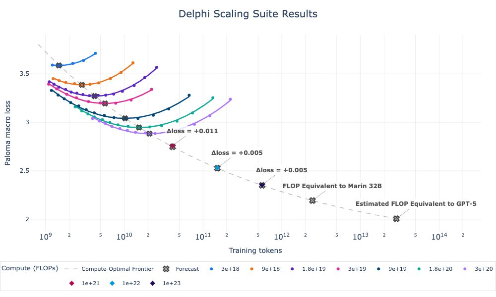
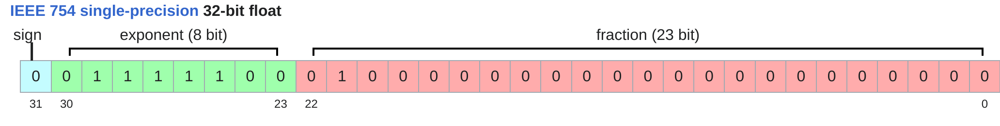
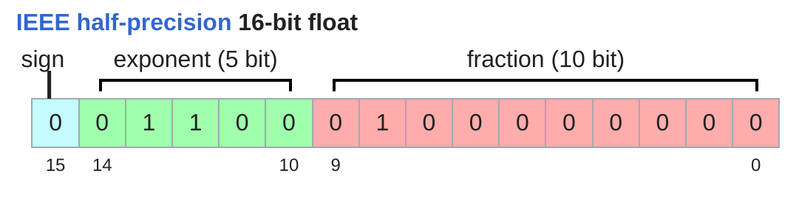
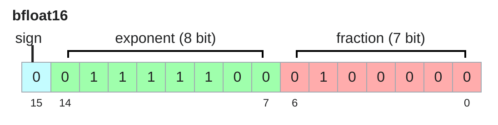
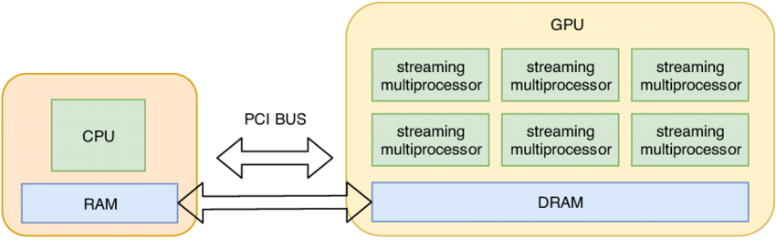
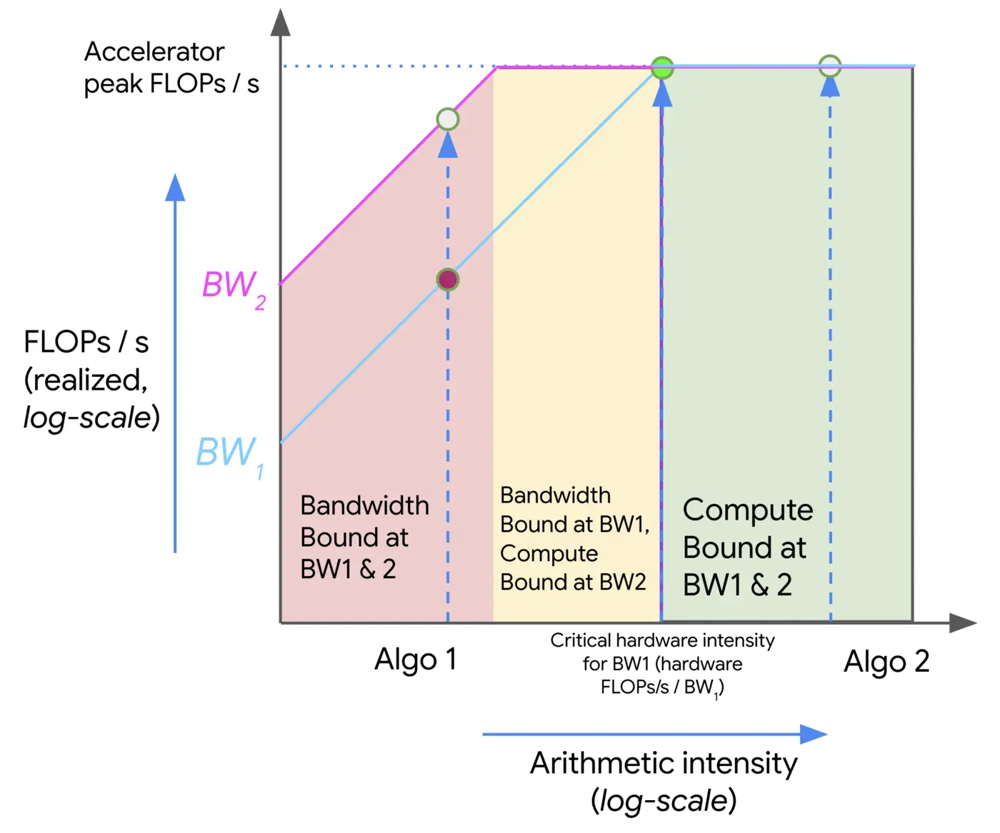
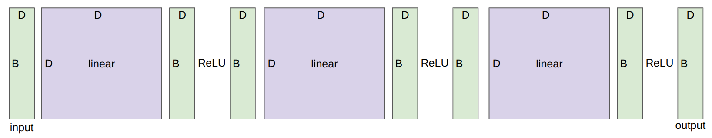

(cs336-02-cover)=
# Lecture 02: Resource accounting

Stanford CS336 · Language Modeling from Scratch · Spring 2026.


(cs336-02-topic-001)=
## Resource accounting

Announcements:

- Join the CS336 slack
- Sign up on Modal with your **Stanford** email
- Read the [AI policy guide](https://docs.google.com/document/d/1SZAlExB1qAc9izHt54gwunNpjKE6wXb8Y7yA_e-baK8/edit?tab=t.0)
- Read the [cluster guide](https://docs.google.com/document/d/1cHE0iKVyXLJ3XpIs2XuXTmZ-HMmPk2hIPeCvy-AydMg/edit?tab=t.otis27tacaef)

Marin 1e23 FLOPs run finished and [matched forecasts](https://x.com/WilliamBarrHeld/status/2039373983632814318)!



Last lecture: overview, tokenization

Today: resource accounting (systems)

Recall: what's the best model one can train given fixed resources (compute, memory)?

In other words: maximize (computational) **efficiency**.

Prerequisite: understand the resources (compute, memory) for a given computation.

**Question**: How long would it take to train a 70B parameter model on 15T tokens on 1024 H100s?

| Variable | Value |
| --- | --- |
| `total_flops` | 6.3e+24 |

| Variable | Value |
| --- | --- |
| `flops_per_day` | 4.37723136e+22 |

| Variable | Value |
| --- | --- |
| `days` | 143.92659381842682 |

**Question**: What's the largest model that can you can train on 8 H100s using AdamW?

| Variable | Value |
| --- | --- |
| `h100_bytes` | 80000000000.0 |

| Variable | Value |
| --- | --- |
| `bytes_per_parameter` | 12 |

| Variable | Value |
| --- | --- |
| `num_parameters` | 53333333333.333336 |

Caveat: activations are not accounted for (depends on batch size and sequence length), so this is an upper bound.

This is a rough back-of-the-envelope calculation.

But it gives you the flavor of napkin math one can quickly do to get a sense of resources.

What knowledge to take away from this lecture:

- Mechanics: straightforward (PyTorch semantics)
- Mindset: resource accounting (remember to do it)
- Intuitions: get a sense of how resources are spent, no ML magic today

Tensors are the basic building block for storing everything:

- data
- parameters
- gradients
- optimizer state
- activations

Example: parameters of the DeepSeek v3.2 model [DeepSeek-AI+ 2025](https://arxiv.org/abs/2512.02556) [DeepSeek v3.2 model on Hugging Face](https://huggingface.co/deepseek-ai/DeepSeek-V3.2?show_file_info=model.safetensors.index.json)

Each tensor has a rank, which is the number of dimensions.

**`x`** (torch.float32 · 4)

```python
[0.0, 0.0, 0.0, 0.0]
```

**`x`** (torch.float32 · 4 × 8)

```python
[[0.0, 0.0, 0.0, 0.0, 0.0, 0.0, 0.0, 0.0], [0.0, 0.0, 0.0, 0.0, 0.0, 0.0, 0.0, 0.0],
 [0.0, 0.0, 0.0, 0.0, 0.0, 0.0, 0.0, 0.0], [0.0, 0.0, 0.0, 0.0, 0.0, 0.0, 0.0, 0.0]]
```

**`x`** (torch.float32 · 4 × 8 × 2)

```python
[[[0.0, 0.0], [0.0, 0.0], [0.0, 0.0], [0.0, 0.0], [0.0, 0.0], [0.0, 0.0], [0.0, 0.0],
  [0.0, 0.0]],
 [[0.0, 0.0], [0.0, 0.0], [0.0, 0.0], [0.0, 0.0], [0.0, 0.0], [0.0, 0.0], [0.0, 0.0],
  [0.0, 0.0]],
 [[0.0, 0.0], [0.0, 0.0], [0.0, 0.0], [0.0, 0.0], [0.0, 0.0], [0.0, 0.0], [0.0, 0.0],
  [0.0, 0.0]],
 [[0.0, 0.0], [0.0, 0.0], [0.0, 0.0], [0.0, 0.0], [0.0, 0.0], [0.0, 0.0], [0.0, 0.0],
  [0.0, 0.0]]]
```

In Transformers, will see tensors of rank 4:

Elements of tensors are generally floating point numbers.

(cs336-02-topic-002)=
## fp32

[Wikipedia](https://en.wikipedia.org/wiki/Single-precision_floating-point_format)



The fp32 data type (also known as float32 or single precision) is the default.

Traditionally, in scientific computing, fp32 is the baseline; you could use double precision (fp64) in some cases.

In deep learning, you can be a lot sloppier.

Let's examine memory usage of these tensors.

Memory is determined by the (i) number of values and (ii) data type of each value.

**`x`** (torch.float32 · 4 × 8)

```python
[[0.0, 0.0, 0.0, 0.0, 0.0, 0.0, 0.0, 0.0], [0.0, 0.0, 0.0, 0.0, 0.0, 0.0, 0.0, 0.0],
 [0.0, 0.0, 0.0, 0.0, 0.0, 0.0, 0.0, 0.0], [0.0, 0.0, 0.0, 0.0, 0.0, 0.0, 0.0, 0.0]]
```

One matrix in the feedforward layer of GPT-3:

(cs336-02-topic-003)=
## fp16

[Wikipedia](https://en.wikipedia.org/wiki/Half-precision_floating-point_format)



The fp16 data type (also known as float16 or half precision) cuts down the memory.

**`x`** (torch.float16 · 4 × 8)

```python
[[0.0, 0.0, 0.0, 0.0, 0.0, 0.0, 0.0, 0.0], [0.0, 0.0, 0.0, 0.0, 0.0, 0.0, 0.0, 0.0],
 [0.0, 0.0, 0.0, 0.0, 0.0, 0.0, 0.0, 0.0], [0.0, 0.0, 0.0, 0.0, 0.0, 0.0, 0.0, 0.0]]
```

However, the dynamic range (especially for small numbers) isn't great.

**`x`** (torch.float16 · 1)

```python
[0.0]
```

If this happens when you train, you can get instability.

(cs336-02-topic-004)=
## bf16

[Wikipedia](https://en.wikipedia.org/wiki/Bfloat16_floating-point_format)



Google Brain developed brain floating point (bf16) in 2018 to address this issue.

bf16 uses the same memory as fp16 but has the same dynamic range as fp32!

The only catch is that the resolution is worse, but this matters less for deep learning.

**`x`** (torch.bfloat16 · 1)

```python
[1.0011717677116394e-08]
```

(cs336-02-topic-005)=
## Mixed precision

Implications on training:

- Training with fp32 works, but requires lots of memory.
- Training with fp16 and even bf16 is risky, and you can get instability.

Solution: mixed precision training [Micikevicius+ 2017](https://arxiv.org/pdf/1710.03740.pdf)

- Use bf16 for parameters, activations, and gradients
- Use fp32 for optimizer states

Pytorch has an automatic mixed precision (AMP) library. [docs](https://pytorch.org/docs/stable/amp.html)

Tries to cast things into bf16 when safe (matmuls, not exp).

**`x`** (torch.float32 · 4 × 8)

```python
[[0.0, 0.0, 0.0, 0.0, 0.0, 0.0, 0.0, 0.0], [0.0, 0.0, 0.0, 0.0, 0.0, 0.0, 0.0, 0.0],
 [0.0, 0.0, 0.0, 0.0, 0.0, 0.0, 0.0, 0.0], [0.0, 0.0, 0.0, 0.0, 0.0, 0.0, 0.0, 0.0]]
```

(cs336-02-topic-006)=
## fp8

In 2022, fp8 was standardized, motivated by machine learning workloads [primer](https://docs.nvidia.com/deeplearning/transformer-engine/user-guide/examples/fp8_primer.html).


H100s support two variants of FP8: E4M3 (range [-448, 448]) and E5M2 ([-57344, 57344]).

Reference: [Micikevicius+ 2022](https://arxiv.org/pdf/2209.05433.pdf)

(cs336-02-topic-007)=
## fp4

In 2025, NVIDIA developed [nvfp4](https://developer.nvidia.com/blog/introducing-nvfp4-for-efficient-and-accurate-low-precision-inference/)

Only 4 bits per value!

Values: -6, -4, -3, -2, -1.5, -1.0, -0.5, 0.0, 0.5, 1.0, 1.5, 2, 3, 4, 6

Use a separate scale factor per block, so actually get more dynamic range (but just can't vary freely from neighbors).

Nemotron 3 Super was trained in NVFP4 [Nemotron 3 Super: Open, Efficient Mixture-of-Experts Hybrid Mamba-Transformer Model for Agentic Reasoning](https://research.nvidia.com/labs/nemotron/files/NVIDIA-Nemotron-3-Super-Technical-Report.pdf)

Some of this is done in NVIDIA libraries outside of user control.

By default, tensors are stored in CPU memory.

However, what about GPUs?



| Variable | Value |
| --- | --- |
| `device` | cuda:0 |

In order to take advantage of the massive parallelism of GPUs, we need to move them to GPU memory.

Or create the tensor directly on the GPU:

Traditional PyTorch code:

**`x`** (torch.float32 · 2 × 2 × 3)

```python
[[[1.0, 1.0, 1.0], [1.0, 1.0, 1.0]], [[1.0, 1.0, 1.0], [1.0, 1.0, 1.0]]]
```

**`y`** (torch.float32 · 2 × 2 × 3)

```python
[[[1.0, 1.0, 1.0], [1.0, 1.0, 1.0]], [[1.0, 1.0, 1.0], [1.0, 1.0, 1.0]]]
```

**`z`** (torch.float32 · 2 × 2 × 2)

```python
[[[3.0, 3.0], [3.0, 3.0]], [[3.0, 3.0], [3.0, 3.0]]]
```

Easy to mess up the dimensions (what is -2, -1?)...

Einops is a library for manipulating tensors where dimensions are named.

It is inspired by Einstein summation notation (Einstein, 1916). [Einops tutorial](https://einops.rocks/1-einops-basics/)

Einsum is generalized matrix multiplication with good bookkeeping.

**`x`** (torch.float32 · 3 × 4)

```python
[[1.0, 1.0, 1.0, 1.0], [1.0, 1.0, 1.0, 1.0], [1.0, 1.0, 1.0, 1.0]]
```

**`y`** (torch.float32 · 4 × 3)

```python
[[1.0, 1.0, 1.0], [1.0, 1.0, 1.0], [1.0, 1.0, 1.0], [1.0, 1.0, 1.0]]
```

**`z`** (torch.float32 · 3 × 3)

```python
[[4.0, 4.0, 4.0], [4.0, 4.0, 4.0], [4.0, 4.0, 4.0]]
```

Let's try a more complex example...

**`x`** (torch.float32 · 2 × 3 × 4)

```python
[[[1.0, 1.0, 1.0, 1.0], [1.0, 1.0, 1.0, 1.0], [1.0, 1.0, 1.0, 1.0]],
 [[1.0, 1.0, 1.0, 1.0], [1.0, 1.0, 1.0, 1.0], [1.0, 1.0, 1.0, 1.0]]]
```

**`y`** (torch.float32 · 2 × 3 × 4)

```python
[[[1.0, 1.0, 1.0, 1.0], [1.0, 1.0, 1.0, 1.0], [1.0, 1.0, 1.0, 1.0]],
 [[1.0, 1.0, 1.0, 1.0], [1.0, 1.0, 1.0, 1.0], [1.0, 1.0, 1.0, 1.0]]]
```

**`z`** (torch.float32 · 2 × 3 × 3)

```python
[[[4.0, 4.0, 4.0], [4.0, 4.0, 4.0], [4.0, 4.0, 4.0]],
 [[4.0, 4.0, 4.0], [4.0, 4.0, 4.0], [4.0, 4.0, 4.0]]]
```

Dimensions that are not named in the output are summed over.

You can reduce a single tensor via some operation (e.g., sum, mean, max, min).

**`y`** (torch.float32 · 2 × 3)

```python
[[4.0, 4.0, 4.0], [4.0, 4.0, 4.0]]
```

Sometimes, a dimension represents two dimensions

...and you want to operate on one of them.

**`x`** (torch.float32 · 3 × 8)

```python
[[1.0, 1.0, 1.0, 1.0, 1.0, 1.0, 1.0, 1.0], [1.0, 1.0, 1.0, 1.0, 1.0, 1.0, 1.0, 1.0],
 [1.0, 1.0, 1.0, 1.0, 1.0, 1.0, 1.0, 1.0]]
```

...where `total_hidden` is a flattened representation of `heads * hidden1`

**`w`** (torch.float32 · 4 × 4)

```python
[[1.0, 1.0, 1.0, 1.0], [1.0, 1.0, 1.0, 1.0], [1.0, 1.0, 1.0, 1.0], [1.0, 1.0, 1.0, 1.0]]
```

**`x`** (torch.float32 · 3 × 2 × 4)

```python
[[[1.0, 1.0, 1.0, 1.0], [1.0, 1.0, 1.0, 1.0]],
 [[1.0, 1.0, 1.0, 1.0], [1.0, 1.0, 1.0, 1.0]],
 [[1.0, 1.0, 1.0, 1.0], [1.0, 1.0, 1.0, 1.0]]]
```

**`x`** (torch.float32 · 3 × 2 × 4)

```python
[[[4.0, 4.0, 4.0, 4.0], [4.0, 4.0, 4.0, 4.0]],
 [[4.0, 4.0, 4.0, 4.0], [4.0, 4.0, 4.0, 4.0]],
 [[4.0, 4.0, 4.0, 4.0], [4.0, 4.0, 4.0, 4.0]]]
```

**`x`** (torch.float32 · 3 × 8)

```python
[[4.0, 4.0, 4.0, 4.0, 4.0, 4.0, 4.0, 4.0], [4.0, 4.0, 4.0, 4.0, 4.0, 4.0, 4.0, 4.0],
 [4.0, 4.0, 4.0, 4.0, 4.0, 4.0, 4.0, 4.0]]
```

Having gone through all the operations, let us examine their computational cost.

A floating-point operation (FLOP) is a basic operation like addition (x + y) or multiplication (x y).

Two terribly confusing acronyms (pronounced the same!):

- FLOPs: floating-point operations (measure of computation done)
- FLOP/s: floating-point operations per second (also written as FLOPS), which is used to measure the speed of hardware.

(cs336-02-topic-008)=
## Intuitions

Training GPT-3 (2020) took 3.14e23 FLOPs. [article](https://lambdalabs.com/blog/demystifying-gpt-3)

Training GPT-4 (2023) is speculated to take 2e25 FLOPs. [article](https://patmcguinness.substack.com/p/gpt-4-details-revealed)

H100 has a peak performance of 1979 teraFLOP/s with sparsity, 50% without [spec](https://resources.nvidia.com/en-us-tensor-core/nvidia-tensor-core-gpu-datasheet)

8 H100s for 2 weeks:

| Variable | Value |
| --- | --- |
| `total_flops` | 9.5751936e+21 |

(cs336-02-topic-009)=
## Linear model

How many FLOPs is this matmul?

We have one multiplication (x[i][j] * w[j][k]) and one addition per (i, j, k) triple.

| Variable | Value |
| --- | --- |
| `actual_num_flops` | 8796093022208 |

We can also time this operation to see how long it takes.

| Variable | Value |
| --- | --- |
| `actual_time` | 0.16473602780000007 |

The actual FLOP/s of this operation:

| Variable | Value |
| --- | --- |
| `actual_flop_per_sec` | 53395077808280.12 |

Each GPU has a specification sheet that provides the peak performance.

- Example: [H100 spec](https://resources.nvidia.com/en-us-gpu-resources/h100-datasheet-24306)

Note that the FLOP/s depends heavily on the data type!

| Variable | Value |
| --- | --- |
| `properties.name` | NVIDIA H100 80GB HBM3 |

| Variable | Value |
| --- | --- |
| `promised_flop_per_sec` | 67500000000000.0 |

(cs336-02-topic-010)=
## Model FLOPs utilization (MFU)

Definition: MFU = (actual FLOP/s) / (promised FLOP/s) [ignore communication/overhead]

| Variable | Value |
| --- | --- |
| `mfu` | 0.791038189752298 |

Usually, MFU of ≥ 0.5 is quite good!

But why is MFU not closer to 1?

To answer this question, we need to look more closely at how computations are done on GPUs...


How to compute a thing:

1. Send inputs from memory to accelerator
2. Perform computation
3. Send outputs from accelerator to memory

How long does this take?

Depends on two things:

1. Accelerator speed (FLOP/s)
2. Memory bandwidth (bytes/s)

| Variable | Value |
| --- | --- |
| `communication_time` | 1.2520310447761193e-06 |

| Variable | Value |
| --- | --- |
| `computation_time` | 1.0597028802425467e-09 |

Assume we can overlap communication and computation perfectly.

| Variable | Value |
| --- | --- |
| `total_time` | 1.2520310447761193e-06 |

What is the bottleneck?

- Memory-bound: communication time > computation time
- Compute-bound: computation time > communication time

In this case, ReLU is memory-bound.

Alternative way to see this:

Accelerator intensity: how much work can the accelerator do per byte transferred?

| Variable | Value |
| --- | --- |
| `h100_accelerator_intensity` | 295.3731343283582 |

Arithmetic intensity: how much actual work per byte for this workload?

| Variable | Value |
| --- | --- |
| `arithmetic_intensity` | 0.25 |

What is the bottleneck?

- Memory-bound: arithmetic intensity < accelerator intensity
- Compute-bound: arithmetic intensity > accelerator intensity

In general, we'll find ourselves memory bound.

Can we increase arithmetic intensity?

| Variable | Value |
| --- | --- |
| `arithmetic_intensity` | 5.0 |

Note that GeLU does more work than ReLU per byte moved, so it has higher arithmetic intensity.

But still memory-bound!

In other words, ReLU is not faster than GeLU (when doing things in an isolated way).

| Variable | Value |
| --- | --- |
| `arithmetic_intensity` | 0.49999952316306917 |

Memory-bound!

| Variable | Value |
| --- | --- |
| `arithmetic_intensity` | 0.9975633528265108 |

Memory-bound!

| Variable | Value |
| --- | --- |
| `arithmetic_intensity` | 341.1666666666667 |

Finally, compute-bound!

As long as we have large matrices, we're compute-bound (saturating the accelerator).

Training Transformers involves big matrix multiplications.

Matrix-vector product is what happens during inference, which is why inference is memory-bound.

Note: arithmetic/accelerator intensity also depends on the precision (bf16 versus fp32).

We can visualize the relationship between arithmetic intensity and performance using roofline plots.



- Each slice on the x-axis is a particular computation (with some arithmetic intensity)
- Each piecewise linear function corresponds to a particular hardware
- Kink is the accelerator intensity (transition from memory-bound to compute-bound)

We can now relate this back to MFU:

MFU = min(1, arithmetic-intensity / accelerator-intensity) [reference](https://jax-ml.github.io/scaling-book/roofline/)



Consider a deep network with L layers and D-dimensional inputs, activations, and outputs.

| Variable | Value |
| --- | --- |
| `num_parameters` | 192 |

**`x`** (torch.float32 · 4 × 8)

```python
[[-0.72291499376297, -0.6120545268058777, 1.6612735986709595, -1.062111258506775,
  -1.616408348083496, -0.562229573726654, 0.9921274781227112, 1.3648921251296997],
 [-0.4067245125770569, 0.33605775237083435, -1.1981796026229858, 0.4662819504737854,
  -0.8871488571166992, 0.4371821880340576, 0.5280646681785583, 2.169325351715088],
 [0.10878380388021469, -0.42200401425361633, 0.23314610123634338, 0.27144762873649597,
  0.17549186944961548, 0.20626647770404816, -0.552985429763794, 0.9418168663978577],
 [1.854123592376709, -1.4687186479568481, -0.5016686320304871, -0.6536047458648682,
  0.06595765799283981, 0.2897912561893463, 1.368851661682129, 1.2301273345947266]]
```

**`y`** (torch.float32 · 4 × 8)

```python
[[0.0235306266695261, 0.0, 0.23113322257995605, 0.0, 0.0, 0.29269376397132874, 0.0,
  0.0],
 [0.0, 0.0, 0.3809593915939331, 0.0, 0.0, 0.21591168642044067, 0.0, 0.0],
 [0.0, 0.0, 0.14147023856639862, 0.0, 0.0, 0.17523622512817383, 0.0,
  0.012988884933292866],
 [0.0, 0.0, 0.017859330400824547, 0.0, 0.0, 0.2608188986778259, 0.0, 0.0]]
```

So far, we've constructed tensors and passed them through operations (forward).

Now, we're going to compute the gradient (backward).

As a simple example, let's consider the simple linear model:

y = 0.5 (x * w - 5)^2

Forward pass: compute loss

Backward pass: compute gradients

**`w.grad`** (torch.float32 · 3)

```python
[1.0, 2.0, 3.0]
```

Let us count the FLOPs for computing gradients.


Define a simplified model (2-layer linear network):

(cs336-02-topic-011)=
## Zoom in on one layer

Let's focus on the second layer (h2 = h1 @ w2)

**Forward pass**: Recall the number of forward FLOPs:

| Variable | Value |
| --- | --- |
| `num_forward_flops` | 134217728 |

**Backward pass**: How many FLOPs is running the backward pass?

We need to compute:

- h1.grad = d loss / d h1
- w2.grad = d loss / d w2

| Variable | Value |
| --- | --- |
| `num_backward_flops` | 268435456 |

Note that the backward pass is 2x more expensive than the forward pass.

(cs336-02-topic-012)=
## Consider all layers

This was just for w2, need to apply it to all parameters in the network.

Putting it together:

- Forward pass: 2 (# data points) (# parameters) FLOPs
- Backward pass: 4 (# data points) (# parameters) FLOPs
- Total: 6 (# data points) (# parameters) FLOPs

This is for multilayer perceptrons (MLPs)

...but it turns out to be a good approximation for Transformers for short context lengths as well.

Recall our deep network.

Let's define the AdaGrad optimizer

- momentum = SGD + exponential averaging of grad
- AdaGrad = SGD + averaging by grad^2
- RMSProp = AdaGrad but with exponential averaging of grad^2
- Adam = RMSProp + momentum

AdaGrad [Duchi+ 2011](https://www.jmlr.org/papers/volume12/duchi11a/duchi11a.pdf)

**`state`**

```python
{'layers.0.weight': [[0.12565205991268158, -0.4037643373012543, -0.5802772045135498,
                      -0.09542008489370346],
                     [-0.566138744354248, 0.5806535482406616, -0.44740989804267883,
                      0.09120729565620422],
                     [-1.4790738821029663, -0.04514556750655174, -0.3360743224620819,
                      -0.5281411409378052],
                     [-0.9840545654296875, -0.32218900322914124, -0.42407146096229553,
                      -0.24516351521015167]],
 'layers.1.weight': [[0.46539613604545593, 0.6678878664970398, -0.27391934394836426,
                      0.39892899990081787],
                     [0.631434440612793, -0.0681697204709053, -1.1128594875335693,
                      -0.07139184325933456],
                     [-0.11660940200090408, -0.5985015034675598, 0.3100452721118927,
                      0.3057173490524292],
                     [0.7570882439613342, -1.1655778884887695, 0.18017065525054932,
                      0.6537290811538696]],
 'layers.2.weight': [[-1.085352897644043, -0.4440416693687439, -0.15685807168483734,
                      -0.03024565801024437],
                     [-0.5796391367912292, -0.1088181585073471, 1.346548080444336,
                      -0.027938872575759888],
                     [-0.3900461494922638, 0.3673260807991028, 0.5264703035354614,
                      -0.1486826241016388],
                     [-0.9801381230354309, -0.0005752771976403892, -0.6993281841278076,
                      -0.6743273138999939]]}
```

**`optimizer_state`**

```python
{'0': {'g2': [[0.5346072316169739, 0.0, 0.0, 0.0], [0.04465468227863312, 0.0, 0.0, 0.0],
              [0.050645485520362854, 0.0, 0.0, 0.0],
              [0.07512986660003662, 0.0, 0.0, 0.0]]},
 '1': {'g2': [[0.0018079879228025675, 0.13323718309402466, 0.0, 0.03593716025352478],
              [0.0, 0.0, 0.0, 0.0], [0.0, 0.0, 0.0, 0.0], [0.0, 0.0, 0.0, 0.0]]},
 '2': {'g2': [[0.0, 0.0, 0.015915758907794952, 0.0],
              [0.0, 0.0, 0.032778482884168625, 0.0], [0.0, 0.0, 0.0, 0.0],
              [0.0, 0.0, 0.011694265529513359, 0.0]]}}
```

(cs336-02-topic-013)=
## Memory

| Variable | Value |
| --- | --- |
| `parameter_memory` | 96 |

| Variable | Value |
| --- | --- |
| `gradient_memory` | 96 |

| Variable | Value |
| --- | --- |
| `optimizer_state_memory` | 192 |

| Variable | Value |
| --- | --- |
| `activation_memory` | 48 |

It is customary to use fp32 for stability (accumulating averages over powers over many steps).

Optimizer state memory:

- AdaGrad: 4 bytes/parameter for storing second moments
- Adam: 8 bytes/parameter for storing first and second moments

| Variable | Value |
| --- | --- |
| `total_memory` | 432 |

(cs336-02-topic-014)=
## Compute (for one training step)

| Variable | Value |
| --- | --- |
| `flops` | 576 |

(cs336-02-topic-015)=
## Transformers

The accounting for a Transformer is more complicated, but the same idea.

Assignment 1 will ask you to do that.

Blog post describing memory usage for Transformer training [article](https://erees.dev/transformer-memory/)

Blog post describing FLOPs for a Transformer: [article](https://www.adamcasson.com/posts/transformer-flops)

Large batch sizes: improve training stability

However, activation memory scales with batch size, so might run out.

| Variable | Value |
| --- | --- |
| `activation_memory` | 2097152 |

Gradient accumulation:

- Compute gradient on micro batches
- Accumulate the gradients (don't zero it out)
- Every batch_size / micro_batch_size steps, update the parameters and zero out the gradients

| Variable | Value |
| --- | --- |
| `activation_memory` | 8388608 |

For training, we need to store the activations of all layers

For inference, we don't compute gradients, so we only need to store the current layer's activations.


The memory usage is

| Variable | Value |
| --- | --- |
| `activation_memory` | 2097152 |

| Variable | Value |
| --- | --- |
| `memory` | 202114048 |

Can we reduce this?

Activation checkpointing = gradient checkpointing = rematerialization

Key idea:

- Forward pass: keep only activations at subset of layers
- Backward pass: recompute the missing activations from the last checkpoint

Philosophy: tradeoff memory for compute

| Variable | Value |
| --- | --- |
| `checkpointed_memory` | 202900480 |

Can we reduce this even more, especially for deep networks (large L)?

How frequently to checkpoint?

- If store each layer's activations, then activation memory is O(L) and no recomputation.
- If store no activations, then activation memory is O(1) and compute is O(L^2) (recompute from the start for each layer).
- If store every sqrt(L) layers, then activation memory is O(sqrt(L)) and O(L) recomputation.

Summary:

- Everything is operations on tensors (parameters, gradients, activations, optimizer states, data)
- einops: better way to think about tensor operations
- 6 (# data points) (# parameters) FLOPs per training step
- Arithmetic intensity / roofline analysis: compute-bound or memory-bound?
- Matrix multiplications are compute-bound, elementwise operations are memory-bound
- Gradient accumulation, activation checkpointing: reduce memory to use bigger batch sizes
