(cs336-03-cover)=
# Lecture 03: Architectures and hyperparameters

Stanford CS336 · Language Modeling from Scratch · Spring 2026.

(cs336-03-page-001)=

## Lecture 3

Everything you didn’t want to know about LM architecture and hyperparameters

CS336 Tatsu H

(cs336-03-page-002)=

## Outline and goals

- Quick recap of a modern transformer (what you implement) 
- What do most of the large LMs have in common? 
- What are common variations to the architecture / training process? Today’s theme: the best way to learn is hands-on experience the second best way is to try to learn from others’ experience

(cs336-03-page-003)=

## Starting point: the ‘original’ transformer

**Review:** choices in the standard transformer

**Position embedding:** sines and cosines

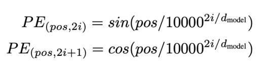

**FFN:** ReLU

**Norm type:** post-norm, LayerNorm

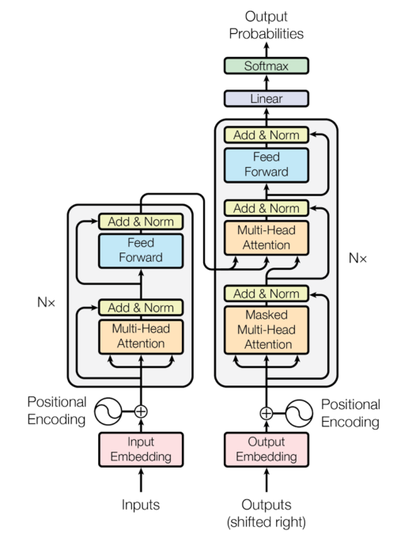

(cs336-03-page-004)=

## What you implemented – simple, modern variant

**Differences:**

**LayerNorm** is in front of the block

**Rotary position embeddings (RoPE)**

FF layers use **SwiGLU**, not ReLU

- **no**
Linear layers (and layernorm) have
**bias** (constant) terms

**Why did we pick these?**

**What should you pick?**

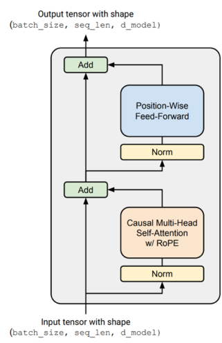

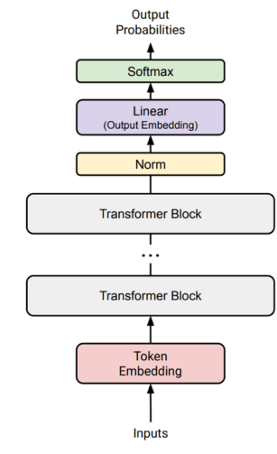

(cs336-03-page-005)=

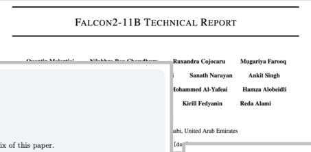
## How should we think about architectures?

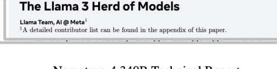

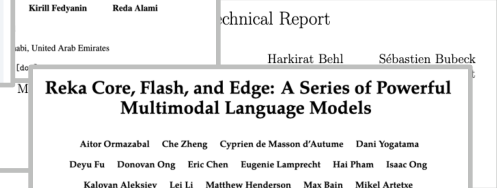

Over 19 new dense model releases, many of them with minor architecture tweaks..

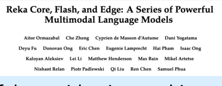

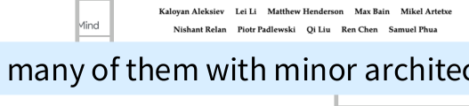

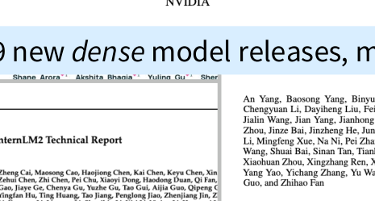

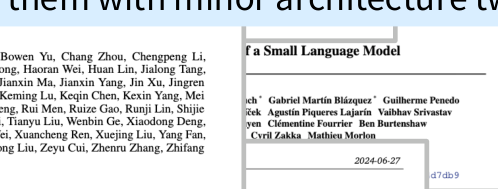

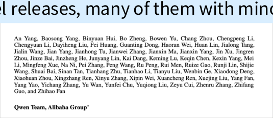

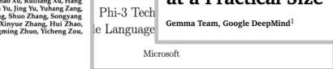

(cs336-03-page-006)=

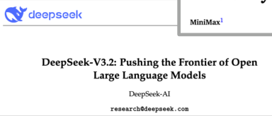

There can’t be _that_ many LLMs released this year right?

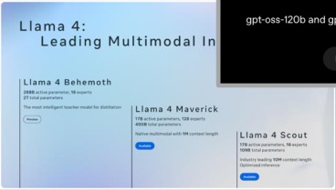

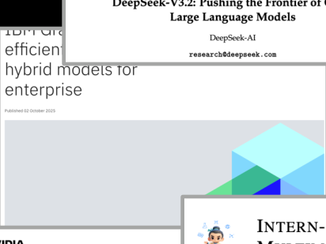

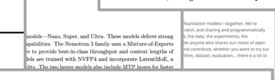

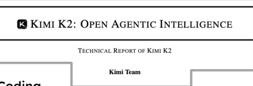

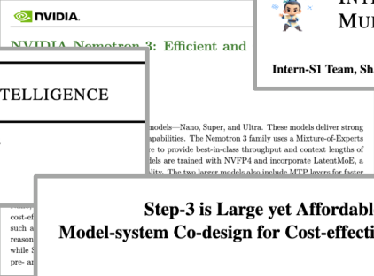

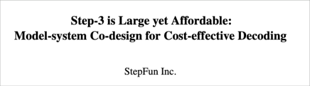

(cs336-03-page-007)=

## Let’s look at the data (on dense architectures)

Learn from the many other models (and papers) out there

**We will talk through many major**
**architecture and hyperparameter variants.**

What do all these models have in common?

What parts vary?

What can we learn from this?

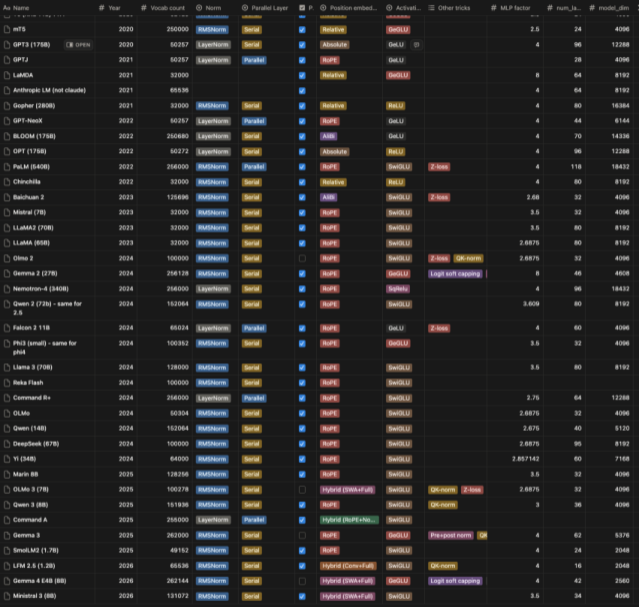

(cs336-03-page-008)=

## What are we going to cover?

**Common architecture variations**

Activations, FFN

Attention variants

Position embeddings

**Hyperparameters that (do or don’t) matter**

What is ff_dim? Do multi_head dims always sum to model_dim?

How many vocab elements?

**Stability tricks**

(cs336-03-page-009)=

## Architecture variations..

Let’s think about the core architecture piece

High level view:** 
- Dominance of ‘LLaMA- like’ architectures 
- Trends over the years (QK-norm, Hybrid attention)

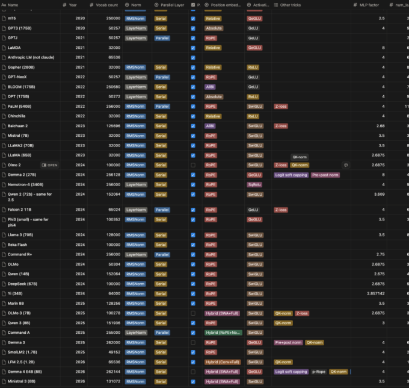

(cs336-03-page-010)=

## Pre-vs-post norm

The one thing _everyone_ agrees on (in 2024)

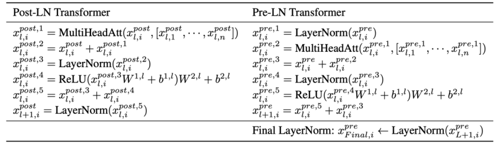

Set up LayerNorm so that it doesn’t affect the

main residual signal path (on the left)

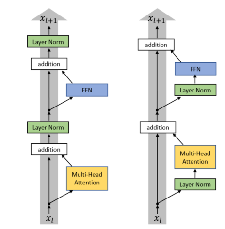

Figure from Xiong 2020

**Almost all modern LMs use pre-norm (but BERT was post-norm)**

(One somewhat funny exception – OPT350M. I don’t know why this is post-norm)

(cs336-03-page-011)=

## Pre-vs-post-norm, the data

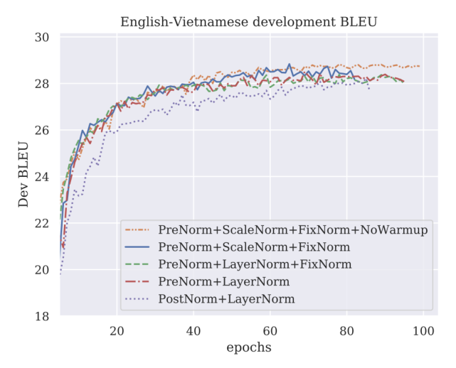

Salazar and Ngyuen 2019

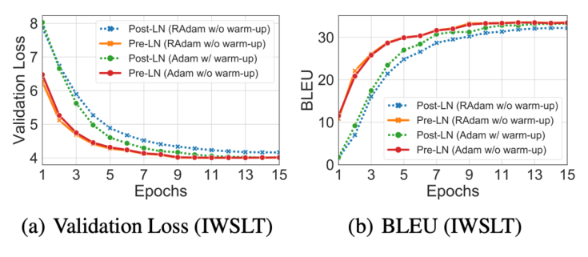
Figure from Xiong 2020

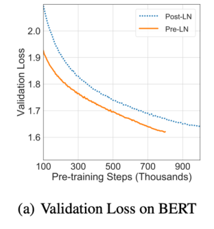

(cs336-03-page-012)=

## Pre-vs-post norm, explanations?

Gradient attenuation [Xiong 2020] Gradient spikes [Salazar and Ngyuen]

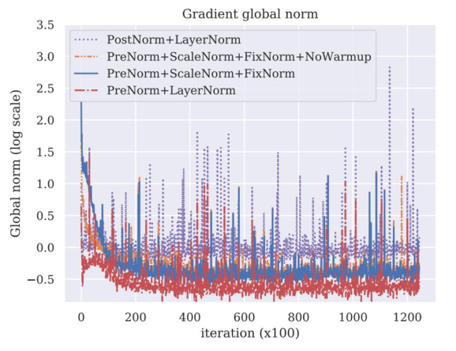

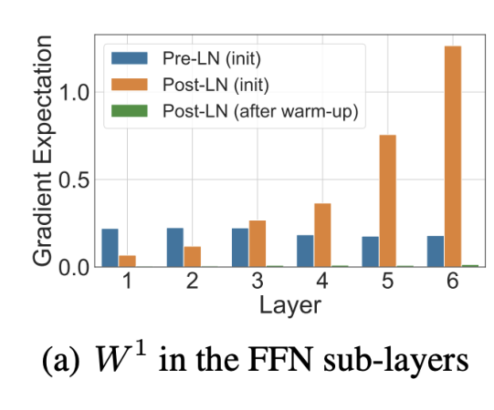

Original stated advantage – removing warmup. Today – stability and larger LRs for large networks

(cs336-03-page-013)=

## New things – ‘double’ norm or non-residual postnorm

If putting LayerNorms in residual streams is bad.. Why not post-norm outside the stream?

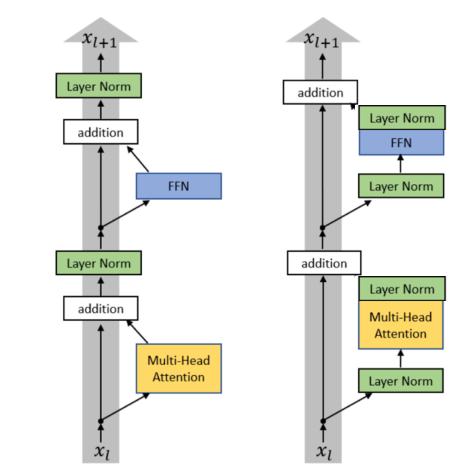

Recent models: Grok, Gemma 2. Olmo 2 only does non-residual post norm

(cs336-03-page-014)=

## LayerNorm vs RMSNorm

Original transformer: **LayerNorm** – normalizes

the mean and variance across 𝑑 𝑚𝑜𝑑𝑒𝑙

Many modern LMs: **RMSNorm** – does not

subtract mean or add a bias term

**Notable models:**

GPT3/2/1, OPT, GPT-J, BLOOM

**Notable models:**

LLaMA-family, PaLM, Chinchilla, T5

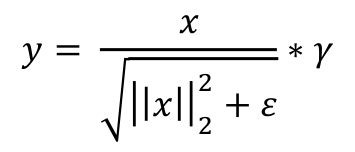

(cs336-03-page-015)=

## Why RMSNorm?

**Modern explanation** – it’s faster (and just as good).

**Fewer operations** (no mean calculation)

**Fewer parameters** (no bias term to store)

**Does this explanation make sense?**

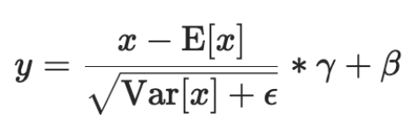

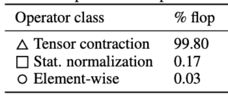

Matrix multiplies are the vast majority of FLOPs (and memory)

[Ivanov et al 2023]

(cs336-03-page-016)=

## Why RMSNorm (2)

**Important lesson:** FLOPS are not runtime! (we will discuss this in far more detail later)

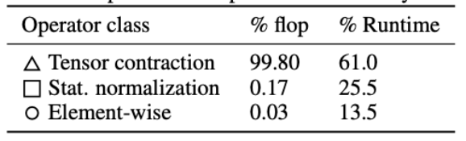

RMSNorm can still matter due to the importance of data movement

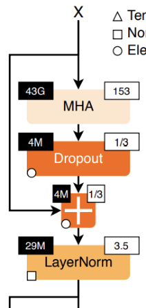

Left top (”43G”) is FLOPS
Right top (“153”) is the FLOP-to-memory ratio

[Ivanov et al 2023]

(cs336-03-page-017)=

## RMSNorm - validation

**RMSNorm** runtime (and surprisingly, perf) gains have been seen in papers

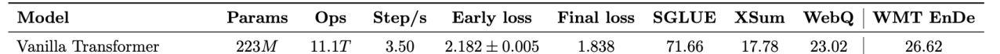

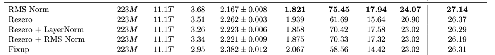

Narang et al 2020

(cs336-03-page-018)=

## More generally: dropping bias terms

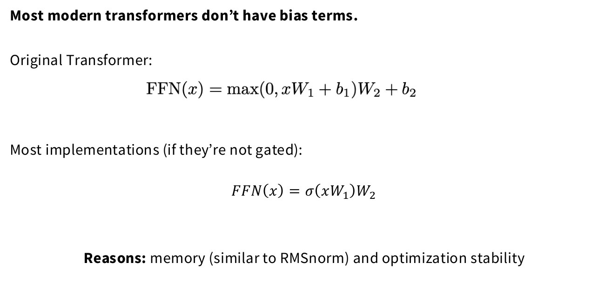

(cs336-03-page-019)=

## LayerNorm: recap

- Basically everyone does non-residual norm (often prenorm)

-

Intuition – keep the good parts of residual connections

-

Observations – nicer gradient propagation, fewer spike

-

Some people add a second norm outside the residual stream

- Most people do RMSnorm

-

In practice, works as well as LayerNorm

-

But, has fewer parameters to move around, which saves on wallclock time

-

People more generally drop bias terms since the compute/param tradeoffs are not

great.

(cs336-03-page-020)=

## Activations

**A whole zoo of activations** ..

ReLU, GeLU, Swish, ELU, GLU, GeGLU, ReGLU, SeLU, SwiGLU, LiGLU

What are these things? What do people use? Does it matter?

(cs336-03-page-021)=

## A few of the common activations

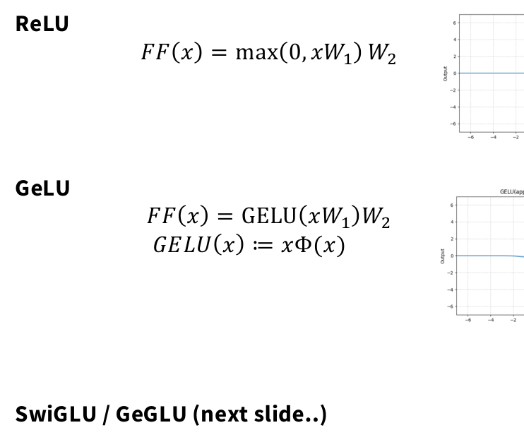

**Notable models:**

Original transformer, T5,
Gopher, Chinchilla, OPT

**Notable models:**

GPT1/2/3, GPTJ, GPT-Neox,

BLOOM

**Notable models:**

Llama, PaLM,T5 v1.1, _most_
models post 2023

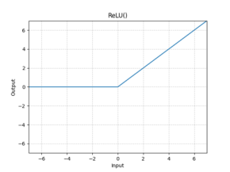

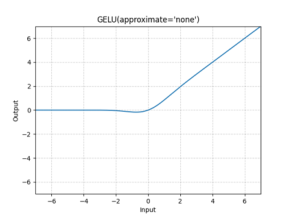

(cs336-03-page-022)=

## Gated activations (*GLU)

GLUs modify the ‘first part’ of a FF layer

Instead of a linear + ReLU, augment the above with an (entrywise) linear term

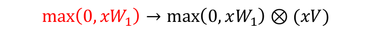

This gives the gated variant (ReGLU) – note that we have an extra parameter (V)

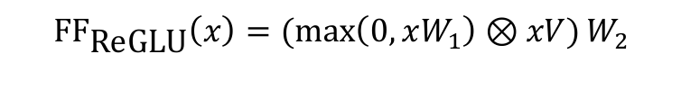

(cs336-03-page-023)=

## Gated variants of standard FF layers

GeGLU

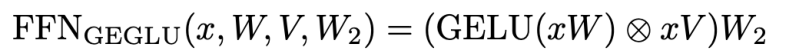

SwiGLU (swish is 𝑥∗sigmoid(𝑥))

**Notable models:**

T5 v1.1, mT5, LaMDA, Phi3,
Gemma 2, Gemma 3, Gemma 4

**Notable models:**

LLaMa 1/2/3, PaLM, Mistral,
OlMo, _most models post 2023_

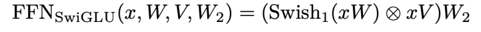

Note: Gated models use smaller dimensions for the 𝑑 𝑓𝑓 by 2/3

(cs336-03-page-024)=

## Do gated linear units work?

Yes, fairly consistently so.

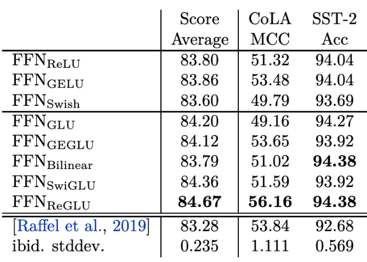

Shazeer 2020

(cs336-03-page-025)=

## Do gated linear units work (2)?

Yes, with other works corroborating Shazeer 2020

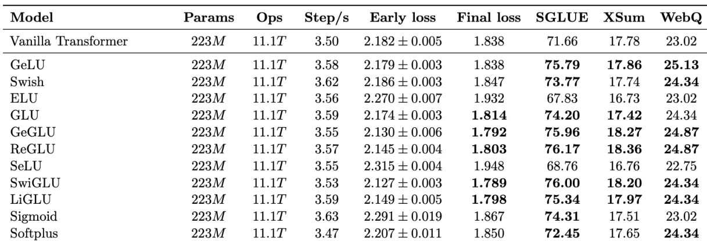

Narang et al 2020

(cs336-03-page-026)=

## Gating, activations

**Many variations (ReLU, GeLU, *GLU) across models.**

***GLU isn’t** _**necessary**_ **for a working model (see GPT3), but it’s rare to see others..**

Some outlier models..

Nemotron 340B (Squared ReLU)

**Evidence points towards somewhat consistent gains from Swi/GeGLU**

(cs336-03-page-027)=

## Serial vs Parallel layers

Normal transformer blocks are _serial_ – they compute attention, then the MLP

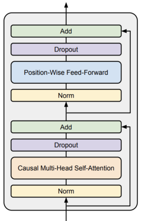

Could we parallelize the transformer block?

(cs336-03-page-028)=

## Parallel layers

A few models (GPTJ, PaLM, GPT-NeoX) do parallel layers. Originally in GPT-J

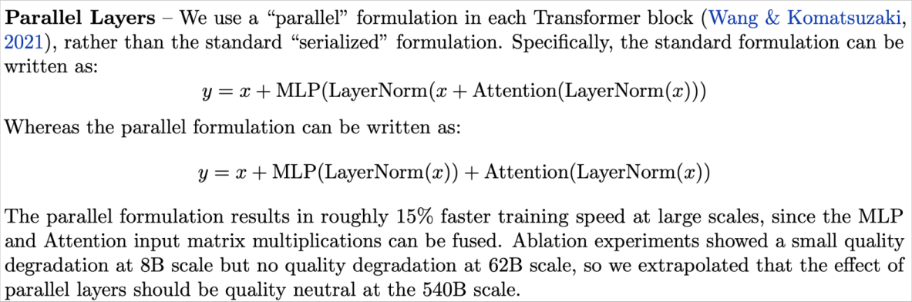

If implemented right, LayerNorm can be shared, and matrix multiplies can be fused

Recent Models: Cohere Command A, Falcon 2 11B, Command R+

(cs336-03-page-029)=

## Summary: architectures

Pre-vs-post norm:** 
- Everyone does non-residual norm (except OPT350M), likely with good reason.

**Layer vs RMSnorm:**

- RMSnorm has clear compute wins, sometimes even performance **Gating:** 
- GLUs are consensus now **Serial vs parallel layers:** 
- Most models now use serial layers

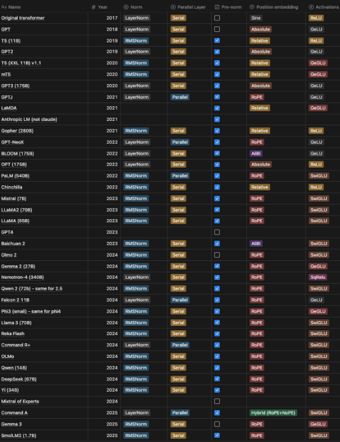

(cs336-03-page-030)=

## Many variations in position embeddings

**Notable models:**

Original transformer

**Notable models:**

GPT1/2/3, OPT

**Notable models:**

T5, Gopher, Chinchilla

**Notable models:**

GPTJ, PaLM, LLaMA
_Most 2024+ models_

**Rope embeddings** (next slides..)

(cs336-03-page-031)=

## RoPE: rotary position embeddings

(cs336-03-page-032)=

**How can we solve this problem?**

We want our embeddings to be invariant to absolute position

We know that inner products are invariant to arbitrary rotation.

we know

Position independent

embedding

we know

Embedding
“we know that”

we

know

Embedding
“of course we know”

Rotate we by ‘0 positions’ Rotate we by ‘2 positions’

know by ‘1 positions’ Rotate know by ‘3 positions’

(cs336-03-page-033)=

**There are many rotations, which one do you pick?**

[Su et al 2021]

Just pair up the coordinates and rotate them in 2d (motivation: complex numbers)

Gemma 4 alternative: just first 2

(cs336-03-page-034)=

## The actual RoPE math

Multiply with sines and cosines

Difference with sine embeddings – not additive, no cross terms

(cs336-03-page-035)=

## Implementation and code for RoPE

Usual

attention stuff

Get the RoPE
matrix cos/sin

Multiply
query/key inputs

…

Same stuff as the usual multi-head self attention below

Note: embedding at each attention operation to enforce position invariance

(cs336-03-page-036)=

## Hyperparameters

**Transformer hyperparameter questions you might have had in 224n..**

How much bigger should the feedforward size be compared to hidden size?

How many heads, and should num_heads always divide hidden size?

What should my vocab size be?

And other model setting questions

Do people even regularize these huge LMs?

How do people scale these models - very deep or very wide?

(cs336-03-page-037)=

## Surprising (?) consensus hyperparameter 1

Feedforward – model dimension ratio.

There are two dimensions that are relevant – the feedforward dim (𝑑 𝑓𝑓 ) and model dim

(𝑑 𝑚𝑜𝑑𝑒𝑙 ). What should their relationship be?

𝒅 = 𝟒 𝒅
𝒇𝒇 𝒎𝒐𝒅𝒆𝒍

This is _almost always_ true. There’s just a few exceptions.

(cs336-03-page-038)=

## Exception #1 – GLU variants

Remember that GLU variants scale down by 2/3 [rd] . This means most GLU variants have

𝑑 =
𝑓𝑓

8

3 [𝑑] [𝑚𝑜𝑑𝑒𝑙] [. This is mostly what happens. Some notable such examples.]

**Model** 𝒅 𝒇𝒇 /𝒅 𝒎𝒐𝒅𝒆𝒍

PaLM 4

Mistral 7B 3.5

LLaMA-2 70B 3.5

LLaMA 70B 2.68

Qwen 14B 2.67

DeepSeek 67B 2.68

Yi 34B 2.85

T5 v1.1 2.5

Models are roughly in this range, though PaLM, LLaMA2 and Mistral are slightly larger

(cs336-03-page-039)=

## Exception #2 – T5

Other, recent exceptions – Gemma 2 (8x), SmolLM/Gemma 3/Gemma 4 (4x, GLU)

(cs336-03-page-040)=

## Why this range of multipliers?

Empirically, there’s a basin between 1-10 where this hyperparameter is near-optimal

[Kaplan+ 2020]

(cs336-03-page-041)=

## What can we learn from the model-dim hyperparam?

The ‘default’ choices of 𝑑 𝑓𝑓 = 4𝑑 𝑚𝑜𝑑𝑒𝑙 and 𝑑 𝑓𝑓 = 2.66𝑑 𝑚𝑜𝑑𝑒𝑙 have worked well for nearly
all modern LLMs.

But T5 does show that even radical choices of 𝑑 = 64𝑑 can work. This
𝑓𝑓 𝑚𝑜𝑑𝑒𝑙
hyperparameter choice isn’t written in stone.

That said, T5 has a follow-up model (T5 v1.1) that is ‘improved’ and uses a much more
standard 2.5 multiplier on GeGLU, so the 64-times multiplier is likely suboptimal.

(cs336-03-page-042)=

## Surprising (?) consensus hyperparameter 2

Head-dim*num-heads to model-dim ratio. As a reminder, slide from 224n.

This doesn’t _have to_ be true: we can have head-dimensions > model-dim / num-heads.

But most models do follow this guideline

(cs336-03-page-043)=

## How many heads, whats the model dim?

Some examples of this hyperparameter

||Num heads|Head dim|Model dim|Ratio|
|---|---|---|---|---|
|GPT3|96|128|12288|1|
|T5|128|128|1024|16|
|T5 v1.1|64|64|4096|1|
|LaMDA|128|128|8192|2|
|PaLM|48|258|18432|1.48|
|LLaMA2|64|128|8192|1|
|Qwen 3.5 (27B)|24|256|5120|1.2|

Most models have ratios around 1 – notable exceptions by some google models.

(cs336-03-page-044)=

## Aspect ratios

Should my model be deep or wide? _How_ deep and how wide?

Most models are sur risin l consistent on this one too!
p g y

Sweet spot?

|Model|𝒅 /𝒏 𝒎𝒐𝒅𝒆𝒍 𝒍𝒂𝒚𝒆𝒓|
|---|---|
|BLOOM|205|
|T5 v1.1|171|
|PaLM (540B)|156|
|GPT3/OPT/Mistral/Qwen /OLMo 3|128|
|LLaMA / LLaMA2|102|
|Gemma 3|87|
|Gemma 4|61|
|T5 (11B)|33|

(cs336-03-page-045)=

## Considerations about aspect ratio

**Extremely deep models are harder to parallelize and have higher latency**

[Tay et al 2021]

(cs336-03-page-046)=

## Evidence on aspect ratio scaling

[Tay et al 2021]

[Kaplan et al 2020]

(cs336-03-page-047)=

## What are typical vocabulary sizes?

Monolingual models – 30-50k vocab

Multilingual / production systems 100-250k

|Model|Token count|
|---|---|
|Original transformer|37000|
|GPT|40257|
|GPT2/3|50257|
|T5/T5v1.1|32128|
|LLaMA|32000|

|Model|Token count|
|---|---|
|mT5|250000|
|PaLM|256000|
|GPT4|100276|
|Gemma 4|262144|
|DeepSeek|100000|
|Qwen 15B|152064|
|Yi|64000|

Monolingual vocabs don’t need to be huge, but multilingual ones do

(cs336-03-page-048)=

## Dropout and other regularization

Do we need regularization during pretraining?

**Arguments against:**

There is _a lot_ of data (trillions of tokens), more than parameters.

SGD only does a single pass on a corpus (hard to memorize)

This is all quite reasonable.. but what do people do in practice?

(cs336-03-page-049)=

## Dropout and weight decay in practice

Many older models used
dropout during pretraining

Newer models (except Qwen) rely
only on weight decay

|Model|Dropout*|Weight decay|
|---|---|---|
|Original transformer|0.1|0|
|GPT2|0.1|0.1|
|T5|0.1|0|
|GPT3|0.1|0.1|
|T5 v1.1|0|0|
|PaLM|0|(variable)|
|OPT|0.1|0.1|
|LLaMA|0|0.1|
|Qwen 14B|0.1|0.1|

- Most of the times papers just don’t discuss dropout. On open models, this closely matches not doing dropout.

This may not be true of closed models.

(cs336-03-page-050)=

## Why weight decay LLMs?

[Andriushchenko et al 2023] has interesting observations about LLM weight decay

It’s not to control overfitting Weight decay interacts with learning rates (cosine schedule)

(cs336-03-page-051)=

## Summary: hyperparameters

**Feedforward**

Factor-of-4 rule of thumb (8/3 for GLUs) is
standard (with some evidence)

**Head dim**

Head dim*Num head = D model is standard
– but low to no validation

**Aspect ratio**

Wide range of ‘good’ values (100-200).
Systems concerns dictate the value

**Regularization**

You still ‘regularize’ LMs but its effects are
primarily on optimization dynamics

(cs336-03-page-052)=

## Stability tricks

Recently, lots of attention on _stable training_

Don’t train models that look like the blue curve!

(cs336-03-page-053)=

## Where do the issues arise? Beware of softmaxes!

**Softmaxes** – can be ill-behaved due to exponentials / divison by zero

(cs336-03-page-054)=

## Output softmax stability – the ‘z-loss’

Recall the softmax calculation

This is useful for stability! PaLM used this ‘z loss’ trick.

[From Devlin 2014]

**Other examples:** Baichuan 2 (2023), DCLM (2024), OLMo 2 (2025), OLMo 3 (2025)

(cs336-03-page-055)=

## Attention softmax stability – the ‘QK norm’

**Other examples: DCLM, OLMo2, Gemma 2, Qwen3, OLMo 3, Gemma 4**
Originally from vision and multimodal models [Dehgani 2023, Idefcs, Chameleon]

(cs336-03-page-056)=

## Logit soft-capping.

**Soft-capping** the logits to some maximum value via Tanh

Prevents logits from blowing up, but also might have perf issues?

(cs336-03-page-057)=

## Attention heads

Most models don’t touch the attention heads much at all with a few minor exceptions..

**GQA / MQA** : Saving inference costs by reducing the number of heads

**Sparse or sliding window attention (GPT4/Mistral):** restricting the attention pattern

to reduce compute cost

**Exotic SSM stuff (Jamba, Falcon 3, Qwen 3.5, etc):** next lecture!

(cs336-03-page-058)=

## GQA/MQA – Reducing attention head cost

**Let’s think about the compute involved for attention**

X softmax projection

d = hidden dim

b = batch
n = length (&lt;d)
h = heads

k = head dim (d/h)

(cs336-03-page-059)=

What about the _incremental_ case when we generate text?

**Key difference:** can’t parallelize the generation process – needs to be step by step

In this case – we need to incrementally re-compute/update attention via the ‘KV cache’

[Animation from https://medium.com/@joaolages/kv-caching-explained-276520203249]

(cs336-03-page-060)=

What’s the incremental arithmetic intensity?

K, V projection

Is there some way around this? The n/d term is difficult to reduce.

(cs336-03-page-061)=

## MQA – just have fewer key dimensions.

**Key idea** – have multiple queries, but just one dimension for keys and values

[figure from https://blog.fireworks.ai/multi-query-attention-is-all-you-need-db072e758055]

(cs336-03-page-062)=

## Additional extensions – GQA

Don’t go all the way to one dimension of KV – have fewer dims

Simple knob to control expressiveness (key-query ratio) and inference efficiency

**More recently –** MLA (multihead latent attention) from deepseek v2

(cs336-03-page-063)=

## Does MQA hurt? Sometimes..

Small PPL hit w/ MQA [Shazeer 2019] Low/no hit w/ GQA [Ainslie 2023]

(cs336-03-page-064)=

## Sparse / sliding window attention

**Attending to the entire context can be expensive (quadratic).**

Build sparse / structured attention that trades off expressiveness vs runtime (GPT3, GPT
OSS, Gemma4)

[Child et al 2019]

(cs336-03-page-065)=

## Current standard trick – interleave ‘full’ and ‘LR’ attention

From Cohere Command A – Every 4 [th] layer is a full attention

Long-range info via NoPE, short-range info via RoPE + SWA.

**Other models –** LLaMA 4, Gemma 3, Gemma 4, OLMo 3 does SWA+Full RoPE.

(cs336-03-page-066)=

## Other recent examples of interleaved attention

Gemma 4 Olmo 3 Qwen 3.5 / Qwen 3 Next

https://newsletter.maartengrootendorst.com/p/a-visual-guide-to-gemma-4

(cs336-03-page-067)=

## Recap, conclusion, etc.

Many aspects (arch, hparams) of transformers are in common across the big LMs

Major differences? Position embeddings, activations, tokenization
