(cs336-04-cover)=
# Lecture 04: Attention alternatives and mixture of experts

Stanford CS336 · Language Modeling from Scratch · Spring 2026.

(cs336-04-page-001)=

## Lecture 4

A T T EN TI ON A LTE RNAT IV ES A ND M IX TU RES O F E XP E RT S

CS336 Tatsu H

(cs336-04-page-002)=

## Attention alternatives

Cost of attention rises with large context sizes… how do we control those costs?

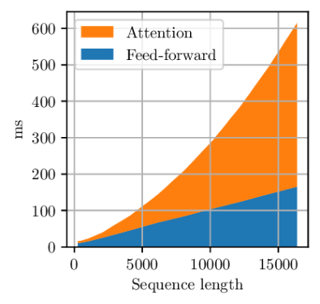

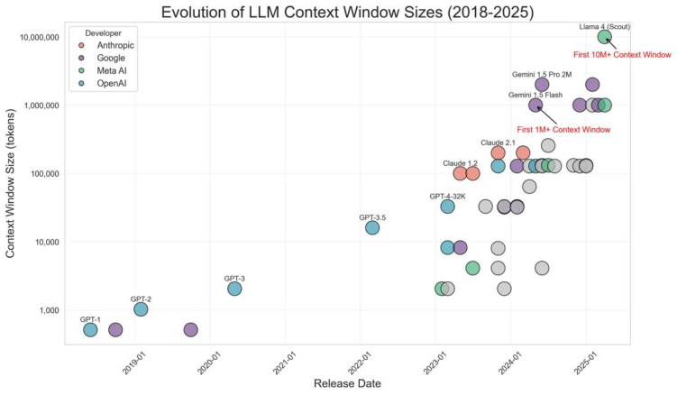

https://www.meibel.ai/post/understanding-the-impact-of-increasing-llm-context-windows

(cs336-04-page-003)=

## The ‘basic’ toolkit

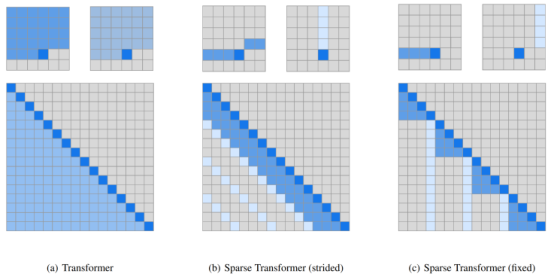

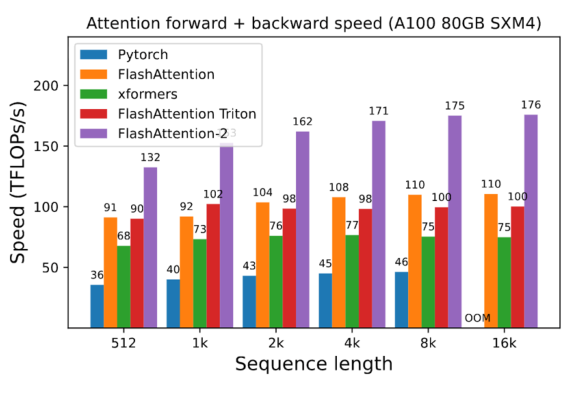

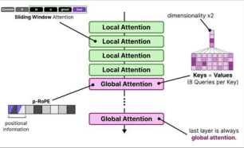

Combine local + global attention Systems engineering

But what if we want more radical and potentially large gains?

(cs336-04-page-004)=

## Linear attention

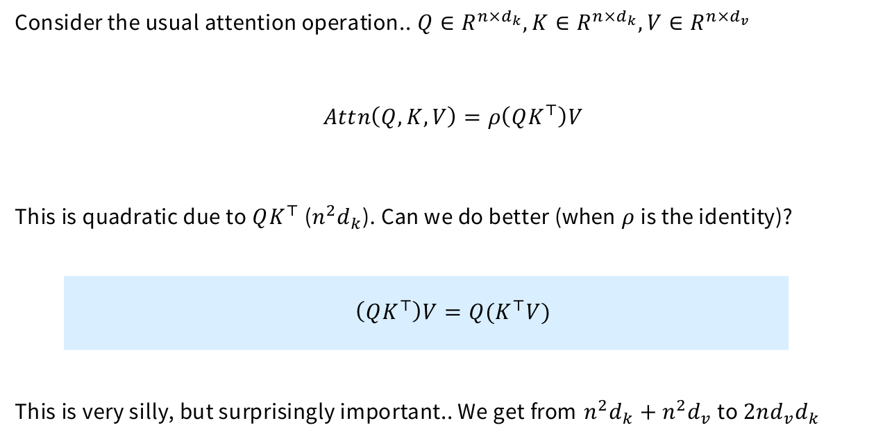

[Shen et al 2018, Katharopoulos 2020 for kernel version. Also connections to things like fast weight programmers]

(cs336-04-page-005)=

## Recurrent form of linear attention

Recall that in purely linear attention, we consider the reordering

𝑄𝐾 [⊤] 𝑉= 𝑄(𝐾 [⊤] 𝑉)

This is linear time (great) but the even nicer thing is that this looks like a RNN.

⊤ and
𝑦 𝑡 = 𝑞 𝑡

𝑆 = 𝑆 𝑣
𝑡 𝑡−1 + 𝑘 𝑡 𝑡

⊤ 𝑆

𝑡 𝑡

This ‘duality’ allows us to train efficiently (using the parallel, quadratic form) and

inference efficiently (using the serial, linear form)

(Note: if one weights 𝑆 𝑡−1 by 𝛾, you get a RetNet)

(cs336-04-page-006)=

## Minimax M1

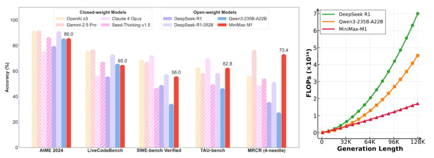

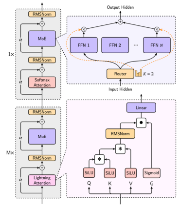

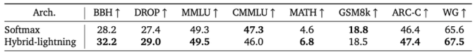

**Minimax M1** (and minimax-text-01) use a 7-to-1 hybrid (7 linear, 1 full) linear attention.

Performance (generally) seems strong, and they show linear scaling in context length

(cs336-04-page-007)=

## From linear attention to Mamba-2

Let’s generalize linear attention a little bit and add per-position weights..

𝑆 𝑡 = 𝑆 𝑡−1 + 𝑘 𝑡 𝑣 𝑡 ⊤ and  𝑦 𝑡 = 𝑞 𝑡 ⊤ 𝑆 𝑡 (Linear attention)

⊤ ⊤ ⊤

𝑆 𝑡 = 𝛾 𝑡 𝑆 𝑡−1 + 𝑘 𝑡 𝑣 𝑡 and  𝑦 𝑡 = 𝑞 𝑡 𝑆 𝑡 + 𝑣 𝑡 𝐷 with 𝛾 𝑡 = 𝑓(𝑥 𝑡 )

⊤ and
𝑦 𝑡 = 𝑞 𝑡

𝑆 = 𝑆 𝑣
𝑡 𝑡−1 + 𝑘 𝑡 𝑡

⊤ and
𝑦 𝑡 = 𝑞 𝑡

𝑡⊤ 𝑆 𝑡 + 𝑣 𝑡

⊤ 𝐷 with 𝛾 𝑡 = 𝑓(𝑥 𝑡 )(Mamba-2)

There is a lot more words to justify this (go read the mamba 2 paper) but the mechanics

is that we can make linear attention more expressive via gating (gating is good!)

This continues to have duality properties (compute 𝛾 in parallel, apply duality)

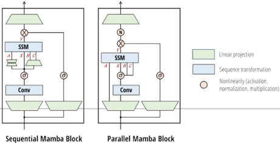

(cs336-04-page-008)=

## Nemotron 3

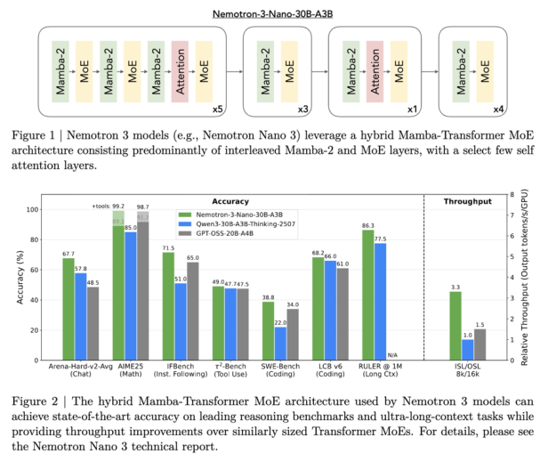

Mamba attention hybrid (3-1 ish) – comparable (or better) pref to other similar models

(cs336-04-page-009)=

## Gated delta net (and friends)

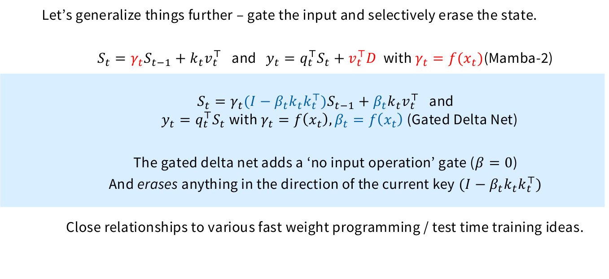

(cs336-04-page-010)=

## Qwen 3.5 / Qwen Next

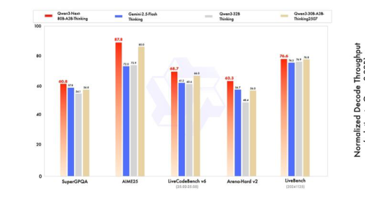

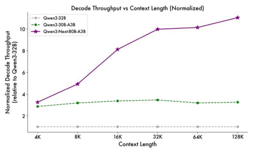

The newest qwen are 3-1 GDN / Attention hybrids.

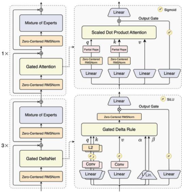

Once again, pretty reasonable performance with good inference characteristics

(cs336-04-page-011)=

## Hybrid performance

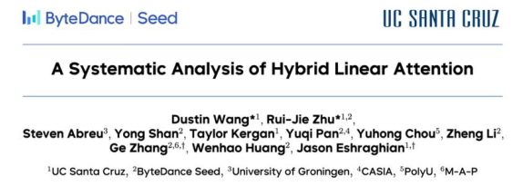

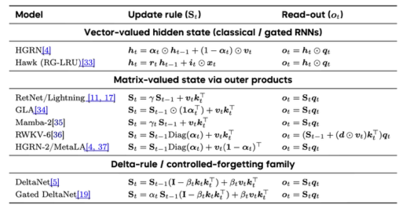

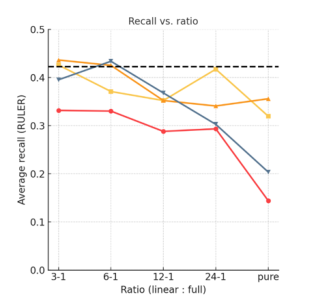

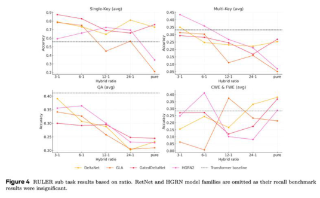

Not many controlled ablations, but some evidence of low losses at small hybrid ratios

(cs336-04-page-012)=

## Alternative to hybrids: sparse adaptation

**Instead of attending to every token, do sparse attention (DSA)**

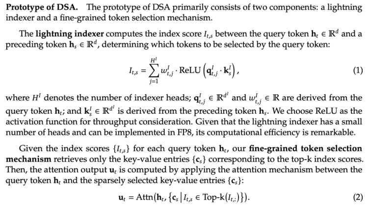

The indexer can be very lightweight, giving significant gains
Can be ‘post hoc’ adapted after dense short context pretraining

(cs336-04-page-013)=

## DSA – Deepseek Sparse Attention (v3.2, GLM5)

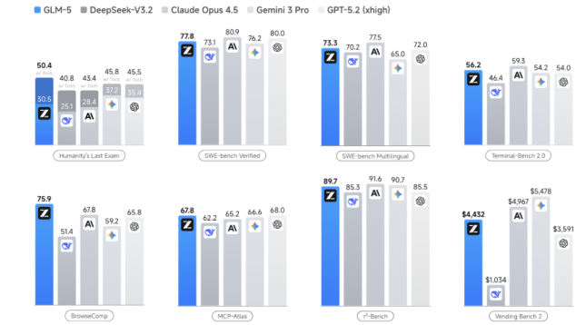

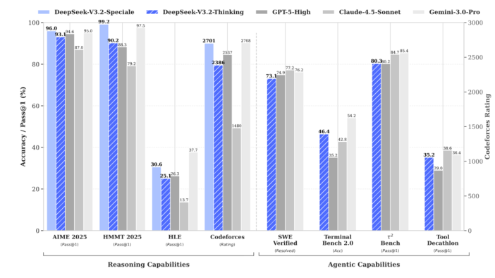

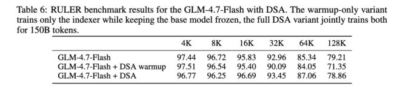

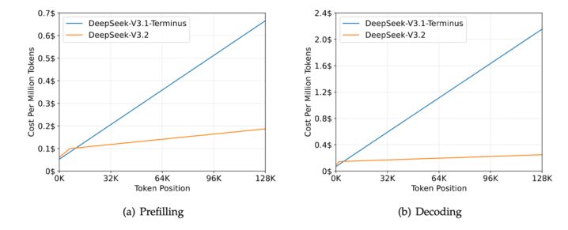

(cs336-04-page-014)=

## Mixture of experts

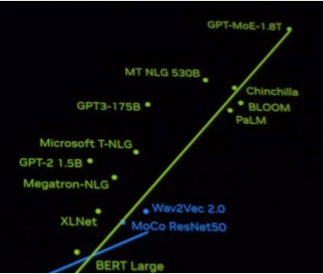

GPT4 (?)

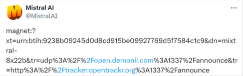

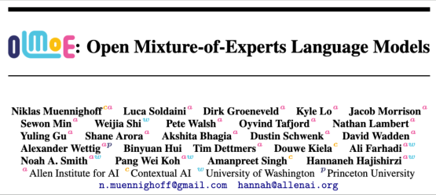

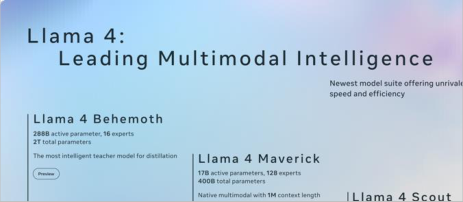

(cs336-04-page-015)=

## What’s a MoE?

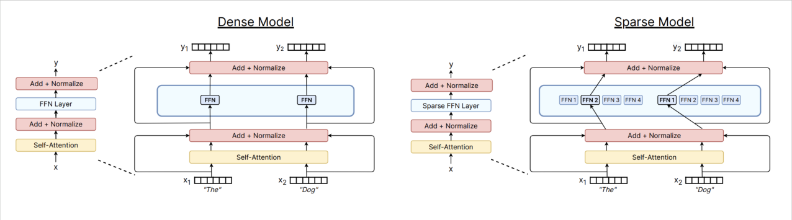

[Fedus et al 2022]

Replace big feedforward with (many) big feedforward networks and a selector layer

You can increase the # experts without affecting FLOPs

(cs336-04-page-016)=

## Why are MoEs getting popular?

Same FLOP, more param does better

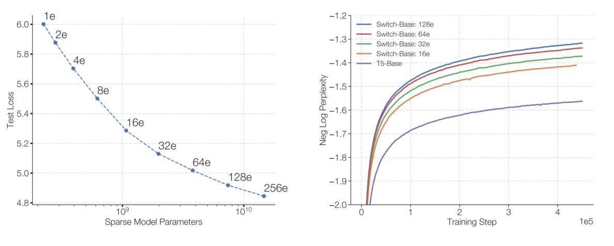

[Fedus et al 2022]

(cs336-04-page-017)=

Faster to train MoEs

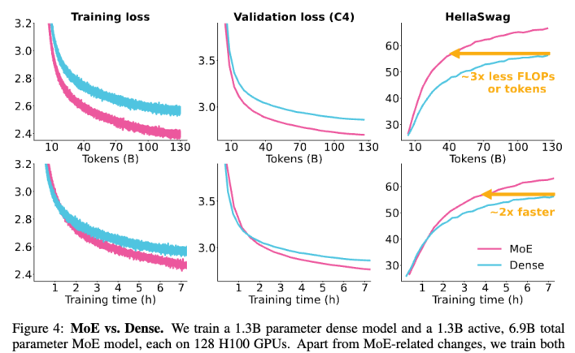
[OlMoE]

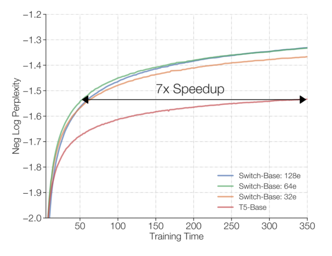

(cs336-04-page-018)=

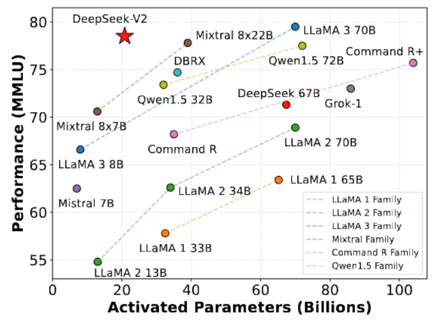

**Highly competitive vs dense equivalents**

(cs336-04-page-019)=

Parallelizable to many devices

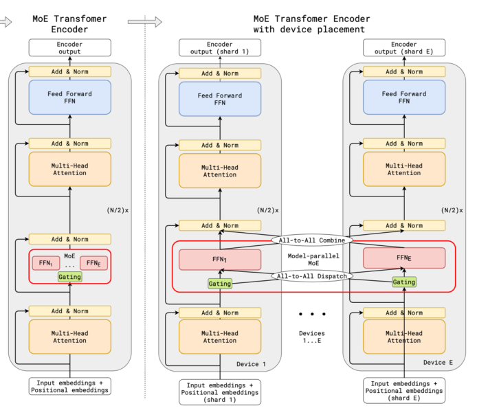

(cs336-04-page-020)=

## Some MoE results – from the west

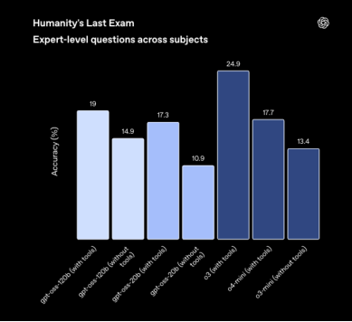

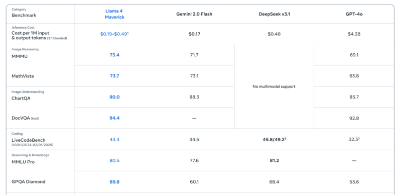

MoEs are most of the highest-performance open models, and are quite quick

(cs336-04-page-021)=

## Earlier MoE results from Chinese groups – Qwen

Chinese LLM companies are also doing quite a bit of MoE work on the smaller end

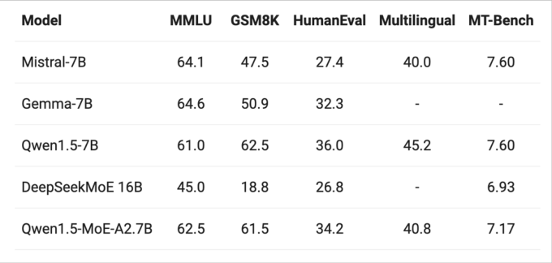

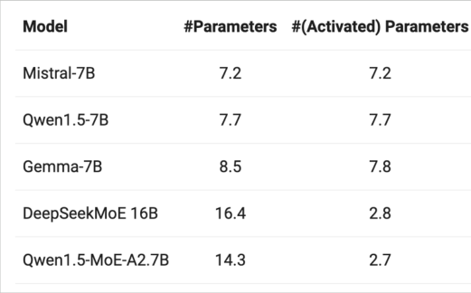

(cs336-04-page-022)=

## Earlier MoE results from Chinese groups - DeepSeek

There’s also some good recent ablation work on MoEs showing they’re generally good

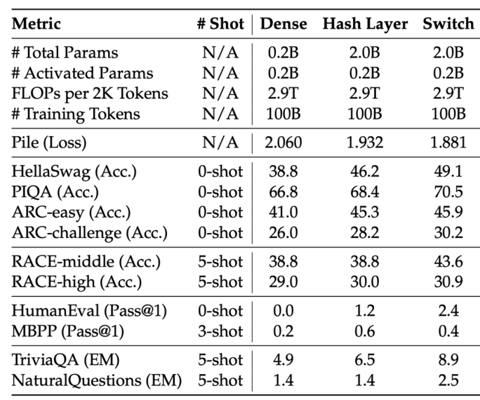

(cs336-04-page-023)=

## Recent MoE results – DeepSeek v3

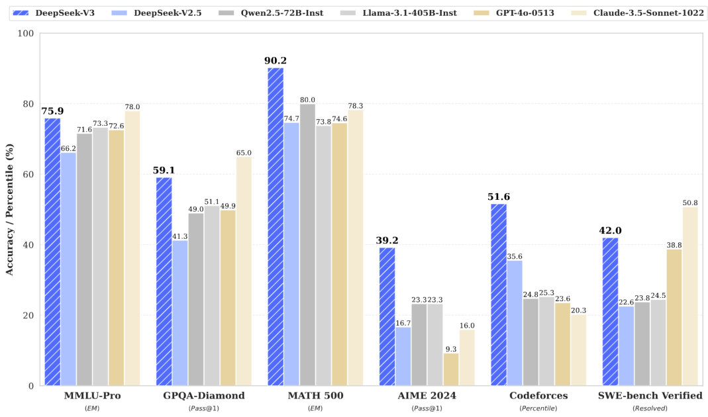

(cs336-04-page-024)=

## Why haven’t MoEs been more popular?

Infrastructure is complex / advantages on multi node

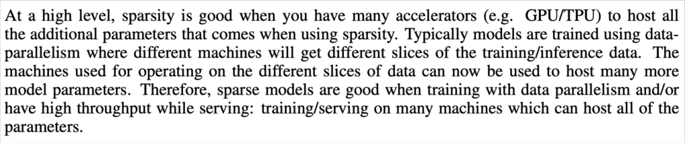

Training objectives are somewhat heuristic (and sometimes unstable)

[Fedus et al 2022]

[Zoph et al 2022]

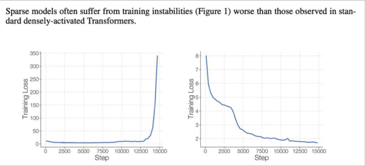

(cs336-04-page-025)=

## What MoEs generally look like

Typical: replace MLP with MoE layer Less common: MoE for attention heads

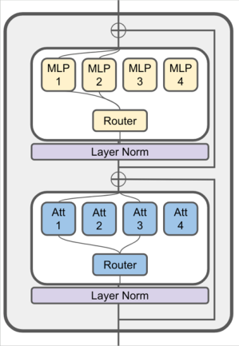

[ModuleFormer, JetMoE]

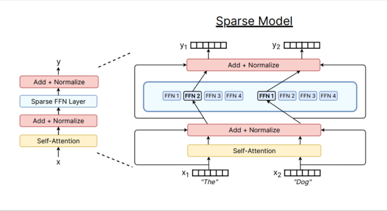

(cs336-04-page-026)=

## MoE – what varies?

- Routing function 
- Expert sizes 
- Training objectives

(cs336-04-page-027)=

## Routing function - overview

Many of the routing algorithms boil down to ‘choose top k’

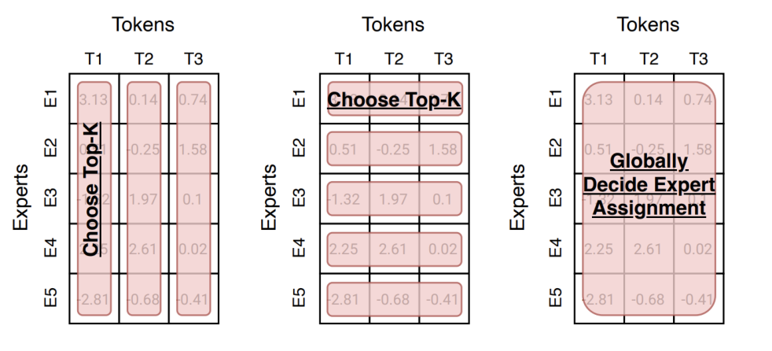
Global routing via optimization

Token chooses expert

Expert chooses token

[Fedus et al 2022]

(cs336-04-page-028)=

## Routing type

Almost all the MoEs do a standard ‘token choice topk’ routing. Some recent ablations

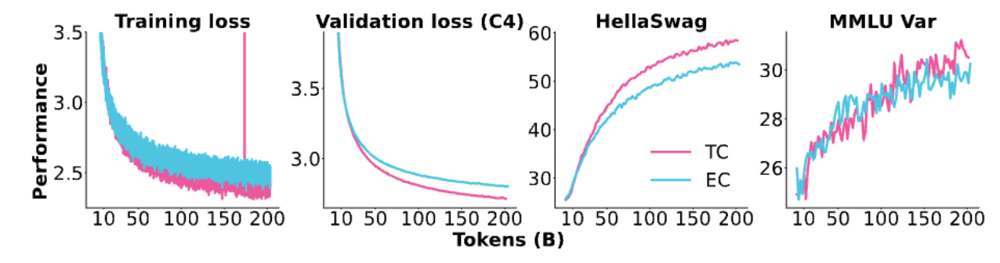

(cs336-04-page-029)=

## Top-k

Common routing variants in detail

Used in most MoEs Switch Transformer (k=1) Gshard (k=2), Grok (2), Mixtral (2), Qwen (4), DBRX (4), DeepSeek (7)

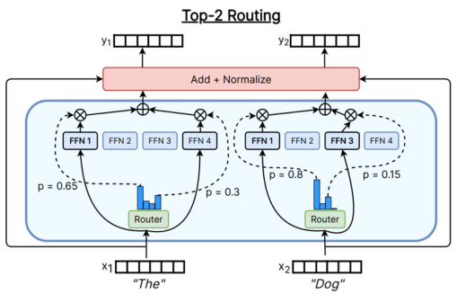

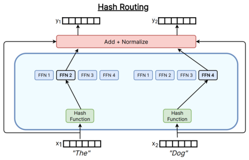
Common baseline Hashing

[Fedus et al 2022]

(cs336-04-page-030)=

## Other routing methods

Used in some of the earliest work RL to learn routes Bengio 2013, not common now

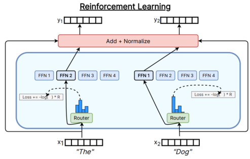

Solve a matching Linear assignment for routing problem Used in various papers like Clark ‘22

[Fedus et al 2022]

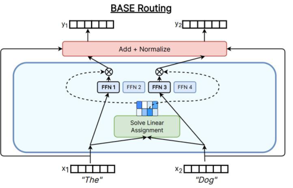

(cs336-04-page-031)=

## Top-K routing in detail.

_Most_ papers do the old and classic top-k routing. How does this work?

Gating

Gates selected by a logistic regressor

This is the DeepSeek (V1-2) router (Grok, Qwen do this too) Mixtral, DBRX, DeepSeek v3 softmaxes after the TopK

[Dai et al 2024]

(cs336-04-page-032)=

## Recent variations from DeepSeek and other Chinese LMs

Smaller, larger number of experts + a few shared experts that are always on.

(Used in DeepSeek / Qwen, originally from DeepSpeed MoE)

(cs336-04-page-033)=

## Various ablations from the DeepSeek paper

More experts, shared experts all seem to generally help

(cs336-04-page-034)=

## Ablations from OlMoE

Gains from fine-grained experts, none from shared experts.

(cs336-04-page-035)=

## Ex ert routin setu s for recent MoEs** **p g p

|Model|Routed|Active|Shared|Fine-grained ratio|
|---|---|---|---|---|
|GShard|2048|2|0||
|Switch Transformer|64|1|0||
|ST-MOE|64|2|0||
|Mixtral|8|2|0||
|DBRX|16|4|0||
|Grok|8|2|0||
|DeepSeek v1|64|6|2|1/4|
|Qwen 1.5|60|4|4|1/8|
|DeepSeek v3|256|8|1|1/14|
|OlMoE|64|8|0|1/8|
|MiniMax|32|2|0|~1/4|
|Llama 4 (maverick)|128|1|1|1/2|

(cs336-04-page-036)=

## How do we train MoEs?

**Major challenge:** we need sparsity for training-time efficiency…

But sparse gating decisions are not differentiable!

**Solutions?**

1. Reinforcment learning to optimize gating policies

2. Stochastic perturbations

3. Heuristic ‘balancing’ losses.

Guess which one people use in practice?

(cs336-04-page-037)=

## RL for MoEs

RL via REINFORCE does work, but not so much better that it’s a clear win

(REINFORCE baseline approach, Clark et al 2020)

RL is the ‘right solution’ but gradient variances and complexity means it’s not widely used

(cs336-04-page-038)=

## Stochastic approximations

From Shazeer et al 2017 – routing decisions are _stochastic_ with gaussian perturbations.

1. This naturally leads to experts that are a bit more robust.

2. The softmax means that the model learns how to rank K experts

(cs336-04-page-039)=

Stochastic jitter in Fedus et al 2022. This does a uniform multiplicative perturbation for the

same goal of getting less brittle experts. This was later removed in Zoph et al 2022

(cs336-04-page-040)=

## Heuristic balancing losses

Another key issue – systems efficiency requires that we use experts evenly..

From the Switch Transformer [Fedus et al 2022]

𝑝 𝑖 (𝑥) is 𝑇 [2] [σ 1] [𝑎𝑟𝑔𝑚𝑎𝑥 𝑝𝑥=𝑖] [, ]

so more frequent use = stronger downweighting

The derivative with respect to 𝑝 𝑖 (𝑥) is

𝛼𝑁

(cs336-04-page-041)=

## Example from deepseek (v1-2)

**Per-expert balancing** – same as the switch transformer

**Per-device balancing** – the objective above, but aggregated by device.

(cs336-04-page-042)=

## DeepSeek v3 variation – per-expert biases

Set up a per-expert bias (making it more likely to get tokens) and use online learning

They call this ‘ **auxiliary loss free balancing** ’

(but the approach is not fully aux loss free..)

(cs336-04-page-043)=

## What happens when removing load balancing losses?

(cs336-04-page-044)=

## Training MoEs – the systems side

MoEs parallelize nicely – Each FFN

can fit in a device

Enables additional kinds of parallelism

(cs336-04-page-045)=

MoE routing allows for parallelism, but also some complexities

Modern libraries like MegaBlocks (used in many open MoEs) use smarter sparse MMs

(cs336-04-page-046)=

## MoE parallelism and architecture modifications

New ideas from Nemotron 3 – down-projecting the activations to reduce communication

(cs336-04-page-047)=

## Fun side issue – stochasticity of MoE models

MoEs can have additional stochasticity beyond normal models..

Why would a MoE have additional randomness?

Token dropping from routing happens at a _batch_ level – this means that

other people’s queries can drop your token!

(cs336-04-page-048)=

## Issues with MoEs - stability

**Solution:** Use Float 32 just for the expert router (sometimes with an aux z-loss)

[Zoph 2022]

(cs336-04-page-049)=

## Z-loss stability for the router

What happens when we remove the z-loss?

(cs336-04-page-050)=

## Issues with MoEs – fine-tuning

Sparse MoEs can overfit on smaller fine-tuning data

Zoph et al solution – finetune non-MoE MLPs DeepSeek solution – use lots of data 1.4M SFT

(cs336-04-page-051)=

## Other training methods - upcycling

Can we use a pre-trained LM to initialize a MoE?

(cs336-04-page-052)=

## Upcycling example - MiniCPM

Uses the MiniCPM model (topk=2, 8 experts, ~ 4B active params).

Simple MoE, shows gains from the base model with ~ 520B tokens for training

(cs336-04-page-053)=

## Upcycling example – Qwen MoE

**Qwen MoE** – Initialized from the Qwen 1.8B model top-k=4, 60 experts w/ 4 shared.

Similar architecture / setup to DeepSeekMoE, but one of the first (confirmed) upcycling successes

(cs336-04-page-054)=

## DeepSeek MoE v1-v2-v3

To wrap up, we’ll walk through the DeepSeek MoE architecture.
V1 (16B – 2.8 active):

**Shared (2) + Fine-grained (64/4) experts**

**Standard, top-k routing**

**Standard Aux-loss balancing** (Expert + Device)

(cs336-04-page-055)=

## DeepSeek MoE v2

V2 (236B – 21 active):

**Shared (2) + Fine-grained (160/10) experts, 6 active**

**New things:**

Top-M device routing Communication balancing loss – balancing both communication in _and_ out

(cs336-04-page-056)=

## DeepSeek MoE v3

V2 (671B – 37 active):

**Shared (1) + Fine-grained (258) experts, 8 active**

**New things**

Sigmoid+Softmax topK + topM

Aux-loss-free + seq-wise aux

(cs336-04-page-057)=

## Bonus: What else do you need to make DeepSeek MoE v3?

**MLA :** Multihead, latent attention

**Basic idea:** express the Q, K, V as functions of a lower-dim, ‘latent’ activation

(cs336-04-page-058)=

## What else do you need to make DeepSeek MoE v3?

**Basic idea:** express the Q, K, V as functions of a lower-dim, ‘latent’ activation

𝐾𝑉

**Benefits:** when KV-caching, we only need to store 𝑐 𝑡, which can be much smaller.

𝑊 [𝑈𝐾] can be merged into the Q projection

(they also compress queries, for memory savings during training)

(cs336-04-page-059)=

**MTP:** Have small, lightweight models that predict multiple steps ahead

(But they only do MTP with one token ahead)

[Deepseek v3] [EAGLE]

(See paper for ablations)

(cs336-04-page-060)=

## MoE summary

- MoEs take advantage of sparsity – not all inputs need the full model 
- Discrete routing is hard, but top-k heuristics seem to work 
- Lots of empirical evidence now that MoEs work, and are cost-effective
