(cs336-05-cover)=
# Lecture 05: GPUs

Stanford CS336 · Language Modeling from Scratch · Spring 2026.

(cs336-05-page-001)=

## Lecture 5

G PU S

CS336 Tatsu H

(cs336-05-page-002)=

## Outline and goals

- Make CUDA and GPUs less magic Understand when GPUs get slow Understand how to make fast algorithms

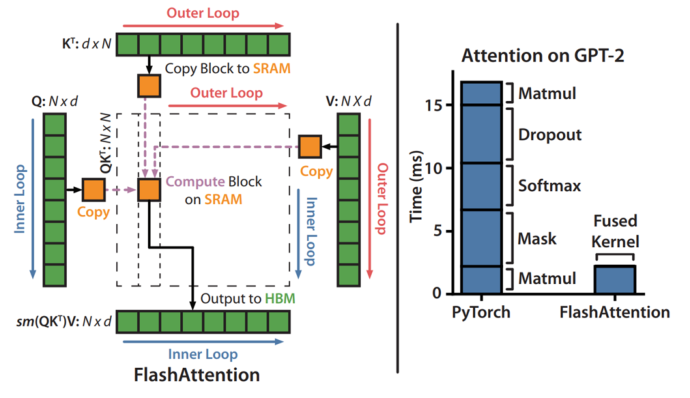

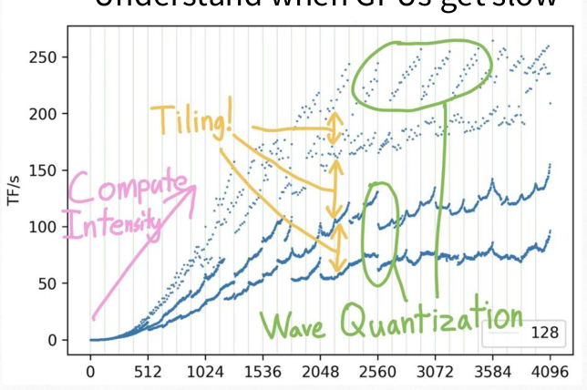

https://www.thonking.ai/p/what-shapes-do-matrix-multiplications Dao et al, Flash Attention

(cs336-05-page-003)=

## Before we start..

Substantial credit goes to a few sources that I’d like to highlight..

Horace He’s blog CUDA Mode group

TPU (and now GPU) book (!!)

And other sources including [https://nichijou.co/, https://jonathan-hui.medium.com/](https://nichijou.co/)

(cs336-05-page-004)=

## Organization today:

- Part 1 : GPUs in depth – how they work and important parts 
- Part 2 : Understanding GPU performance 
- Part 3 : Putting it together – unpacking FlashAttention

(cs336-05-page-005)=

## Setting the stage: compute leads to predictable perf

**Often times, compute leads to predictable performance gains for language models**

Kaplan et al, Neural Scaling Laws

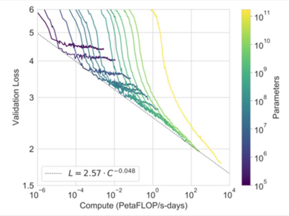

Faster hardware, better utilization, improved parallelization alone can drive progress (for now..)

(cs336-05-page-006)=

## How do we get compute scaling? Early on – Dennard scaing

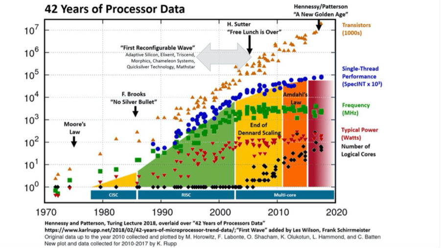

But the traditional form of scaling ( _Dennard scaling_ ) from 1980-2000s has tapped out.

.. How do we feed LLMs’ insatiable appetite for compute?

(cs336-05-page-007)=

## Parallel scaling continues

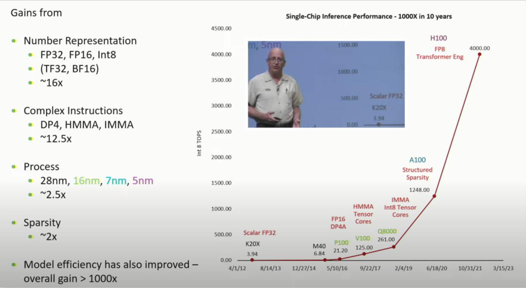

Parallel scaling with GPUs has scaled > 1000x in 10 years.

_There is no LLM scaling without GPU scaling_

Bill dally, HotChips keynote

(cs336-05-page-008)=

## How is a GPU different from a CPU?

CPUs optimize for a few, fast threads while GPUs optimize for many many threads

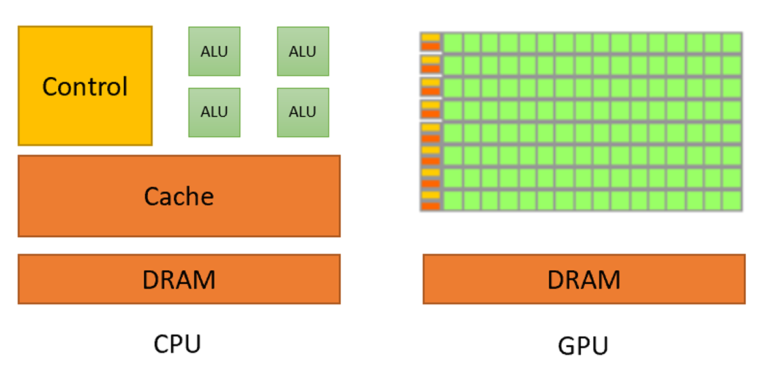

Many tiny compute units (ALUs).
Much less support for branching (control, cache)

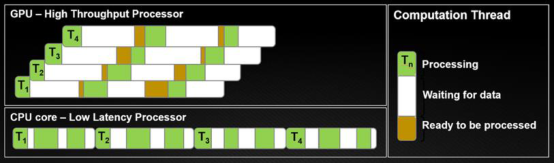

CPUs optimize for latency (each thread finishes quickly)
GPUs optimize for throughput (total processed data)

https://developer.nvidia.com/blog/cuda-refresher-reviewing-the-origins-of-gpu-computing/

(cs336-05-page-009)=

## Anatomy of a GPU (execution units)

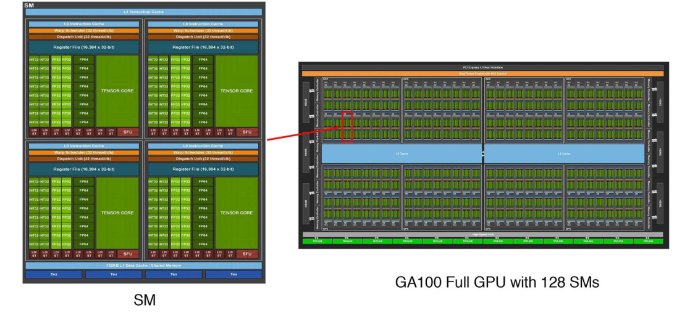

Each SM further contains many **SPs**

**(streaming processor)** that can
execute ‘threads’ in parallel

GPUs have _many_ **SM (streaming**
**multiprocessors)** that independently
execute ‘blocks’ (jobs).

(cs336-05-page-010)=

## Anatomy of a GPU (memory)

The closer the memory to the SM, the faster it is – L1 and shared memory is inside the SM. L2 cache is on die, and global memory are the memory chips next to the GPU

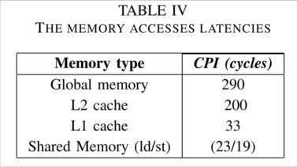

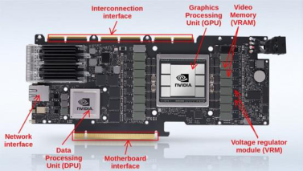

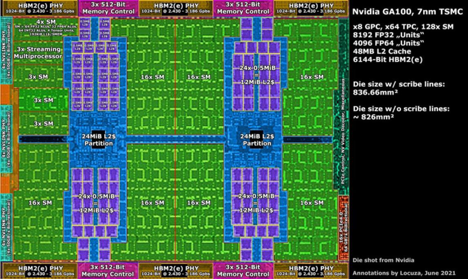

SRAM (shared/cache memory) is much more expensive (100x) but ~ 8x faster than DRAM (Global memory)

(cs336-05-page-011)=

## Execution model of a GPU

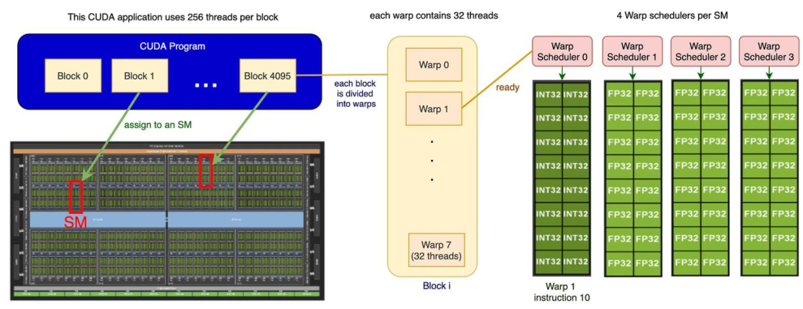

There are 3 important players in the execution model

**Threads:** Threads ‘do the work’ in parallel – all threads execute the same instructions but with

different inputs (SIMT).

**Blocks:** Blocks are groups of threads. Each block runs on a SM w/ its own shared memory.

**Warp:** Threads always execute in a ‘warp’ of 32 consecutively numbered threads each.

(cs336-05-page-012)=

## Memory model of a GPU

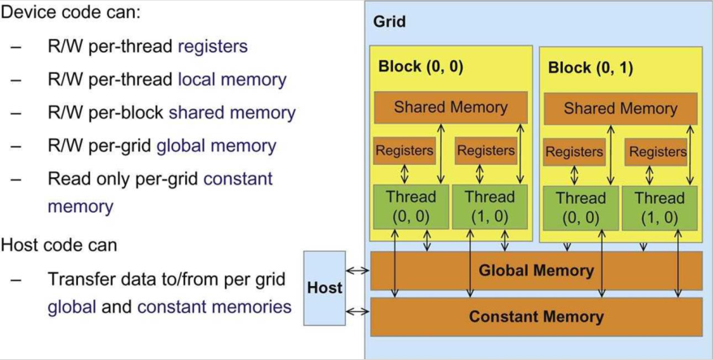

Each thread can access its own register, and shared memory within the block.
**Information that goes across blocks need to be read/written to global memory (slow)**

(cs336-05-page-013)=

## Side thread – What about TPUs?

GPUs, TPUs, and many other accelerators are at a high level, similar

A GPU has _more SMs_

TPUs has fewer TCs
(but similar matmul perf)

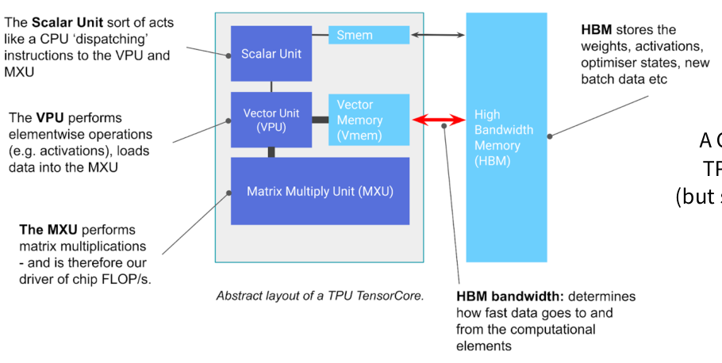

Core structure – lightweight control, fast (big) matmul unit, fast memory. Differences - how the accelerators are networked (in the parallelism lecture) -  no warps (just blocks – tradeoffs in matmul vs non-matmul)

(cs336-05-page-014)=

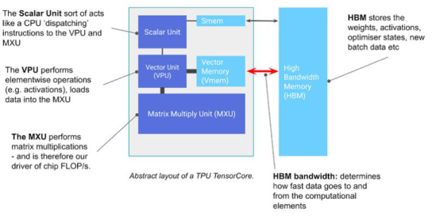

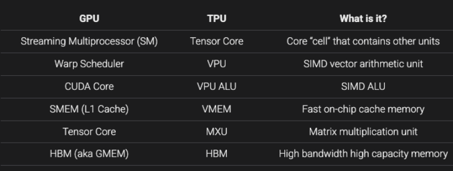

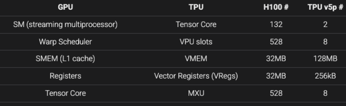

Core structure – lightweight control, fast (big) matmul unit, fast memory.

https://jax-ml.github.io/scaling-book/gpus/

(cs336-05-page-015)=

## Strengths of the GPU model

- Easily scales up hard workloads (by adding more SMs) 
- Easy (?) to program due to the SIMT model

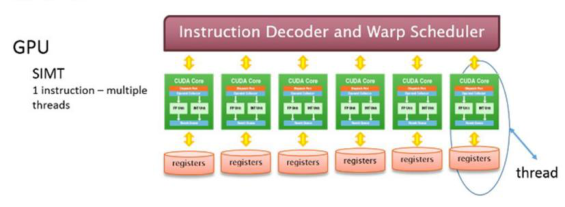

- Threads are ‘lightweight’ and can be stopped and started

(cs336-05-page-016)=

## GPUs as fast matrix multipliers

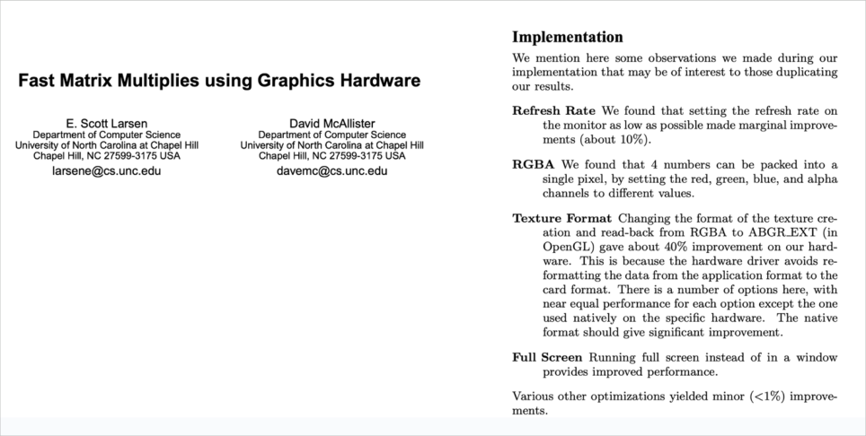

Early days of NVIDIA GPUs – programmable shaders. Researchers hacked this to do matmuls

(cs336-05-page-017)=

## New matmul hardware means matmuls are fast and special

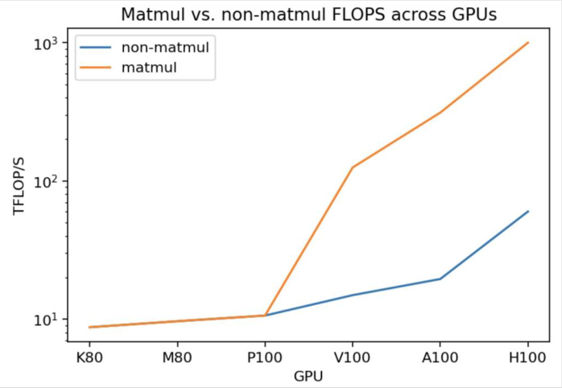

Tensor cores (introduced in V, T series) are specialized matrix multiplication circuits.

**Matmuls are >10x faster than other floating point ops!**

(cs336-05-page-018)=

## Compute scaling is faster than memory scaling

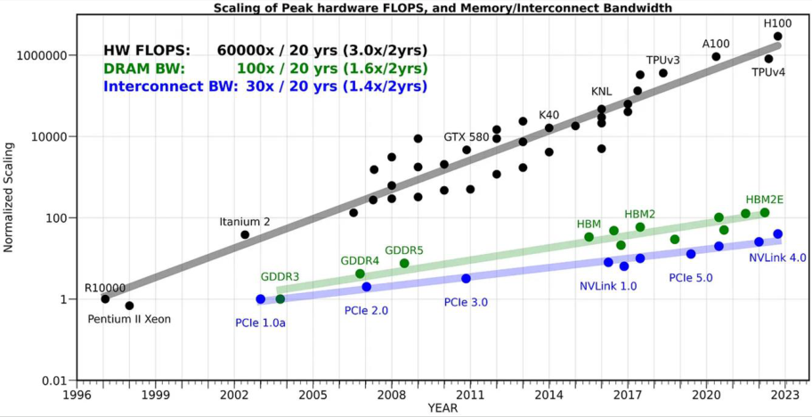

https://medium.com/riselab/ai-and-memory-wall-2cb4265cb0b8

FLOPs scale faster than memory – it’s hard to keep our compute units fed with data!

(cs336-05-page-019)=

## Recap: GPUs – what are they and how do they work

- GPUs are massively parallel – same instructions
applied across many workers

- Compute (and esp matmuls) have scaled faster
than memory

- We have to respect the memory hierarchy to
make things go fast.

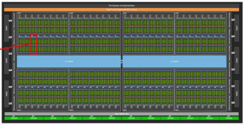

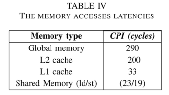

(cs336-05-page-020)=

## Part 2: Making ML workloads fast on a GPU

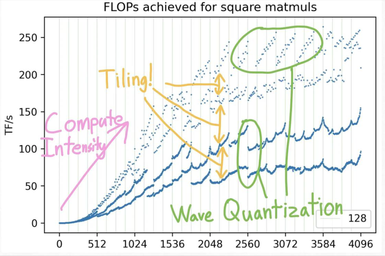

Performance on a GPU can be complex, even for something as simple as a square matmul

(cs336-05-page-021)=

## What makes ML workloads fast?

**The roofline model**

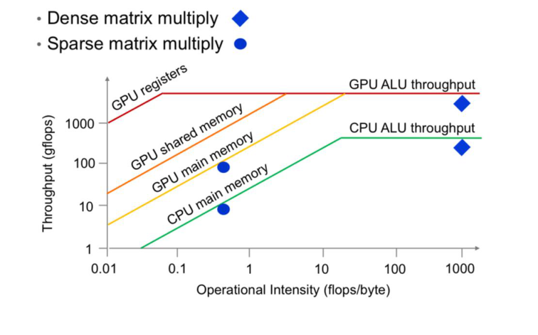

Key to this section: **how do we avoid being memory bound?**

(cs336-05-page-022)=

## How do we make GPUs go fast?

**1.** **Control divergence (not a memory bottleneck..)**

**2.** **Low precision computation**

**3.** **Operator fusion**

**4.** **Recomputation**

**5.** **Coalescing memory**

**6.** **Tiling**

(cs336-05-page-023)=

## Control divergence (not a memory issue)

GPUs operate in a SIMT model – every thread in a warp is executing the same instruction

Conditionals are fine, but lead to significant overhead from the execution model

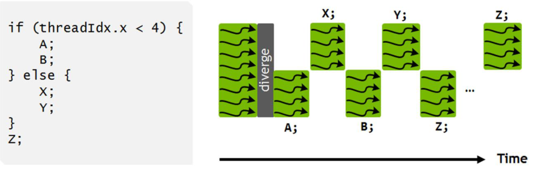

(cs336-05-page-024)=

## Trick 1: Low precision computation

If you have fewer bits, you have fewer bits to move

(cs336-05-page-025)=

## Low precision improves arithmetic intensity

**Example:** elementwise ReLU (𝑥= max(0, 𝑥)) on a vector of size 𝑛 **.**

(Float 32 case)

**Memory access** : 1 read (x), 1 write (if x < 0), float 32 = 4 bytes per op

**Operations:** 1 comparison op, 1 FLOP.

**Intensity:** 8 bytes / FLOP

(Float 16)

**Memory access** : 1 read (x), 1 write (if x < 0), float 16 = 2 bytes per op

**Operations:** 1 comparison op, 1 FLOP.

**Intensity:** 4 bytes / FLOP

(cs336-05-page-026)=

## Low precision drives faster matrix multiplies

Lots of operations in modern GPUs are accelerated via low / mixed precision operations

Tensor cores

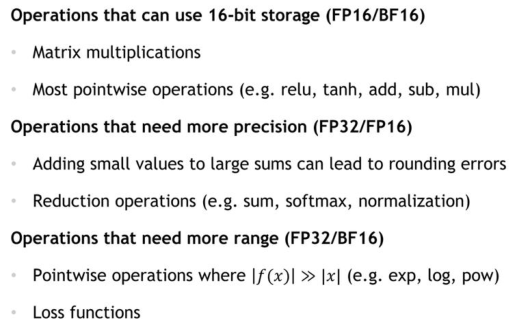

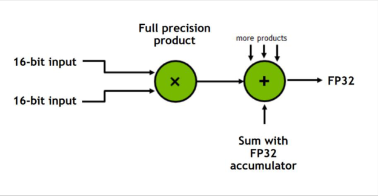

[https://nvlabs.github.io/eccv2020-mixed-precision-tutorial/files/dusan_stosic-training-neural-networks-with-tensor-cores.pdf](https://nvlabs.github.io/eccv2020-mixed-precision-tutorial/files/dusan_stosic-training-neural-networks-with-tensor-cores.pdf)

(cs336-05-page-027)=

## Frontiers in low precision

Very low precision (FP8) with different tradeoffs Multiple scaling factors MXFP8 (Blackwell)

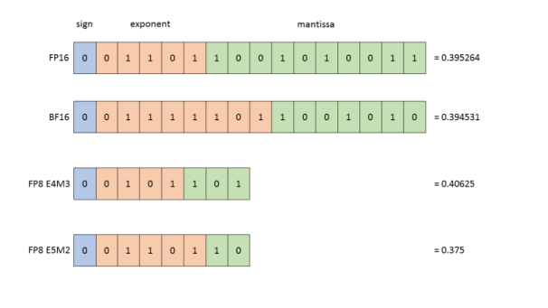

MXFP8 has many _interesting_ things about it

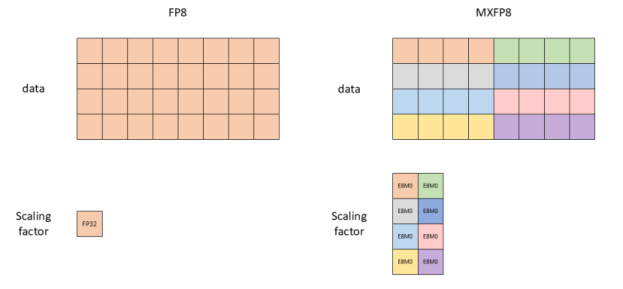
Uses E4M3 (more mantissa) due to more scale factors

Scale factors themselves are FP8 (E8M0), 1 per 32

- Transposes are now nontrivial!

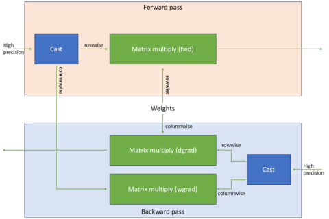

(cs336-05-page-028)=

## MXFP8 training in practice

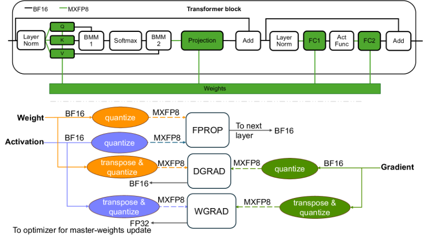

Notice – not all weights in MXFP8, transposes also separately quantized

https://arxiv.org/html/2506.08027v2

(cs336-05-page-029)=

## Frontiers in low precision

MXFP4..

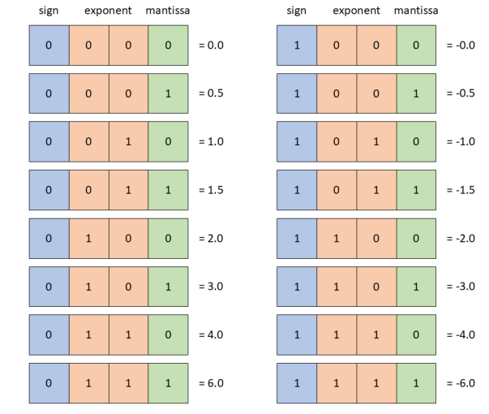

This is all the values you can represent! 1 per 16 scaling, E4M3 scaling factors.

(cs336-05-page-030)=

## Trick 2: Operator fusion

Think of a GPU like a factory – inputs come from a warehouse (memory) and is

processed at a factory

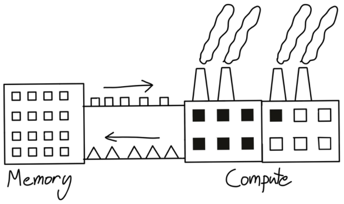

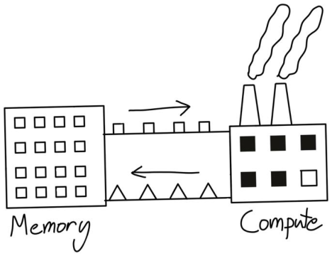

**Compute scales up, memory doesn’t**

https://horace.io/brrr_intro.html

(cs336-05-page-031)=

## Operator fusion to minimize memory access

What if we have to do many operations? Shipping back and forth is somewhat silly

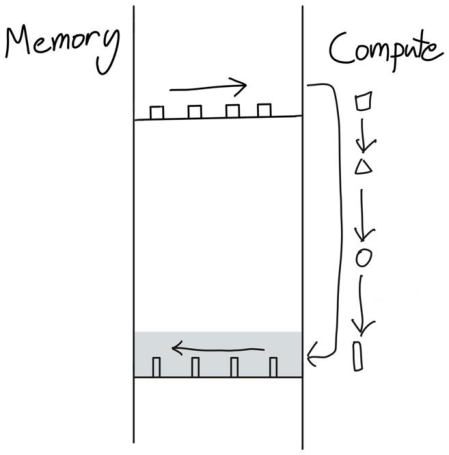

Fused kernel

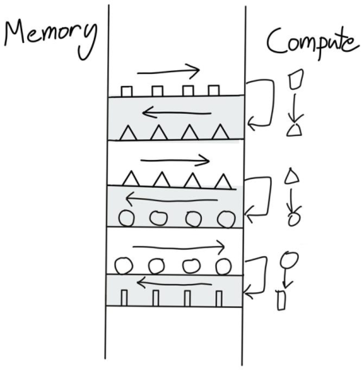
Naïve (non-fused)

(cs336-05-page-032)=

## Example – sines and cosines

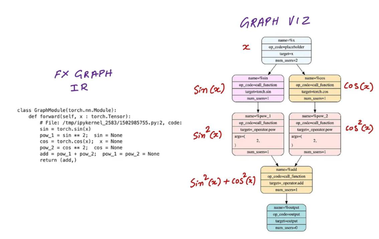

Computing sin [2] 𝑥+ cos [2] 𝑥 naively launches 5 CUDA kernels (back and forth)

[https://towardsdatascience.com/how-pytorch-2-0-accelerates-deep-learning-with-operator-fusion-and-cpu-gpu-code-generation-35132a85bd26](https://towardsdatascience.com/how-pytorch-2-0-accelerates-deep-learning-with-operator-fusion-and-cpu-gpu-code-generation-35132a85bd26)

(cs336-05-page-033)=

## Fusion example

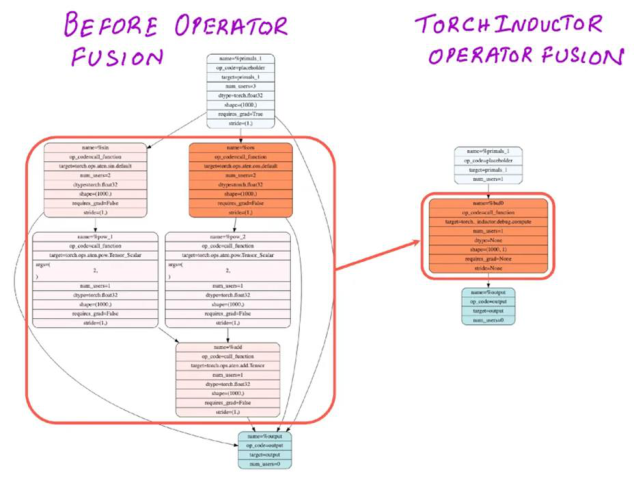

All 5 pointwise operations can be fused into a single CUDA kernel call.
‘Easy’ fusions like this can be done automatically by compilers (torch.compile)

(cs336-05-page-034)=

## Trick 3: recomputation

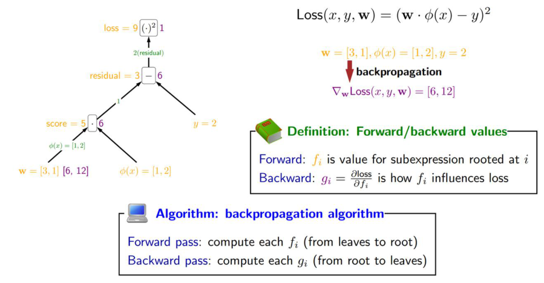

[From cs221]

In backpropagation, we store the activations (yellow) and compute Jacobians (green)

(cs336-05-page-035)=

## Storing (and retrieving) activations can be expensive!

Let’s say we stack 3 sigmoids on top of each other.

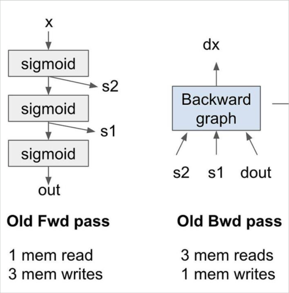

This is really terrible for perf – 8 mem read/writes, very low arithmetic intensity.

https://dev-discuss.pytorch.org/t/min-cut-optimal-recomputation-i-e-activation-checkpointing-with-aotautograd/467

(cs336-05-page-036)=

## Throw away the activations, re-compute them!

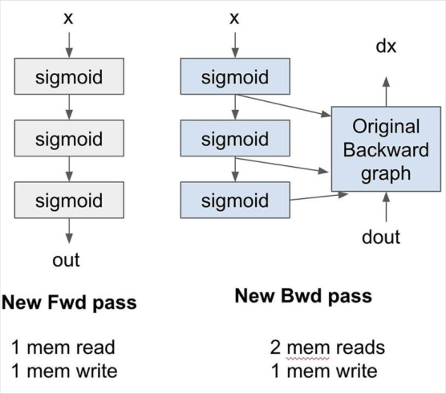

Throwing away computation can actually be optimal, w/ 5/8 [th] the memory accesses!

https://dev-discuss.pytorch.org/t/min-cut-optimal-recomputation-i-e-activation-checkpointing-with-aotautograd/467

(cs336-05-page-037)=

## Trick (?) 4: Memory coalescing and DRAM

**DRAM** (global memory) is read in ‘burst mode’ – each read gives you many bytes!

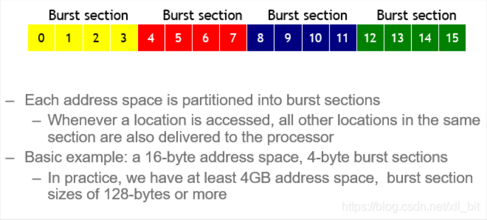

[https://blog.csdn.net/xll_bit/article/details/117702476]

 Burst mode comes from the slow per-row copy to the sense amplifier

[https://www.youtube.com/watch?v=9BjVUmaXaCQ]

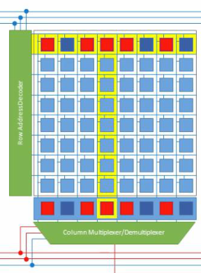

(cs336-05-page-038)=

## Memory coalescing

Memory accesses are _coalesced_ if all the threads (in a warp) fall within the same burst

Reminder : a warp is a set of 32 consecutively numbered threads that execute together in a block. Memory accesses happen together

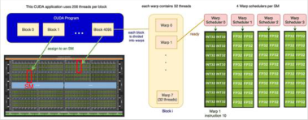

(cs336-05-page-039)=

## Coalescing for matrix multiplication

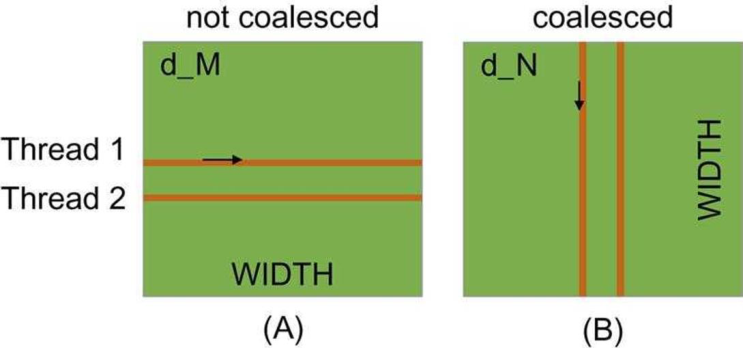

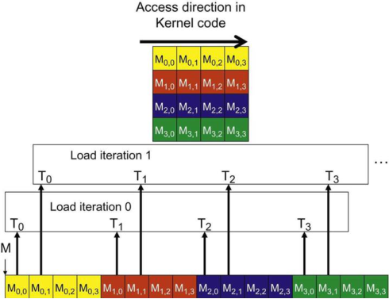

For row-major matrices – **threads that move along rows are not coalesced**

Note how the second diagram reads the entire vector at each step!

(cs336-05-page-040)=

## Trick 5 (the big one): tiling

**Tiling** is the idea of grouping and ordering threads to minimize global memory access.

Let’s go back to matrix multiplication..

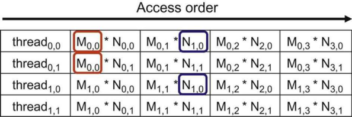

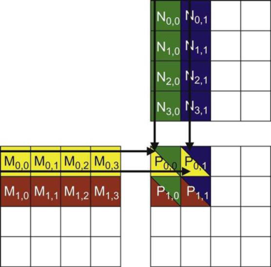

Note that memory access is not coalesced, and repeated (M0,0 and N1,0)

(cs336-05-page-041)=

## Tiling – store and reuse information in shared memory

Cut up the matrix into smaller ‘tiles’, and load this into shared memory

Compute the matrix multiply in ‘phases’

1. Load 𝑀 and 𝑁 tiles into SHM
0,0 0,0

2. Compute partial sums for 𝑃

(Done with one tile)

3. Load the 𝑀 and 𝑁 tile into SHM
0,0 2,0

4. …

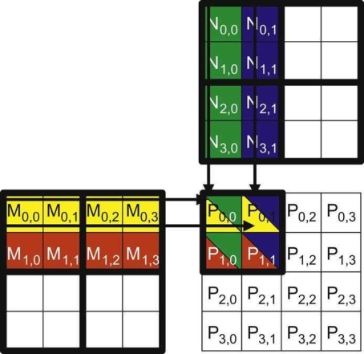

Advantages : repeated reads now access shared, not global memory and memory access can be coalesced

(cs336-05-page-042)=

## Tiling math

(cs336-05-page-043)=

## Complexities with tiling

**Tile sizes may not divide the matrix size** and lead to low utilization

Factors affecting tile sizes 
- Coalesced memory access 
- Shared memory size 
- Divisibility of the matrix dim

[https://docs.nvidia.com/deeplearning/performance/dl-performance-matrix-multiplication/index.html#tile-quant](https://docs.nvidia.com/deeplearning/performance/dl-performance-matrix-multiplication/index.html#tile-quant)

(cs336-05-page-044)=

## Complexities with tiling 2 – memory alignment

Memory comes in bursts Loading tiles are fast if bursts align with the matrix

[https://www.thonking.ai/p/what-shapes-do-matrix-multiplications](https://www.thonking.ai/p/what-shapes-do-matrix-multiplications)

**Coalesced accesses may be impossible depending on the dimension of the matrix..**

(have to do padding)

(cs336-05-page-045)=

## Putting it together: understanding a matrix mystery

Why is it _faster_ to have bigger matrices?

[This section is from https://www.thonking.ai/p/what-shapes-do-matrix-multiplications](https://www.thonking.ai/p/what-shapes-do-matrix-multiplications)

(cs336-05-page-046)=

## Matrix mystery

We understand some of this (compute intensity, tiling). Let’s take a closer look..

(cs336-05-page-047)=

## Part 1: tiling

Tiling has a major impact through alignment.

(cs336-05-page-048)=

## Part 2: wave quantization

What’s with the periodic behavior?

(cs336-05-page-049)=

## Recap of part 2: making ML workloads go fast

- Reduce memory accesses
- Coalescing 
- Fusion

- Move memory to shared memory
- Tiling

- Trade memory for compute/accuracy

- Quantization 
- Recomputation

(cs336-05-page-050)=

## Part 3: Using what we know to understand Flash Attention

**Flash attention** [Dao et al] dramatically accelerates attention.. But how?

Technique from paper:

(cs336-05-page-051)=

## Recap of attention computation

**Attention** **computation** : 3 matrix multiplies (K, Q, V) with a softmax in between

(cs336-05-page-052)=

## Tiling part 1: tiling for the KQV matrix multiply

This figure 1 from the paper is literally just tiling for a KQV matrix multiply..

**But what do we do about the softmax?**

(cs336-05-page-053)=

## Tiling part 2: incremental computation of the softmax

From Mikailov and Gimelshein 2018,

**Normal softmax**

**Online softmax**

To keep track of the max, incrementally update the max, and set up a telescoping sum

**This lets you compute the softmax tile-by-tile**

(cs336-05-page-054)=

## Putting it all together – the forward pass of flash attention

From Dao 2023, we see

Tile-wise computation of the inner products, (𝑆)

Fusion of the exponential operator

Tile-wise computation of the softmax via the online, telescoping sum trick

(We won’t cover the backward pass – but they recompute tile-by-tile..)

(cs336-05-page-055)=

## Recap for the whole lecture

- Hardware powers scale, and low-level details
determine what scales or doesnt

- Curent GPU based compute strongly
encourages thinking about matmul + data

movement

- Thinking carefully about the GPU (coalescing,
tiling, fusion) leads us to good performance

