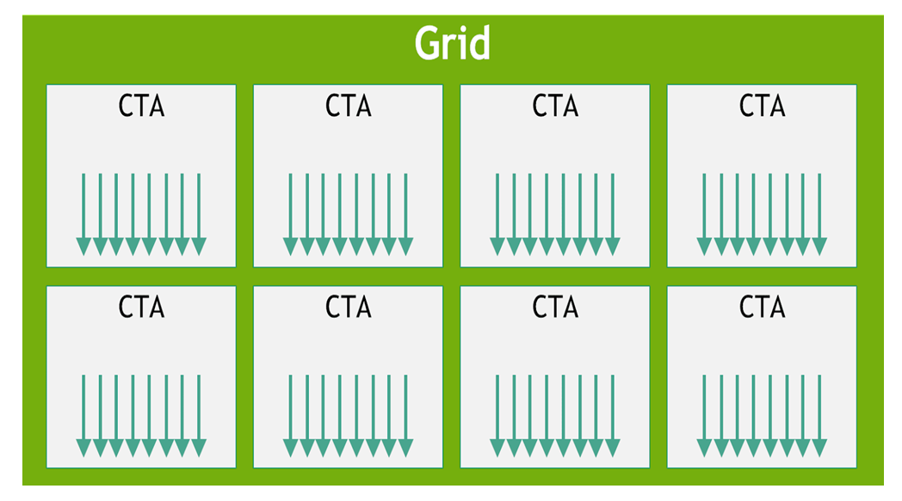
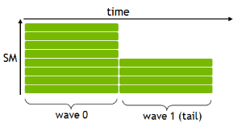
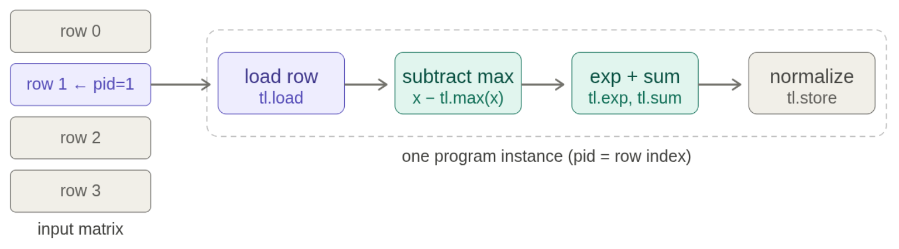
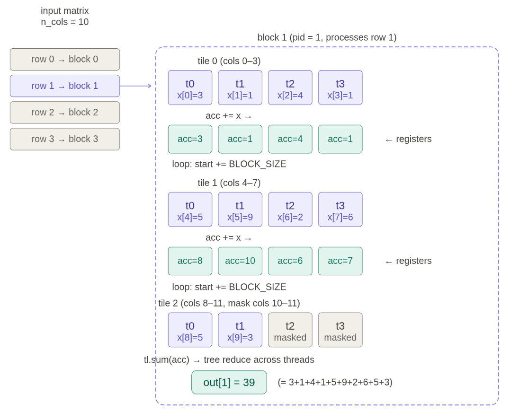
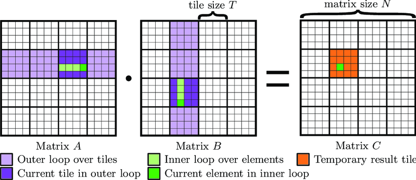

(cs336-06-cover)=
# Lecture 06: GPU programming

Stanford CS336 · Language Modeling from Scratch · Spring 2026.


(cs336-06-topic-001)=
## GPU programming

Last lecture: high-level overview of GPUs and performance

This lecture: benchmarking/profiling + writing kernels

(cs336-06-topic-002)=
## Hardware


```text
| Accelerator                        | A100      | H100      | B200      |
```

```text
+------------------------------------+-----------+-----------+-----------+
```

```text
| # SMs                              |       108 |       132 |       148 |
```

```text
+------------------------------------+-----------+-----------+-----------+
```

```text
| Register size (per SM)             |    256 KB |    256 KB |    256 KB |
```

```text
| L1 cache + shared memory (per SM)  |    192 KB |    256 KB |    256 KB |
```

```text
| L2 cache size                      |     40 MB |     50 MB | 96-126 MB |
```

```text
| HBM size                           |     80 GB |     80 GB |    192 GB |
```

```text
+------------------------------------+-----------+-----------+-----------+
```

```text
| Register bandwidth                 | ~116 TB/s | ~401 TB/s | ~447 TB/s |
```

```text
| L1 cache + shared memory bandwidth |  ~19 TB/s |  ~33 TB/s |  ~40 TB/s |
```

```text
| L2 cache bandwidth                 | ~5-8 TB/s |  ~12 TB/s |  ~17 TB/s |
```

```text
| HBM bandwidth                      |    2 TB/s | 3.35 TB/s |    8 TB/s |
```

Note: the L1/L2 bandwidth numbers are rough estimates (online sources differ).

(B200s also have tensor memory (TMEM) for tensor cores (between registers and shared memory) that are invisible to programmer.)

(cs336-06-topic-003)=
## Programming model



- *Thread*: executes code on a small part of the data
- *Thread block* or concurrent thread array (CTA): a group of threads
- *Grid*: collection of thread blocks

(H100s and B200s also have thread block clusters that enable distributed shared memory.)

Why thread blocks?

For elementwise operations (e.g., GeLU), threads are most natural: each thread processes one element.

- f(i) for i = 0, ..., N-1

However, for non-elementwise operations like softmax or matrix multiplication, threads need to communicate.

Reading/writing from HBM is slow, so use shared memory (local to SM).

Thread block: a collection of threads that access the same shared memory.

Consequently, a thread block is scheduled on one SM.

In Triton, think natively in terms of thread blocks (later).

(cs336-06-topic-004)=
## Interaction between programming model and hardware

Programming model provides an abstraction of the hardware.

In principle, don't need to think about anything else (for correctness).

In practice, performance is very sensitive to the hardware, so need to understand it to obtain high performance.

Let's go over some considerations.

**Warps**:

- Within a thread block, threads are grouped into warps (32 threads per warp).
- Example: thread block has 64 threads => it has 2 warps.

```text
| TTTTTTTTTTTTTTTTTTTTTTTTTTTTTTTT | TTTTTTTTTTTTTTTTTTTTTTTTTTTTTTTT |
```

- All threads within a warp must execute same instructions in lockstep on an SM.
- Control divergence: if different threads in a warp need to execute different instructions (if A, else B), must be done sequentially (bad)

```text
| AAAAAAAAA....................... |
```

```text
| .........BBBBBBBBBBBBBBBBBBBBBBB |
```

- SM runs multiple warps and switches between them (e.g., when one warp is blocked on HBM reads/writes) with zero cost.

**(Warp) occupancy**:

- Each thread can use between 0 and 255 registers.
- The more registers threads use, the fewer threads can be scheduled on an SM (low occupancy).
- Low occupancy isn't necessarily bad if each thread is doing more work.
- Example: thread coarsening (each thread processes multiple elements).
- Example: thread block has 64 threads, each using 160 registers, SM has 65536 registers

| Variable | Value |
| --- | --- |
| `num_registers_per_block` | 20480 |

| Variable | Value |
| --- | --- |
| `num_blocks` | 3 |

| Variable | Value |
| --- | --- |
| `num_warps` | 12.0 |

| Variable | Value |
| --- | --- |
| `occupancy` | 0.1875 |

**Bank conflicts** (shared memory):

- Shared memory is divided into 32 banks, each 4 bytes wide.

```text
B00 B01 B02 B03 B04 B05 B06 B07 B08 B09 B10 B11 B12 B13 B14 B15 B16 B17 B18 B19 B20 B21 B22 B23 B24 B25 B26 B27 B28 B29 B30 B31
```

```text
... ... ... ... ... ... ... ... ... ... ... ... ... ... ... ... ... ... ... ... ... ... ... ... ... ... ... ... ... ... ... ...
```

```text
... ... ... ... ... ... ... ... ... ... ... ... ... ... ... ... ... ... ... ... ... ... ... ... ... ... ... ... ... ... ... ...
```

```text
... ... ... ... ... ... ... ... ... ... ... ... ... ... ... ... ... ... ... ... ... ... ... ... ... ... ... ... ... ... ... ...
```

- Each cycle, each bank can only be accessed by one thread (if not the same exact location).
- If multiple threads access the same bank, accesses serialized (bank conflict).
- Worst case example: matrix where each row spans all banks; 32 threads accessing first column results in 32-way bank conflict!
- Unavoidable: when doing matmul A @ B, access rows of A and columns of B
- Solution: swizzling rearranges shared memory (e.g., row xor col) to avoid bank conflicts

**Memory coalescing** (HBM):

- When the 32 threads in a warp access HBM, memory accesses combined into transactions of 128 bytes (cache lines).

```text
M00 M01 M02 M03 M04 M05 M06 M07 M08 M09 M10 M11 M12 M13 M14 M15 M16 M17 M18 M19 M20 M21 M22 M23 M24 M25 M26 M27 M28 M29 M30 M31
```

```text
M32 M33 M34 M35 M36 M37 M38 M39 M40 M41 M42 M43 M44 M45 M46 M47 M48 M49 M50 M51 M52 M53 M54 M55 M56 M57 M58 M59 M60 M61 M62 M63
```

- Best case: full coalescing, all threads access the same cache line (32 threads x 4 bytes = 128 bytes).

**Block occupancy**:



- Thread blocks scheduled onto SMs in waves.
- B200 has 148 SMs, if we launch 160 thread blocks, first wave has 148 blocks, second wave has 12 blocks.
- Wave quantization problem: last wave has fewer thread blocks, leaving some SMs idle (low block occupancy).
- Solution: make number of thread blocks divide # SMs.

Summary:

- Programming model: grid (HBM) -> thread block (shared memory) -> thread (registers)
- Details of hardware (warps, bank conflicts, memory coalescing, occupancy) determine performance

Recipe for success:

1. Benchmark and profile your code
2. Make changes
3. Benchmark and profile your code again

Benchmarking measures the wall-clock time of performing some operation.

It only gives you end-to-end time, not where time is spent (profiling).

It is still useful for:

- comparing different implementations (which is faster?), and
- understanding how performance scales (e.g., with dimension).

You can use [`torch.utils.benchmark`](https://pytorch.org/tutorials/recipes/recipes/benchmark.html).

We will roll our own to make benchmarking more transparent.

**`times`**

```python
[]
```

**`times`**

```python
[0.9670079946517944, 0.8406400084495544, 0.910368025302887]
```

| Variable | Value |
| --- | --- |
| `mean_time` | 0.906005342801412 |

| Variable | Value |
| --- | --- |
| `result` | 0.906005342801412 |

**`results`**

```python
{'256': 0.7438933253288269,
 '512': 0.6991466681162516,
 '1024': 0.7078079978624979,
 '2048': 0.7564266721407572,
 '4096': 2.6289066473642984,
 '8192': 17.650890986124676}
```

Note: time is roughly constant when dimension is small, then cubic scaling.

While benchmarking looks at end-to-end time, profiling looks at where time is spent.

Independent of time, profiling also helps you understand what's going under the hood.

PyTorch has a built-in [profiler](https://pytorch.org/tutorials/recipes/recipes/profiler_recipe.html).

In your assignment, you will use nsight to get more details.

(cs336-06-topic-005)=
## add(dim=2048)

```text
----------------------------------------------------------------------------------------------------  ------------  ------------  ------------  ------------  ------------  ------------  ------------  ------------  ------------  ------------  
                                                                                                Name    Self CPU %      Self CPU   CPU total %     CPU total  CPU time avg     Self CUDA   Self CUDA %    CUDA total  CUDA time avg    # of Calls  
----------------------------------------------------------------------------------------------------  ------------  ------------  ------------  ------------  ------------  ------------  ------------  ------------  ------------  ------------  
void at::native::vectorized_elementwise_kernel<4, at::native::CUDAFunctor_add<float>, std::array<...         0.00%       0.000us         0.00%       0.000us       0.000us       4.833us       100.00%       4.833us       4.833us             1  
                                                                             Activity Buffer Request        97.09%       1.961ms        97.09%       1.961ms       1.961ms       0.000us         0.00%       0.000us       0.000us             1  
                                                                                    cudaLaunchKernel         2.19%      44.216us         2.19%      44.216us      44.216us       0.000us         0.00%       0.000us       0.000us             1  
                                                                               cudaDeviceSynchronize         0.72%      14.478us         0.72%      14.478us       7.239us       0.000us         0.00%       0.000us       0.000us             2  
----------------------------------------------------------------------------------------------------  ------------  ------------  ------------  ------------  ------------  ------------  ------------  ------------  ------------  ------------  
Self CPU time total: 2.019ms
Self CUDA time total: 4.833us
```

(cs336-06-topic-006)=
## matmul(dim=2048)

```text
--------------------------------------------------------------------------------------------  ------------  ------------  ------------  ------------  ------------  ------------  ------------  ------------  ------------  ------------  
                                                                                        Name    Self CPU %      Self CPU   CPU total %     CPU total  CPU time avg     Self CUDA   Self CUDA %    CUDA total  CUDA time avg    # of Calls  
--------------------------------------------------------------------------------------------  ------------  ------------  ------------  ------------  ------------  ------------  ------------  ------------  ------------  ------------  
    cutlass3x_sm100_simt_sgemm_f32_f32_f32_f32_f32_64x64x16_1x1x1_3_nnn_align1_bias_f32_relu         0.00%       0.000us         0.00%       0.000us       0.000us     330.366us       100.00%     330.366us     330.366us             1  
                                                                            cuLaunchKernelEx         1.30%      24.828us        99.23%       1.896ms       1.896ms       0.000us         0.00%       0.000us       0.000us             1  
                                                                     Activity Buffer Request        97.93%       1.871ms        97.93%       1.871ms       1.871ms       0.000us         0.00%       0.000us       0.000us             1  
                                                                       cudaDeviceSynchronize         0.77%      14.746us         0.77%      14.746us       7.373us       0.000us         0.00%       0.000us       0.000us             2  
--------------------------------------------------------------------------------------------  ------------  ------------  ------------  ------------  ------------  ------------  ------------  ------------  ------------  ------------  
Self CPU time total: 1.910ms
Self CUDA time total: 330.366us
```

(cs336-06-topic-007)=
## matmul(dim=128)

```text
--------------------------------------------------------------------------------------------  ------------  ------------  ------------  ------------  ------------  ------------  ------------  ------------  ------------  ------------  
                                                                                        Name    Self CPU %      Self CPU   CPU total %     CPU total  CPU time avg     Self CUDA   Self CUDA %    CUDA total  CUDA time avg    # of Calls  
--------------------------------------------------------------------------------------------  ------------  ------------  ------------  ------------  ------------  ------------  ------------  ------------  ------------  ------------  
    cutlass3x_sm100_simt_sgemm_f32_f32_f32_f32_f32_32x32x16_1x1x1_3_nnn_align1_bias_f32_relu         0.00%       0.000us         0.00%       0.000us       0.000us       4.544us       100.00%       4.544us       4.544us             1  
                                                                            cuLaunchKernelEx         1.48%      27.125us        99.19%       1.822ms       1.822ms       0.000us         0.00%       0.000us       0.000us             1  
                                                                     Activity Buffer Request        97.72%       1.795ms        97.72%       1.795ms       1.795ms       0.000us         0.00%       0.000us       0.000us             1  
                                                                       cudaDeviceSynchronize         0.81%      14.796us         0.81%      14.796us       7.398us       0.000us         0.00%       0.000us       0.000us             2  
--------------------------------------------------------------------------------------------  ------------  ------------  ------------  ------------  ------------  ------------  ------------  ------------  ------------  ------------  
Self CPU time total: 1.837ms
Self CUDA time total: 4.544us
```

Observations:

- You can see which CUDA kernels are actually being called (the long names).
- Different CUDA kernels are invoked depending on the tensor dimensions.

Name of CUDA kernel tells us something about the implementation.

Example: cutlass3x_sm100_simt_sgemm_f32_f32_f32_f32_f32_64x64x16_1x1x1_3_nnn_align1_bi...

- cutlass: NVIDIA's CUDA library for linear algebra
- sm100: corresponds to the NVIDIA Blackwell architecture (B200)
- f32: float32
- 64x64x16: tile shape (more on this later)

Benchmark and profile your code!

Let's benchmark and profile the [GeLU activation function](https://pytorch.org/docs/stable/generated/torch.nn.GELU.html).

**`x`** (torch.float32 · 1)

```python
[1.0]
```

**`y1`** (torch.float32 · 1)

```python
[0.8411920070648193]
```

**`y2`** (torch.float32 · 1)

```python
[0.8411920070648193]
```

**`y3`** (torch.float32 · 1)

```python
[0.8411920070648193]
```

| Variable | Value |
| --- | --- |
| `naive_time` | 3.8332692782084146 |

| Variable | Value |
| --- | --- |
| `builtin_time` | 0.7309120098749796 |

| Variable | Value |
| --- | --- |
| `compiled_time` | 1.0826133092244465 |

The builtin and compiled versions are significantly faster!

To understand why, let's look at the profiler to see where time is being spent.

(cs336-06-topic-008)=
## naive_gelu

```text
----------------------------------------------------------------------------------------------------  ------------  ------------  ------------  ------------  ------------  ------------  ------------  ------------  ------------  ------------  
                                                                                                Name    Self CPU %      Self CPU   CPU total %     CPU total  CPU time avg     Self CUDA   Self CUDA %    CUDA total  CUDA time avg    # of Calls  
----------------------------------------------------------------------------------------------------  ------------  ------------  ------------  ------------  ------------  ------------  ------------  ------------  ------------  ------------  
void at::native::vectorized_elementwise_kernel<4, at::native::BinaryFunctor<float, float, float, ...         0.00%       0.000us         0.00%       0.000us       0.000us       1.378ms        40.71%       1.378ms     459.243us             3  
void at::native::vectorized_elementwise_kernel<4, at::native::AUnaryFunctor<float, float, float, ...         0.00%       0.000us         0.00%       0.000us       0.000us     926.785us        27.39%     926.785us     308.928us             3  
void at::native::vectorized_elementwise_kernel<4, at::native::CUDAFunctor_add<float>, std::array<...         0.00%       0.000us         0.00%       0.000us       0.000us     460.800us        13.62%     460.800us     460.800us             1  
void at::native::vectorized_elementwise_kernel<4, at::native::tanh_kernel_cuda(at::TensorIterator...         0.00%       0.000us         0.00%       0.000us       0.000us     309.632us         9.15%     309.632us     309.632us             1  
void at::native::vectorized_elementwise_kernel<4, at::native::CUDAFunctorOnSelf_add<float>, std::...         0.00%       0.000us         0.00%       0.000us       0.000us     309.280us         9.14%     309.280us     309.280us             1  
                                                                             Activity Buffer Request        24.65%       1.372ms        24.65%       1.372ms       1.372ms       0.000us         0.00%       0.000us       0.000us             1  
                                                                                    cudaLaunchKernel        23.63%       1.315ms        23.63%       1.315ms     146.136us       0.000us         0.00%       0.000us       0.000us             9  
                                                                               cudaDeviceSynchronize        51.72%       2.879ms        51.72%       2.879ms       1.439ms       0.000us         0.00%       0.000us       0.000us             2  
----------------------------------------------------------------------------------------------------  ------------  ------------  ------------  ------------  ------------  ------------  ------------  ------------  ------------  ------------  
Self CPU time total: 5.566ms
Self CUDA time total: 3.384ms
```

(cs336-06-topic-009)=
## builtin_gelu

```text
----------------------------------------------------------------------------------------------------  ------------  ------------  ------------  ------------  ------------  ------------  ------------  ------------  ------------  ------------  
                                                                                                Name    Self CPU %      Self CPU   CPU total %     CPU total  CPU time avg     Self CUDA   Self CUDA %    CUDA total  CUDA time avg    # of Calls  
----------------------------------------------------------------------------------------------------  ------------  ------------  ------------  ------------  ------------  ------------  ------------  ------------  ------------  ------------  
void at::native::vectorized_elementwise_kernel<4, at::native::GeluCUDAKernelImpl(at::TensorIterat...         0.00%       0.000us         0.00%       0.000us       0.000us     304.640us       100.00%     304.640us     304.640us             1  
                                                                             Activity Buffer Request        84.27%       1.618ms        84.27%       1.618ms       1.618ms       0.000us         0.00%       0.000us       0.000us             1  
                                                                                    cudaLaunchKernel        15.15%     291.008us        15.15%     291.008us     291.008us       0.000us         0.00%       0.000us       0.000us             1  
                                                                               cudaDeviceSynchronize         0.57%      10.983us         0.57%      10.983us       5.492us       0.000us         0.00%       0.000us       0.000us             2  
----------------------------------------------------------------------------------------------------  ------------  ------------  ------------  ------------  ------------  ------------  ------------  ------------  ------------  ------------  
Self CPU time total: 1.920ms
Self CUDA time total: 304.640us
```

(cs336-06-topic-010)=
## compiled_gelu

```text
-----------------------------------  ------------  ------------  ------------  ------------  ------------  ------------  ------------  ------------  ------------  ------------  
                               Name    Self CPU %      Self CPU   CPU total %     CPU total  CPU time avg     Self CUDA   Self CUDA %    CUDA total  CUDA time avg    # of Calls  
-----------------------------------  ------------  ------------  ------------  ------------  ------------  ------------  ------------  ------------  ------------  ------------  
    triton_poi_fused_add_mul_tanh_0         0.00%       0.000us         0.00%       0.000us       0.000us     342.178us       100.00%     342.178us     342.178us             1  
            Activity Buffer Request        87.65%       1.652ms        87.65%       1.652ms       1.652ms       0.000us         0.00%       0.000us       0.000us             1  
                     cuLaunchKernel        11.77%     221.966us        11.77%     221.966us     221.966us       0.000us         0.00%       0.000us       0.000us             1  
              cudaDeviceSynchronize         0.58%      10.907us         0.58%      10.907us       5.454us       0.000us         0.00%       0.000us       0.000us             2  
-----------------------------------  ------------  ------------  ------------  ------------  ------------  ------------  ------------  ------------  ------------  ------------  
Self CPU time total: 1.885ms
Self CUDA time total: 342.178us
```

Notes:

- Naive implementation: multiple kernels, requires many reads/writes from/to HBM (**no fusion**).
- Builtin and compiled versions: one kernel (**kernel fusion**), one read from HBM, one write to HBM.
- The compiled kernel is a Triton kernel.


In CUDA (developed by NVIDIA), specify what each thread does.

- Pros: fine-grained control
- Cons: need to manage more things (e.g., shared memory)

In Triton (developed by OpenAI), specify what each thread block does.

- Generally powerful enough (especially when getting started)
- Conceptual framework: load data into shared memory, operate on it, write back to global memory

Let's write the Triton kernel for GeLU.

| Variable | Value |
| --- | --- |
| `num_elements` | 8192 |

| Variable | Value |
| --- | --- |
| `num_blocks` | 8 |

Triton compiles down to PTX (parallel thread execution), an assembly language for GPUs.

We can see the PTX code generated by Triton. [https://github.com/stanford-cs336/lectures/blob/main/var/triton_gelu-ptx.txt](https://github.com/stanford-cs336/lectures/blob/main/var/triton_gelu-ptx.txt)

Observations:

- ld.global.* and st.global.* reads and writes from global memory
- %ctaid.x is block index, %tid.x is thread index
- %f* are floating point registers, %r* are integer registers
- One thread processes 8 elements at the same time (thread coarsening)

So far, we've looked at elementwise operations in Triton (e.g., GeLU).

Now let us look at operations that aggregate over multiple values.

We will roughly follow the Triton fused softmax tutorial: [https://triton-lang.org/main/getting-started/tutorials/02-fused-softmax.html](https://triton-lang.org/main/getting-started/tutorials/02-fused-softmax.html)

Recall the softmax operation is used in attention and generating probabilities.

Exponentiate and normalize each row of a matrix:

```text
[0 0 0]      =>   [1/3 1/3 1/3]
```

```text
[1 1 -inf]        [1/2 1/2 0  ]
```

Let's first start with the naive implementation and keep track of reads/writes.

**`y1`** (torch.float32 · 2 × 3)

```python
[[0.3333333432674408, 0.3333333432674408, 0.3333333432674408],
 [3.783505853677006e-44, 3.783505853677006e-44, 1.0]]
```

Now let us write the Triton kernel.



**`y2`** (torch.float32 · 2 × 3)

```python
[[0.3333333432674408, 0.3333333432674408, 0.3333333432674408],
 [3.783505853677006e-44, 3.783505853677006e-44, 1.0]]
```

In the softmax example, an entire row fits in a block, so the reduction happens within a block (handled by Triton).

What if the row doesn't fit in a block?

Example: 4096 columns, but block size is 1024...

Strategy:

- Break up row into tiles (4 in the example above)
- Each thread iterates over tiles and accumulates a sum
- Do final reduction (sum) over accumulators of each thread (shared memory or warp shuffles)

Consider the simpler example (row sum instead of softmax):

**`x`** (torch.float32 · 2 × 4)

```python
[[1.0, 2.0, 3.0, 4.0], [5.0, 6.0, 7.0, 8.0]]
```

**`y1`** (torch.float32 · 2)

```python
[10.0, 26.0]
```



**`y2`** (torch.float32 · 2)

```python
[10.0, 26.0]
```

Matrix multiplication is the bread and butter of deep learning.

How should we build a matmul kernel?

```text
|        k                  n
```

```text
|   [ A1 A2 A3 ]       [ B1 B2 B3 ]   [ C1 C2 C3 ]
```

```text
| m [ A4 A5 A6 ]  *  k [ B4 B5 B6 ] = [ C4 C5 C6 ]
```

```text
|   [ A7 A8 A9 ]       [ B7 B8 B9 ]   [ C7 C8 C9 ]
```

**Naive approach:**

Fix any (m, n).

For each k:

- Read A[m, k] and B[k, n] from HBM.
- Multiply and accumulate.

Write result to C[m, n] in HBM.

Bottleneck: M K N reads, M N writes

Arithmetic intensity: O(1)

Computing C4 and C5 both need A4, A5, A6.

Can we read A4, A5, A6 from HBM once to compute both?

Answer: yes, using shared memory!

**Idealized approach:**

- Load all of A and B into shared memory, then compute C.
- Now we get M K + K N reads and M N writes.
- This yields the idealized O(N) arithmetic intensity from before.
- However, A and B are usually too large to fit in shared memory.

**Tiling:**



Key idea: divide the matrix C into output tiles (thread blocks).

Fix an output tile in C.

For each pair of (row tile of A, column tile of B):

- Load the corresponding A tile and B tile from HBM into shared memory.
- Perform matrix multiplication on the tiles.
- Accumulate into the partial sum (in shared memory).

Write output tile to HBM.

Arithmetic intensity: O(tile_size).

Bonus:

- Often, you want to apply an elementwise activation function.
- Example: GeLU(A @ B)
- Solution: kernel fusion!

**Implementation.**

Review: each matrix is linearized in memory

**`x`** (torch.float32 · 2 × 4)

```python
[[0.0, 1.0, 2.0, 3.0], [4.0, 5.0, 6.0, 7.0]]
```

| Variable | Value |
| --- | --- |
| `stride_row` | 4 |
| `stride_col` | 1 |

| Variable | Value |
| --- | --- |
| `index` | 6 |

Summary:

- Know the programming model (PyTorch, Triton, PTX) to give you correctness
- Understand the hardware (SMs, warps, occupancy, bank conflicts, etc.) to optimize performance
- Benchmark to understand scaling
- Profile to see what's being executed for how long
- Triton: think in terms of thread blocks (read to shared memory, do stuff (fusion), write back HBM)
- Examples: GeLU (elementwise), softmax (row-wise), row sum (baby tiling), matmul (tiling)

Next time: more than one GPU!
