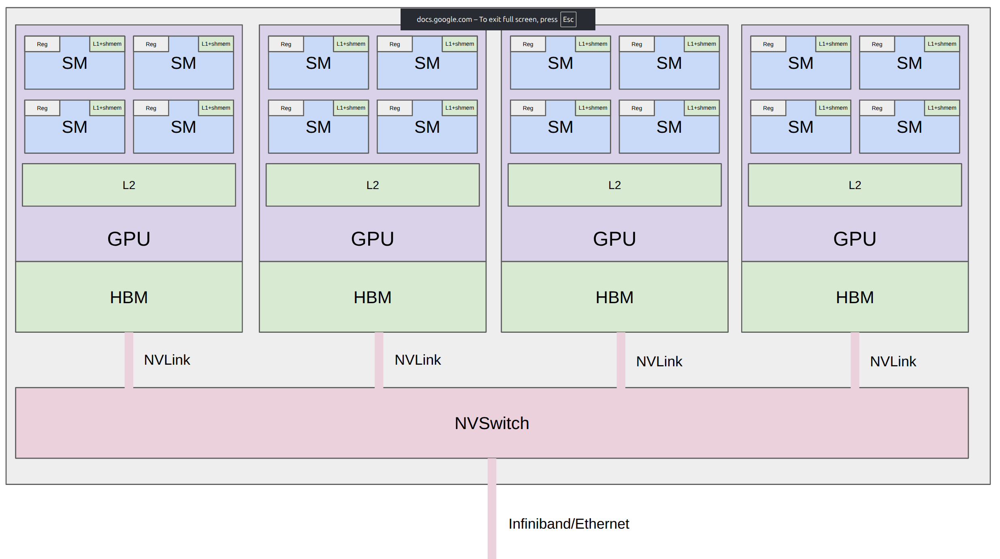
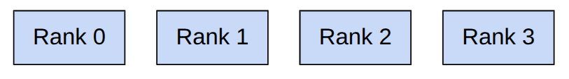
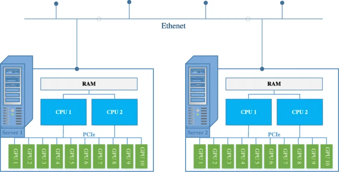
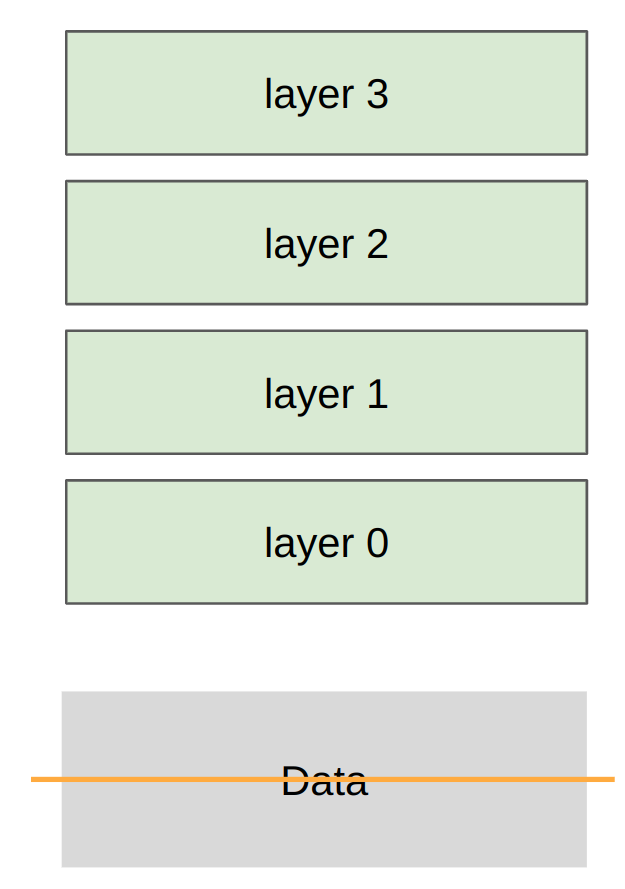
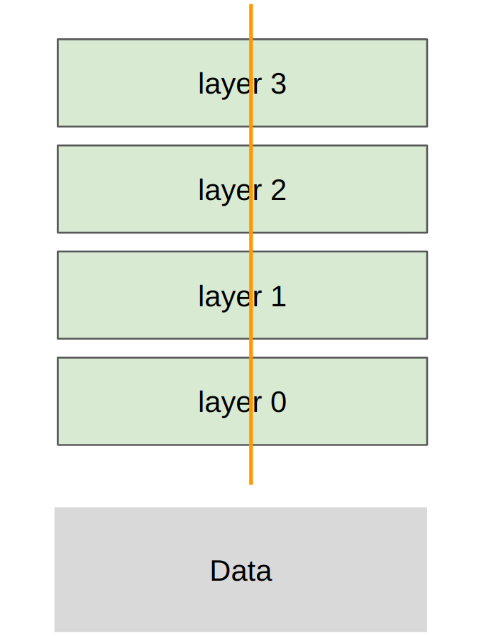
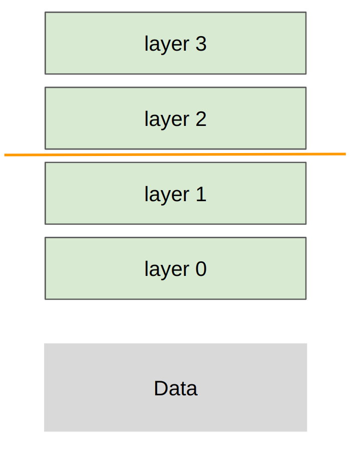

(cs336-07-cover)=
# Lecture 07: Parallelism

Stanford CS336 · Language Modeling from Scratch · Spring 2026.

(cs336-07-topic-002)=
## Lecture 7: parallelism

Last week: parallelism within a single GPU

This week: parallelism across multiple GPUs

In both cases, **compute** (arithmetic logic units) is far from inputs/outputs (**data**).

Unifying theme: orchestrate computation to avoid data transfer bottlenecks

Generalized hierarchy:

- Single node, single GPU: L1 cache / shared memory (fastest)
- Single node, single GPU: HBM
- Single node, multi-GPU: NVLink/NVSwitch
- Multi-node, multi-GPU: Infiniband/Ethernet (slowest)

Last week: reduce memory accesses via fusion/tiling

This week: reduce communication across GPUs/nodes via replication/sharding

Why do multi-GPU?

1. Your parameters (optimizer state + gradients + activations) don't fit on a single GPU.
2. You want to use more GPUs (more FLOPs) to train faster. [stdout for this lecture](../source/var/traces/lecture_07_stdout.txt)

(cs336-07-topic-003)=
### Part 1: building blocks of distributed communication/computation

**Collective operations** are the conceptual primitives used for distributed programming [article](https://en.wikipedia.org/wiki/Collective_operation)

- These are classic in the parallel programming literature from the 1980s.
- *Collective* means that you specify a general communication pattern across many devices.
- This can be better/faster than managing point-to-point communication yourself.

**Setup**:

- **Rank**: a particular device/GPU (e.g., 0, 1, 2, 3)
- **World size**: total number of devices (e.g., 4)

Operations:

- Broadcast, scatter, gather, reduce (foundations)
- All-gather, reduce-scatter, all-reduce (workhorse)
- All-to-all (for MoEs)

**Broadcast**: copy from rank 0 to all ranks

Minor use case: rank 0 loads initial checkpoint and broadcasts to all ranks

**Scatter** tensor on rank 0 to all ranks

Note: stepping stone to understanding reduce-scatter

**Gather** pieces from all ranks to rank 0 (opposite of scatter)

Note: stepping stone to understanding all-gather

**Reduce** pieces from all ranks to rank 0, applying some operation (e.g., sum, min, max)

Note: stepping stone to understanding all-reduce

**All-gather**: perform gather to all ranks, not just rank 0

Use case: each rank holds parameter shard, gather to get full parameters for forward pass

**Reduce-scatter**: perform reduce on each dimension, scatter results

Use case: after backward pass, sum gradients from different data shards, but distribute storage

**All-reduce** = reduce-scatter + all-gather

Use case: after backward pass, sum gradients from different data shards, but replicate full parameters

Breaking all-reduce into reduce-scatter + all-gather allows for flexibility (e.g., ZeRO/FSDP)

**All-to-all**: each rank sends each other rank some tensor (most general)

Notes:

- Useful for MoEs: each rank has split of data and subset of experts; need to route data to experts
- For balanced splits, all-to-all looks like transpose
- Also handles unbalanced splits (but want splits to be as balanced as possible)

Way to remember the terminology:

- Reduce: performs some associative/commutative operation (sum, min, max)
- Scatter is inverse of gather
- All: means destination is all devices

Classic (in the home):

- GPUs on same node communicate via a PCI(e) bus (v7.0, 16 lanes => 242 GB/s) [article](https://en.wikipedia.org/wiki/PCI_Express)
- GPUs on different nodes communicate via Ethernet (~200 MB/s)

Modern (in the data center):

Typical setup:

- 8 GPUs per node, connected by NVLink to an NVSwitch (B200s' NVLink 5.0 gets 1.8 TB/s; HBM was 8 TB/s)
- 256 nodes per pod, connected by Infiniband (via PCIe -> HCA / Infiniband NIC -> Infiniband cable) (~0.05 TB/s)
- N pods per cluster / datacenter, connected by Ethernet (via PCIe -> CPU)

Bypassing the CPU:

- Ethernet requires passing through the CPU (copying data to kernel socket buffer, build TCP packets, copy to NIC ring buffer)
- Remote Direct Memory Access (RDMA): allows one GPU to directly read/write another GPU's memory without involving the CPU
- Infiniband supports RDMA, but standard Ethernet does not

Advancements:

- GB200/GB300 NVL72: 8 GPUs per tray, 9 trays per rack -> 72 GPUs in one NVLink domain
- RDMA over Converged Ethernet (RoCE): Ethernet bypasses CPU, similar but cheaper/weaker than Infiniband, used by Meta

(cs336-07-topic-004)=
### NVIDIA Collective Communication Library (NCCL)

NCCL translates collective operations into low-level packets that are sent between GPUs. [talk](https://www.nvidia.com/en-us/on-demand/session/gtcspring21-s31880/)

- Detects topology of hardware (e.g., number of nodes, switches, NVLink/PCIe)
- Optimizes the path between GPUs
- Launches GPU kernels to send/receive data

PyTorch distributed library (`torch.distributed`) [documentation](https://pytorch.org/docs/stable/distributed.html)

- Provides clean interface for collective operations (e.g., `all_gather_into_tensor`)
- Supports multiple backends for different hardware: gloo (CPU), nccl (GPU)
- Also supports higher-level algorithms (e.g., `FullyShardedDataParallel`) [not used in this course]

Let's walk through some examples.

| Variable | Value |
| --- | --- |
| `rank` | 0 |
| `world_size` | 4 |

Indeed, all-reduce = reduce-scatter + all-gather!

How fast does communication happen?

References: [How to reason about collective operations](https://github.com/NVIDIA/nccl-tests/blob/master/doc/PERFORMANCE.md#allreduce) [Sample benchmarking code](https://github.com/stas00/ml-engineering/blob/master/network/benchmarks/all_reduce_bench.py)

(cs336-07-topic-005)=
### Part 2: distributed training

Walk through bare-bones implementations of each strategy on deep MLPs.

Recall that MLPs are the compute bottleneck in Transformers, so this is representative.

Sharding strategy: each rank gets a slice of the data

| Variable | Value |
| --- | --- |
| `batch_size` | 128 |

| Variable | Value |
| --- | --- |
| `num_dim` | 1024 |

| Variable | Value |
| --- | --- |
| `local_batch_size` | 32 |

| Variable | Value |
| --- | --- |
| `start_index` | 0 |

| Variable | Value |
| --- | --- |
| `end_index` | 32 |

Notes:

- Losses are different across ranks (computed on local data)
- Gradients are all-reduced to be the same across ranks
- Therefore, parameters remain the same across ranks

Next time: FSDP/ZeRO: use all-gather and reduce-scatter to avoid holding all parameters in memory

Sharding strategy: each rank gets part of each layer, transfer all data/activations

| Variable | Value |
| --- | --- |
| `local_num_dim` | 256 |

Sharding strategy: each rank gets subset of layers, transfer all data/activations

| Variable | Value |
| --- | --- |
| `local_num_layers` | 2 |

| Variable | Value |
| --- | --- |
| `micro_batch_size` | 32 |

Not handled: overlapping communication/computation to eliminate pipeline bubbles

What's missing?

- Communication/computation overlap
- More general models (with attention, etc.)
- Other forms of parallelism (e.g., sequence parallelism, expert parallelism, combinations)
- Jax/TPUs: just define the model, the sharding strategy, and the Jax compiler handles the rest [levanter](https://crfm.stanford.edu/2023/06/16/levanter-1_0-release.html)
- But we're doing PyTorch so you can see how one builds up from the primitives

(cs336-07-topic-006)=
### Summary

- Many ways to parallelize: data (batch), tensor/expert (width), pipeline (depth), sequence (length)
- Data parallelism: DDP (all-reduce), FSDP/ZeRO (all-gather + reduce-scatter)
- Tensor parallelism: requires very fast interconnects (e.g., NVLink)
- Pipeline parallelism: can work with slow interconnects, but need to work to reduce pipeline bubbles
- Can **re-compute** or store in **memory** or store in another GPUs memory and **communicate**
- Hardware is getting faster, but will always want bigger models, so will have this hierarchical structure
