(cs336-08-cover)=
# Lecture 08: Parallelism basics

Stanford CS336 · Language Modeling from Scratch · Spring 2026.

(cs336-08-page-001)=

## Lecture 8

P A R A LLE LIS M BA SIC S

CS336 Tatsu H

(cs336-08-page-002)=

## Outline and goals

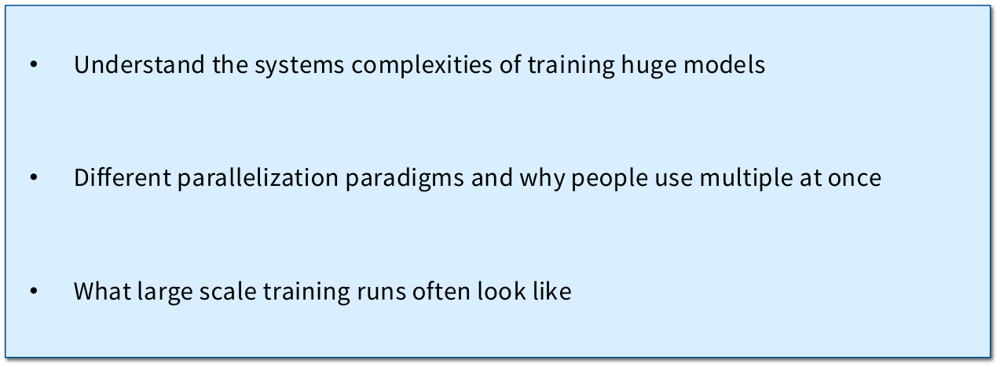

(cs336-08-page-003)=

## Organization today:

- Part 1 : Basics of networking for LLMs 
- Part 2 : Different forms of parallel LLM training 
- Part 3 : Scaling and training big LMs with parallelism

(cs336-08-page-004)=

## Limits to GPU-based scaling – compute

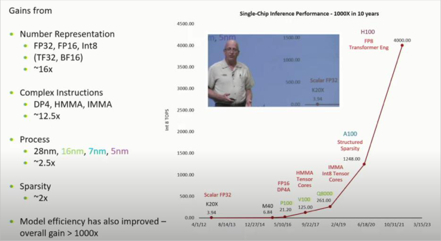

There are limits to single-GPU scaling.

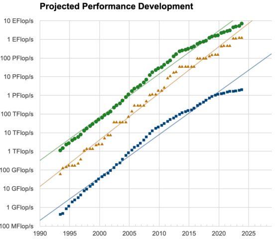

The word’s fastest supercomputers have _exaflops_ of compute

(cs336-08-page-005)=

## Limits to GPU-based scaling - memory

Models are getting really big..

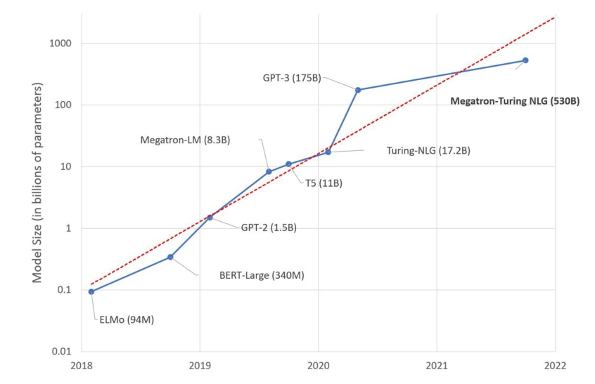

A single GPU can’t fit most of these large models!

(cs336-08-page-006)=

## What do we do? Multi-GPU, multi-machine parallelism

Intra-node parallelism
High-speed inter-node parallelism
via high-speed interconnects

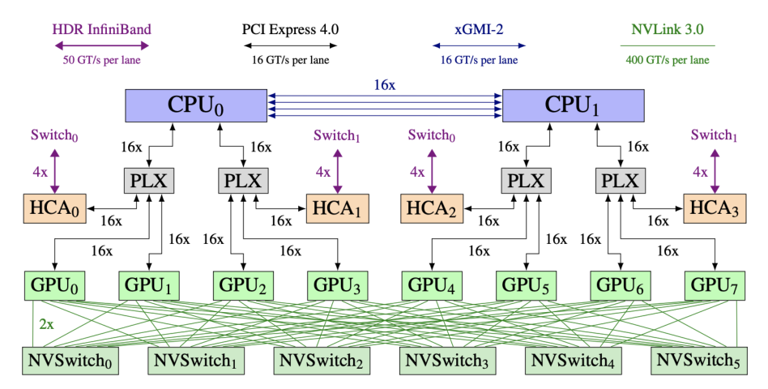

Split up memory and compute requirements across GPUs and machines

(cs336-08-page-007)=

## But first.. Some basics about collective communication

Reduce All reduce

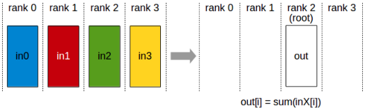

All Gather

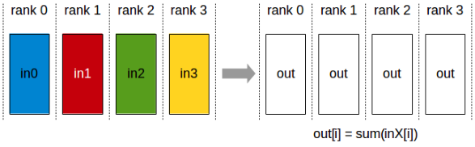

Broadcast

Reduce Scatter

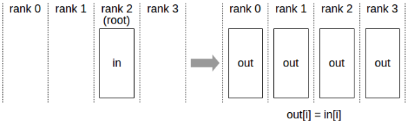

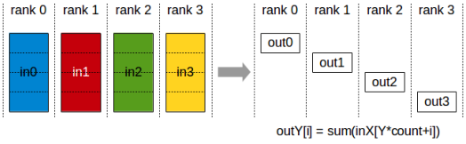

(cs336-08-page-008)=

## Important detail – all reduce vs reduce-scatter-gather.

Reduce can be implemented as two steps: reduce-scatter and all-gather

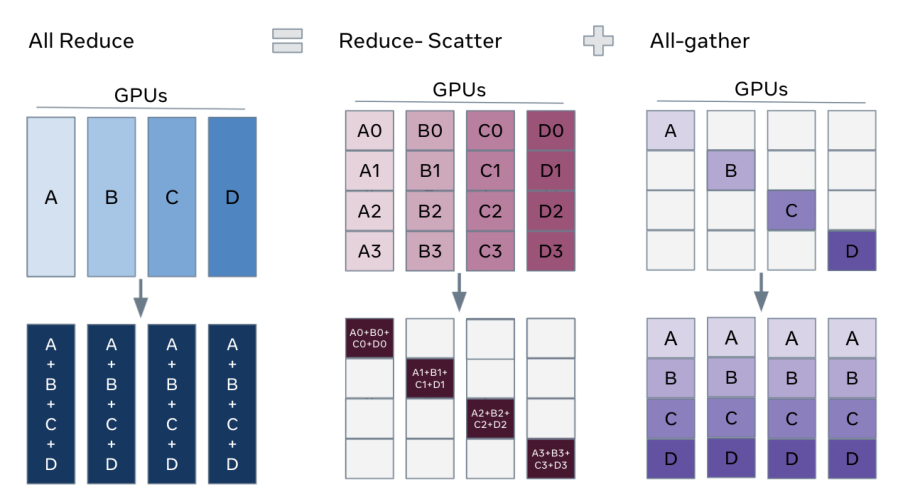

Importantly, in the bandwidth-limited regime, this is the best you can do

(cs336-08-page-009)=

## TPUs vs GPUs – design differences at the comm level

**TPU networking**

toroidal mesh

**GPU networking**

All-to-all (up to 256)

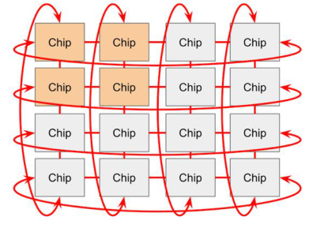

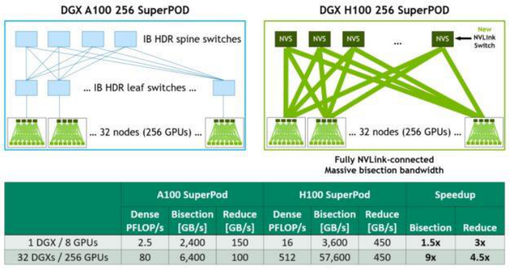

(cs336-08-page-010)=

## Mesh vs tree vs other

**Why mesh? Why tree?**

Pro mesh – Cheaper to operate, can be made fast (and just do tensor parallel)

Pro tree/A2A – Better for less structured communications (expert parallel)

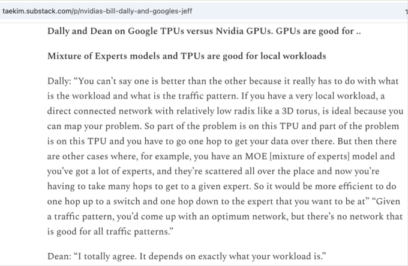

(cs336-08-page-011)=

## But then things change.. TPU8i/t

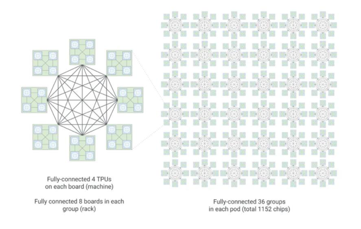

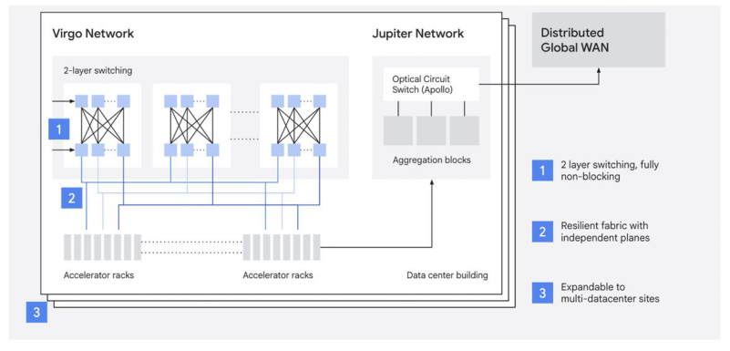

TPU8i networking – closer to tree-style topologies (maybe for MoEs?) TPU8t scale-out networking – ‘Virgo’ with switched networks

(cs336-08-page-012)=

## Why not connect everything?

**Domain sizes** – why not connect everything?

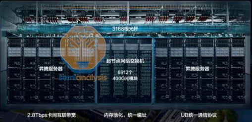

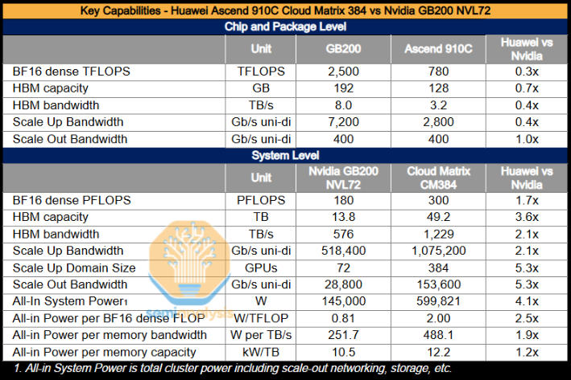

https://newsletter.semianalysis.com/p/huawei-ai-cloudmatrix-384-chinas-answer-to-nvidia-gb200-nvl72

(cs336-08-page-013)=

## Part 1 recap

- New unit of compute – the datacenter 
- What we want from multi-machine scaling:

- Linear memory scaling (max model params scales with num gpus) 
- Linear compute scaling (model flops scale linearly with num gpus)

- Simple collective comms primitives

(cs336-08-page-014)=

## Part 2 – Standard LLM parallelization primitives

How do we parallelize LLMs? 3 important ideas

**Data parallelism**

-
Naïve data parallel

-
ZeRO levels 1-3

**Model parallelism**

-
Pipeline parallel

-
Tensor parallel

**Activation parallelism**

-
Sequence parallel

(cs336-08-page-015)=

## Naïve data parallelism

**Starting point** – imagine we are doing naïve SGD

𝐵

𝜃 𝑡+1 = 𝜃 𝑡
−𝜂෍

𝑖=1

∇𝑓(𝑥 𝑖 )

**Naive parallelism:** split the elements of B sized batch across M machines. Exchange gradients to

synchronize

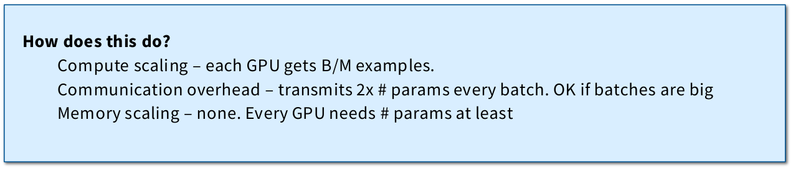

(cs336-08-page-016)=

## What’s wrong with naïve data parallel?

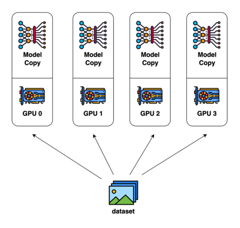

Memory seems like it’d be a problem – we copy the model parameters to each GPU.

Let’s take a closer look..

(cs336-08-page-017)=

## What’s wrong with naïve data parallelism? - Memory

**Our memory situation is actually** _**terrible.**_

Depending on our precision..

2 bytes for FP/BF 16 model parameters

2 bytes for FP/BF 16 gradients

4 bytes for FP32 master weights (the thing you accumulate into in SGD)

4 (or 2) bytes for FP32/BF16 Adam first moment estimates

4 (or 2) bytes for FP32/BF16 Adam second moment estimates

“Optimizer state”

(cs336-08-page-018)=

## ZeRO – solving the memory overhead issue of DP

**Core idea:** split up the expensive parts (state) and use the reduce-scatter equivalence.

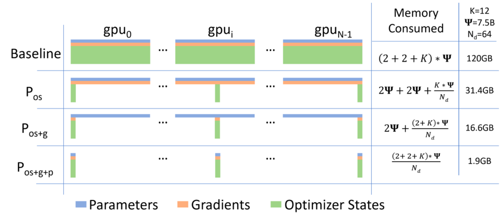

(cs336-08-page-019)=

## ZeRO stage 1. optimizer state sharding

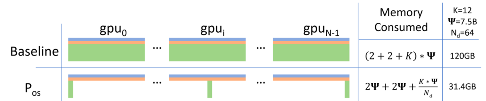

**High level idea:**

Split up the optimizer state (first + second moments) across GPUs

Everyone has the parameters + gradients

Each worker is responsible for updating a subset of params (corresponding to their slice)

(cs336-08-page-020)=

## ZeRO stage 1. how it works

**Step 1.** Everyone computes a full gradient on their subset of the batch

**Step 2.** ReduceScatter the gradients – incur #params communication cost

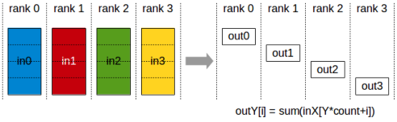

**Step 3.** Each machine updates their param using their gradient + state.

**Step 4.** All Gather the parameters – incur #params communication cost

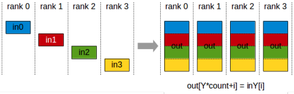

(cs336-08-page-021)=

## Comparing ZeRO stage 1 and naïve data parallel

||Naïve DDP|ZeRO stage 1|
|---|---|---|
|Communication primitive|One all-reduce (gradients)|One reduce scatter (send gradients) + all gather (collect params)|
|Communication cost|2* # params|2* # params|
|Memory|(4+K) * #params|(4+K/Ngpu) * #params|

ZeRO stage 1 is free (in the bandwidth limited regime) memory wins

(cs336-08-page-022)=

## ZeRO stage 2. the simple extension to gradient sharding

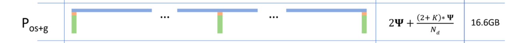

Emboldened by our success, let’s shard even more stuff

**High level idea**

Also keep the gradients (pink slices) sharded across the machines.

Use the same (rough) tricks as stage 1.

**Complexity** – we can never instantiate a full gradient vector, but each worker must

compute a full gradient (since we’re data parallel)

(cs336-08-page-023)=

## ZeRO stage 2. how it works

**Step 1.** Everyone incrementally goes backward on the computation graph

Step 1a. After computing a layer’s gradients, immediately reduce to send this to the
right worker

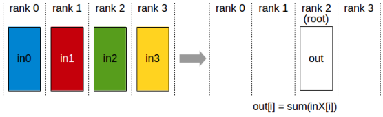

Step 1b. Once gradients are not needed in the backward graph, immediately free it.

**Step 2.** Each machine updates their param using their gradient + state.

**Step 3.** All Gather the parameters.

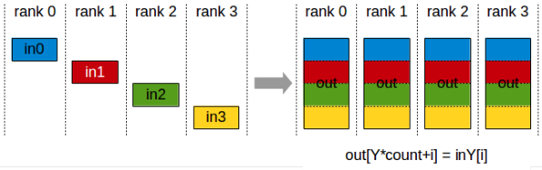

(cs336-08-page-024)=

## ZeRO stage 3 (aka FSDP) shard everything

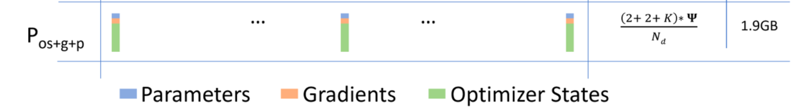

We’ve gotten almost everything for free so far.. lets try to solve _all_ our memory issues

**High level idea**

Shard everything – incl parameters!

Use the same ‘incremental communication / computation’ ideas

Send and request parameters on demand while stepping through the compute graph.

Is it possible to do this with low overhead?

(cs336-08-page-025)=

## ZeRO stage 3 (aka FSDP) how it works (baby version)

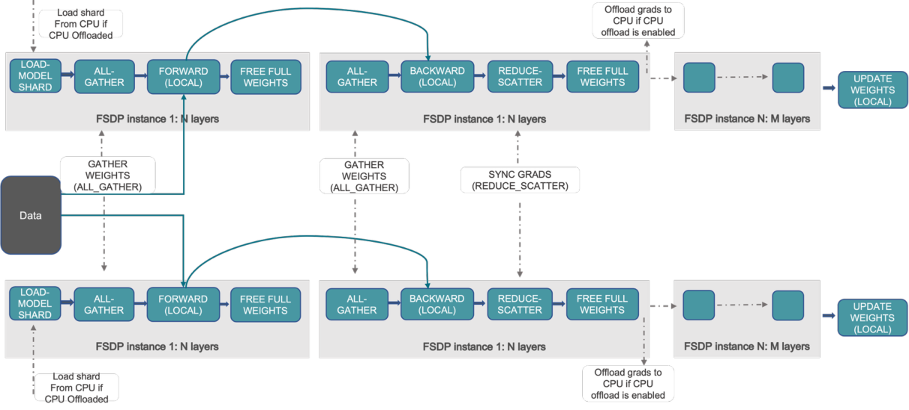

Communication cost – 2 all gather (#param), 1 reduce-scatter (#param).

https://pytorch.org/tutorials/intermediate/FSDP_tutorial.html

(cs336-08-page-026)=

## Actual picture of how FDSP / ZeRO stage 3 works

Let’s walk through a FSDP example to see some important ideas

**Incremental computation / communication**

Parameters / gradients are requested / sent and then immediately freed

**Overlapping communication and computation (** 𝑾 𝟏 𝑾 𝟎 + 𝑾 𝟐 𝑾 𝟎 )𝒙= 𝒚

The all-gathers happen all at once while forward happens, masking the comm cost.

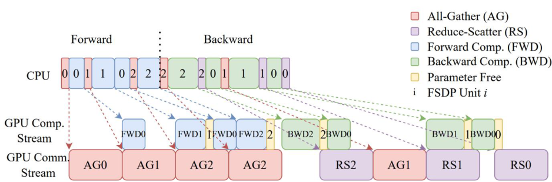

https://arxiv.org/pdf/2304.11277.pdf

(cs336-08-page-027)=

## What’s the point?

Distributed data parallel costs 2*# param communication

**What about ZeRO?**

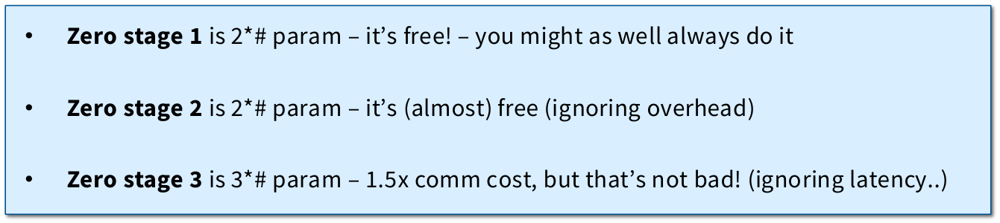

This is also conceptually very simple – write a FSDP block wrapper.

(cs336-08-page-028)=

## ZeRO in practice: will it fit?

Pure BF16 training (with Kahan summation), is viable and optimizer states are less

beefy. Let’s say BF16 for everything but the master weights – 12 bytes per param

On a 8X A100 80G..

||Max size (params)|Formula for B/param|
|---|---|---|
|Baseline|6.66.. B|12|
|Zero stage 1|16 B|5|
|Zero stage 2|24.62 B|2 (param) + (10 (grad+state))/8)|
|Zero stage 3|53.33 B|12/8|

(cs336-08-page-029)=

## Issues remain with data parallel – compute scaling

With data parallel **, #machines < batch size** (and near this, comm overhead is high)

And there’s diminishing returns to batch sizes

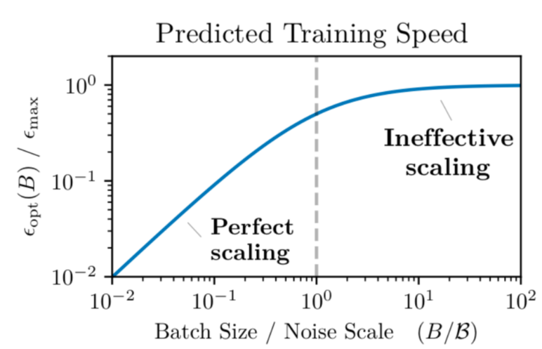

(cs336-08-page-030)=

## Issues remain with data parallel – models don’t fit

**Zero stages 1 and 2** don’t let you scale memory

**Zero stage 3** is nice in principle, but _does not reduce activation memory_

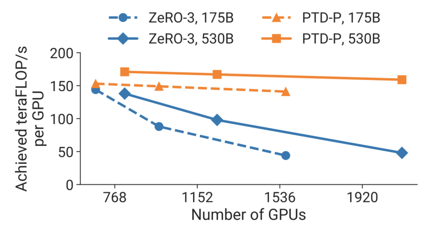

Better ways to split up the model is needed…

(cs336-08-page-031)=

## Beyond data parallel – model parallelism

**Scaling up in memory (without changing batch size) with model parallelism**

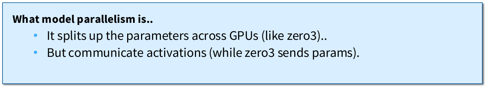

**We cover three different types of parallelism**

1. Pipeline parallel
2. Tensor parallel (+ Sequence parallel)
3. Expert parallel

These correspond to three different ways of cutting up the model.

(cs336-08-page-032)=

## Layer-wise parallel

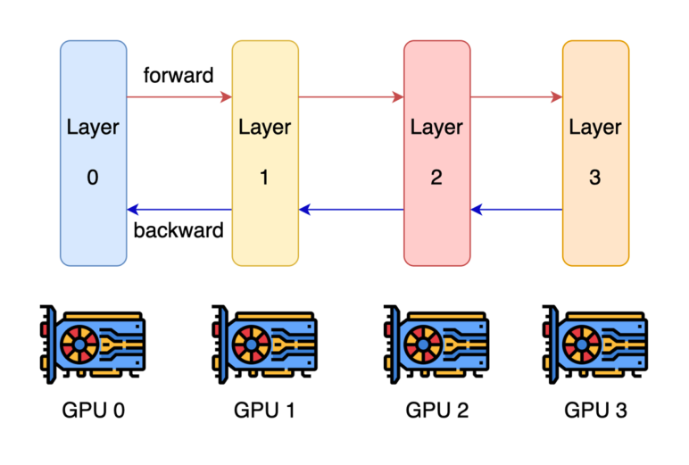

**Layer-wise parallel** cuts up layers, assigns some subset to GPUS.

**Activations and partial gradients** are passed back and forth

(cs336-08-page-033)=

## What’s wrong with layer-wise parallel

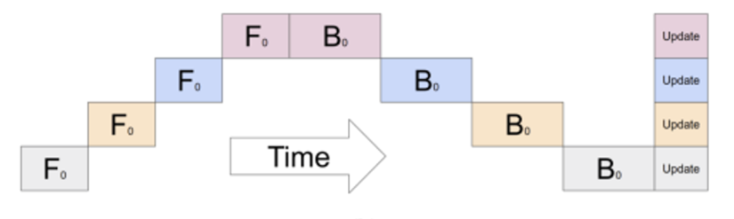

Each GPU is idling most of the time, waiting for the backward pass to propagate back

(cs336-08-page-034)=

## A solution: pipeline parallel

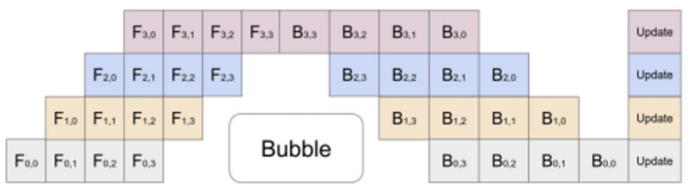

The ratio of bubble time to useful compute is ..

𝑛 𝑠𝑡𝑎𝑔𝑒𝑠 −1

𝑛 𝑚𝑖𝑐𝑟𝑜 [ so we need a big batch size!]

(cs336-08-page-035)=

|Why pipeline parallel?||
|---|---|
|Pipelines seem terrible. Why do we do it?||
|1. Pipelines save memory (compared to DDP) 2. Pipelines can have good communication properties (compared to FDSP) – it depends only on activations (𝑏× 𝑠× ℎ) and is_point to point_ ||
|Generally, we will use pipelines on slower network links (i.e. inter-node) as a way to get better memory-wise scaling.||

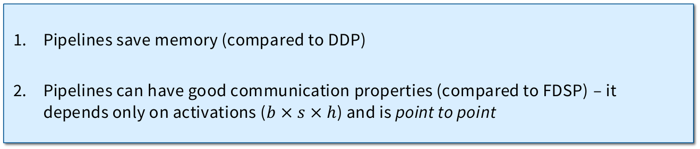

(cs336-08-page-036)=

## Pipeline performance is highly dependent on batch size

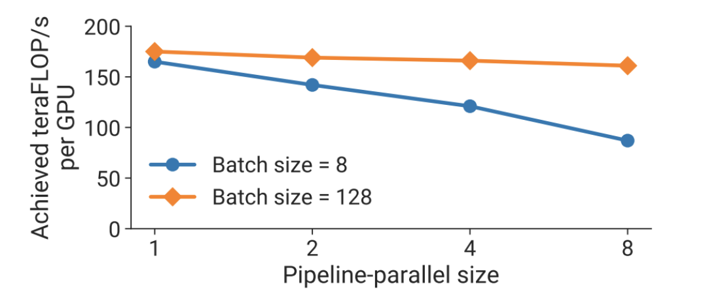

Batch sizes are key to hiding the bubble – otherwise pipeline rapidly degrades perf

(cs336-08-page-037)=

## Trading communication bandwidth for utilization

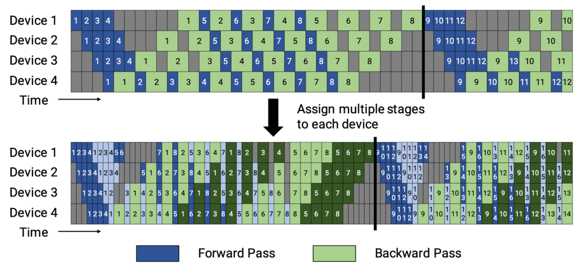

Some more crazy pipeline patterns can improve utilization, but at the cost of bandwidth

(cs336-08-page-038)=

## ‘Zero bubble’ pipelining

**Split up backwards into two parts**

1. Backpropagating activations (z,x)

2. Computing weight gradients (W)

The second part can be done whenever

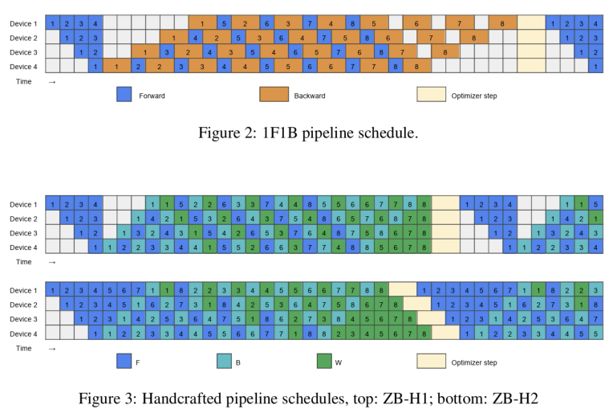

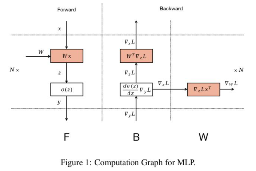

(cs336-08-page-039)=

## Model parallel along the width axes

**Are there model parallel schemes with better utilization?**

We can think of pipeline parallel as cutting up along depth. What about width?

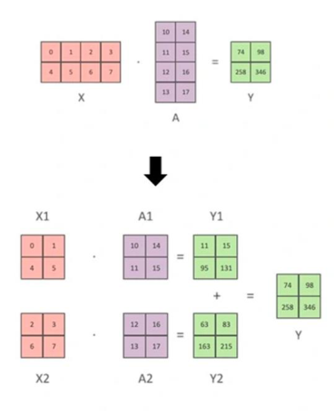

Simple matrix multiplication observation: decompose into submatrices, add partial sums

(cs336-08-page-040)=

## Tensor parallel – GPUs have submatrices

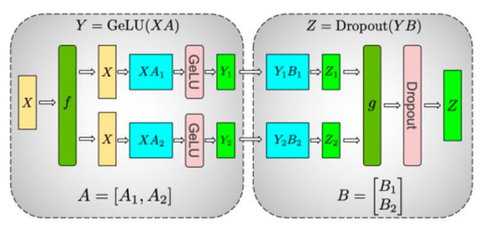

Assign columns (A1, A2) and rows (B1, B2) to separate GPUs.

In the forward pass, f is the identity, and g is an all-reduce.

In the backward pass, f is an all-reduce, g is the identity.

(cs336-08-page-041)=

## Row vs Column tensor parallel

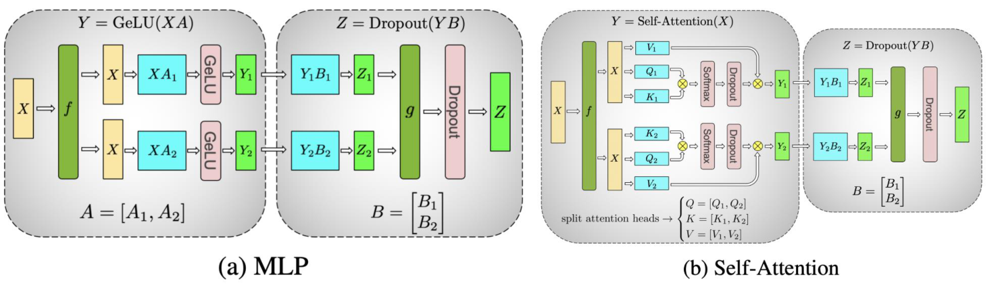

How do we split up in tensor parallel across a transformer block?

Columnwise – QKV, up-projection

Rowwise – Attention output, down-projection

Replicated – norms, routers, etc

(cs336-08-page-042)=

## When do we tensor parallel?

On GPUs, tensor parallel within a node (up to 8 GPUs) due to high speed interconnects.

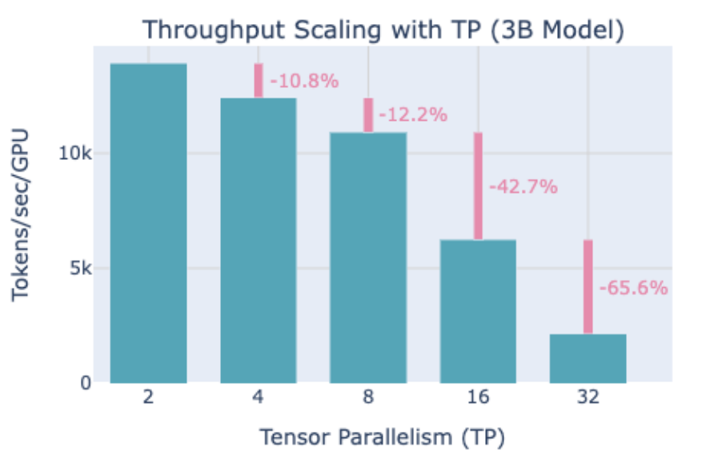

(cs336-08-page-043)=

## Tensor parallel – pros and cons vs pipeline parallel

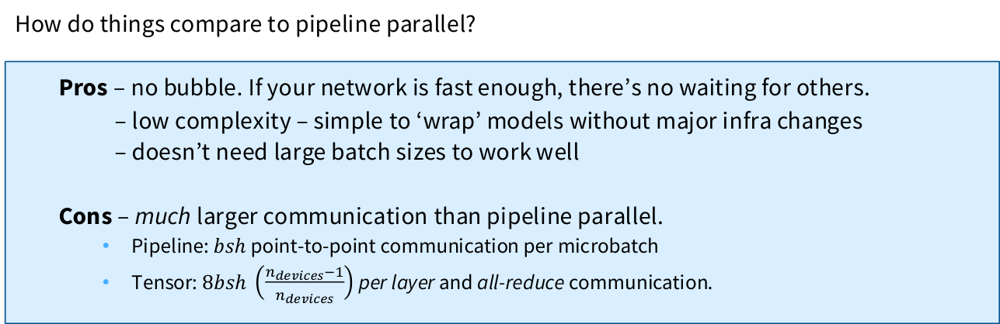

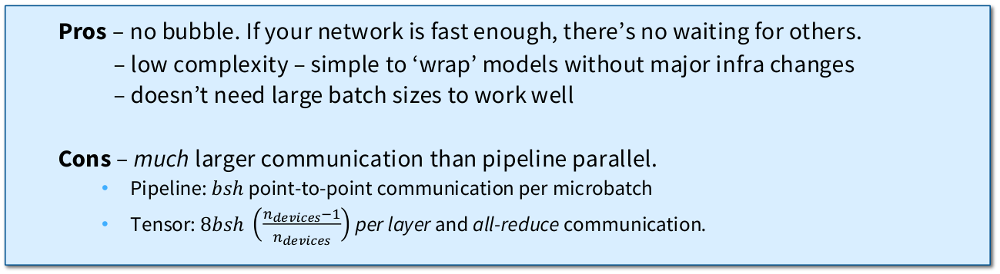

Use tensor parallel whenever we have low-latency, high-bandwidth interconnects

(cs336-08-page-044)=

## A final complexity – memory is dynamic!

Memory isn’t just the static bits, but also activations! This can be big

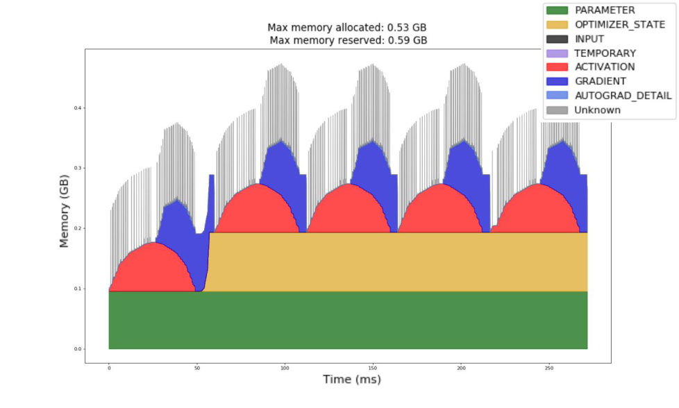

(cs336-08-page-045)=

## A final complexity – activation memory

Thus far, we have only really discussed parameter memory.

Tensor and pipeline parallel can linearly reduce those.. **but what about activations?**

[Korthikanti et al 2022]

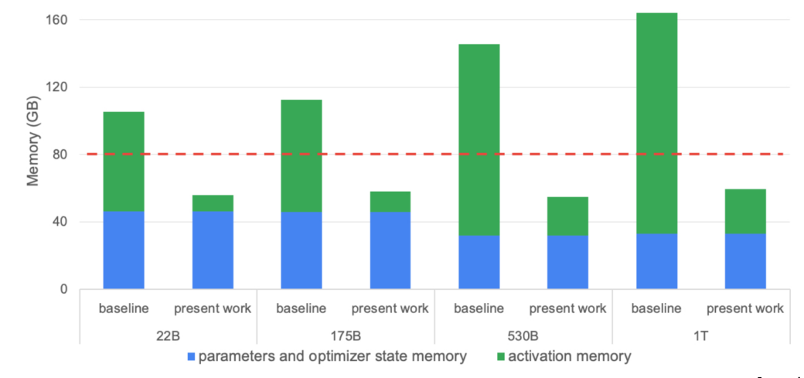

(cs336-08-page-046)=

## What’s the activation memory per layer?

**Starting point:** activation memory needed if storing everything

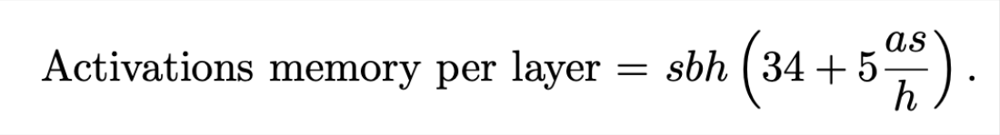

(cs336-08-page-047)=

## Activation under tensor parallel

**Tensor parallel** splits out the matrix multiplies in attention + MLP

The remaining **10** term is for the LayerNorm (4sbh), Dropout (2sbh), and inputs to the
attention and MLP (4sbh). These terms alone will continue to grow with size

(cs336-08-page-048)=

## Making memory truly linear – sequence parallel

**Observation:** all the 10sbh terms are pointwise ops over the sequence

… so split up the layer norm/dropout layers along the sequence axis.

In the forward pass, ‘𝑔’ is an all gather, ‘ ത𝑔’ is reduce-scatter

In the backward pass, the two are reversed.

(cs336-08-page-049)=

## Making activation memory fully scale with more machines

Putting it together to get full linear scaling for memory.

(cs336-08-page-050)=

## Expert parallelism

Instead of splitting up the matmul, split up the experts and route activations

(cs336-08-page-051)=

## Why EP?

EP is _roughly_ like TP in behavior for MLPs – high bandwidth, reduces activation

But, splitting matmuls can reduce efficiency vs routing activations

(cs336-08-page-052)=

## Complexity – combining EP and others

Naively – we can compose EP and all other strategies..

**But there are important notes** – DP usually shares replicas with EP splits (so EP&lt;DP)

DP and TP can interact badly to lower utilization

(cs336-08-page-053)=

## Complexity: Decoupling attention / expert parallelism

**Recall** : MoEs apply to the MLPs, not the attention (with some exotic exceptions)

This can lead to some imbalance between attention and MLPs for parallelism

High TP – useful for attention parallelization (since we cant use EP)

Low TP – useful for MLP parallelization (we’d rather EP than TP)

What to do? More flexible parallelism strategies (i.e. in Megatron)

Separates out TP/CP/DP (for attention) and (ETP/EP/EDP) for MLPs

https://docs.nvidia.com/megatron-core/developer-guide/latest/user-guide/features/moe.html

(cs336-08-page-054)=

## Other parallelism strategies

**Context parallel / Ring attention** (split activations across GPUs in a long sequence)

(cs336-08-page-055)=

## Recap: LLM parallelism table

|Method|Comm/Sync|Param memory per rank|Activation / KV memory per rank|Main bandwidth cost|Scales global batch?|Easy to use?|
|---|---|---|---|---|---|---|
|**DDP / ZeRO-1**|gradient all-reduce per step|**No param scaling**  (ZeRO-1 only opt state)|**None**|**Gradient traffic ~** **O(params)**|**Yes, linear in DP**|**Very**|
|**FSDP / ZeRO-3**|Gradient all reduce – can be overlapped|**~1/DP** for params/grads/opti mizer state|**None**|**Param traffic ~** **O(params)**, higher than DDP, overlap|**Yes, linear in DP**|**Moderate**|
|**Pipeline parallel**|Activation between layers,**pipeline** **bubbles**|**~1/PP**|Depends on pipeline buffers|**Activation traffic** **between stages**|**No**, but needs microbatches|**Hard**|
|**Tensor parallel**|**Blocking** **activation** **communication**|**~1/TP** for TP- sharded weights|**~1/TP**for relevant matmul activations w/ SP|**Activation-sized** **collectives every** **block**|**No**|**Hard**|
|**Sequence /** **Context parallel**|per-layer sequence- shard exchange|**None**|**~1/SP or 1/CP** on sequence-side activations / KV|**Activation / KV** **communication**|**No**|**Hard**|
|**Expert parallel** **(MoE)**|**token dispatch -** **all-to-all per MoE**|**~1/EP for expert** **weights only**|**None**|**Token-routing all-** **to-all**|**No**, but needs enough tokens per expert|**Hard**|

(cs336-08-page-056)=

## Model vs Tensor parallel (TPU book)

**Key quantity**
Global batch size (divided by GPU)

(cs336-08-page-057)=

## ‘3D (4D) parallelism’ – putting it all together

**Simple rules of thumb from the literature.**

1. Until your model fits in memory..

Tensor / expert parallel up to GPUs / machine

Pipeline parallel across machines

›
(Or use Zero-3, depending on BW)

2. Then until you run out of GPUs

Scale the rest of the way with data parallel

If your batch size is small.. gradient accumulate to trade higher
batch sizes for better communication efficiency.

(cs336-08-page-058)=

## Example from Metagron’s current recommendations

The “ **basics** ” Plus more advanced “ **extras** ”

https://docs.nvidia.com/megatron-core/developer-guide/latest/user-guide/features/moe.html

(cs336-08-page-059)=

## Scaling strategies from Narayanan 2021

**Notes**

Tensor parallel first up to 8, then caps out at 8.

Pipeline parallel goes up to make the model fit.

Dara parallel gradually decreases with scale, with the largest model having DP=6

DP size

32

32

32

32

32

32

24

15

9

6

(cs336-08-page-060)=

## Careful ‘3D’ parallelism gives linear gains

More GPUS, same, flat utilization!

(cs336-08-page-061)=

## Tensor parallel = 8 is often optimal

When parallelizing across 64 machines – it’s best to use a 8 x 8 configuration.

(cs336-08-page-062)=

## Activation recomputation can pay for itself (via memory)

Activation recomputation enables larger batches, improving throughput (t=8, p=16)

(cs336-08-page-063)=

## Recent LMs – what do they do?

**Dolma** – 7B model, FDSP (probably fits intra-node)

(cs336-08-page-064)=

## DeepSeek

**DeepSeek** – ZeRO stage 1 with Tensor, Sequence, and Pipeline parallel
**V3** – PP (16), EP (64-way, 8 nodes), ZeRO stage 1
EP uses 1F1B A2A Overlap

(cs336-08-page-065)=

## Yi

**Yi** - ZeRO stage 1 + Tensor + Pipeline parallel

Yi-lightning (2025) – Tensor replaced by Expert parallelism

(cs336-08-page-066)=

## Llama3 405B

(Stage 1, small bsz training, Stage 2 pretraining, Stage 3 long-context)

(cs336-08-page-067)=

## Llama 3 405B

**Side note** – Lots of GPU failures at this scale!

(cs336-08-page-068)=

## Gemma 2

**For 2, 9, 27B models**

ZeRO-3, MP (=TP+SP), DP

(cs336-08-page-069)=

## Mixtral 8x22B

–
**From megatron docs**

TP / PP / CP / EP (4/4/1/8) – DP likely 2 (to add up to 256GPUs)

(cs336-08-page-070)=

## Nemotron 3 Super 120B-A12B

**From the long-context extension section**

TP / PP / CP / EP (2/0/64/64)

(cs336-08-page-071)=

## Qwen 3

225B-A22B and 30B-A3B

Primarily expert parallel up to 8 GPUs, 2/8/32 parallelism for larger models

(cs336-08-page-072)=

## Overview table of model parallelism

||DP|TP/SP|EP|PP|CP|
|---|---|---|---|---|---|
|Deepseek|?? (Zero1)|1|8|16|??|
|Deepseek v3|?? (Zero1)|1|64|16|??|
|Yi|?? (Zero1)|>0|1|>0|??|
|Llama3 405B|128|8|0|16|1|
|Gemma 2|768|8|0|0|0|
|Mixtral 8x22 (megatron)|2|4|8|4|1|
|Nemotron 3 120B (long context)|??|2|64|??|64|
|Qwen 3 (megatron)|??|2|32|8|1|

Patterns – TP generally <= 8. EP can be big (but hard!). Long context phases use large CP

(cs336-08-page-073)=

## Recap for the whole lecture

