(cs336-09-cover)=
# Lecture 09: Scaling laws: basics

Stanford CS336 · Language Modeling from Scratch · Spring 2026.

(cs336-09-page-001)=

## Lecture 9

S C A LIN G LAW S - BA SIC S

CS336

(cs336-09-page-002)=

## Taking scaling seriously

**Imagine the following scenario..**

Your friend has given you ten thousand B200s for a month,

and asked you to build a good open source LM.

What do you do?

Put together your infra team and distributed training framework (A2)

Put together a great pretraining dataset (A4)

Run a big model (but which one??) <- we are here.

(cs336-09-page-003)=

## Scaling isn’t easy

Wide or deep? How many heads? Which nonlinearity?

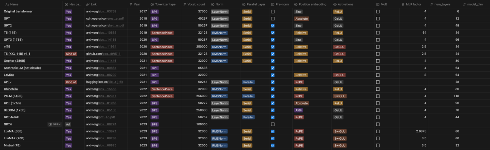

We could cargo cult things from existing LMs… but how do these get optimized in the first place?

(cs336-09-page-004)=

## Today: simple, predictive ‘laws’ for behaviors of LMs

The approach

**scaling laws** which are simple, predictive rules for model performance

**Old and unpleasant** : tune hyperparameters on big models
**New (over?) optimism** : tune on small models, extrapolate to large ones

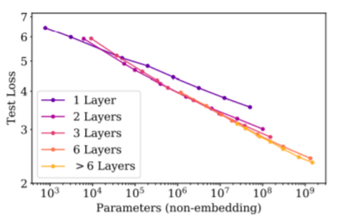

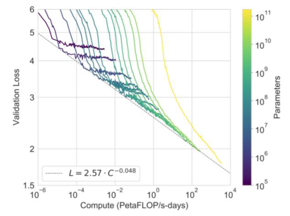

(cs336-09-page-005)=

## Part 1. Scaling laws, history and background.

- Data scaling as empirical sample complexities 
- Initial forays into understanding neural scaling with data

(cs336-09-page-006)=

## Sample complexity and rates

Theorists have thought about ‘scaling’ for a long time..

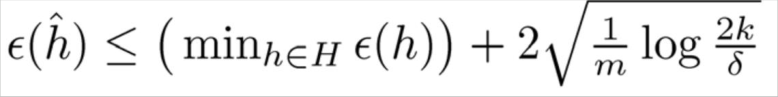

(learning in a finite set of k hypotheses)

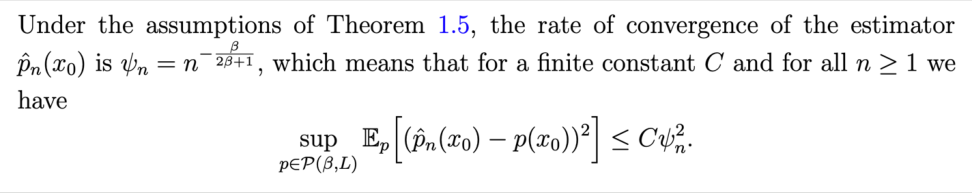

(generative modeling for smooth densities)

But these are upper bounds, not actual, realized loss values.

[https://www.cs.cmu.edu/~epxing/Class/10701/slides/lecture16-VC.pdf](https://www.cs.cmu.edu/~epxing/Class/10701/slides/lecture16-VC.pdf)
Hall, 1989

(cs336-09-page-007)=

## Earliest (data) scaling law paper – 1993

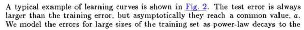

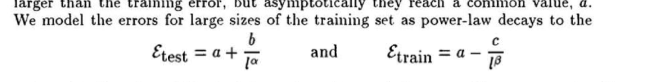

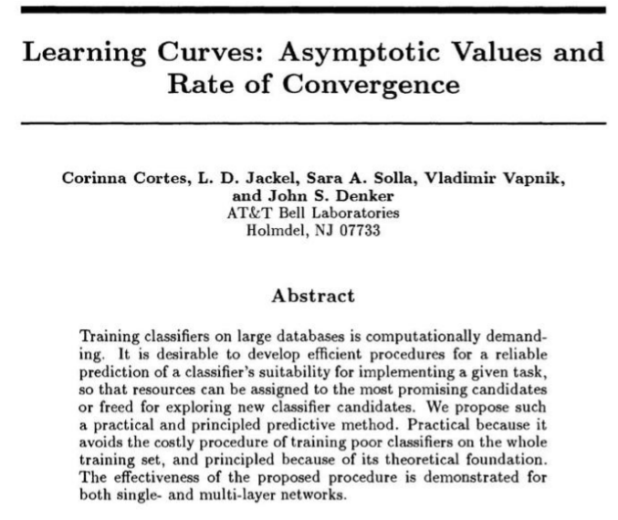

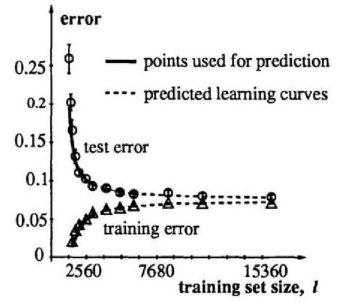

(cs336-09-page-008)=

## Early history of scaling laws – data scaling

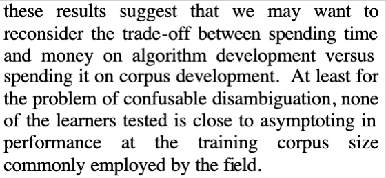

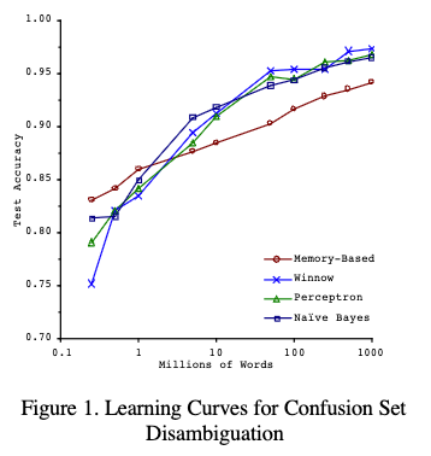

Log-linear scaling with data [Banko and Brill ‘01]

(cs336-09-page-009)=

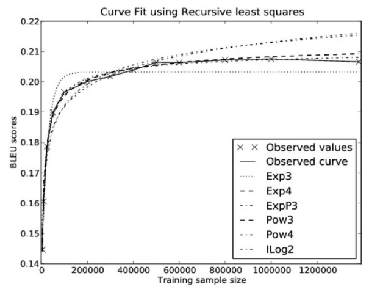

**Early tests of functional forms**

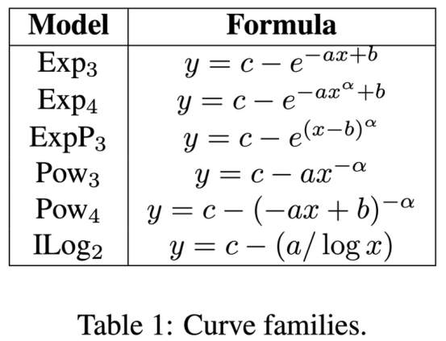

Kolachina et al 2012 – power law relation between data and downstream performance

(cs336-09-page-010)=

## Hestness et al 2017

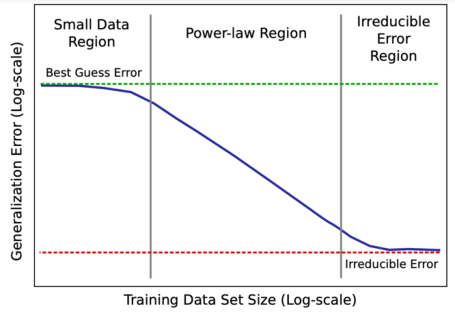

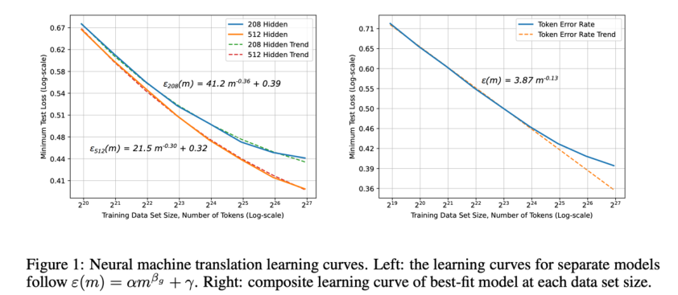

**Earliest ‘large scale neural’ scaling work:** Hestness 2017

Predictable scaling on many tasks (MT, LM, Speech) and hypothesized scaling shape.

(cs336-09-page-011)=

## Hestness II

Very ahead of its time..

“Emergence” Scaling by compute Speed = accuracy

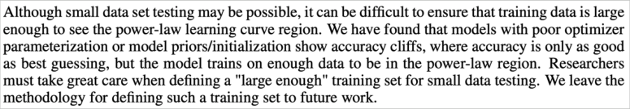

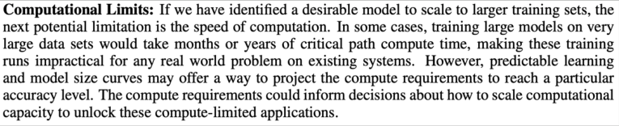

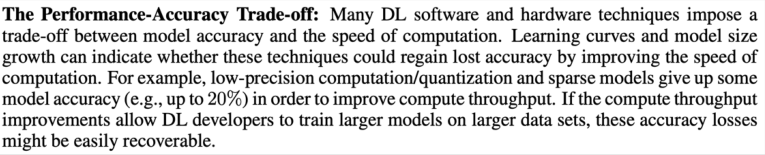

(cs336-09-page-012)=

## Part 2. Neural (LLM) scaling behaviors

1.Data vs performance

“Are there simple rules that determine how data affects

performance?”

2. Data vs model size

Do we train on more data or bigger models?

3. Hyper-parameters vs performance

“How should we set hyperparameters on the big model??”

(cs336-09-page-013)=

## Scaling laws – power law relationships for many factors

These scaling laws hold on _many_ different kind of phenomena!

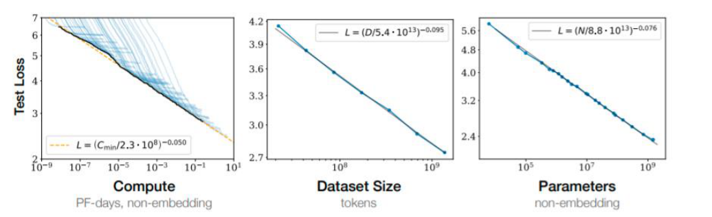

They even hold in non
standard settings

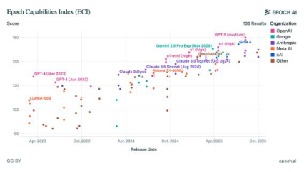

[Kaplan+ 2020]

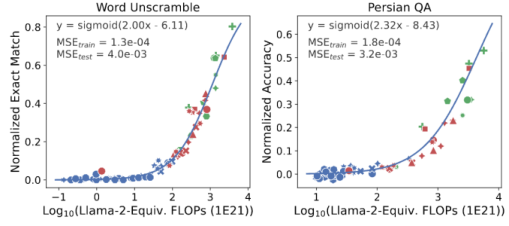

(cs336-09-page-014)=

## Data vs performance

What’s a data scaling law?

**Data scaling laws** : simple formula that maps dataset size (n) to error

What do we expect out of scaling laws?

Monotonic, logistic
like curves

[Hestness+ 2017]

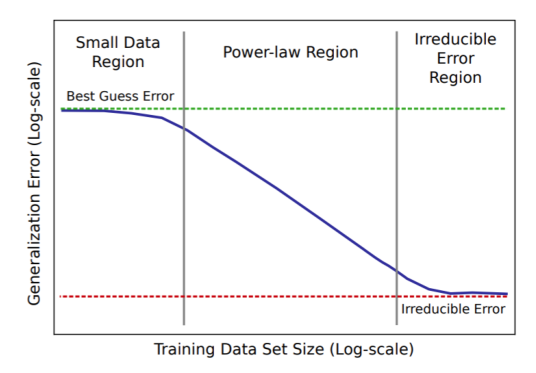

(cs336-09-page-015)=

## Data scaling laws for language models

First, an empirical observation

Loss and dataset size is linear on a log-log plot** “Scale-free” or

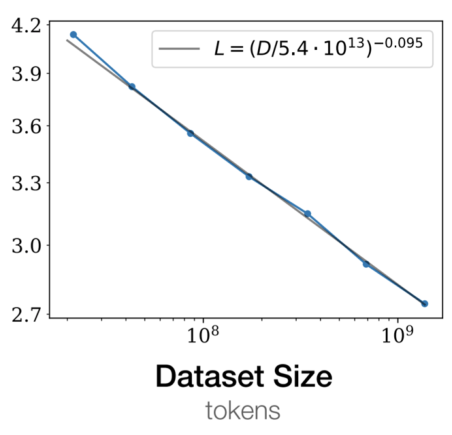
“Power law” (For language modeling, from Kaplan+ 2020)

(cs336-09-page-016)=

## Conceptual foundations of data scaling laws.

We know error should be monotone

But why is it a power law / linear in log-log?

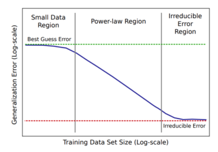

But this answer may take a moment to understand. Let’s work through an example.

**Example:** If our task is to estimate the mean of a dataset, what’s the scaling law?

(cs336-09-page-017)=

## Toy example: mean estimation

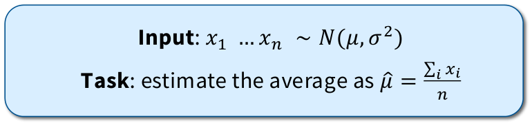

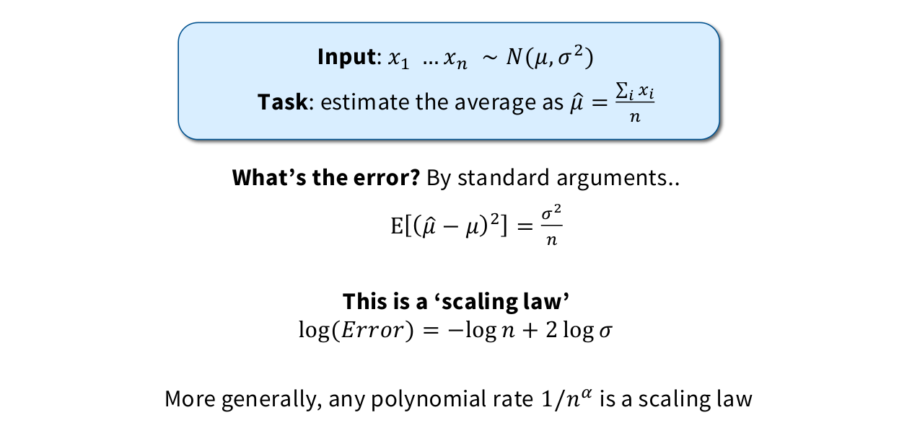

(cs336-09-page-018)=

## Scaling law exponents: an intriguing mystery

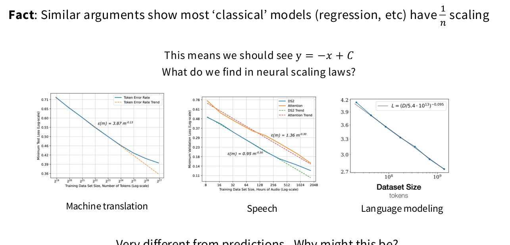

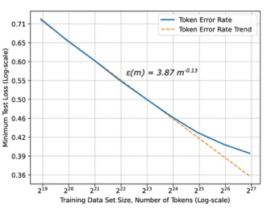

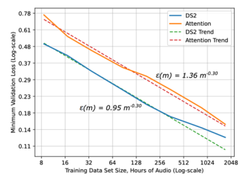

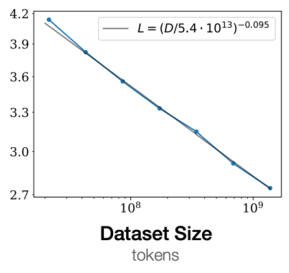

Very different from predictions.. Why might this be?

(cs336-09-page-019)=

## Detour: scaling laws for (nonparametric) learning

Neural nets can approximate arbitrary functions. Lets turn that into an example.

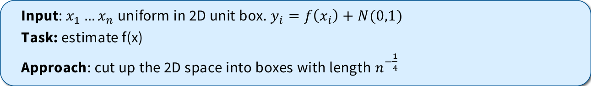

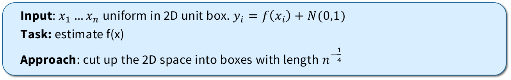

**What’s our estimation error?**

𝑛 𝑛
Informally, we have boxes, each box gets samples.

𝐸𝑟𝑟𝑜𝑟≈ [1]

𝑛 [+ 𝑜𝑡ℎ𝑒𝑟 𝑠𝑚𝑜𝑜𝑡ℎ𝑛𝑒𝑠𝑠 𝑡𝑒𝑟𝑚𝑠]

In 𝑑-dimensions, this becomes 𝐸𝑟𝑟𝑜𝑟= 𝑛 [−1/𝑑] - **This means scaling is** 𝒚= −

𝟏

𝒅 [𝒙+ 𝑪]

**Takeaway:** flexible ‘nonparametric’ learning has dimension dependent scaling laws.

(cs336-09-page-020)=

## Intrinsic dimensionality theory of data scaling laws

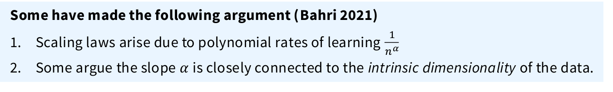

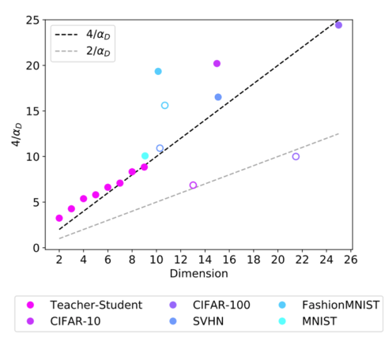

But estimators of intrinsic dimension are sketchy, and this is not airtight..

(cs336-09-page-021)=

## Other data scaling laws

Data scaling thus far : how does dataset size relate to performance? Related question : how does dataset composition affect performance 
- Picking optimal data mixture using small scale models 
- Deciding whether to repeat data or not 
- Combing the two and balancing quality with repetition rate

(cs336-09-page-022)=

## Other advanced data scaling law: distribution shift

**Data scaling thus far** : how does dataset size relate to performance?

**Related question** : how does dataset _composition_ affect performance

**A:** Data composition affects the offset, not the slope.

These ‘distribution shift’ scaling laws can tell us about the importance of collecting diverse data!

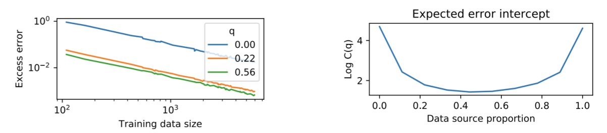

[Hashimoto 2021]

(cs336-09-page-023)=

## In practice: data mixture selection via scaling is hard

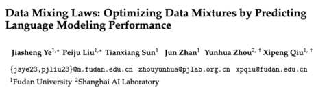

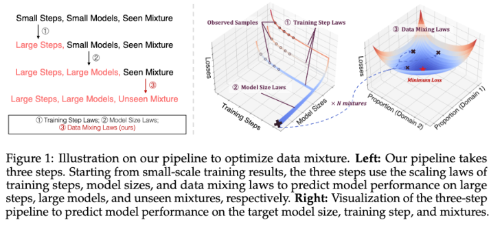

**Natural idea** – build data scaling laws

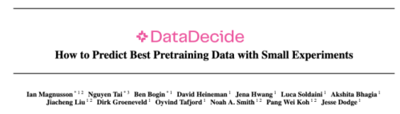

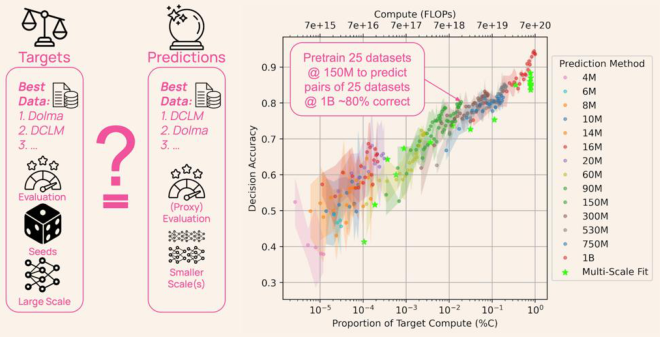
**Empirical eval** – just take the best small dataset

(cs336-09-page-024)=

## Scaling laws under data repetition

In practice, we have finite data – how does repeating examples affect scaling?

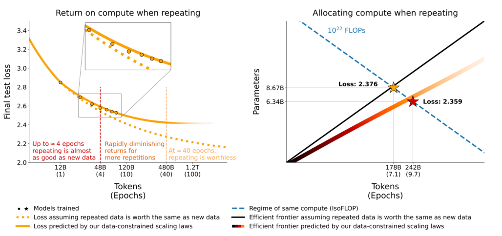

D’ = Effective data
Ud = Unique tokens
Rd* = Constant
Rd = Repetition

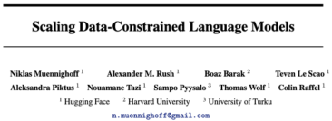

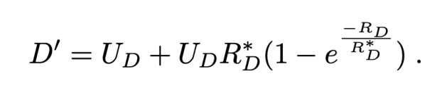

(cs336-09-page-025)=

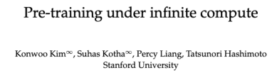
## Scaling laws in compute unbounded settings

**Important notes:**

1. Scaling laws can ‘break’ if you blindly apply it

2. Scaling laws are _lower bounds_ so you can always potentially do better

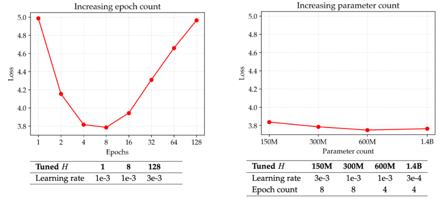

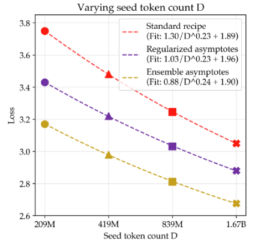

(cs336-09-page-026)=

## Data selection scaling and accounting for finiteness

Given that repeated data is less valuable..

Data selection should then be adaptive to scale !

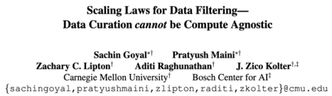

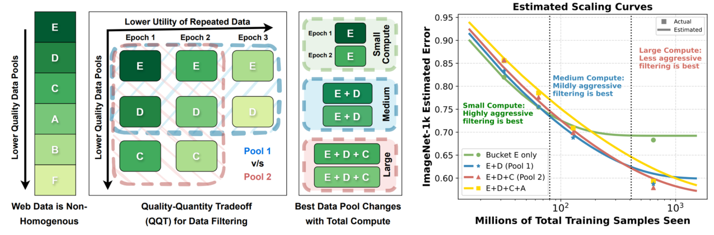

(cs336-09-page-027)=

## Recap: data scaling laws

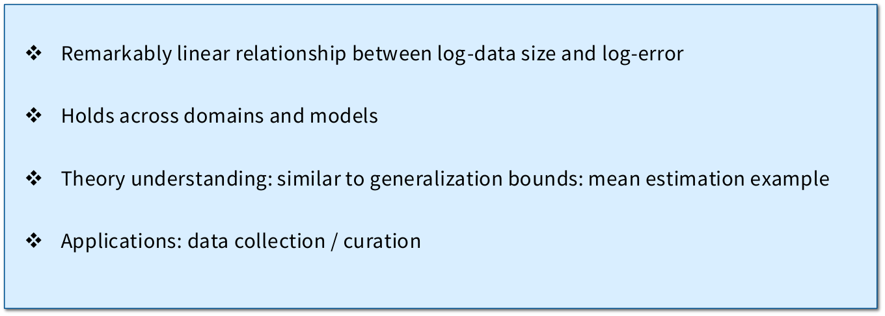

(cs336-09-page-028)=

## Scaling laws for model engineering

Now for what I promised at the start: **model scaling!**

Scaling laws provide a simple procedure to answer these.

(cs336-09-page-029)=

## Hyperparameter questions

We’ll consider some of these choices in the context of the classic Kaplan scaling paper

Architecture

Optimizer

Aspect ratio / depth

Batch size

(cs336-09-page-030)=

## 1. Architecture: transformers vs LSTMs

Scaling law way:

[Kaplan+ 2021]

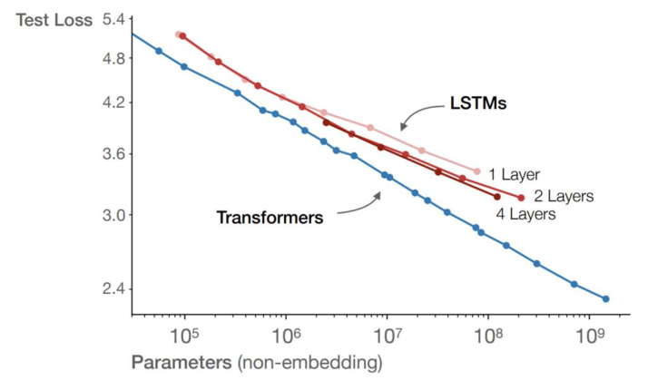

(cs336-09-page-031)=

## 1. Many architectures

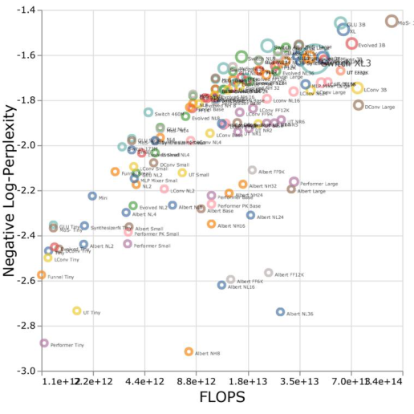

Cross-architecture scaling in Tay et al 2022.

(cs336-09-page-032)=

## 2. Optimizer choice

What about ADAM vs SGD?

[Hestness+ 2017]

(Note, this is in 2017, so pre-transformers. RHN is recurrent highway nets)

(cs336-09-page-033)=

## 3. Depth/Width: Number of layers

Does depth or width make a huge difference?

-

1 vs 2 layers makes a huge difference. 
- 10 [7] More layers have diminishing returns below  params

(cs336-09-page-034)=

## 3. Depth/Width: and other Transformer hypers

Do hyperparameters like the aspect ratio depend on scale?

(cs336-09-page-035)=

## 3. Depth/Width: But not all parameters are made equal

We’ve been thinking about ‘parameters’ but not all parameters are equal

Embedding layer parameters don’t behave the same!

**Related** : recent papers on scaling laws for mixtures of experts.

(cs336-09-page-036)=

## Side note – ‘Value of parameters’

With MoEs, we expect parameter scaling to change

(cs336-09-page-037)=

## 4. Batch size: Critical batch size

**Batch size** – known to have strong diminishing returns past a certain point.

**Critical batch** = min number of examples before diminishing returns (what does that mean?)

(cs336-09-page-038)=

## 4. Critical batch size definitions..

**What is critical batch size, more precisely?**

Pick a target loss and train 1). Steps needed (S), 2). Examples needed.

Sweep over batches
The curve should follow roughly..

Fit for 𝑆 𝑚𝑖𝑛, 𝐸 𝑚𝑖𝑛 on this curve and pick

This balances both sides of the equation, giving roughly 2x the steps / passes optimal

(this is claimed to be close to the ratio of the trace of the gradient covariance and squared norm of the gradient)

(cs336-09-page-039)=

## 4. Batch size: critical batch size

The smaller the loss target,

The bigger the batch

(cs336-09-page-040)=

## 5. Learning rates: muP and scale-aware LR choices

Yang et al 2022 Yao et al 2024

If we naively scale up – optimal learning rate depends on scale. We need scaling aware initialization and learning rate scaling

(cs336-09-page-041)=

## Caution – scaling behaviors can differ downstream

**Thus far** : scaling is predictable and depends mainly on parameters

**Catch** : downstream scaling can often be much less predictable

Tay et al 2023

(cs336-09-page-042)=

## Some surprising takeaways

**The scaling law based design procedure.**

1. Train a few smaller models

2. Establish a scaling law (e.g. ADAM vs SGD scaling law)

3. Select optimal hyperparam based on the scaling law prediction.

(cs336-09-page-043)=

## One important use of scaling laws

(cs336-09-page-044)=

## Model-data joint scaling is accurate

From Rosenfeld – fit scaling exponents on small data, small models. Predict rest.

Trading off data size and model size: optimize 𝑛 [−𝛼] +𝑚 [−𝛽] + 𝐶 with your costs.

(cs336-09-page-045)=

## ‘Optimal’ compute and data tradeoffs as a case study.

Rosenfeld, Kaplan both predict relationship of data, model and perf.

Kaplan claims : 𝑁 𝑜𝑝𝑡 = 𝐶 [0.73], 𝐷 𝑜𝑝𝑡 = 𝐶 [0.27] (tokens per param decreases w/ C)

**Chinchilla [Hoffman et al] argue these fits are quite off.**

Hoffman+ 2022

(cs336-09-page-046)=

## Chinchilla in depth – 3 methods

**The chinchilla authors suggest 3 ways of fitting scaling laws – we’ll go over each.**

They mostly (minus method 3) suggest similar constants. More on this later..

(cs336-09-page-047)=

## Method 1 – minimum over runs.

Similar to the FLOPS figure on Kaplan –
the minimum over the union of all training curves is a power law.

(cs336-09-page-048)=

## Method 2 - IsoFLOPS

Pick a range of FLOP budgets, vary the total parameter count, take the min over these

convex shapes. The minima form a power law.

(cs336-09-page-049)=

## Method 3 – Joint fits

Run a bunch of models on the size-data grid. Use least squares to fit a joint scaling law

(cs336-09-page-050)=

## Why do we have this big difference?

Kaplan claims : 𝑁 𝑜𝑝𝑡 = 𝐶 [0.73], 𝐷 𝑜𝑝𝑡 = 𝐶 [0.27] (tokens per param decreases w/ C)

Why such a big difference (when both fit joint scaling laws?)

(cs336-09-page-051)=

## Explanation 1

Kaplan removed last layer param from the count

Warmup at very small compute budgets was too high

(Decay itself is maybe not critical if batch / LR is properly tuned)

(cs336-09-page-052)=

## Explanation 2

Non-embedding vs total param choice + small nonlinearities

(cs336-09-page-053)=

## Fun addendum – errors in chinchilla method 3

Note that this method three was likely flawed in the original paper. Some authors did

data forensics, recovered the raw data, and re-did the fit and got results more
consistent with methods 1 and 2

[Besiroglu et al 2024]

(cs336-09-page-054)=

## Important note – train-optimal is likely not what you want

**Chinchilla** aims to tell you what gives the best model for fixed training compute..
But most of the compute in a real deployment is inference.. So we should ‘over’ train

**GPT3** – 2 tokens / param

**Chinchilla** – 20 tokens / param

- **LLaMA65B** – 22 tokens / param

**Llama 2 70B** – 29 tokens / param

**Mistral 7B** – 110 tokens / param

**Llama 3 70B** – 215 tokens / param

… etc etc

The more usage we expect, the more it becomes worth it to pay the upfront cost

(cs336-09-page-055)=

## Isoflops everywhere

Methods like IsoFLOPS are pretty easy to execute and usually pretty clean

Diffusion - Gulrajani+ 2023.

MoEs – Abnar+ 2025.

(cs336-09-page-056)=

## Scaling laws for models and compute

Log-linearity extends to model parameters and compute!

(cs336-09-page-057)=

## Recap: scaling laws – surprising and useful!

