(cs336-10-cover)=
# Lecture 10: Inference

Stanford CS336 · Language Modeling from Scratch · Spring 2026.


(cs336-10-section-001)=
## Lecture 10: inference

:::{slide}
:label: cs336-10-001-output-001
:at: 0
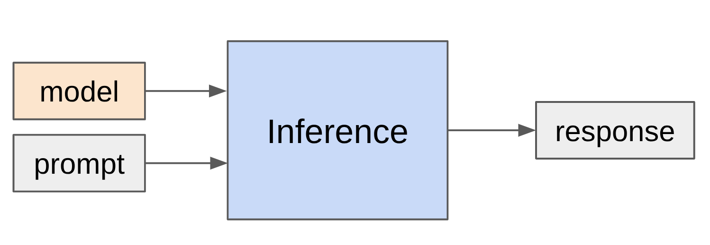
:::


(cs336-10-section-002)=
## Understanding the inference workload

:::{slide}
:label: cs336-10-002-output-001
:at: 0
Inference shows up in many places:
:::

:::{slide}
:label: cs336-10-002-output-002
:at: 1
- Actual use (chatbots, code completion, agents, batch data processing)
:::

:::{slide}
:label: cs336-10-002-output-003
:at: 2
- Model evaluation (e.g., on instruction following)
:::

:::{slide}
:label: cs336-10-002-output-004
:at: 3
- Reinforcement learning (sample many generations, then apply score)
:::


(cs336-10-section-003)=
## Understanding the inference workload

:::{slide}
:label: cs336-10-003-output-001
:at: 0
Why **efficiency** matters: training is one-time cost, inference is repeated many times
:::

:::{slide}
:label: cs336-10-003-output-002
:at: 1
- OpenAI processes ~8.6T tokens per day 

[article](https://www.pymnts.com/artificial-intelligence-2/2025/openai-bests-google-in-race-for-consumer-ai-token-consumption/)
:::

:::{slide}
:label: cs336-10-003-output-003
:at: 2
- For reference, DeepSeek v4 was trained on 32T tokens 

[DeepSeek-V4: Towards Highly Efficient Million-Token Context Intelligence](https://huggingface.co/deepseek-ai/DeepSeek-V4-Pro/blob/main/DeepSeek_V4.pdf)
:::

:::{slide}
:label: cs336-10-003-output-004
:at: 3
Moreover:
:::

:::{slide}
:label: cs336-10-003-output-005
:at: 4
- Chatbots: most tokens are meant for human consumption (humans are bottleneck)
:::


(cs336-10-section-004)=
## Understanding the inference workload

:::{slide}
:label: cs336-10-004-output-001
:at: 0
- Agents: query → internal trace → output for human (number of tokens generated can grow unbounded)
:::

:::{slide}
:label: cs336-10-004-output-002
:at: 1
- Tokens generated = compute spent
:::

:::{slide}
:label: cs336-10-004-output-003
:at: 2
Companies doing inference (a big deal for anyone who has a product or platform):
:::

:::{slide}
:label: cs336-10-004-output-004
:at: 3
- Providers serving closed models (OpenAI, Anthropic, Google, etc.)
:::

:::{slide}
:label: cs336-10-004-output-005
:at: 4
- Providers serving open-weight models (Together, Fireworks, Baseten, DeepInfra, Groq, Cerebras, etc.)
:::


(cs336-10-section-005)=
## Understanding the inference workload

:::{slide}
:label: cs336-10-005-output-001
:at: 0
Open-source packages:
:::

:::{slide}
:label: cs336-10-005-output-002
:at: 1
- vLLM: from Berkeley, pioneered PagedAttention, popular and good default 

[GitHub](https://github.com/vllm-project/vllm)
:::

:::{slide}
:label: cs336-10-005-output-003
:at: 2
- SGLang: from Berkeley, pioneered RadixAttention, good for agentic workloads 

[project](https://sgl-project.github.io/)
:::

:::{slide}
:label: cs336-10-005-output-004
:at: 3
- TensorRT-LLM: from NVIDIA, highly optimized for GPUs 

[article](https://nvidia.github.io/TensorRT-LLM/overview.html)
:::

:::{slide}
:label: cs336-10-005-output-005
:at: 4
- llama.cpp: C++ only, supports CPU inference, runs locally 

[GitHub](https://github.com/ggml-org/llama.cpp)
:::


(cs336-10-section-006)=
## Understanding the inference workload

:::{slide}
:label: cs336-10-006-output-001
:at: 0
Inference is huge. Important to make it fast.
:::

:::{slide}
:label: cs336-10-006-output-002
:at: 1
What does "fast" mean (metrics)?
:::

:::{slide}
:label: cs336-10-006-output-003
:at: 2
- Time-to-first-token (TTFT): how long user waits before any generation happens (for interactive applications)
:::

:::{slide}
:label: cs336-10-006-output-004
:at: 3
- Latency (seconds/token): how fast tokens appear for *one* query (for interactive applications)
:::

:::{slide}
:label: cs336-10-006-output-005
:at: 4
- Throughput (tokens/second): how fast tokens appear for *many* queries (for batch processing)
:::


(cs336-10-section-007)=
## Understanding the inference workload

:::{slide}
:label: cs336-10-007-output-001
:at: 0
What governs efficiency?
:::

:::{slide}
:label: cs336-10-007-output-002
:at: 1
- Training (supervised): you see all tokens, can parallelize over sequence (matmul in Transformer)
:::

:::{slide}
:label: cs336-10-007-output-003
:at: 2
- Inference: you have to generate sequentially, can't parallelize over generation, so harder to fully utilize compute
:::

:::{slide}
:label: cs336-10-007-output-004
:at: 3
[Scaling book chapter on Transformers](https://jax-ml.github.io/scaling-book/transformers/)
:::

:::{slide}
:label: cs336-10-007-output-005
:at: 4
Notation (similar to einops):
:::


(cs336-10-section-008)=
## Understanding the inference workload

:::{slide}
:label: cs336-10-008-output-001
:at: 0
- Symbols denote dimensions (and their length): B (batch), T (sequence), D (model dim), H (head dim)
:::

:::{slide}
:label: cs336-10-008-output-002
:at: 1
- Example: BT&lt;font color="red">D&lt;/font> x &lt;font color="red">D&lt;/font>H → BTH
:::

:::{slide}
:label: cs336-10-008-output-003
:at: 2
- &lt;font color="red">Contracting (red)&lt;/font> dimensions appear in both operands and disappear from result
:::

:::{slide}
:label: cs336-10-008-output-004
:at: 3
- Regular (black) dimensions appear in one operand and stay in result
:::

:::{slide}
:label: cs336-10-008-output-005
:at: 4
- Example: &lt;font color="blue">B&lt;/font>&lt;font color="red">D&lt;/font> x &lt;font color="blue">B&lt;/font>&lt;font color="red">D&lt;/font> → B
:::


(cs336-10-section-009)=
## Understanding the inference workload

:::{slide}
:label: cs336-10-009-output-001
:at: 0
- &lt;font color="blue">Batching (blue)&lt;/font> dimensions appear in both operands and stay in result
:::

:::{slide}
:label: cs336-10-009-output-002
:at: 1
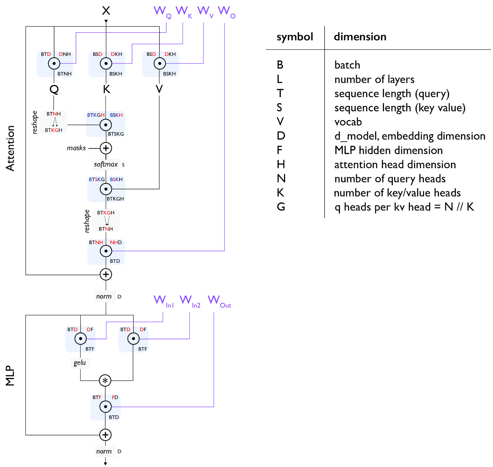
:::

:::{slide}
:label: cs336-10-009-output-003
:at: 2
Conventions:
:::

:::{slide}
:label: cs336-10-009-output-004
:at: 3
- F = 4 D (MLP up-projects into 4x the model dimension)
:::

:::{slide}
:label: cs336-10-009-output-005
:at: 4
- D = N H (model dimension split across N heads)
:::


(cs336-10-section-010)=
## Understanding the inference workload

:::{slide}
:label: cs336-10-010-output-001
:at: 0
- N = K G (for GQA, number of heads split across K groups)
:::

:::{slide}
:label: cs336-10-010-output-002
:at: 1
- S = T (during training, condition on S input tokens to predict T output tokens)
:::

:::{slide}
:label: cs336-10-010-output-003
:at: 2
Setup: multiply X &lt;font color="gray">(B x D)&lt;/font> and W &lt;font color="gray">(D x F)&lt;/font> matrix
:::

:::{slide}
:label: cs336-10-010-output-004
:at: 3
Intuition: B is batch size, D is hidden dimension, F is up-projection dimension in MLP
:::

:::{slide}
:label: cs336-10-010-output-005
:at: 4
Let's do FLOPs and memory read/write accounting for the matrix multiplication (X * W).
:::


(cs336-10-section-011)=
## Understanding the inference workload

:::{slide}
:label: cs336-10-011-output-001
:at: 0
1. Read X &lt;font color="gray">(B x D)&lt;/font> from HBM
:::

:::{slide}
:label: cs336-10-011-output-002
:at: 1
2. Read W &lt;font color="gray">(D x F)&lt;/font> from HBM
:::

:::{slide}
:label: cs336-10-011-output-003
:at: 2
3. Compute Y = X &lt;font color="gray">(B x D)&lt;/font> @ W &lt;font color="gray">(D x F)&lt;/font>
:::

:::{slide}
:label: cs336-10-011-output-004
:at: 3
4. Write Y &lt;font color="gray">(B x F)&lt;/font> to HBM
:::

:::{slide}
:label: cs336-10-011-output-005
:at: 4
Recall that **arithmetic intensity** is how much compute we do per byte transferred (want to be high).
:::


(cs336-10-section-012)=
## Understanding the inference workload

:::{slide}
:label: cs336-10-012-values-001
:at: 0
:until: 2
| Variable | Value |
| --- | --- |
| `intensity` | B*D*F/(B*D + B*F + D*F) |
:::

:::{slide}
:label: cs336-10-012-output-002
:at: 1
Assuming B is much less than D and F, then we can simplify:
:::

:::{slide}
:label: cs336-10-012-values-003
:at: 2
:until: 4
| Variable | Value |
| --- | --- |
| `intensity` | B |
:::

:::{slide}
:label: cs336-10-012-output-004
:at: 3
Accelerator intensity of H100:
:::

:::{slide}
:label: cs336-10-012-values-005
:at: 4
| Variable | Value |
| --- | --- |
| `intensity` | B |
| `accelerator_intensity` | 295.2238805970149 |
:::


(cs336-10-section-013)=
## Understanding the inference workload

:::{slide}
:label: cs336-10-013-output-001
:at: 0
If computation intensity > accelerator intensity, **compute-bound** (good)
:::

:::{slide}
:label: cs336-10-013-values-002
:at: 0
| Variable | Value |
| --- | --- |
| `intensity` | B |
| `accelerator_intensity` | 295.2238805970149 |
:::

:::{slide}
:label: cs336-10-013-output-003
:at: 1
If computation intensity < accelerator intensity, **memory-bound** (bad)
:::

:::{slide}
:label: cs336-10-013-output-004
:at: 2
Conclusion: compute-bound iff B > 295
:::

:::{slide}
:label: cs336-10-013-output-005
:at: 3
Extreme case (B = 1, corresponding to matrix-vector product):
:::

:::{slide}
:label: cs336-10-013-output-006
:at: 4
- Arithmetic intensity: 1
:::


(cs336-10-section-014)=
## Understanding the inference workload

:::{slide}
:label: cs336-10-014-output-001
:at: 0
- Memory-bound (read D x F matrix, perform only 2 D F FLOPs)
:::

:::{slide}
:label: cs336-10-014-values-002
:at: 0
:until: 2
| Variable | Value |
| --- | --- |
| `intensity` | B |
| `accelerator_intensity` | 295.2238805970149 |
:::

:::{slide}
:label: cs336-10-014-output-003
:at: 1
- This is basically what happens with inference...
:::

:::{slide}
:label: cs336-10-014-output-004
:at: 3
[Scaling book chapter on inference](https://jax-ml.github.io/scaling-book/inference/)
:::

:::{slide}
:label: cs336-10-014-output-005
:at: 4
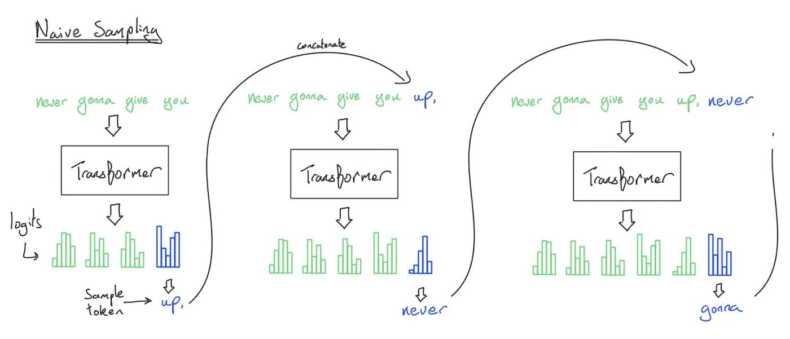
:::

:::{slide}
:label: cs336-10-014-output-006
:at: 5
Naive inference: to generate each token, feed history into Transformer
:::


(cs336-10-section-015)=
## Understanding the inference workload

:::{slide}
:label: cs336-10-015-output-001
:at: 0
Complexity: generating T tokens requires O(T^3) FLOPs (one feedforward pass is O(T^2))
:::

:::{slide}
:label: cs336-10-015-output-002
:at: 1
Observation: a lot of the work can be shared across prefixes
:::

:::{slide}
:label: cs336-10-015-output-003
:at: 2
Solution: store **KV cache** in HBM
:::

:::{slide}
:label: cs336-10-015-output-004
:at: 3
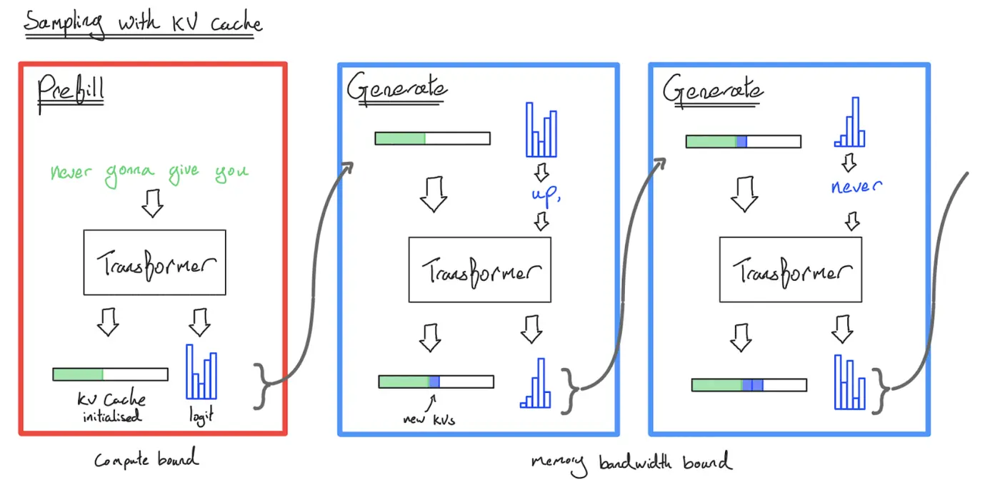
:::

:::{slide}
:label: cs336-10-015-output-005
:at: 4
KV cache: for every sequence (B), token (S), layer (L), head (K), store an H-dimensional vector
:::


(cs336-10-section-016)=
## Understanding the inference workload

:::{slide}
:label: cs336-10-016-output-001
:at: 0
Two stages of inference:
:::

:::{slide}
:label: cs336-10-016-output-002
:at: 1
1. **Prefill**: given a prompt, encode into vectors (parallelizable like in training)
:::

:::{slide}
:label: cs336-10-016-output-003
:at: 2
2. **Generation**: generate new response tokens (sequential)
:::

:::{slide}
:label: cs336-10-016-output-004
:at: 3
Let's compute the FLOPs and memory IO for both the MLP and attention layers.
:::

:::{slide}
:label: cs336-10-016-output-005
:at: 4
S is the number of tokens we're conditioning on, T is the number of tokens we're generating.
:::


(cs336-10-section-017)=
## Understanding the inference workload

:::{slide}
:label: cs336-10-017-output-001
:at: 0
Later, we'll specialize to prefill (T = S) and generation (T = 1).
:::


(cs336-10-section-018)=
## MLP layers (only looking at the matrix multiplications)

:::{slide}
:label: cs336-10-018-output-001
:at: 0
1. Read X &lt;font color="gray">(B x T x D)&lt;/font> from HBM
:::

:::{slide}
:label: cs336-10-018-output-002
:at: 1
2. Read Wup &lt;font color="gray">(D x F)&lt;/font>, Wgate &lt;font color="gray">(D x F)&lt;/font>, Wdown &lt;font color="gray">(F x D)&lt;/font> from HBM
:::

:::{slide}
:label: cs336-10-018-output-003
:at: 2
3. Compute U = X &lt;font color="gray">(B x T x D)&lt;/font> @ Wup &lt;font color="gray">(D x F)&lt;/font>
:::

:::{slide}
:label: cs336-10-018-output-004
:at: 3
4. Write U &lt;font color="gray">(B x T x F)&lt;/font> to HBM
:::


(cs336-10-section-019)=
## MLP layers (only looking at the matrix multiplications)

:::{slide}
:label: cs336-10-019-output-001
:at: 0
5. Compute G = X &lt;font color="gray">(B x T x D)&lt;/font> @ Wgate &lt;font color="gray">(D x F)&lt;/font>
:::

:::{slide}
:label: cs336-10-019-output-002
:at: 1
6. Write G &lt;font color="gray">(B x T x F)&lt;/font> to HBM
:::

:::{slide}
:label: cs336-10-019-output-003
:at: 2
7. Compute Y = GeLU(G)*U &lt;font color="gray">(B x T x F)&lt;/font> @ Wdown &lt;font color="gray">(F x D)&lt;/font>
:::

:::{slide}
:label: cs336-10-019-output-004
:at: 3
8. Write Y &lt;font color="gray">(B x T x D)&lt;/font> to HBM
:::

:::{slide}
:label: cs336-10-019-values-005
:at: 4
| Variable | Value |
| --- | --- |
| `intensity` | 3*B*D*F*T/(2*B*D*T + 2*B*F*T + 3*D*F) |
:::


(cs336-10-section-020)=
## MLP layers (only looking at the matrix multiplications)

:::{slide}
:label: cs336-10-020-output-001
:at: 0
Assume that B*T is much smaller than D and F.
:::

:::{slide}
:label: cs336-10-020-values-002
:at: 0
:until: 1
| Variable | Value |
| --- | --- |
| `intensity` | 3*B*D*F*T/(2*B*D*T + 2*B*F*T + 3*D*F) |
:::

:::{slide}
:label: cs336-10-020-values-003
:at: 1
| Variable | Value |
| --- | --- |
| `intensity` | B*T |
:::

:::{slide}
:label: cs336-10-020-output-004
:at: 2
For the two stages:
:::

:::{slide}
:label: cs336-10-020-output-005
:at: 3
1. Prefill: easy to make compute-bound (good) by making `B*T` large enough (large batches, long sequences)
:::

:::{slide}
:label: cs336-10-020-output-006
:at: 4
2. Generation: two problems
:::


(cs336-10-section-021)=
## MLP layers (only looking at the matrix multiplications)

:::{slide}
:label: cs336-10-021-output-001
:at: 0
- Generating one token at a time (T = 1)
:::

:::{slide}
:label: cs336-10-021-values-002
:at: 0
| Variable | Value |
| --- | --- |
| `intensity` | B*T |
:::

:::{slide}
:label: cs336-10-021-output-003
:at: 1
- B is number of concurrent requests, unpredictable for interactive applications
:::


(cs336-10-section-022)=
## Attention layers (focusing on the matrix multiplications with FlashAttention)

:::{slide}
:label: cs336-10-022-values-001
:at: 0
| Variable | Value |
| --- | --- |
| `intensity` | B*T |
:::

:::{slide}
:label: cs336-10-022-output-002
:at: 1
- S is number of previous tokens (already generated)
:::

:::{slide}
:label: cs336-10-022-output-003
:at: 2
- T is number of next tokens (to generate logits for)
:::

:::{slide}
:label: cs336-10-022-output-004
:at: 3
1. Read Q &lt;font color="gray">(B x T x D)&lt;/font>, K &lt;font color="gray">(B x S x D)&lt;/font>, V &lt;font color="gray">(B x S x D)&lt;/font> from HBM
:::

:::{slide}
:label: cs336-10-022-output-005
:at: 4
2. Compute A = Q &lt;font color="gray">(B x T x D)&lt;/font> @ K &lt;font color="gray">(B x S x D)&lt;/font>
:::


(cs336-10-section-023)=
## Attention layers (focusing on the matrix multiplications with FlashAttention)

:::{slide}
:label: cs336-10-023-output-001
:at: 0
3. Compute Y = softmax(A) &lt;font color="gray">(B x S x T x K x G)&lt;/font> @ V &lt;font color="gray">(B x S x K x H)&lt;/font>
:::

:::{slide}
:label: cs336-10-023-values-002
:at: 0
:until: 2
| Variable | Value |
| --- | --- |
| `intensity` | B*T |
:::

:::{slide}
:label: cs336-10-023-output-003
:at: 1
4. Write Y &lt;font color="gray">(B x T x D)&lt;/font> to HBM
:::

:::{slide}
:label: cs336-10-023-values-004
:at: 2
| Variable | Value |
| --- | --- |
| `intensity` | S*T/(S + T) |
:::

:::{slide}
:label: cs336-10-023-output-005
:at: 3
For the two stages:
:::

:::{slide}
:label: cs336-10-023-output-006
:at: 4
1. Prefill: T = S
:::


(cs336-10-section-024)=
## Attention layers (focusing on the matrix multiplications with FlashAttention)

:::{slide}
:label: cs336-10-024-values-001
:at: 0
:until: 2
| Variable | Value |
| --- | --- |
| `intensity` | S*T/(S + T) |
| `prefill_intensity` | S/2 |
:::

:::{slide}
:label: cs336-10-024-output-002
:at: 1
2. Generation: T = 1
:::

:::{slide}
:label: cs336-10-024-values-003
:at: 2
| Variable | Value |
| --- | --- |
| `intensity` | S*T/(S + T) |
| `prefill_intensity` | S/2 |
| `generate_intensity` | S/(S + 1) |
:::

:::{slide}
:label: cs336-10-024-output-004
:at: 3
Unlike MLPs, no dependence on B, so batching doesn't help!
:::

:::{slide}
:label: cs336-10-024-output-005
:at: 4
Why?
:::


(cs336-10-section-025)=
## Attention layers (focusing on the matrix multiplications with FlashAttention)

:::{slide}
:label: cs336-10-025-output-001
:at: 0
- In MLP layers, every sequence hits the same MLP weights (Wup, Wgate, Wdown don't depend on B)
:::

:::{slide}
:label: cs336-10-025-values-002
:at: 0
| Variable | Value |
| --- | --- |
| `intensity` | S*T/(S + T) |
| `prefill_intensity` | S/2 |
| `generate_intensity` | S/(S + 1) |
:::

:::{slide}
:label: cs336-10-025-output-003
:at: 1
- In attention layers, every sequence has its own KV cache vectors (Q, K, V all depend on B)
:::

:::{slide}
:label: cs336-10-025-output-004
:at: 2
Summary:
:::

:::{slide}
:label: cs336-10-025-output-005
:at: 3
- Prefill is compute-bound, generation is memory-bound
:::

:::{slide}
:label: cs336-10-025-output-006
:at: 4
- Prefill MLP intensity: `B*S`
:::


(cs336-10-section-026)=
## Attention layers (focusing on the matrix multiplications with FlashAttention)

:::{slide}
:label: cs336-10-026-output-001
:at: 0
- Prefill attention intensity: `S/2`
:::

:::{slide}
:label: cs336-10-026-values-002
:at: 0
:until: 3
| Variable | Value |
| --- | --- |
| `intensity` | S*T/(S + T) |
| `prefill_intensity` | S/2 |
| `generate_intensity` | S/(S + 1) |
:::

:::{slide}
:label: cs336-10-026-output-003
:at: 1
- Generation MLP intensity: `B` (requires concurrent requests)
:::

:::{slide}
:label: cs336-10-026-output-004
:at: 2
- Generation attention intensity: `<1` (impossible to improve)
:::

:::{slide}
:label: cs336-10-026-output-005
:at: 4
So we have shown that inference is memory-bound.
:::

:::{slide}
:label: cs336-10-026-output-006
:at: 5
Let us now compute the theoretical maximum latency and throughput of a single request.
:::


(cs336-10-section-027)=
## Attention layers (focusing on the matrix multiplications with FlashAttention)

:::{slide}
:label: cs336-10-027-output-001
:at: 0
Assumption: can overlap compute and communication perfectly and ignore overhead.
:::

:::{slide}
:label: cs336-10-027-output-002
:at: 1
Instantiate latency and throughput for Llama 2 13B on an H100:
:::

:::{slide}
:label: cs336-10-027-values-003
:at: 2
:until: 3
**`config`**

```python
{'S': 1024,
 'D': 5120,
 'F': 13824,
 'N': 40,
 'K': 40,
 'H': 128,
 'L': 40,
 'V': 32000,
 'memory_bandwidth': 3350000000000.0}
```

:::

:::{slide}
:label: cs336-10-027-values-004
:at: 3
:until: 4
| Variable | Value |
| --- | --- |
| `num_params` | 13015449600 |

**`config`**

```python
{'S': 1024,
 'D': 5120,
 'F': 13824,
 'N': 40,
 'K': 40,
 'H': 128,
 'L': 40,
 'V': 32000,
 'memory_bandwidth': 3350000000000.0}
```

:::

:::{slide}
:label: cs336-10-027-values-005
:at: 4
| Variable | Value |
| --- | --- |
| `num_params` | 13015449600 |
| `memory` | 838860800*B + 26030899200 |

**`config`**

```python
{'S': 1024,
 'D': 5120,
 'F': 13824,
 'N': 40,
 'K': 40,
 'H': 128,
 'L': 40,
 'V': 32000,
 'memory_bandwidth': 3350000000000.0}
```

:::


(cs336-10-section-028)=
## Attention layers (focusing on the matrix multiplications with FlashAttention)

:::{slide}
:label: cs336-10-028-values-001
:at: 0
:until: 1
| Variable | Value |
| --- | --- |
| `num_params` | 13015449600 |
| `memory` | 838860800*B + 26030899200 |
| `latency` | 0.000250406208955224*B + 0.00777041767164179 |

**`config`**

```python
{'S': 1024,
 'D': 5120,
 'F': 13824,
 'N': 40,
 'K': 40,
 'H': 128,
 'L': 40,
 'V': 32000,
 'memory_bandwidth': 3350000000000.0}
```

:::

:::{slide}
:label: cs336-10-028-values-002
:at: 1
:until: 2
| Variable | Value |
| --- | --- |
| `num_params` | 13015449600 |
| `memory` | 838860800*B + 26030899200 |
| `latency` | 0.000250406208955224*B + 0.00777041767164179 |
| `throughput` | 127792.358398438*B/(32*B + 993) |

**`config`**

```python
{'S': 1024,
 'D': 5120,
 'F': 13824,
 'N': 40,
 'K': 40,
 'H': 128,
 'L': 40,
 'V': 32000,
 'memory_bandwidth': 3350000000000.0}
```

:::

:::{slide}
:label: cs336-10-028-values-003
:at: 3
:until: 4
**`b1`**

```python
{'num_params': 13015449600,
 'memory': 26869760000,
 'latency': 0.008020823880597015,
 'throughput': 124.6754716082317}
```

:::

:::{slide}
:label: cs336-10-028-values-004
:at: 4
**`b1`**

```python
{'num_params': 13015449600,
 'memory': 26869760000,
 'latency': 0.008020823880597015,
 'throughput': 124.6754716082317}
```


**`b64`**

```python
{'num_params': 13015449600,
 'memory': 79717990400,
 'latency': 0.02379641504477612,
 'throughput': 2689.480742354489}
```

:::

:::{slide}
:label: cs336-10-028-output-005
:at: 5
Result: worse latency, better throughput
:::


(cs336-10-section-029)=
## Attention layers (focusing on the matrix multiplications with FlashAttention)

:::{slide}
:label: cs336-10-029-values-001
:at: 0
**`b1`**

```python
{'num_params': 13015449600,
 'memory': 26869760000,
 'latency': 0.008020823880597015,
 'throughput': 124.6754716082317}
```


**`b64`**

```python
{'num_params': 13015449600,
 'memory': 79717990400,
 'latency': 0.02379641504477612,
 'throughput': 2689.480742354489}
```


**`b256`**

```python
{'num_params': 13015449600,
 'memory': 240779264000,
 'latency': 0.0718744071641791,
 'throughput': 3561.7685084376703}
```

:::

:::{slide}
:label: cs336-10-029-output-002
:at: 1
Result: even worse latency, even better throughput
:::

:::{slide}
:label: cs336-10-029-output-003
:at: 2
Result: doesn't fit into memory and throughput gains are diminishing too...
:::

:::{slide}
:label: cs336-10-029-output-004
:at: 3
What increasing batch size does:
:::

:::{slide}
:label: cs336-10-029-output-005
:at: 4
- Worsens latency because larger KV cache (O(B) size) to read/write
:::


(cs336-10-section-030)=
## Attention layers (focusing on the matrix multiplications with FlashAttention)

:::{slide}
:label: cs336-10-030-output-001
:at: 0
- Improves throughput because amortizes the cost of reading parameters
:::

:::{slide}
:label: cs336-10-030-values-002
:at: 0
**`b1`**

```python
{'num_params': 13015449600,
 'memory': 26869760000,
 'latency': 0.008020823880597015,
 'throughput': 124.6754716082317}
```


**`b64`**

```python
{'num_params': 13015449600,
 'memory': 79717990400,
 'latency': 0.02379641504477612,
 'throughput': 2689.480742354489}
```


**`b256`**

```python
{'num_params': 13015449600,
 'memory': 240779264000,
 'latency': 0.0718744071641791,
 'throughput': 3561.7685084376703}
```

:::

:::{slide}
:label: cs336-10-030-output-003
:at: 1
**Tradeoff** between latency and throughput:
:::

:::{slide}
:label: cs336-10-030-output-004
:at: 2
1. Smaller batch sizes yield better latency but worse throughput
:::

:::{slide}
:label: cs336-10-030-output-005
:at: 3
2. Larger batch sizes yield better throughput but worse latency
:::

:::{slide}
:label: cs336-10-030-output-006
:at: 4
Easy parallelism: if you launch M copies of the model, latency is the same, throughput increases by M!
:::


(cs336-10-section-031)=
## Attention layers (focusing on the matrix multiplications with FlashAttention)

:::{slide}
:label: cs336-10-031-output-001
:at: 0
Harder parallelism: shard the model and the KV cache 

[Scaling book chapter on inference](https://jax-ml.github.io/scaling-book/inference/)
:::

:::{slide}
:label: cs336-10-031-values-002
:at: 0
:until: 4
**`b1`**

```python
{'num_params': 13015449600,
 'memory': 26869760000,
 'latency': 0.008020823880597015,
 'throughput': 124.6754716082317}
```


**`b64`**

```python
{'num_params': 13015449600,
 'memory': 79717990400,
 'latency': 0.02379641504477612,
 'throughput': 2689.480742354489}
```


**`b256`**

```python
{'num_params': 13015449600,
 'memory': 240779264000,
 'latency': 0.0718744071641791,
 'throughput': 3561.7685084376703}
```

:::

:::{slide}
:label: cs336-10-031-output-003
:at: 1
Note: time-to-first-token (TTFT) is essentially a function of prefill time
:::

:::{slide}
:label: cs336-10-031-output-004
:at: 2
Use smaller batch sizes during prefill for faster TTFT
:::

:::{slide}
:label: cs336-10-031-output-005
:at: 3
Use larger batch sizes during generation to improve throughput
:::


(cs336-10-section-032)=
## Taking shortcuts (lossy)

:::{slide}
:label: cs336-10-032-output-001
:at: 0
Recall that memory is the bottleneck for inference.
:::

:::{slide}
:label: cs336-10-032-output-002
:at: 1
So let's try to reduce the size of the KV cache
:::

:::{slide}
:label: cs336-10-032-output-003
:at: 2
...but make sure we don't lose too much accuracy.
:::


(cs336-10-section-033)=
## Grouped-query attention (GQA)

:::{slide}
:label: cs336-10-033-output-001
:at: 0
[Ainslie+ 2023](https://arxiv.org/pdf/2305.13245.pdf)
:::

:::{slide}
:label: cs336-10-033-output-002
:at: 1
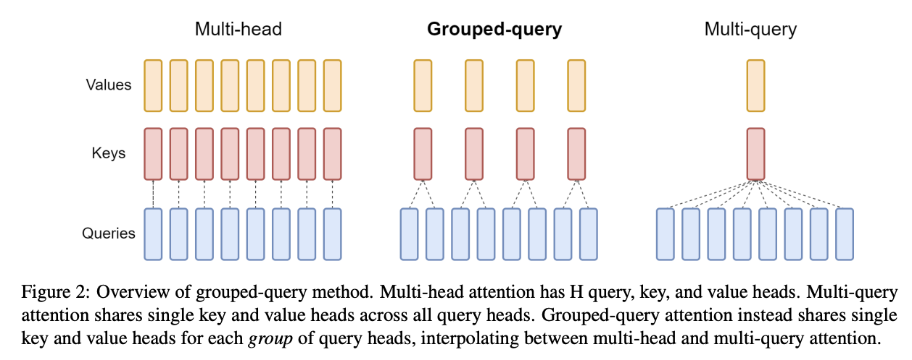
:::

:::{slide}
:label: cs336-10-033-output-003
:at: 2
Idea: N query heads, but only K key and value heads, each interacting with N/K query heads
:::

:::{slide}
:label: cs336-10-033-output-004
:at: 3
Multi-headed attention (MHA): K=N
:::

:::{slide}
:label: cs336-10-033-output-005
:at: 4
Multi-query attention (MQA): K=1
:::


(cs336-10-section-034)=
## Grouped-query attention (GQA)

:::{slide}
:label: cs336-10-034-output-001
:at: 0
Group-query attention (GQA): K is somewhere in between
:::

:::{slide}
:label: cs336-10-034-output-002
:at: 1
Latency/throughput improves: 

[Ainslie+ 2023](https://arxiv.org/pdf/2305.13245.pdf)
:::

:::{slide}
:label: cs336-10-034-output-003
:at: 2
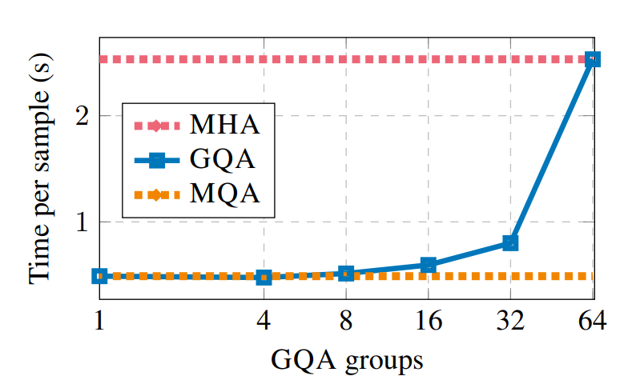
:::

:::{slide}
:label: cs336-10-034-output-004
:at: 3
Why does GQA improve latency and throughput?
:::

:::{slide}
:label: cs336-10-034-output-005
:at: 4
GQA reduces the KV cache by a factor of N/K.
:::


(cs336-10-section-035)=
## Grouped-query attention (GQA)

:::{slide}
:label: cs336-10-035-output-001
:at: 0
Reminder: reducing memory usage leads to speedup (since we're memory-bound).
:::

:::{slide}
:label: cs336-10-035-values-002
:at: 1
:until: 2
**`k40_b64`**

```python
{'num_params': 13015449600,
 'memory': 79717990400,
 'latency': 0.023796415044776118,
 'throughput': 2689.480742354489}
```

:::

:::{slide}
:label: cs336-10-035-values-003
:at: 2
:until: 4
**`k40_b64`**

```python
{'num_params': 13015449600,
 'memory': 79717990400,
 'latency': 0.023796415044776118,
 'throughput': 2689.480742354489}
```


**`k8_b64`**

```python
{'num_params': 11337728000,
 'memory': 33412874240,
 'latency': 0.00997399231044776,
 'throughput': 6416.688323787855}
```

:::

:::{slide}
:label: cs336-10-035-output-004
:at: 3
Result: Worse latency, but better throughput (and it fits in memory now!)
:::

:::{slide}
:label: cs336-10-035-values-005
:at: 4
**`k40_b64`**

```python
{'num_params': 13015449600,
 'memory': 79717990400,
 'latency': 0.023796415044776118,
 'throughput': 2689.480742354489}
```


**`k8_b64`**

```python
{'num_params': 11337728000,
 'memory': 33412874240,
 'latency': 0.00997399231044776,
 'throughput': 6416.688323787855}
```


**`k8_b256`**

```python
{'num_params': 11337728000,
 'memory': 65625128960,
 'latency': 0.01958959073432836,
 'throughput': 13068.164795877605}
```

:::


(cs336-10-section-036)=
## Grouped-query attention (GQA)

:::{slide}
:label: cs336-10-036-output-001
:at: 0
Result: Worse latency, but better throughput (and still fits in memory!)
:::

:::{slide}
:label: cs336-10-036-values-002
:at: 0
**`k40_b64`**

```python
{'num_params': 13015449600,
 'memory': 79717990400,
 'latency': 0.023796415044776118,
 'throughput': 2689.480742354489}
```


**`k8_b64`**

```python
{'num_params': 11337728000,
 'memory': 33412874240,
 'latency': 0.00997399231044776,
 'throughput': 6416.688323787855}
```


**`k8_b256`**

```python
{'num_params': 11337728000,
 'memory': 65625128960,
 'latency': 0.01958959073432836,
 'throughput': 13068.164795877605}
```

:::

:::{slide}
:label: cs336-10-036-output-003
:at: 1
Check that accuracy doesn't drop: 

[Ainslie+ 2023](https://arxiv.org/pdf/2305.13245.pdf)
:::

:::{slide}
:label: cs336-10-036-output-004
:at: 2
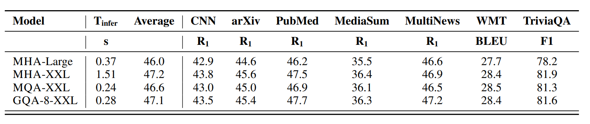
:::


(cs336-10-section-037)=
## Multi-head latent attention (MLA)

:::{slide}
:label: cs336-10-037-output-001
:at: 0
[DeepSeek-AI+ 2024](https://arxiv.org/abs/2405.04434)
:::

:::{slide}
:label: cs336-10-037-values-002
:at: 0
**`k40_b64`**

```python
{'num_params': 13015449600,
 'memory': 79717990400,
 'latency': 0.023796415044776118,
 'throughput': 2689.480742354489}
```


**`k8_b64`**

```python
{'num_params': 11337728000,
 'memory': 33412874240,
 'latency': 0.00997399231044776,
 'throughput': 6416.688323787855}
```


**`k8_b256`**

```python
{'num_params': 11337728000,
 'memory': 65625128960,
 'latency': 0.01958959073432836,
 'throughput': 13068.164795877605}
```

:::

:::{slide}
:label: cs336-10-037-output-003
:at: 1
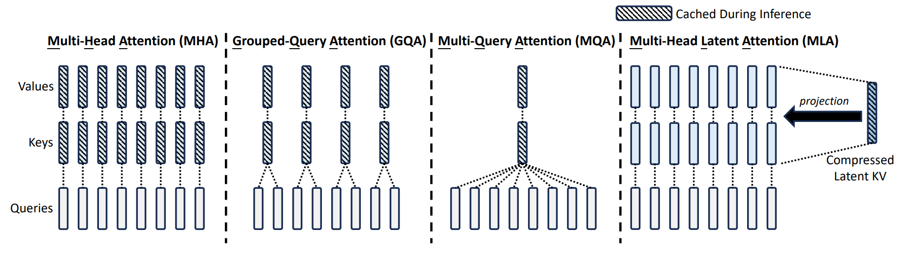
:::

:::{slide}
:label: cs336-10-037-output-004
:at: 2
Normal attention: KV cache consists of K = W_K h, V = W_V h (N*H dimensions)
:::

:::{slide}
:label: cs336-10-037-output-005
:at: 3
MLA: store compressed vector c = W_c h (C dimensions), project up to K = W_K c, V = W_V c when needed
:::

:::{slide}
:label: cs336-10-037-output-006
:at: 4
DeepSeek v2: reduce N*H = 16384 to C = 512
:::


(cs336-10-section-038)=
## Multi-head latent attention (MLA)

:::{slide}
:label: cs336-10-038-output-001
:at: 0
Wrinkle: MLA is not compatible with RoPE, so need to add additional 64 dimensions for RoPE, so 512 + 64 = 576 total dimensions
:::

:::{slide}
:label: cs336-10-038-values-002
:at: 0
**`k40_b64`**

```python
{'num_params': 13015449600,
 'memory': 79717990400,
 'latency': 0.023796415044776118,
 'throughput': 2689.480742354489}
```


**`k8_b64`**

```python
{'num_params': 11337728000,
 'memory': 33412874240,
 'latency': 0.00997399231044776,
 'throughput': 6416.688323787855}
```


**`k8_b256`**

```python
{'num_params': 11337728000,
 'memory': 65625128960,
 'latency': 0.01958959073432836,
 'throughput': 13068.164795877605}
```

:::

:::{slide}
:label: cs336-10-038-output-003
:at: 1
Latency/throughput improvements follow similarly from the KV cache reduction as argued earlier
:::

:::{slide}
:label: cs336-10-038-output-004
:at: 2
Let's now check the accuracy.
:::

:::{slide}
:label: cs336-10-038-output-005
:at: 3
First, MHA is better than GQA (though more expensive) [Table 8] 

[DeepSeek-AI+ 2024](https://arxiv.org/abs/2405.04434)
:::

:::{slide}
:label: cs336-10-038-output-006
:at: 4
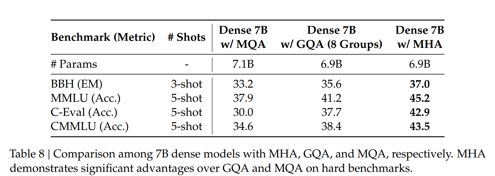
:::


(cs336-10-section-039)=
## Multi-head latent attention (MLA)

:::{slide}
:label: cs336-10-039-output-001
:at: 0
Second, MLA is even a bit better than MHA (and much cheaper) [Table 9] 

[DeepSeek-AI+ 2024](https://arxiv.org/abs/2405.04434)
:::

:::{slide}
:label: cs336-10-039-values-002
:at: 0
**`k40_b64`**

```python
{'num_params': 13015449600,
 'memory': 79717990400,
 'latency': 0.023796415044776118,
 'throughput': 2689.480742354489}
```


**`k8_b64`**

```python
{'num_params': 11337728000,
 'memory': 33412874240,
 'latency': 0.00997399231044776,
 'throughput': 6416.688323787855}
```


**`k8_b256`**

```python
{'num_params': 11337728000,
 'memory': 65625128960,
 'latency': 0.01958959073432836,
 'throughput': 13068.164795877605}
```

:::

:::{slide}
:label: cs336-10-039-output-003
:at: 1
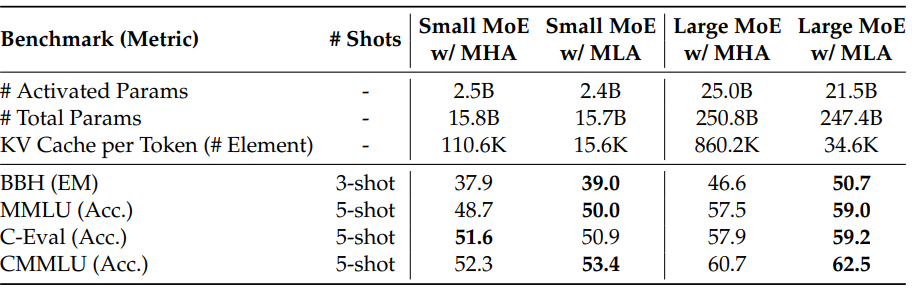
:::


(cs336-10-section-040)=
## Cross-layer attention (CLA)

:::{slide}
:label: cs336-10-040-output-001
:at: 0
[Brandon+ 2024](https://arxiv.org/abs/2405.12981)
:::

:::{slide}
:label: cs336-10-040-values-002
:at: 0
**`k40_b64`**

```python
{'num_params': 13015449600,
 'memory': 79717990400,
 'latency': 0.023796415044776118,
 'throughput': 2689.480742354489}
```


**`k8_b64`**

```python
{'num_params': 11337728000,
 'memory': 33412874240,
 'latency': 0.00997399231044776,
 'throughput': 6416.688323787855}
```


**`k8_b256`**

```python
{'num_params': 11337728000,
 'memory': 65625128960,
 'latency': 0.01958959073432836,
 'throughput': 13068.164795877605}
```

:::

:::{slide}
:label: cs336-10-040-output-003
:at: 1
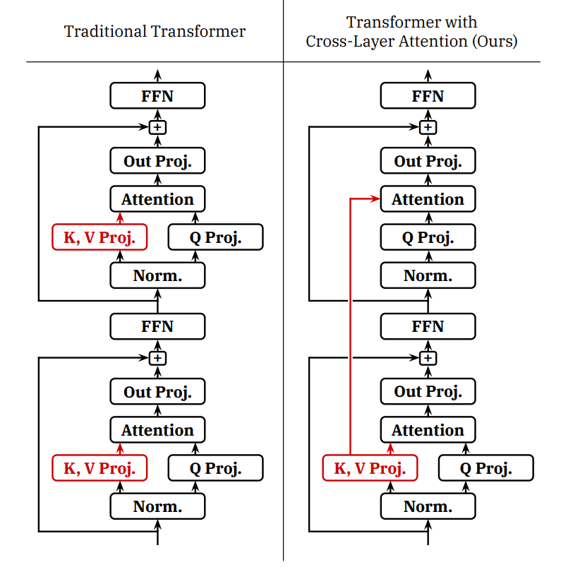
:::

:::{slide}
:label: cs336-10-040-output-004
:at: 2
Idea: share KVs across **layers** (just as GQA shares KVs across heads)
:::

:::{slide}
:label: cs336-10-040-output-005
:at: 3
Empirically improves the pareto frontier of accuracy and KV cache size (latency and throughput)
:::

:::{slide}
:label: cs336-10-040-output-006
:at: 4
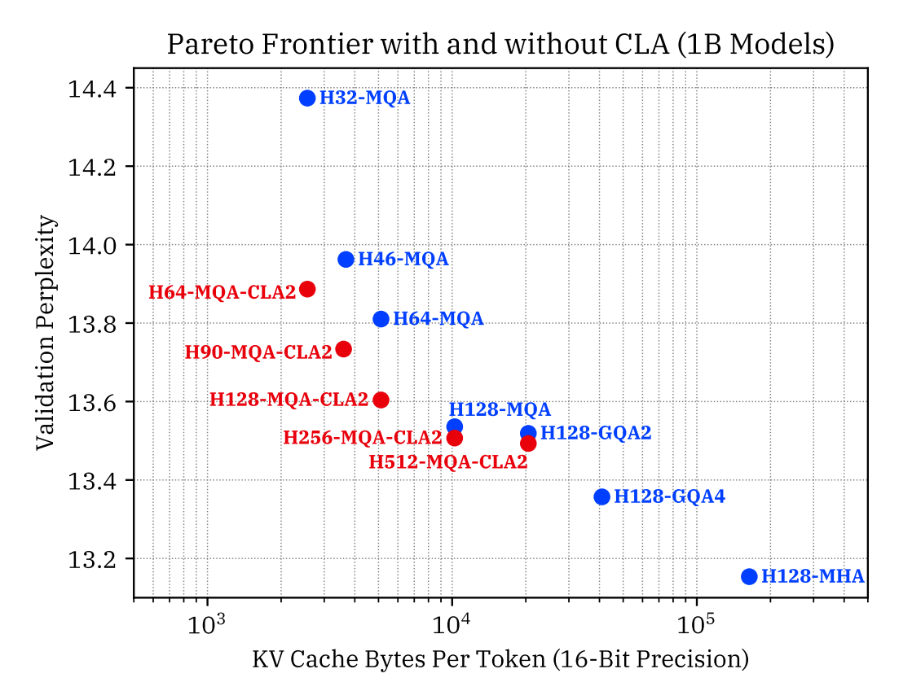
:::


(cs336-10-section-041)=
## Local (sliding window) attention

:::{slide}
:label: cs336-10-041-output-001
:at: 0
[Beltagy+ 2020](https://arxiv.org/pdf/2004.05150.pdf)

[Child+ 2019](https://arxiv.org/pdf/1904.10509.pdf)

[Jiang+ 2023](https://arxiv.org/pdf/2310.06825.pdf)
:::

:::{slide}
:label: cs336-10-041-values-002
:at: 0
**`k40_b64`**

```python
{'num_params': 13015449600,
 'memory': 79717990400,
 'latency': 0.023796415044776118,
 'throughput': 2689.480742354489}
```


**`k8_b64`**

```python
{'num_params': 11337728000,
 'memory': 33412874240,
 'latency': 0.00997399231044776,
 'throughput': 6416.688323787855}
```


**`k8_b256`**

```python
{'num_params': 11337728000,
 'memory': 65625128960,
 'latency': 0.01958959073432836,
 'throughput': 13068.164795877605}
```

:::

:::{slide}
:label: cs336-10-041-output-003
:at: 1

:::

:::{slide}
:label: cs336-10-041-output-004
:at: 2
Idea: just look at the local context, which is most relevant for modeling
:::

:::{slide}
:label: cs336-10-041-output-005
:at: 3
Effective context scales linearly with the number of layers
:::

:::{slide}
:label: cs336-10-041-output-006
:at: 4
KV cache is independent of sequence length!
:::


(cs336-10-section-042)=
## Local (sliding window) attention

:::{slide}
:label: cs336-10-042-output-001
:at: 0
Problem: this can still hurt accuracy
:::

:::{slide}
:label: cs336-10-042-values-002
:at: 0
**`k40_b64`**

```python
{'num_params': 13015449600,
 'memory': 79717990400,
 'latency': 0.023796415044776118,
 'throughput': 2689.480742354489}
```


**`k8_b64`**

```python
{'num_params': 11337728000,
 'memory': 33412874240,
 'latency': 0.00997399231044776,
 'throughput': 6416.688323787855}
```


**`k8_b256`**

```python
{'num_params': 11337728000,
 'memory': 65625128960,
 'latency': 0.01958959073432836,
 'throughput': 13068.164795877605}
```

:::

:::{slide}
:label: cs336-10-042-output-003
:at: 1
Solution: interleave local attention with global attention (hybrid layers)
:::


(cs336-10-section-043)=
## DeepSeek v4 attention

:::{slide}
:label: cs336-10-043-values-001
:at: 0
**`k40_b64`**

```python
{'num_params': 13015449600,
 'memory': 79717990400,
 'latency': 0.023796415044776118,
 'throughput': 2689.480742354489}
```


**`k8_b64`**

```python
{'num_params': 11337728000,
 'memory': 33412874240,
 'latency': 0.00997399231044776,
 'throughput': 6416.688323787855}
```


**`k8_b256`**

```python
{'num_params': 11337728000,
 'memory': 65625128960,
 'latency': 0.01958959073432836,
 'throughput': 13068.164795877605}
```

:::

:::{slide}
:label: cs336-10-043-output-002
:at: 1
- Supports 1M context length 

[DeepSeek-V4: Towards Highly Efficient Million-Token Context Intelligence](https://huggingface.co/deepseek-ai/DeepSeek-V4-Pro/blob/main/DeepSeek_V4.pdf)
:::

:::{slide}
:label: cs336-10-043-output-003
:at: 2
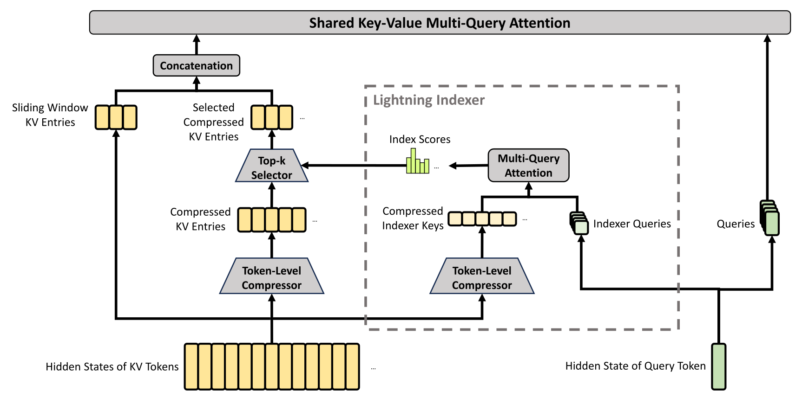
:::

:::{slide}
:label: cs336-10-043-output-004
:at: 3
- Compressed Sparse Attention (CSA): compresses every m tokens into 1
:::

:::{slide}
:label: cs336-10-043-output-005
:at: 4
- DeepSeek Sparse Attention (DSA): selects the top k
:::


(cs336-10-section-044)=
## DeepSeek v4 attention

:::{slide}
:label: cs336-10-044-output-001
:at: 0
- Heavily Compressed Attention (HCA): compresses even more
:::

:::{slide}
:label: cs336-10-044-values-002
:at: 0
**`k40_b64`**

```python
{'num_params': 13015449600,
 'memory': 79717990400,
 'latency': 0.023796415044776118,
 'throughput': 2689.480742354489}
```


**`k8_b64`**

```python
{'num_params': 11337728000,
 'memory': 33412874240,
 'latency': 0.00997399231044776,
 'throughput': 6416.688323787855}
```


**`k8_b256`**

```python
{'num_params': 11337728000,
 'memory': 65625128960,
 'latency': 0.01958959073432836,
 'throughput': 13068.164795877605}
```

:::

:::{slide}
:label: cs336-10-044-output-003
:at: 1
Summary:
:::

:::{slide}
:label: cs336-10-044-output-004
:at: 2
- Goal: reduce the KV cache size (since inference is memory-bound) without hurting accuracy
:::

:::{slide}
:label: cs336-10-044-output-005
:at: 3
- Lower-dimensional KV cache (GQA, MLA, CLA)
:::

:::{slide}
:label: cs336-10-044-output-006
:at: 4
- Local attention (truncates the KV cache) on some of the layers
:::


(cs336-10-section-045)=
## DeepSeek v4 attention

:::{slide}
:label: cs336-10-045-output-001
:at: 0
- Other ideas: linear attention / state-space-models (Mamba 2, GatedDeltaNet), diffusion models
:::

:::{slide}
:label: cs336-10-045-values-002
:at: 0
:until: 1
**`k40_b64`**

```python
{'num_params': 13015449600,
 'memory': 79717990400,
 'latency': 0.023796415044776118,
 'throughput': 2689.480742354489}
```


**`k8_b64`**

```python
{'num_params': 11337728000,
 'memory': 33412874240,
 'latency': 0.00997399231044776,
 'throughput': 6416.688323787855}
```


**`k8_b256`**

```python
{'num_params': 11337728000,
 'memory': 65625128960,
 'latency': 0.01958959073432836,
 'throughput': 13068.164795877605}
```

:::

:::{slide}
:label: cs336-10-045-output-003
:at: 2
Key idea: reduce the precision of numbers
:::

:::{slide}
:label: cs336-10-045-output-004
:at: 3
Less memory means higher latency/throughput (since inference is memory-bound).
:::

:::{slide}
:label: cs336-10-045-output-005
:at: 4
Of course we have to worry about accuracy...
:::

:::{slide}
:label: cs336-10-045-values-006
:at: 5
| Variable | Value |
| --- | --- |
| `x` | 5.2342 |
:::


(cs336-10-section-046)=
## DeepSeek v4 attention

:::{slide}
:label: cs336-10-046-values-001
:at: 0
:until: 1
| Variable | Value |
| --- | --- |
| `x` | 5.2342 |
| `x_quant` | 56 |
:::

:::{slide}
:label: cs336-10-046-values-002
:at: 1
| Variable | Value |
| --- | --- |
| `x` | 5.2342 |
| `x_quant` | 56 |
| `x_approx` | 5.2 |
:::

:::{slide}
:label: cs336-10-046-output-003
:at: 2
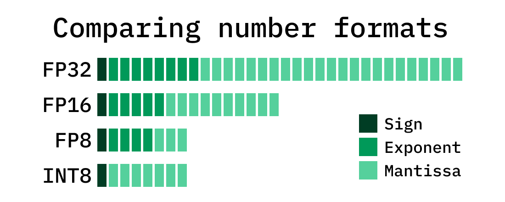

[article](https://www.baseten.co/blog/fp8-efficient-model-inference-with-8-bit-floating-point-numbers/)
:::

:::{slide}
:label: cs336-10-046-output-004
:at: 3
- fp32 (4 bytes): needed for parameters and optimizer states during training
:::

:::{slide}
:label: cs336-10-046-output-005
:at: 4
- bf16 (2 bytes): default for inference
:::


(cs336-10-section-047)=
## DeepSeek v4 attention

:::{slide}
:label: cs336-10-047-output-001
:at: 0
- fp8 (1 byte) [-240, 240] for e4m3 on H100s: can train if you dare 

[Peng+ 2023](https://arxiv.org/pdf/2310.18313)
:::

:::{slide}
:label: cs336-10-047-values-002
:at: 0
| Variable | Value |
| --- | --- |
| `x` | 5.2342 |
| `x_quant` | 56 |
| `x_approx` | 5.2 |
:::

:::{slide}
:label: cs336-10-047-output-003
:at: 1
- int8 (1 byte) [-128, 127]: less accurate but cheaper than fp8, but for inference only 

[Baalen+ 2023](https://arxiv.org/pdf/2303.17951)
:::

:::{slide}
:label: cs336-10-047-output-004
:at: 2
- int4 (0.5 bytes) [-8, 7]: cheaper, even less accurate 

[Baalen+ 2023](https://arxiv.org/pdf/2303.17951)
:::

:::{slide}
:label: cs336-10-047-output-005
:at: 3
[Overview of approaches](https://apxml.com/posts/llm-quantization-techniques-explained)
:::

:::{slide}
:label: cs336-10-047-output-006
:at: 4
Quantization-aware training (QAT)
:::


(cs336-10-section-048)=
## DeepSeek v4 attention

:::{slide}
:label: cs336-10-048-output-001
:at: 0
- During training, quantize-and-dequantize during the forward pass to simulate quantization errors
:::

:::{slide}
:label: cs336-10-048-values-002
:at: 0
| Variable | Value |
| --- | --- |
| `x` | 5.2342 |
| `x_quant` | 56 |
| `x_approx` | 5.2 |
:::

:::{slide}
:label: cs336-10-048-output-003
:at: 1
- Pro: weights are trained to work with quantization
:::

:::{slide}
:label: cs336-10-048-output-004
:at: 2
- Con: requires expensive large-scale training
:::

:::{slide}
:label: cs336-10-048-output-005
:at: 3
Post-training quantization (PTQ):
:::

:::{slide}
:label: cs336-10-048-output-006
:at: 4
- Done after training, so much cheaper
:::


(cs336-10-section-049)=
## DeepSeek v4 attention

:::{slide}
:label: cs336-10-049-output-001
:at: 0
- Run on sample data to determine scale and zero point for each layer or tensor
:::

:::{slide}
:label: cs336-10-049-values-002
:at: 0
| Variable | Value |
| --- | --- |
| `x` | 5.2342 |
| `x_quant` | 56 |
| `x_approx` | 5.2 |
:::

:::{slide}
:label: cs336-10-049-output-003
:at: 1
- GPTQ: use Hessian information to update non-quantized weights to account for quantization error 

[Frantar+ 2022](https://arxiv.org/abs/2210.17323)
:::


(cs336-10-section-050)=
## Activation-aware quantization (AWQ)

:::{slide}
:label: cs336-10-050-values-001
:at: 0
| Variable | Value |
| --- | --- |
| `x` | 5.2342 |
| `x_quant` | 56 |
| `x_approx` | 5.2 |
:::

:::{slide}
:label: cs336-10-050-output-002
:at: 1
[Lin+ 2023](https://arxiv.org/abs/2306.00978)
:::

:::{slide}
:label: cs336-10-050-output-003
:at: 2
- Observation: some activation channels are large
:::

:::{slide}
:label: cs336-10-050-output-004
:at: 3
- Weights that hit those matter more
:::

:::{slide}
:label: cs336-10-050-output-005
:at: 4
- Allocate more precision to those weights
:::


(cs336-10-section-051)=
## Activation-aware quantization (AWQ)

:::{slide}
:label: cs336-10-051-output-001
:at: 0
- Idea: select which weights (0.1-1%) to keep in high precision based on activations
:::

:::{slide}
:label: cs336-10-051-values-002
:at: 0
:until: 3
| Variable | Value |
| --- | --- |
| `x` | 5.2342 |
| `x_quant` | 56 |
| `x_approx` | 5.2 |
:::

:::{slide}
:label: cs336-10-051-output-003
:at: 1
- fp16 → int3 produces 4x lower memory, 3.2x speedup
:::

:::{slide}
:label: cs336-10-051-output-004
:at: 2
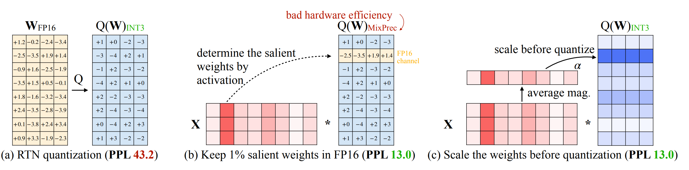
:::

:::{slide}
:label: cs336-10-051-output-005
:at: 4
Key idea: just rip out parts of an expensive model to make it cheaper
:::

:::{slide}
:label: cs336-10-051-output-006
:at: 5
...and then fix it up.
:::


(cs336-10-section-052)=
## Activation-aware quantization (AWQ)

:::{slide}
:label: cs336-10-052-output-001
:at: 0
Paper from NVIDIA 

[Muralidharan+ 2024](https://arxiv.org/abs/2407.14679)
:::

:::{slide}
:label: cs336-10-052-output-002
:at: 1
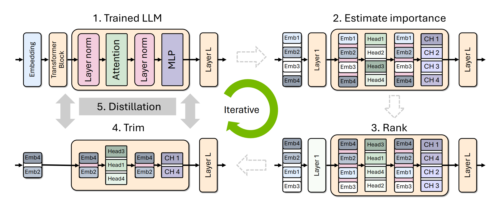
:::

:::{slide}
:label: cs336-10-052-output-003
:at: 2
Algorithm:
:::

:::{slide}
:label: cs336-10-052-output-004
:at: 3
1. Identify important {layer, head, hidden dimension} on a small calibration dataset (1024 samples)
:::

:::{slide}
:label: cs336-10-052-output-005
:at: 4
2. Remove unimportant layers to get a smaller model
:::


(cs336-10-section-053)=
## Activation-aware quantization (AWQ)

:::{slide}
:label: cs336-10-053-output-001
:at: 0
3. Distill the original model into pruned model
:::

:::{slide}
:label: cs336-10-053-output-002
:at: 1
Results:
:::

:::{slide}
:label: cs336-10-053-output-003
:at: 2
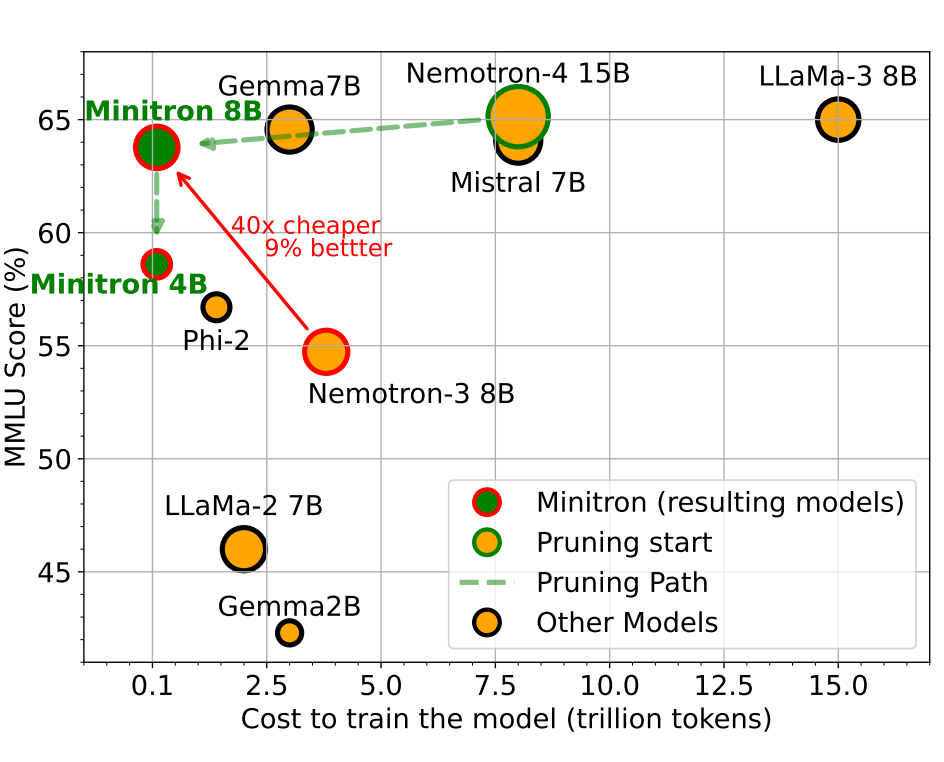
:::

:::{slide}
:label: cs336-10-053-output-004
:at: 3
Summary: reduce inference complexity without hurting accuracy
:::

:::{slide}
:label: cs336-10-053-output-005
:at: 4
From scratch recipe:
:::


(cs336-10-section-054)=
## Activation-aware quantization (AWQ)

:::{slide}
:label: cs336-10-054-output-001
:at: 0
1. Define faster model architecture
:::

:::{slide}
:label: cs336-10-054-output-002
:at: 1
2. Train faster model
:::

:::{slide}
:label: cs336-10-054-output-003
:at: 2
Distillation recipe:
:::

:::{slide}
:label: cs336-10-054-output-004
:at: 3
1. Define faster model architecture
:::

:::{slide}
:label: cs336-10-054-output-005
:at: 4
2. Initialize weights using original model (which has a different architecture)
:::


(cs336-10-section-055)=
## Activation-aware quantization (AWQ)

:::{slide}
:label: cs336-10-055-output-001
:at: 0
3. Repair faster model (distillation)
:::


(cs336-10-section-056)=
## Use shortcuts but double check (lossless)

:::{slide}
:label: cs336-10-056-output-001
:at: 0
Recall the two stages of inference:
:::

:::{slide}
:label: cs336-10-056-output-002
:at: 1
- Prefill: given a sequence, encode tokens in parallel (compute-bound) [note: also gives you probabilities]
:::

:::{slide}
:label: cs336-10-056-output-003
:at: 2
- Generation: generate one token at a time (memory-bound)
:::

:::{slide}
:label: cs336-10-056-output-004
:at: 3
In other words, checking is faster than generation.
:::


(cs336-10-section-057)=
## Use shortcuts but double check (lossless)

:::{slide}
:label: cs336-10-057-output-001
:at: 0
Speculative sampling 

[Leviathan+ 2022](https://arxiv.org/abs/2211.17192)

[Chen+ 2023](https://arxiv.org/abs/2302.01318)
:::

:::{slide}
:label: cs336-10-057-output-002
:at: 1
- Use a cheaper **draft model** p to guess a few tokens (e.g., 4)
:::

:::{slide}
:label: cs336-10-057-output-003
:at: 2
- Evaluate with target model q (process tokens in parallel), and accept if it looks good
:::

:::{slide}
:label: cs336-10-057-output-004
:at: 3
[Speculative sampling video](https://storage.googleapis.com/gweb-research2023-media/media/SpeculativeDecoding-1-Illustration.mp4)
:::

:::{slide}
:label: cs336-10-057-output-005
:at: 4
[article](https://research.google/blog/looking-back-at-speculative-decoding/)
:::


(cs336-10-section-058)=
## Use shortcuts but double check (lossless)

:::{slide}
:label: cs336-10-058-output-001
:at: 0
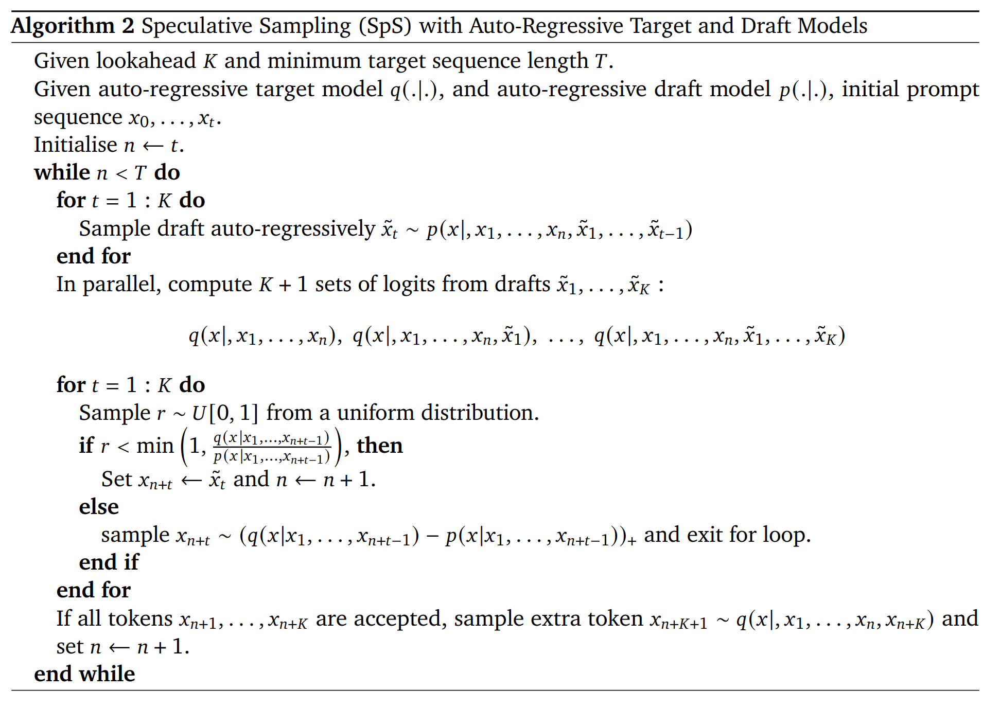
:::

:::{slide}
:label: cs336-10-058-output-002
:at: 1
This is modified rejection sampling with proposal p and target q
:::

:::{slide}
:label: cs336-10-058-output-003
:at: 2
Modification: always generate at least one candidate (rejection sampling will keep looping)
:::

:::{slide}
:label: cs336-10-058-output-004
:at: 3
Key property: guaranteed to be an **exact sample** from the target model!
:::

:::{slide}
:label: cs336-10-058-output-005
:at: 4
Proof by example: assume two vocabulary elements {A, B}
:::


(cs336-10-section-059)=
## Use shortcuts but double check (lossless)

:::{slide}
:label: cs336-10-059-output-001
:at: 0
- Target model probabilities: [q(A), q(B)]
:::

:::{slide}
:label: cs336-10-059-output-002
:at: 1
- Draft model probabilities: [p(A), p(B)]
:::

:::{slide}
:label: cs336-10-059-output-003
:at: 2
- Assume p(A) > q(A) [draft model oversamples A].
:::

:::{slide}
:label: cs336-10-059-output-004
:at: 3
- Therefore p(B) < q(B) [draft model undersamples B].
:::

:::{slide}
:label: cs336-10-059-output-005
:at: 4
- Residual probabilities max(q-p, 0): [0, 1]
:::


(cs336-10-section-060)=
## Use shortcuts but double check (lossless)

:::{slide}
:label: cs336-10-060-output-001
:at: 0
Compute the probabilities of speculatively sampling a token:
:::

:::{slide}
:label: cs336-10-060-output-002
:at: 1
- P[sampling A] = p(A) * (q(A) / p(A)) + p(B) * 1 * 0 = q(A)
:::

:::{slide}
:label: cs336-10-060-output-003
:at: 2
- P[sampling B] = p(B) * 1 + p(A) * (1 - q(A) / p(A)) * 1 = q(B)
:::

:::{slide}
:label: cs336-10-060-output-004
:at: 3
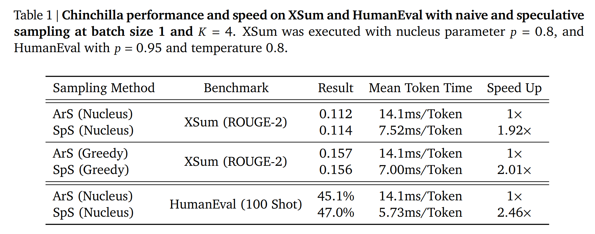
:::

:::{slide}
:label: cs336-10-060-output-005
:at: 4
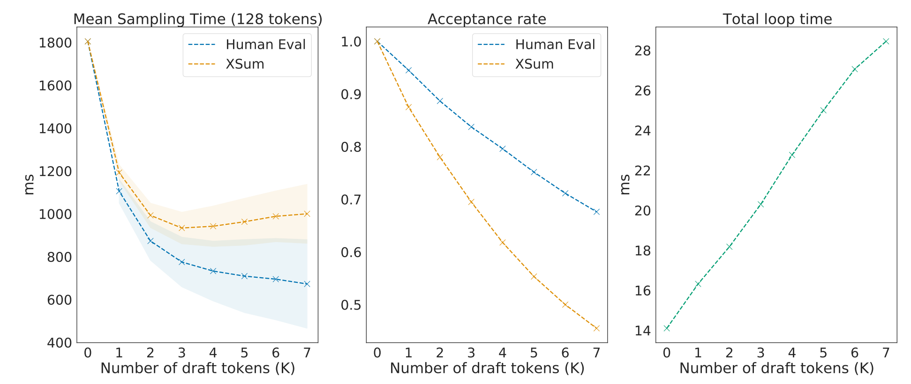
:::


(cs336-10-section-061)=
## Use shortcuts but double check (lossless)

:::{slide}
:label: cs336-10-061-output-001
:at: 0
In practice:
:::

:::{slide}
:label: cs336-10-061-output-002
:at: 1
- Target model has 70B parameters, draft model has 8B parameters
:::

:::{slide}
:label: cs336-10-061-output-003
:at: 2
- Target model has 8B parameters, draft model has 1B parameters
:::

:::{slide}
:label: cs336-10-061-output-004
:at: 3
- Try to make draft model as close to target (distillation)
:::

:::{slide}
:label: cs336-10-061-output-005
:at: 4
Extensions to improve the draft model:
:::


(cs336-10-section-062)=
## Use shortcuts but double check (lossless)

:::{slide}
:label: cs336-10-062-output-001
:at: 0
- Medusa: draft model generates multiple tokens in parallel 

[Cai+ 2024](https://arxiv.org/abs/2401.10774)
:::

:::{slide}
:label: cs336-10-062-output-002
:at: 1
- EAGLE: draft model takes high-level features from target model 

[Li+ 2024](https://arxiv.org/pdf/2401.15077)
:::

:::{slide}
:label: cs336-10-062-output-003
:at: 2
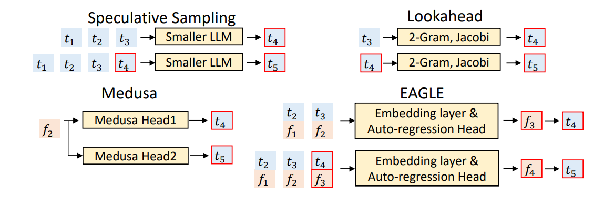
:::

:::{slide}
:label: cs336-10-062-output-004
:at: 3
Summary:
:::

:::{slide}
:label: cs336-10-062-output-005
:at: 4
- Exact sampling from target model (thanks to math)!
:::


(cs336-10-section-063)=
## Use shortcuts but double check (lossless)

:::{slide}
:label: cs336-10-063-output-001
:at: 0
- Exploits asymmetry between checking and generation
:::

:::{slide}
:label: cs336-10-063-output-002
:at: 1
- Lots of room for innovation on the draft model (involves training)
:::


(cs336-10-section-064)=
## Handling dynamic workloads

:::{slide}
:label: cs336-10-064-output-001
:at: 0
Batching over sequences in live traffic is tricky because:
:::

:::{slide}
:label: cs336-10-064-output-002
:at: 1
1. Requests arrive at different times (waiting for batch is bad for early requests)
:::

:::{slide}
:label: cs336-10-064-output-003
:at: 2
2. Sequences have shared prefixes (e.g., system prompts, generating multiple samples)
:::

:::{slide}
:label: cs336-10-064-output-004
:at: 3
3. Sequences have different lengths (padding is inefficient)
:::


(cs336-10-section-065)=
## Handling dynamic workloads

:::{slide}
:label: cs336-10-065-output-001
:at: 0
[Orca: A Distributed Serving System for Transformer-Based Generative Models](https://www.usenix.org/system/files/osdi22-yu.pdf)

[talk](https://www.youtube.com/watch?v=Ob9PPLxETYU)
:::

:::{slide}
:label: cs336-10-065-output-002
:at: 1
Problem:
:::

:::{slide}
:label: cs336-10-065-output-003
:at: 2
- Training: get a dense block of tokens (batch size x sequence length)
:::

:::{slide}
:label: cs336-10-065-output-004
:at: 3
- Inference: requests arrive and finish at different times, so you have a ragged array
:::

:::{slide}
:label: cs336-10-065-output-005
:at: 4
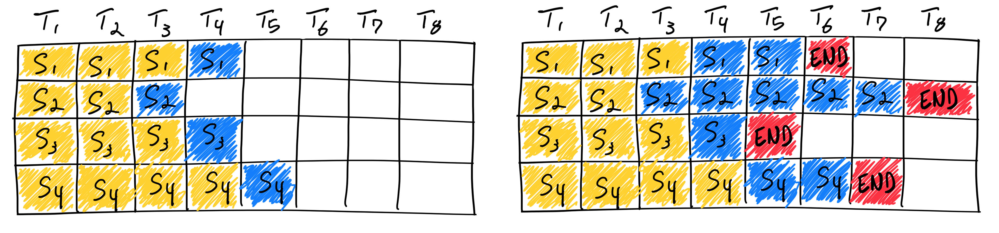
:::


(cs336-10-section-066)=
## Handling dynamic workloads

:::{slide}
:label: cs336-10-066-output-001
:at: 0
Solution: iteration-level scheduling
:::

:::{slide}
:label: cs336-10-066-output-002
:at: 1
- Decode step by step
:::

:::{slide}
:label: cs336-10-066-output-003
:at: 2
- Add new requests to the batch as they arrive (so don't have to wait until generation completes)
:::

:::{slide}
:label: cs336-10-066-output-004
:at: 3
Problem:
:::

:::{slide}
:label: cs336-10-066-output-005
:at: 4
- Batching only works when all sequences have the same dimensionality (right?)
:::


(cs336-10-section-067)=
## Handling dynamic workloads

:::{slide}
:label: cs336-10-067-output-001
:at: 0
- But each request might have a different length
:::

:::{slide}
:label: cs336-10-067-output-002
:at: 1
Solution: selective batching
:::

:::{slide}
:label: cs336-10-067-output-003
:at: 2
- Training: when all sequences of the same length, operate on a B x S x H tensor
:::

:::{slide}
:label: cs336-10-067-output-004
:at: 3
- But we might have different lengths: [3, H], [9, H], [5, H], etc.
:::

:::{slide}
:label: cs336-10-067-output-005
:at: 4
- Attention computation: process each sequence separately
:::


(cs336-10-section-068)=
## Handling dynamic workloads

:::{slide}
:label: cs336-10-068-output-001
:at: 0
- Non-attention computation: concatenate all the sequences together to [3 + 9 + 5, H]
:::

:::{slide}
:label: cs336-10-068-output-002
:at: 1
Paper that introduced vLLM in addition to PagedAttention 

[Kwon+ 2023](https://arxiv.org/pdf/2309.06180.pdf)
:::

:::{slide}
:label: cs336-10-068-output-003
:at: 2
Previous status quo:
:::

:::{slide}
:label: cs336-10-068-output-004
:at: 3
- Request comes in
:::

:::{slide}
:label: cs336-10-068-output-005
:at: 4
- Allocate section of KV cache for prompt and response (up to a max length)
:::


(cs336-10-section-069)=
## Handling dynamic workloads

:::{slide}
:label: cs336-10-069-output-001
:at: 0
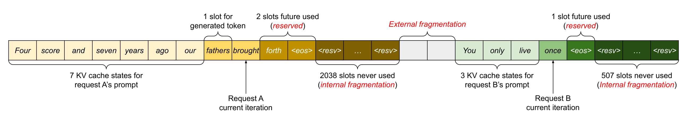
:::

:::{slide}
:label: cs336-10-069-output-002
:at: 1
Problem: fragmentation (what happens to your hard drive)
:::

:::{slide}
:label: cs336-10-069-output-003
:at: 2
- But this is wasteful since we might generate much fewer tokens (internal fragmentation)!
:::

:::{slide}
:label: cs336-10-069-output-004
:at: 3
- Might be extra unused space between sections (external fragmentation)!
:::

:::{slide}
:label: cs336-10-069-output-005
:at: 4
Solution: PagedAttention (remember operating systems)
:::


(cs336-10-section-070)=
## Handling dynamic workloads

:::{slide}
:label: cs336-10-070-output-001
:at: 0
- Divide the KV cache of a sequence into non-contiguous **blocks**
:::

:::{slide}
:label: cs336-10-070-output-002
:at: 1
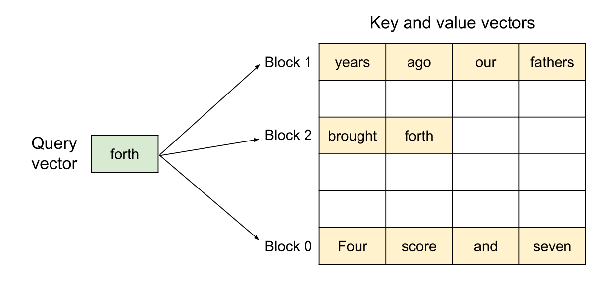
:::

:::{slide}
:label: cs336-10-070-output-003
:at: 2
Two requests share the KV caches:
:::

:::{slide}
:label: cs336-10-070-output-004
:at: 3
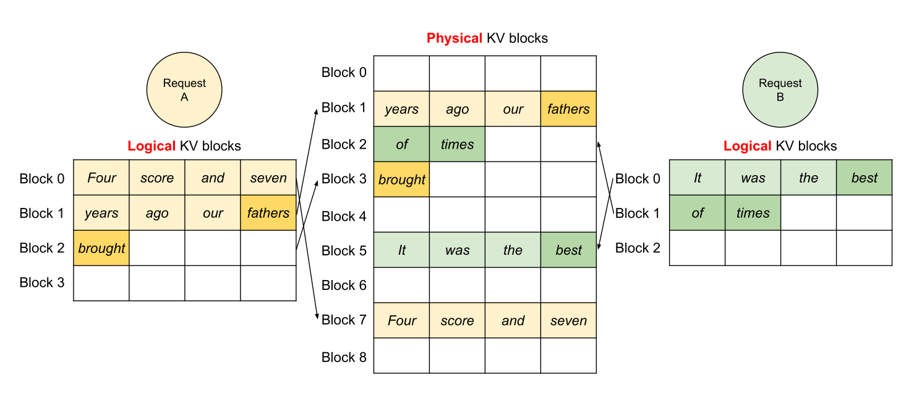
:::

:::{slide}
:label: cs336-10-070-output-005
:at: 4
In general, multiple types of sharing KV caches across sequences:
:::


(cs336-10-section-071)=
## Handling dynamic workloads

:::{slide}
:label: cs336-10-071-output-001
:at: 0
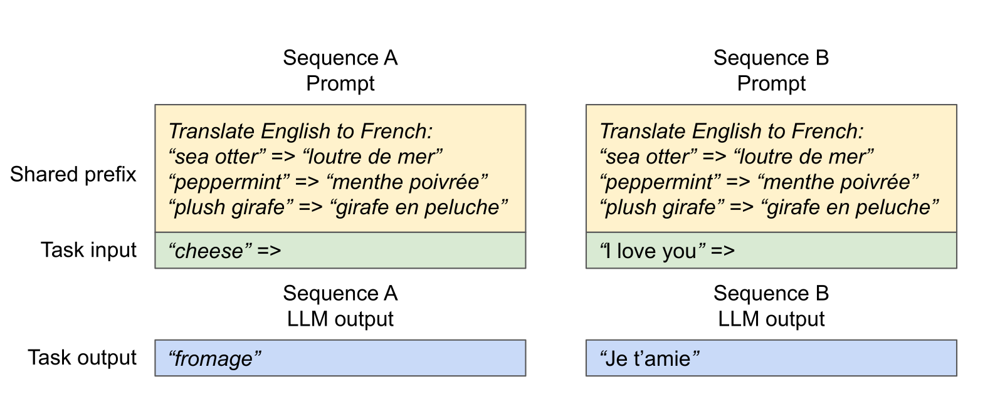
:::

:::{slide}
:label: cs336-10-071-output-002
:at: 1
- Sharing the system prompt
:::

:::{slide}
:label: cs336-10-071-output-003
:at: 2
- Sampling multiple responses per prompt (e.g., for program synthesis)
:::

:::{slide}
:label: cs336-10-071-output-004
:at: 3
Solution: share prefixes, copy-on-write at the block level
:::

:::{slide}
:label: cs336-10-071-output-005
:at: 4
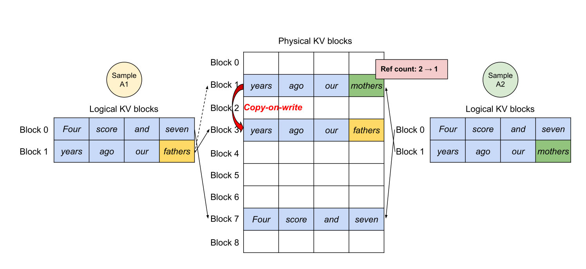
:::


(cs336-10-section-072)=
## Handling dynamic workloads

:::{slide}
:label: cs336-10-072-output-001
:at: 0
Other vLLM optimizations:
:::

:::{slide}
:label: cs336-10-072-output-002
:at: 1
- Kernel to fuse block read and attention (reduce kernel launch overhead)
:::

:::{slide}
:label: cs336-10-072-output-003
:at: 2
- Use latest kernels (FlashAttention, FlashDecoding)
:::

:::{slide}
:label: cs336-10-072-output-004
:at: 3
- Use CUDA graphs to avoid kernel launch overhead
:::

:::{slide}
:label: cs336-10-072-output-005
:at: 4
Summary: use ideas from operating systems (paging) to make use of memory for dynamic workloads
:::


(cs336-10-section-073)=
## Summary

:::{slide}
:label: cs336-10-073-output-001
:at: 0
- Inference is important (actual use, evaluation, reinforcement learning)
:::

:::{slide}
:label: cs336-10-073-output-002
:at: 1
- Different characteristics compared to training (memory-bound, dynamic)
:::

:::{slide}
:label: cs336-10-073-output-003
:at: 2
- Techniques: new architectures, quantization, pruning/distillation, speculative sampling
:::

:::{slide}
:label: cs336-10-073-output-004
:at: 3
- Ideas from systems (speculative execution, paging)
:::


(cs336-10-section-074)=
## Summary

:::{slide}
:label: cs336-10-074-output-001
:at: 0
- New architectures have huge potential for improvement
:::

