(cs336-11-cover)=
# Lecture 11: Scaling laws: case studies and details

Stanford CS336 · Language Modeling from Scratch · Spring 2026.

(cs336-11-page-001)=

## Lecture 11

S C A LIN G – C A SE ST UDY A ND D E TA IL S

CS336

(cs336-11-page-002)=

## Motivation today

What is the best practices for scaling and hparam tuning LMs?

Does chinchilla’s approach to scaling actually work?

Can we save compute when training and fitting these things?

Should we be picking particular architectures / parametrizations to scale nicely?

(cs336-11-page-003)=

## Scaling in practice

The newest model we talked about with scaling details - 2022

What about more recently?

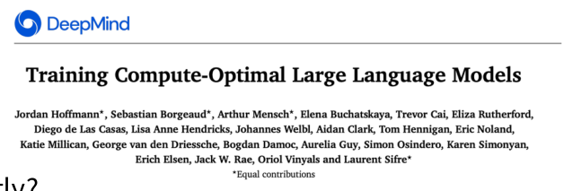

2024

2024

2024

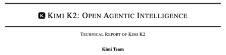

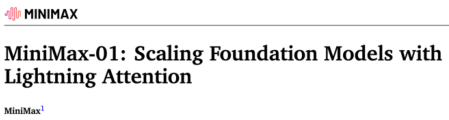

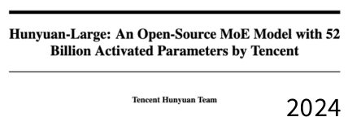

2025 2026

(cs336-11-page-004)=

## Initialization and optimizers

Initialization, optimizers, and various hyperparams (LR/batch) can be scale sensitive

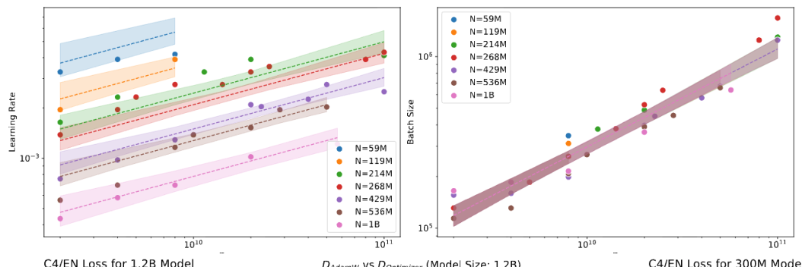

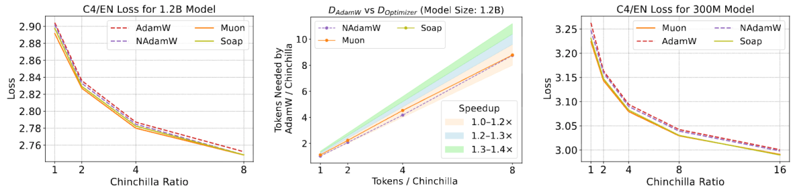

(cs336-11-page-005)=

## Working through some detailed, public scaling recipes

1. MiniCPM

2. DeepSeek

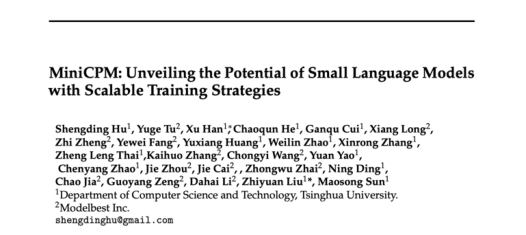

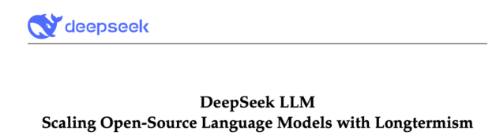

(cs336-11-page-006)=

## MiniCPM

MiniCPM (2024) – small, high-perf LM from Tsinghua group.

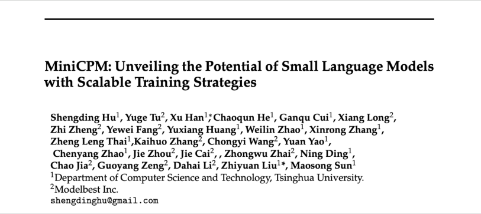

Careful, extensive scaling computations + muP to stabilize and simplify scaling

Not really ‘sota’ model (even in 2024) but many interesting lessons on scaling

(cs336-11-page-007)=

High performance 1-2.5 B parameter models. These models beat most out 2Bs and

match many modern 7B models.

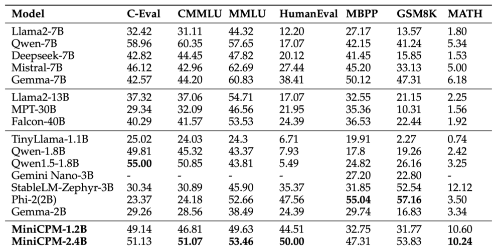

(cs336-11-page-008)=

## Techique 1: muP to stabilize scaling

Scale_emb = 12, scale_depth = 1.4, init_std = 0.1, lr =0.01

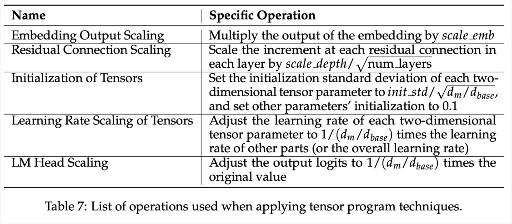

(cs336-11-page-009)=

## Scaling recipe / strategy

Use muP for initialization, fix the aspect ratio, scale up the overall model size.

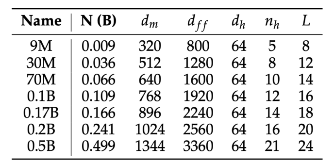

Note that the gap between the largest model here and the actual model they train is ~5x

Optimal batch, LR, token-to-size ratios are directly fitted via scaling analysis

(cs336-11-page-010)=

## Optimal LR

According to muP – optimal learning rate should be (roughly) stable. Is it?

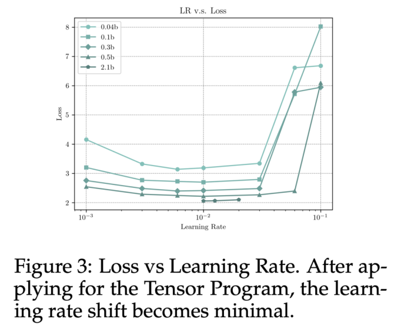

(cs336-11-page-011)=

## Optimal batch

Three model sizes (9m, 30m, 170m) as a function of data size (y), batch (x) and loss (col)

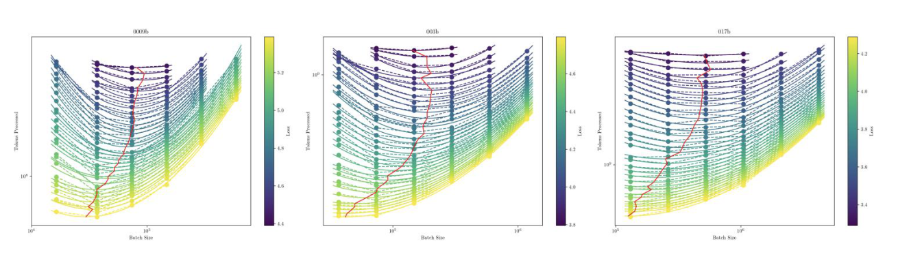

Vertical columns of points represent a single training curve (fixed batch, more points).

Red line attempts to identify minimum loss points for each y-value

– this is the ‘optimal batch size’ for a model size / dataset size combination.

(cs336-11-page-012)=

## Optimal batch size

We can then follow the Kaplan 2020 analysis and plot optimal batch size vs final loss.

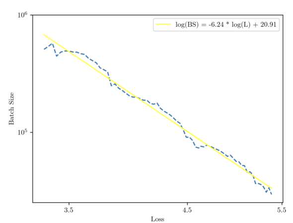

Fairly clean trend – polynomially increase the batch size as loss decreases.

(cs336-11-page-013)=

## What remains – model size vs data tradeoffs.

From chinchilla – to fit a scaling law, we need to train from scratch, not just early stop

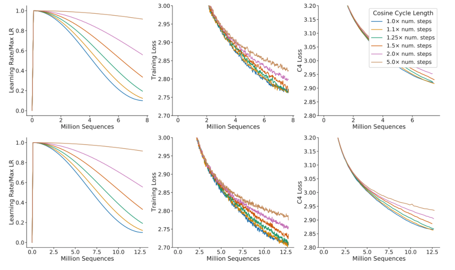

This turns the cost of fitting a scaling law from n to n^2.. Can we avoid this?

(cs336-11-page-014)=

## (partial) solution in miniCPM – WSD learning rate

Instead of cosine, split learning rate into warmup, stable, and decay phases.

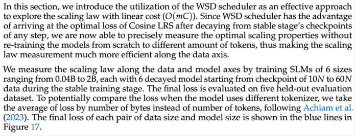

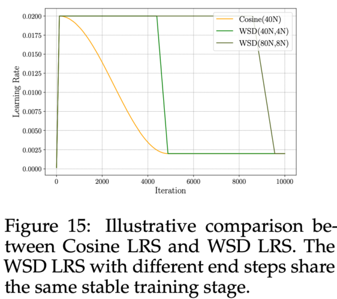

For chinchilla-style analysis, can restart the run at the end of the stable phase.

(cs336-11-page-015)=

## WSD learning rates work well in miniCPM

Slower during the stable phase, rapid loss decay during decay phase. Decay ~ 10%.

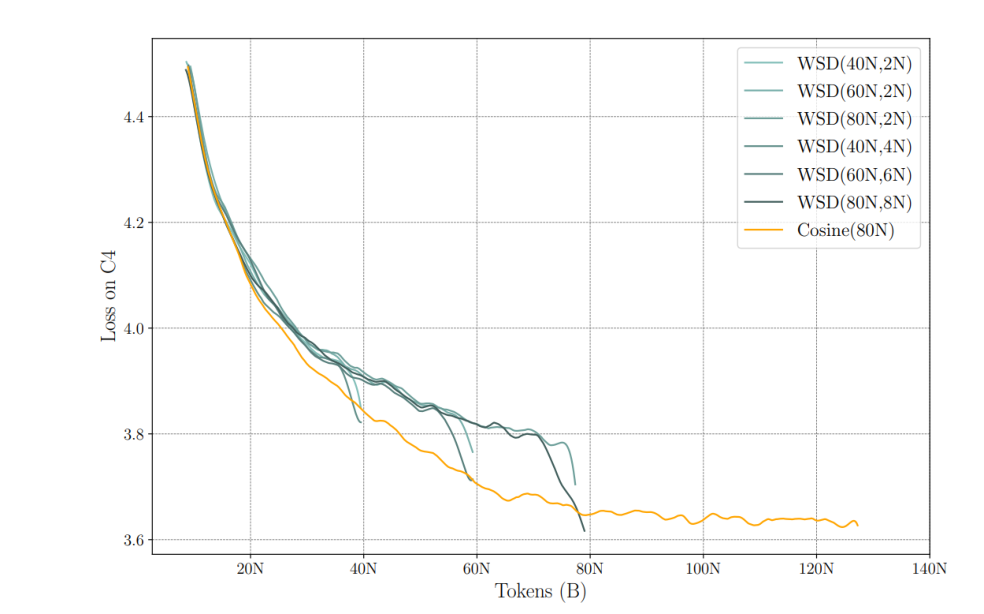

(cs336-11-page-016)=

## Chinchilla-type analysis

Equipped with the WSD learning rate,

we can now try to find the optimal data-to-model size ratio

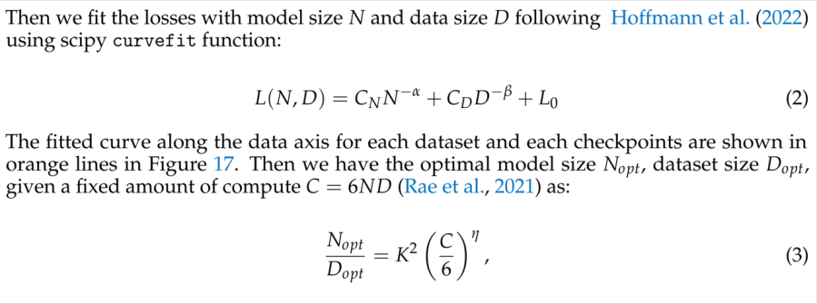

MiniCPM authors choose method 1 (lower envelope) and method 3 (joint fit)

(cs336-11-page-017)=

## Chinchlla method 1

Fairly clear (though maybe not linear?) trends

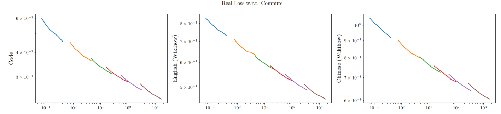

Different colors indicate different models. Their runs suggest relatively low diminishing

returns due to data.

(cs336-11-page-018)=

## Chinchilla method 3

Their primary scaling approach is the joint fit – they find _very_ high data-model ratios.

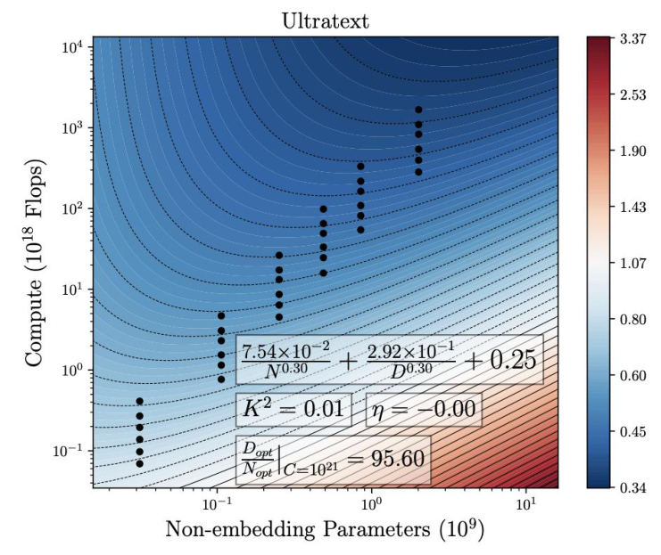

(cs336-11-page-019)=

## DeepSeek

DeepSeek (2024) – another LM with careful scaling analysis

7 and 67B param models – generally high performance compared to other open LM

(cs336-11-page-020)=

## Scaling strategy – batch + LR

**Scaling strategy** : don’t use any muP, directly estimate optimal batch / LR

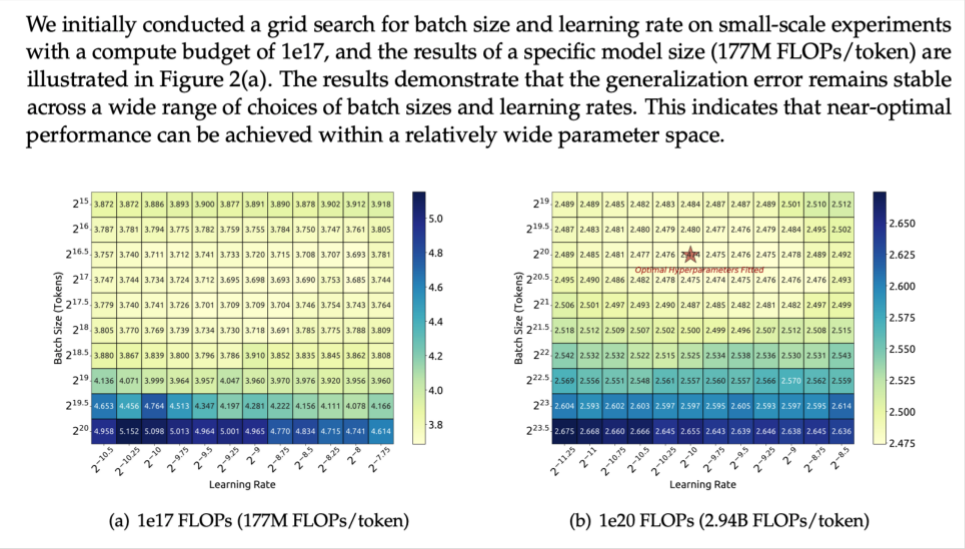

(cs336-11-page-021)=

## Scaling analysis of learning rates

Small scale runs + collect ‘near optimal’ (within 0.25% of min) models.

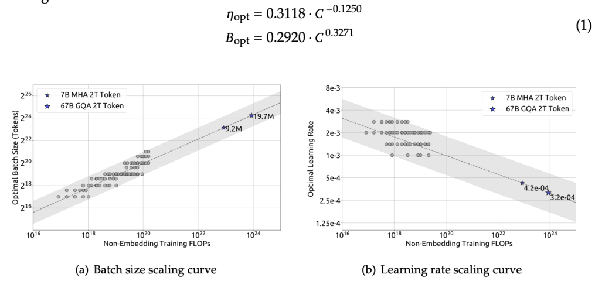

Learning rate fit looks a bit questionable..

(cs336-11-page-022)=

## For chinchilla analysis: WSD-style learning rate

Deepseek uses WSD-style learning rate – fast warmup + two decay steps of 10% each.

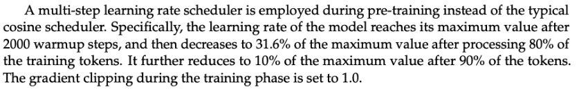

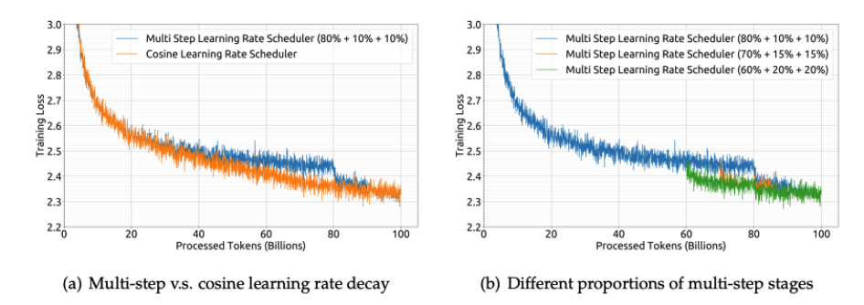

Generally seems to match performance of cosine learning rates.

(cs336-11-page-023)=

## Data-size tradeoff analysis: Chinchilla method 2

Straightforward isoflop-style analysis for selecting the model size tradeoffs.

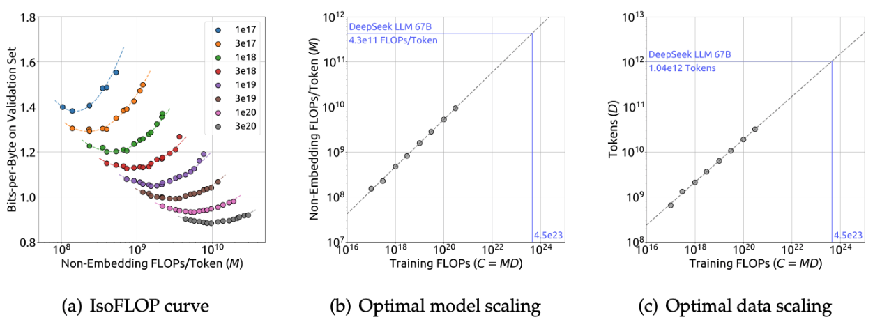

(cs336-11-page-024)=

## Scaling predicts final model loss

The fitted scaling models (generally) accurately predict the final model losses.

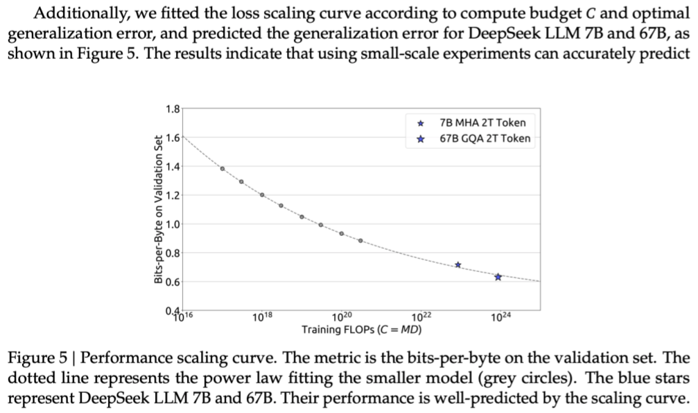

(cs336-11-page-025)=

## Other models: Qwen scaling

**Qwen 2.5** – batch and hyper scaling fits

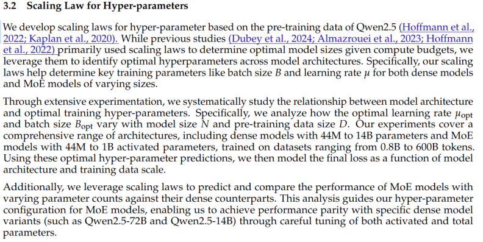

**Qwen 3** – similar scaling for LR/batch

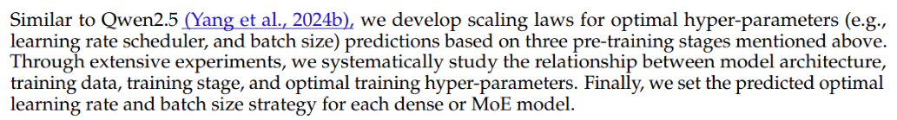

(cs336-11-page-026)=

## Kimi K2

Many recent papers – sparsity scaling law to find the right sparsity levels

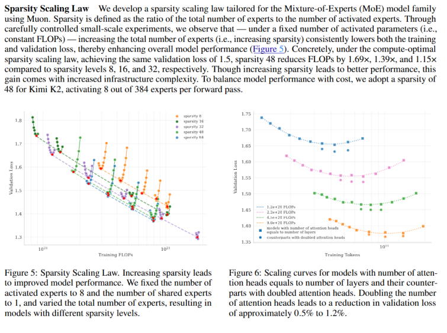

(cs336-11-page-027)=

## Hunyuan (2024) large scaling laws

Yet more isoflops-style scaling (but this time for MoE parameter sizes)

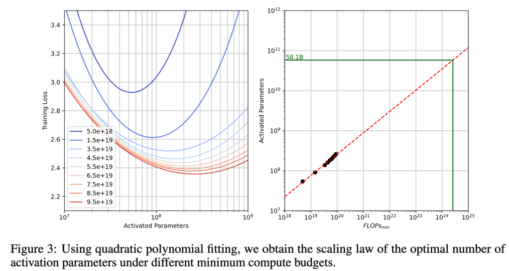

Optimal ratio – 96-1 (data to active param)

(cs336-11-page-028)=

## LLaMA 3 (2024) Scaling laws

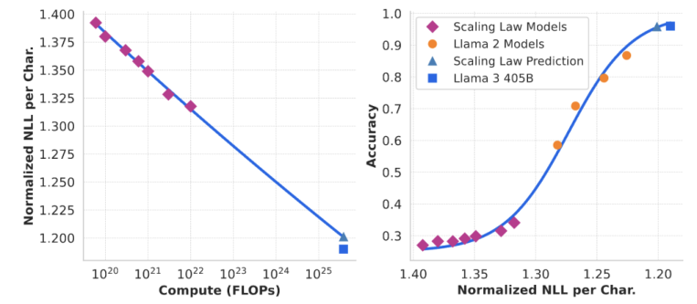

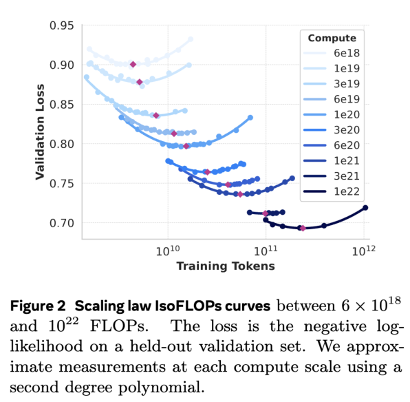

Isoflops-style scaling (39-1 ratio) Compute-to-downstream scaling

(cs336-11-page-029)=

## MiniMax-01 (2025)

Architecture scaling laws + Chinchilla method 1

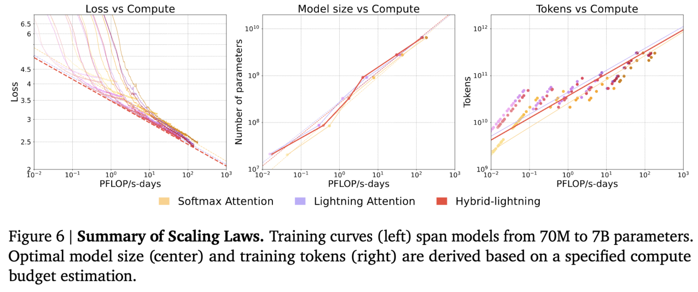

(cs336-11-page-030)=

## Recent scaling law recipes

**DeepSeek recipe**

Assume most transformer hypers are invariant to scale

Do a scaling analysis on batch / LR to figure out optimal scaling

IsoFLOP analysis to figure out model sizing

›
Use a piecewise-linear schedule to make chinchilla scaling cheap.

**miniCPM recipe**

Use muP to make transformer + LR invariant to scale

Use a piecewise linear schedule to get sample for Chinchilla method 3 (curve fitting)

Recent (late 2024+) but less detailed
**Qwen –** Lr/batch (very few details..)
**Kimi K2** – MoE scaling
**LLaMA 3 / Hunyuan**

Just isoflops (no other scaling details)
**Minimax**

Architecture choice / decision scaling

(cs336-11-page-031)=

## Optimizer scaling

Optimizers choices / tuning can be tricky and scale sensitive

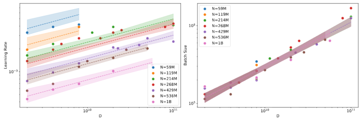

How should we pick different optimizers?

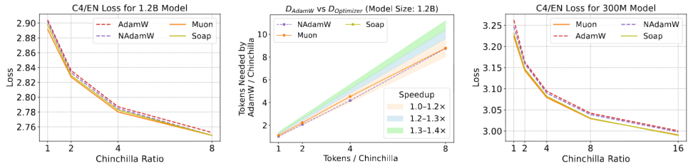

(cs336-11-page-032)=

## StepFun scaling law study

Large scale scaling law study from StepFun

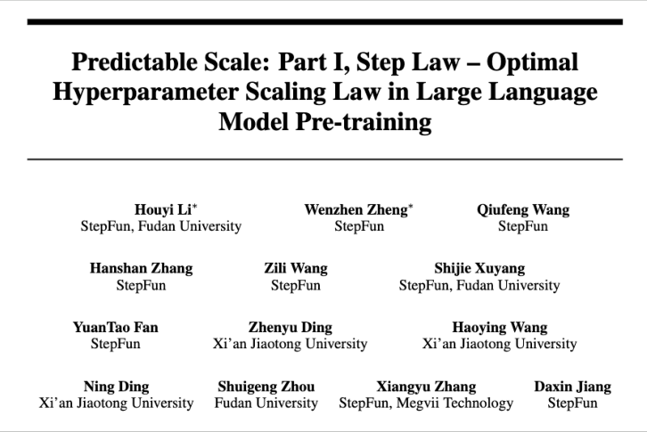

**Core question:** how do we set LR / batch params as we scale? (Deepseek / qwen approach)

(cs336-11-page-033)=

## Core question – scaling rates on LR and batch

What are the right variables / functional form?

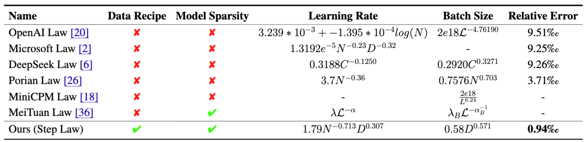

Different views:** Critical batch: batch as a function of loss (OpenAI) Compute power law: poly function of compute (DeepSeek) .. Or something else?

(cs336-11-page-034)=

## The approach: purely empirical – grid search the space

Much like the DeepSeek paper – train models to try to map out the hparam space

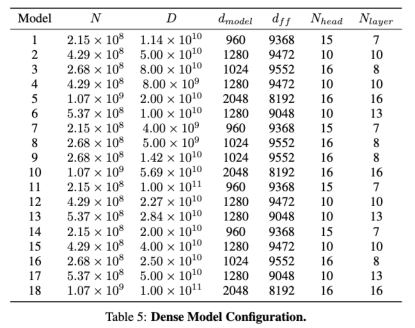

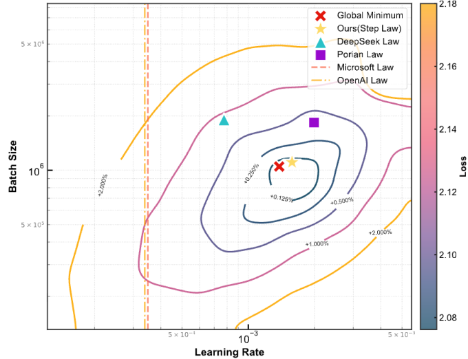

(cs336-11-page-035)=

## Observation 1: loss over batch/LR are convex

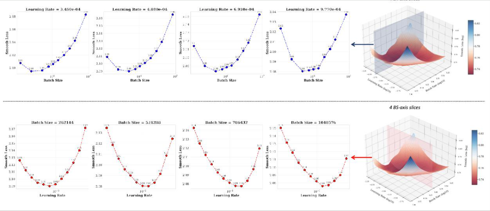

For pre-training losses, minimizers for LR/batch can be cleanly identified

(cs336-11-page-036)=

## Observation 2: scaling trends

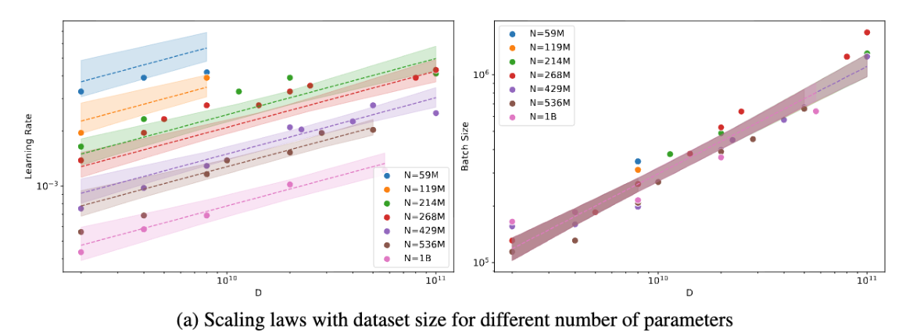

**For chinchilla style joint scaling:** batch is primarily dependent on dataset size.

They also find higher optimal LR with D (for fixed M), but this is likely more fragile if

swapping to WSD – see e.g. InternLM scaling law paper (Zhou+ 2026)

(cs336-11-page-037)=

## Observation 3 (?) robustness

Generalization to MoEs

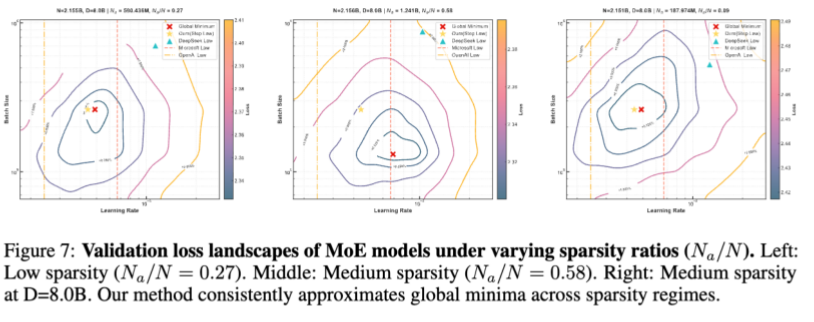

Generalization to other datasets

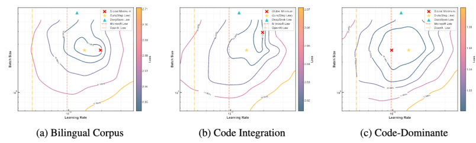

(cs336-11-page-038)=

## Optimizers and scale

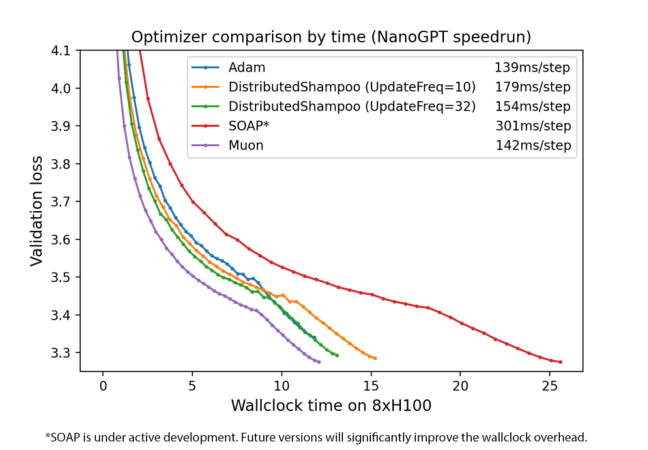

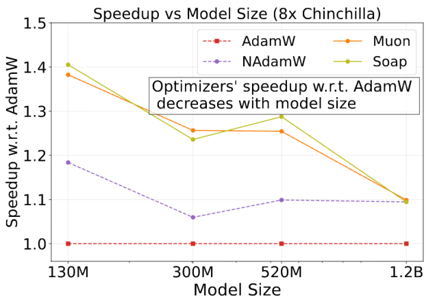

**Optimization is a core part of LLMs (but also tricky, due to scale dependence!)**

(cs336-11-page-039)=

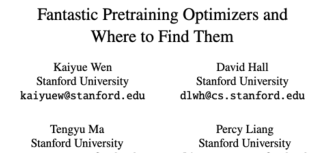
## Problem 1 – hyper tuning is often off..

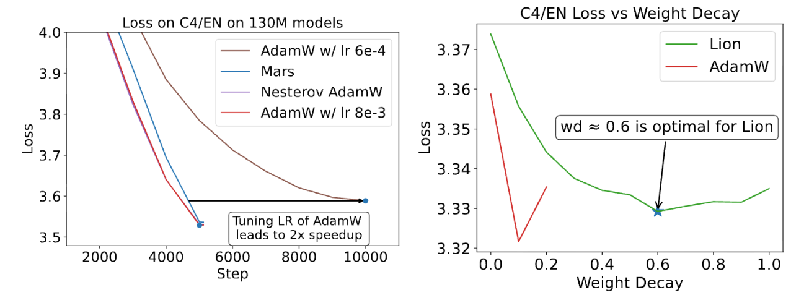

Different optimizers can require different hyperparameters!

( _and_ likely have different optimal hyperparameter scaling)

(cs336-11-page-040)=

## Problem 2 – fairly significant scale dependence

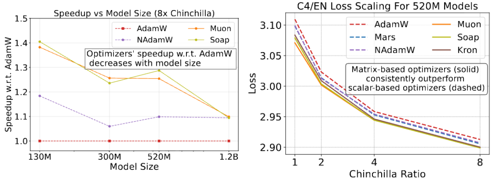

General algorithm development note – _always_ check scaling with respect to compute

and chinchilla ratios. These are often major confounders to performance!

(cs336-11-page-041)=

## Problem 2.5 – establishing scaling is nontrivial!

Sometimes, a good looking scaling can blow up

[From https://oa.williamheld.com/blog/delphi/]

Cautious AdamC + Sqrt batch-size scaling of learning rates (Fixed with some more careful parametrization / scaling / optimizer changes)

(cs336-11-page-042)=

## A few slides on muon..

**Muon:**

Optimizer for ‘matrix valued’ parameters.

𝐵 = 𝑈𝑆𝑉 [⊤] →𝑈𝑉 [⊤]
NewtonSchultz (approximately) orthogonalizes the matrix 𝑡

(cs336-11-page-043)=

## Muon and scaling

NanoGPT speedrun (very small!) Scaling study Kimi K2

Scaling gains are tricky to measure, but clearly muon ‘works’ at scale

(cs336-11-page-044)=

## Maximum update parametrization – in depth

Recall – the maximum update parametrization makes appealing claims

Scale-invariant hyperparameter tuning would be very nice.

How does it work, and does it work in practice?

(cs336-11-page-045)=

## CerebrasGPT

CerebrasGPT – 0.1 to 13B models trained with the Chinchilla recipe.

**Core finding** – using muP parametrization makes scaling more stable

(cs336-11-page-046)=

## What is muP, anyway?

(this is a very accessible ‘muP for babies’ paper)

muP is based off the following assertion. As a function of the width of the network 𝑛 𝑙 .. A1: The activations at initialization should remain Θ(1) A2: After one gradient step, the change in activation should be Θ(1) Note: if individual activations are Θ(1), then the norm should be Θ n l

(cs336-11-page-047)=

## Deriving muP (condition A1)

(cs336-11-page-048)=

## Deriving muP (condition A2)

(cs336-11-page-049)=

## Deriving muP (condition A2) part 2

(cs336-11-page-050)=

## muP mini recap..

So, what is (baby) muP about? Controlling activations (and changes) via 𝑊 and Δ𝑊

𝑛 𝑙

𝑛 𝑙−1

Initialization (stdev) : Set to Θ Learning rates : Set to

Compared to ‘standard’ parametrizations – these set

Initialization : Set to

𝑛 𝑙

𝑛 𝑙−1

1

𝑛 𝑙−1

1
𝑛 𝑙−1 [min 1,]

(for Adam

1

n l−1 [)]

Learning rates : Set to Θ(1) Differences 𝑛 < fanin – LR changes for Adam, also init diffs when fanout 𝑙

(cs336-11-page-051)=

## Deeper dive into muP

Recall – muP is a scaling procedure for hyperparams (as a function of width)

Embedding Attention params

Input/output MLP MM

Softmax linear

(cs336-11-page-052)=

## Replicating muP

**Q1:** Does muP work as claimed? When we scale widths, is optimal LR constant?

(cs336-11-page-053)=

## What is muP robust to?

Modern LMs have many components that deviate from muP’s theory

Activations – SwiGLU and squared relu

Batch sizes – Large / small

Initialization variations – zero attention, etc.

RMS norm gains

Exotic optimizers (Lion)

Regularizers

Which of these (if any) break muP?

(cs336-11-page-054)=

## What is muP not robust to? RMSnorm gain

In our arch – RMSNorm has learnable gains. This turns out to break muP

But these gains can be removed with little loss of perf..

(cs336-11-page-055)=

## What is muP not robust to? Exotic optimizers

There are other, exotic optimizers based on just gradient signs. Do they transfer?

(cs336-11-page-056)=

## What is muP not robust to? – (strong) weight decay

What about strong (0.1) weight decay? – this is maybe the only significant muP failure

(cs336-11-page-057)=

## Is muP useful? At least to some extent..

Overall, muP generally seems useful – insofar that SP is quite a bit more unstable.

Current evidence suggests that muP parametrization / initialization may be easier to tune.

(cs336-11-page-058)=

## Recap: scaling in the wild

**What are challenges in scaling ‘in practice’**

1. Setting model arch hyperparameters ( width, etc)

2. Setting optimizer hyperparameters (LR, batch)

3. Compute needed to fit the big chinchilla sweep

**Some solutions?**

1. Assume stability (or use muP)

2. Search for optimal LR / batch in small scale, either keep fixed or predict scaling

3. Use alternative learning schedules (WSD-like)
