(cs336-13-cover)=
# Lecture 13: Data I

Stanford CS336 · Language Modeling from Scratch · Spring 2026.

(cs336-13-section-001)=
## Lecture 13: Data I

:::{slide}
:label: cs336-13-001-output-001
:at: 0
Previous lectures: how to train a model *given data*
:::

:::{slide}
:label: cs336-13-001-output-002
:at: 1
Next two lectures: *what data* should we train on?
:::

:::{slide}
:label: cs336-13-001-output-003
:at: 2
**Data** is the most important thing to get right in training language models.
:::

:::{slide}
:label: cs336-13-001-output-004
:at: 3
One justification: let's see what companies disclose.
:::

(cs336-13-section-002)=
## Lecture 13: Data I

:::{slide}
:label: cs336-13-002-output-001
:at: 0
Open-weight models (e.g., Llama 3 

[Grattafiori+ 2024](https://arxiv.org/abs/2407.21783)

 have full transparency into architecture
:::

:::{slide}
:label: cs336-13-002-output-002
:at: 1
...and even training procedures
:::

:::{slide}
:label: cs336-13-002-output-003
:at: 2
...but basically no information on data.
:::

:::{slide}
:label: cs336-13-002-output-004
:at: 3
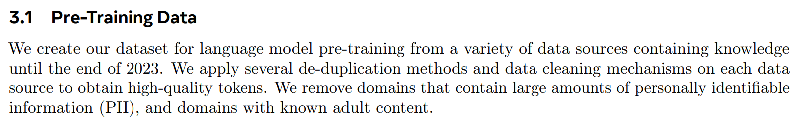
:::

:::{slide}
:label: cs336-13-002-output-005
:at: 4
Reasons for secrecy:
:::

(cs336-13-section-003)=
## Lecture 13: Data I

:::{slide}
:label: cs336-13-003-output-001
:at: 0
1. Competitive dynamics
:::

:::{slide}
:label: cs336-13-003-output-002
:at: 1
2. Copyright liability
:::

:::{slide}
:label: cs336-13-003-output-003
:at: 2
- Before foundation models, data work meant heavy annotation of labeled data for supervised learning.
:::

:::{slide}
:label: cs336-13-003-output-004
:at: 3
- Now there's less annotation, but there's still a lot of curation and cleaning.
:::

:::{slide}
:label: cs336-13-003-output-005
:at: 4
- Data is fundamentally a long-tail problem, scales with human effort (unlike architectures, systems).
:::

(cs336-13-section-004)=
## Lecture 13: Data I

:::{slide}
:label: cs336-13-004-output-001
:at: 0
Stages of training:
:::

:::{slide}
:label: cs336-13-004-output-002
:at: 1
1. Pre-training: train on raw text (e.g., documents from the web)
:::

:::{slide}
:label: cs336-13-004-output-003
:at: 2
2. Mid-training: train more on high quality data to enhance capabilities
:::

:::{slide}
:label: cs336-13-004-output-004
:at: 3
3. Post-training: train on chat transcripts or reinforcement learning
:::

:::{slide}
:label: cs336-13-004-output-005
:at: 4
In practice, the lines are blurry and there could be more stages
:::

(cs336-13-section-005)=
## Lecture 13: Data I

:::{slide}
:label: cs336-13-005-output-001
:at: 0
...but the basic trend is throughout training, we go from
:::

:::{slide}
:label: cs336-13-005-output-002
:at: 1
large amounts of lower quality data to
:::

:::{slide}
:label: cs336-13-005-output-003
:at: 2
small amounts of high quality data.
:::

:::{slide}
:label: cs336-13-005-output-004
:at: 3
Terminology:
:::

:::{slide}
:label: cs336-13-005-output-005
:at: 4
- Base model: after pre-training + mid-training
:::

(cs336-13-section-006)=
## Lecture 13: Data I

:::{slide}
:label: cs336-13-006-output-001
:at: 0
- Instruct/chat model: after post-training
:::

:::{slide}
:label: cs336-13-006-output-002
:at: 1
(Increasingly, base models are not released - e.g., Qwen3.5-397B-A17B is an instruct model.)
:::

:::{slide}
:label: cs336-13-006-output-003
:at: 2
Example (OLMo from AI2) 

[Team OLMo 2024](https://arxiv.org/abs/2501.00656)
:::

:::{slide}
:label: cs336-13-006-output-004
:at: 3
1. **Pre-training**
:::

:::{slide}
:label: cs336-13-006-output-005
:at: 4
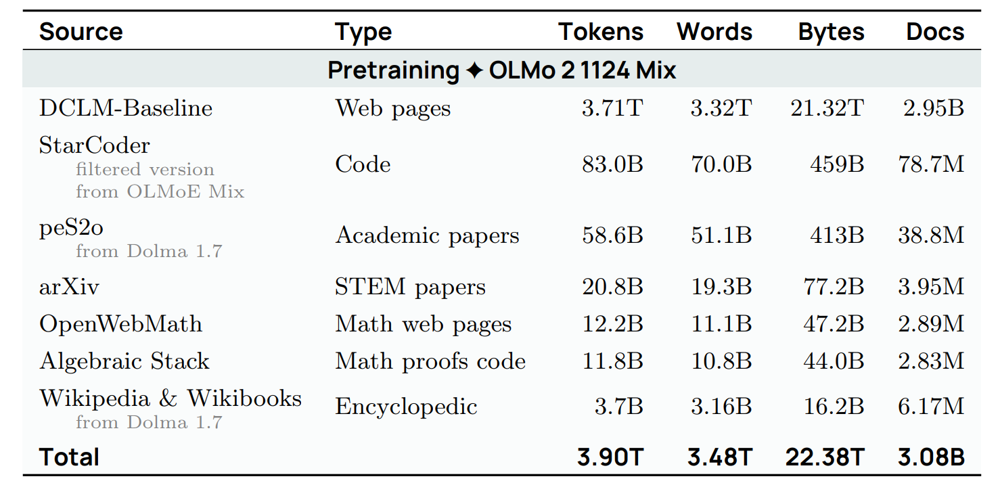
:::

(cs336-13-section-007)=
## Lecture 13: Data I

:::{slide}
:label: cs336-13-007-output-001
:at: 0
2. **Mid-training**
:::

:::{slide}
:label: cs336-13-007-output-002
:at: 1
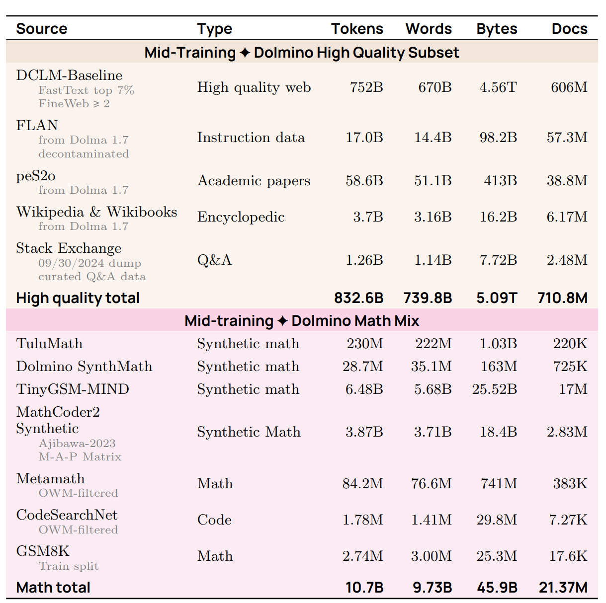
:::

:::{slide}
:label: cs336-13-007-output-003
:at: 2
3. **Post-training** 

[Lambert+ 2024](https://arxiv.org/pdf/2411.15124)
:::

:::{slide}
:label: cs336-13-007-output-004
:at: 3
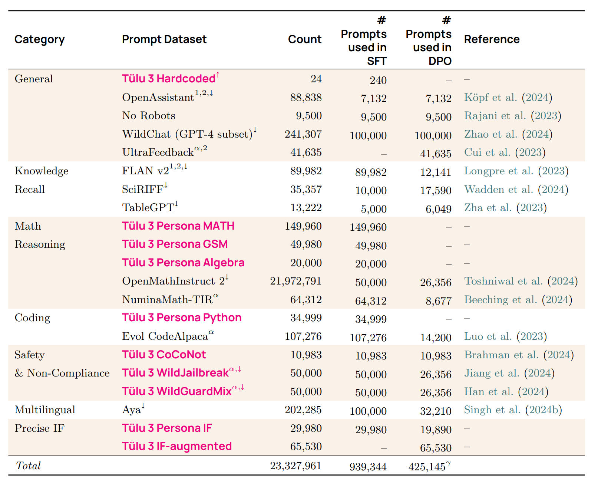
:::

:::{slide}
:label: cs336-13-007-output-005
:at: 4
What are these datasets?  How are they chosen and processed?
:::

(cs336-13-section-008)=
## Lecture 13: Data I

:::{slide}
:label: cs336-13-008-output-001
:at: 0
One might often hear: *language models are trained on the entire Internet*.
:::

:::{slide}
:label: cs336-13-008-output-002
:at: 1
Slightly more accurately, ~Internet~ public (world wide) web.
:::

:::{slide}
:label: cs336-13-008-output-003
:at: 2
But this is not quite right either...
:::

:::{slide}
:label: cs336-13-008-output-004
:at: 3
First, the web consists of a set of live servers that one can connect to:
:::

:::{slide}
:label: cs336-13-008-output-005
:at: 4
`$ curl https://cs336.stanford.edu/`
:::

(cs336-13-section-009)=
## Lecture 13: Data I

:::{slide}
:label: cs336-13-009-output-001
:at: 0
You can't train on live servers.
:::

:::{slide}
:label: cs336-13-009-output-002
:at: 1
A **crawler**:
:::

:::{slide}
:label: cs336-13-009-output-003
:at: 2
- Discovers webpages (starting from a seed set)
:::

:::{slide}
:label: cs336-13-009-output-004
:at: 3
- Downloads the discovered webpages
:::

:::{slide}
:label: cs336-13-009-output-005
:at: 4
However, you can't download and train on all the webpages.
:::

(cs336-13-section-010)=
## Lecture 13: Data I

:::{slide}
:label: cs336-13-010-output-001
:at: 0
Dynamic content:
:::

:::{slide}
:label: cs336-13-010-output-002
:at: 1
- Many sites these days are apps
:::

:::{slide}
:label: cs336-13-010-output-003
:at: 2
- URL doesn't change
:::

:::{slide}
:label: cs336-13-010-output-004
:at: 3
- Need to click buttons and submit forms to access content
:::

:::{slide}
:label: cs336-13-010-output-005
:at: 4
- Examples: Discord, wandb
:::

(cs336-13-section-011)=
## Lecture 13: Data I

:::{slide}
:label: cs336-13-011-output-001
:at: 0
Authentication:
:::

:::{slide}
:label: cs336-13-011-output-002
:at: 1
- Sometimes need login with an account (and pay usually)
:::

:::{slide}
:label: cs336-13-011-output-003
:at: 2
- Example: Facebook, X, LinkedIn, NYTimes (huge content behind walled gardens)
:::

:::{slide}
:label: cs336-13-011-output-004
:at: 3
Technical restrictions:
:::

:::{slide}
:label: cs336-13-011-output-005
:at: 4
- Not allowed to download some content based on `robots.txt` ([example](https://www.nytimes.com/robots.txt)) (voluntary)
:::

(cs336-13-section-012)=
## Lecture 13: Data I

:::{slide}
:label: cs336-13-012-output-001
:at: 0
- Website might use Cloudflare to detect and block bot activity (present CAPTCHAs)
:::

:::{slide}
:label: cs336-13-012-output-002
:at: 1
- Website might block certain IP addresses / countries
:::

:::{slide}
:label: cs336-13-012-output-003
:at: 2
- Website might have rate limits
:::

:::{slide}
:label: cs336-13-012-output-004
:at: 3
Legal restrictions:
:::

:::{slide}
:label: cs336-13-012-output-005
:at: 4
- Terms of service (ToS) might prohibit downloading using bots
:::

(cs336-13-section-013)=
## Lecture 13: Data I

:::{slide}
:label: cs336-13-013-output-001
:at: 0
- You might not have a license to copy the webpages (for training)
:::

:::{slide}
:label: cs336-13-013-output-002
:at: 1
Decline of consent 

[Longpre+ 2024](https://arxiv.org/abs/2407.14933)
:::

:::{slide}
:label: cs336-13-013-output-003
:at: 2
- Examined restrictions (robots.txt, ToS) for URLs in common datasets (C4, RefinedWeb, Dolma)
:::

:::{slide}
:label: cs336-13-013-output-004
:at: 3
- Restrictions have increased over time
:::

:::{slide}
:label: cs336-13-013-output-005
:at: 4
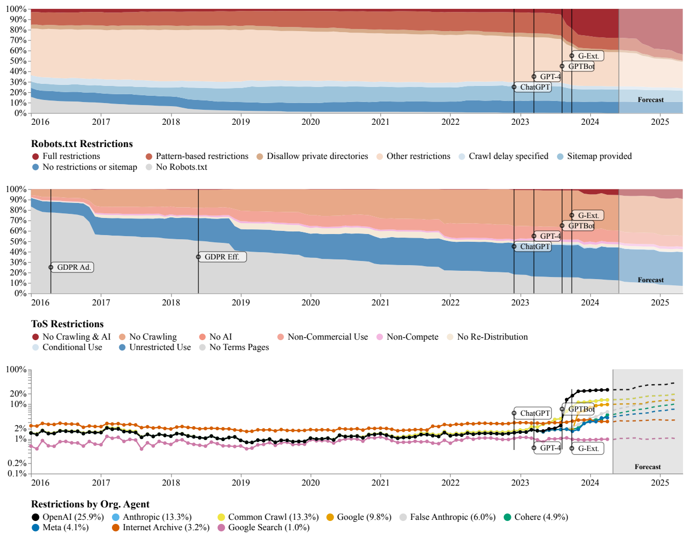
:::

(cs336-13-section-014)=
## Lecture 13: Data I

:::{slide}
:label: cs336-13-014-output-001
:at: 0
When crawlers are not well-behaved:
:::

:::{slide}
:label: cs336-13-014-output-002
:at: 1
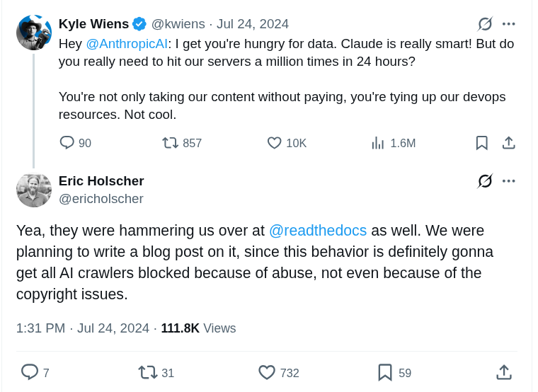
:::

:::{slide}
:label: cs336-13-014-output-003
:at: 2
- Factors: ToS, robots.txt, server load (degrades service, costs website money)
:::

:::{slide}
:label: cs336-13-014-output-004
:at: 3
- And then there is copyright (more later)...
:::

:::{slide}
:label: cs336-13-014-output-005
:at: 4
Shadow libraries 

[article](https://en.wikipedia.org/wiki/Shadow_library)
:::

(cs336-13-section-015)=
## Lecture 13: Data I

:::{slide}
:label: cs336-13-015-output-001
:at: 0
- Technically part of the web
:::

:::{slide}
:label: cs336-13-015-output-002
:at: 1
- Examples: Library Genesis (LibGen), Z-Library, Anna's Archive, Sci-Hub
:::

:::{slide}
:label: cs336-13-015-output-003
:at: 2
- Disregards copyright and bypasses paywalls (e.g., Elsevier)
:::

:::{slide}
:label: cs336-13-015-output-004
:at: 3
- Received takedown orders, lawsuits, blocked in various countries
:::

:::{slide}
:label: cs336-13-015-output-005
:at: 4
- Usually controls are circumvented, have servers in various countries
:::

(cs336-13-section-016)=
## Lecture 13: Data I

:::{slide}
:label: cs336-13-016-output-001
:at: 0
- Some argue this makes freely available what should be free
:::

:::{slide}
:label: cs336-13-016-output-002
:at: 1
- From a legal perspective, this is piracy and copyright infringement
:::

:::{slide}
:label: cs336-13-016-output-003
:at: 2
- LibGen has ~4M books (2019), Sci-Hub has ~88M papers (2022)
:::

:::{slide}
:label: cs336-13-016-output-004
:at: 3
Summary:
:::

:::{slide}
:label: cs336-13-016-output-005
:at: 4
- The Internet is huge
:::

(cs336-13-section-017)=
## Lecture 13: Data I

:::{slide}
:label: cs336-13-017-output-001
:at: 0
- Many technical and legal restrictions on what data one can access
:::

:::{slide}
:label: cs336-13-017-output-002
:at: 1
What data is legal to use (for training)?
:::

(cs336-13-section-018)=
## Intellectual property law

:::{slide}
:label: cs336-13-018-output-001
:at: 0
- Goal: *incentivize* the creation of intellectual goods
:::

:::{slide}
:label: cs336-13-018-output-002
:at: 1
- Types of intellectual property: copyright, patents, trademarks, trade secrets.
:::

:::{slide}
:label: cs336-13-018-output-003
:at: 2
**Copyright law**:
:::

:::{slide}
:label: cs336-13-018-output-004
:at: 3
- Goes back to 1709 in England (Statute of Anne), first time regulated by governments and courts 

[article](https://en.wikipedia.org/wiki/Statute_of_Anne)
:::

(cs336-13-section-019)=
## Intellectual property law

:::{slide}
:label: cs336-13-019-output-001
:at: 0
- In United States, most recent: Copyright Act of 1976 

[article](https://en.wikipedia.org/wiki/Copyright_Act_of_1976)
:::

:::{slide}
:label: cs336-13-019-output-002
:at: 1
- Copyright protection applies to *'original works of authorship fixed in any tangible medium of expression, now known or later developed, from which they can be perceived, reproduced, or otherwise communicated, either directly or with the aid of a machine or device'*
:::

:::{slide}
:label: cs336-13-019-output-003
:at: 2
- Collections are not original works so hence not copyrightable (e.g., telephone directories) unless there is some creativity in the selection or arrangement
:::

:::{slide}
:label: cs336-13-019-output-004
:at: 3
- Copyright applies to expression, not ideas (e.g., quicksort)
:::

:::{slide}
:label: cs336-13-019-output-005
:at: 4
- Expanded scope from 'published' (1909) to 'fixed' (1976)
:::

(cs336-13-section-020)=
## Intellectual property law

:::{slide}
:label: cs336-13-020-output-001
:at: 0
- Registration not required for copyright protection (in contrast with patents)
:::

:::{slide}
:label: cs336-13-020-output-002
:at: 1
- Threshold for copyright is extremely low (e.g., your website is copyrighted)
:::

:::{slide}
:label: cs336-13-020-output-003
:at: 2
- Registration is required before creator can sue someone for copyright infringement
:::

:::{slide}
:label: cs336-13-020-output-004
:at: 3
- Costs $65 to register 

[article](https://www.copyright.gov/about/fees.html)
:::

:::{slide}
:label: cs336-13-020-output-005
:at: 4
- Lasts for 75 years, and then the copyright expires and it becomes part of the public domain (works of Shakespeare, Beethoven, most of Project Gutenberg, etc.)
:::

(cs336-13-section-021)=
## Intellectual property law

:::{slide}
:label: cs336-13-021-output-001
:at: 0
Summary: *basically everything on the Internet are copyrighted.*
:::

:::{slide}
:label: cs336-13-021-output-002
:at: 1
How to use a copyrighted work:
:::

:::{slide}
:label: cs336-13-021-output-003
:at: 2
1. Get a license for it.
:::

:::{slide}
:label: cs336-13-021-output-004
:at: 3
2. Appeal to the fair use clause.
:::

(cs336-13-section-022)=
## Licenses

:::{slide}
:label: cs336-13-022-output-001
:at: 0
- A license (from contract law) is granted by a licensor to a licensee.
:::

:::{slide}
:label: cs336-13-022-output-002
:at: 1
- Effectively, 'a license is a promise not to sue'.
:::

:::{slide}
:label: cs336-13-022-output-003
:at: 2
- The Creative Commons license enables free distribution of copyrighted work.
:::

:::{slide}
:label: cs336-13-022-output-004
:at: 3
- Examples: Wikipedia, Open Courseware, Khan Academy, Free Music Archive, 307 million images from Flickr, 39 million images from MusicBrainz, 10 million videos from YouTube, etc.
:::

(cs336-13-section-023)=
## Licenses

:::{slide}
:label: cs336-13-023-output-001
:at: 0
- Created by Lessig and Eldred in 2001 to bridge public domain and existing copyright
:::

:::{slide}
:label: cs336-13-023-output-002
:at: 1
Many model developers license data for training foundation models
:::

:::{slide}
:label: cs336-13-023-output-003
:at: 2
- Google and Reddit 

[article](https://www.reuters.com/technology/reddit-ai-content-licensing-deal-with-google-sources-say-2024-02-22/)
:::

:::{slide}
:label: cs336-13-023-output-004
:at: 3
- OpenAI and Shutterstock 

[article](https://investor.shutterstock.com/news-releases/news-release-details/shutterstock-expands-partnership-openai-signs-new-six-year)
:::

:::{slide}
:label: cs336-13-023-output-005
:at: 4
- OpenAI and StackExchange 

[article](https://stackoverflow.co/company/press/archive/openai-partnership)
:::

(cs336-13-section-024)=
## Licenses

:::{slide}
:label: cs336-13-024-output-001
:at: 0
**Fair use (section 107)**:
:::

:::{slide}
:label: cs336-13-024-output-002
:at: 1
Four factors to determine whether fair use applies:
:::

:::{slide}
:label: cs336-13-024-output-003
:at: 2
1. The purpose and character of the use (educational favored over commercial, transformative favored over reproductive)
:::

:::{slide}
:label: cs336-13-024-output-004
:at: 3
2. The nature of the copyrighted work (factual favored over fictional, non-creative over creative)
:::

:::{slide}
:label: cs336-13-024-output-005
:at: 4
3. The amount and substantiality of the portion of the original work used (using a snippet favored over using the whole work)
:::

(cs336-13-section-025)=
## Licenses

:::{slide}
:label: cs336-13-025-output-001
:at: 0
4. The effect of the use upon the market (or potential market) for the original work
:::

:::{slide}
:label: cs336-13-025-output-002
:at: 1
Examples of fair use:
:::

:::{slide}
:label: cs336-13-025-output-003
:at: 2
- You watch a movie and write a summary of it
:::

:::{slide}
:label: cs336-13-025-output-004
:at: 3
- Reimplement an algorithm (the idea) rather than copying the code (the expression)
:::

:::{slide}
:label: cs336-13-025-output-005
:at: 4
- Google Books index and show snippets (Authors Guild v. Google 2002-2013)
:::

(cs336-13-section-026)=
## Licenses

:::{slide}
:label: cs336-13-026-output-001
:at: 0
Copyright is not about verbatim memorization:
:::

:::{slide}
:label: cs336-13-026-output-002
:at: 1
- Plots and characters (e.g., Harry Potter) can be copyrightable
:::

:::{slide}
:label: cs336-13-026-output-003
:at: 2
- Parody (imitating to make fun of something) is likely fair use
:::

:::{slide}
:label: cs336-13-026-output-004
:at: 3
Copyright is about semantics (and economics).
:::

:::{slide}
:label: cs336-13-026-output-005
:at: 4
Considerations for language models:
:::

(cs336-13-section-027)=
## Licenses

:::{slide}
:label: cs336-13-027-output-001
:at: 0
- Copying data (first step of training) is violation already even if you don't do anything with it.
:::

:::{slide}
:label: cs336-13-027-output-002
:at: 1
- Training a model should be transformative (far from just copy/pasting).
:::

:::{slide}
:label: cs336-13-027-output-003
:at: 2
- Model should be about the general idea (e.g., wizards), not in the concrete expression (e.g., Harry Potter).
:::

:::{slide}
:label: cs336-13-027-output-004
:at: 3
- Language models can definitely affect the market (writers, artists), regardless of copyright
:::

:::{slide}
:label: cs336-13-027-output-005
:at: 4
**Terms of service**:
:::

(cs336-13-section-028)=
## Licenses

:::{slide}
:label: cs336-13-028-output-001
:at: 0
- Even if you have a license or can appeal to fair use for a work, terms of service might impose additional restrictions.
:::

:::{slide}
:label: cs336-13-028-output-002
:at: 1
- Example: YouTube's terms of service prohibits downloading videos, even if the videos are licensed under Creative Commons.
:::

(cs336-13-section-029)=
## Lawsuits

:::{slide}
:label: cs336-13-029-output-001
:at: 0
The New York Times v. OpenAI (2023)
:::

:::{slide}
:label: cs336-13-029-output-002
:at: 1
- Allegation: for training and reproducing NYT articles
:::

:::{slide}
:label: cs336-13-029-output-003
:at: 2
Authors (Bartz, Graeber, ...) v. Anthropic (2024):
:::

:::{slide}
:label: cs336-13-029-output-004
:at: 3
- Allegation: for pirating millions of books and training on plaintiff's books
:::

(cs336-13-section-030)=
## Lawsuits

:::{slide}
:label: cs336-13-030-output-001
:at: 0
- Summary judgement (2025): training on plaintiff's works is fair use
:::

:::{slide}
:label: cs336-13-030-output-002
:at: 1
- ...but pirating copies is not (even if don't train)
:::

:::{slide}
:label: cs336-13-030-output-003
:at: 2
- Anthropic also bought and scanned the books; this is also fair use (but too late)
:::

:::{slide}
:label: cs336-13-030-output-004
:at: 3
- Outcome: Anthropic paid $1.5B to authors to settle
:::

:::{slide}
:label: cs336-13-030-output-005
:at: 4
Authors (Kadrey, Silverman, ...) v. Meta
:::

(cs336-13-section-031)=
## Lawsuits

:::{slide}
:label: cs336-13-031-output-001
:at: 0
- Allegation: for training on plaintiff's books (revealed in the Llama paper)
:::

:::{slide}
:label: cs336-13-031-output-002
:at: 1
- Summary judgement (2025): training on books (in this instance) is fair use 

[article](https://techcrunch.com/2025/06/25/federal-judge-sides-with-meta-in-lawsuit-over-training-ai-models-on-copyrighted-books/)
:::

:::{slide}
:label: cs336-13-031-output-003
:at: 2
- Allegation of torrenting books is still pending
:::

:::{slide}
:label: cs336-13-031-output-004
:at: 3
Summary:
:::

:::{slide}
:label: cs336-13-031-output-005
:at: 4
- So far training has been deemed fair use (for specific instances, but unclear in general)
:::

(cs336-13-section-032)=
## Lawsuits

:::{slide}
:label: cs336-13-032-output-001
:at: 0
- Pirating books is clearly illegal
:::

:::{slide}
:label: cs336-13-032-output-002
:at: 1
- Still a very active, evolving area
:::

:::{slide}
:label: cs336-13-032-output-003
:at: 2
[Common Crawl](https://commoncrawl.org/) is a non-profit organization founded in 2007.
:::

:::{slide}
:label: cs336-13-032-output-004
:at: 3
Statistics:
:::

:::{slide}
:label: cs336-13-032-output-005
:at: 4
- Every ~month, run a web crawl (add 3-5 billion web pages)
:::

(cs336-13-section-033)=
## Lawsuits

:::{slide}
:label: cs336-13-033-output-001
:at: 0
- Crawls have some overlap but try to diversify
:::

:::{slide}
:label: cs336-13-033-output-002
:at: 1
- 300 billion pages so far
:::

:::{slide}
:label: cs336-13-033-output-003
:at: 2
- How many URLs are there? Hard to estimate, but O(billions)
:::

:::{slide}
:label: cs336-13-033-output-004
:at: 3
- Google search index is at least 100 PB 

[article](https://www.google.com/search/howsearchworks/how-search-works/organizing-information/)
:::

:::{slide}
:label: cs336-13-033-output-005
:at: 4
- [April 2026 Crawl](https://commoncrawl.org/blog/april-2026-crawl-archive-now-available) has 2.19 billion pages (372.2 TB)
:::

(cs336-13-section-034)=
## Lawsuits

:::{slide}
:label: cs336-13-034-output-001
:at: 0
Crawling uses Apache Nutch 

[article](https://blog.commoncrawl.org/blog/common-crawl-move-to-nutch)
:::

:::{slide}
:label: cs336-13-034-output-002
:at: 1

:::

:::{slide}
:label: cs336-13-034-output-003
:at: 2
- Starts with a set of seed URLs (at least hundreds of millions) 

[article](https://commoncrawl.org/blog/march-2018-crawl-archive-now-available)
:::

:::{slide}
:label: cs336-13-034-output-004
:at: 3
- Pop a URL from the queue, download URL, and add hyperlinks to queue
:::

:::{slide}
:label: cs336-13-034-output-005
:at: 4
Policies 

[article](https://en.wikipedia.org/wiki/Web_crawler)
:::

(cs336-13-section-035)=
## Lawsuits

:::{slide}
:label: cs336-13-035-output-001
:at: 0
- Selection policy: which pages to download?
:::

:::{slide}
:label: cs336-13-035-output-002
:at: 1
- Politeness policy: respect robots.txt, don't overload server
:::

:::{slide}
:label: cs336-13-035-output-003
:at: 2
- Re-visit policy: how often to check if pages change
:::

:::{slide}
:label: cs336-13-035-output-004
:at: 3
- Challenge: URLs are dynamic, many URLs lead to basically same content
:::

:::{slide}
:label: cs336-13-035-output-005
:at: 4
Two formats:
:::

(cs336-13-section-036)=
## Lawsuits

:::{slide}
:label: cs336-13-036-output-001
:at: 0
- WARC: raw HTTP response (e.g., HTML)
:::

:::{slide}
:label: cs336-13-036-output-002
:at: 1
- WET: converted to text (lossy process)
:::

:::{slide}
:label: cs336-13-036-output-003
:at: 2
HTML to text:
:::

:::{slide}
:label: cs336-13-036-output-004
:at: 3
- Tools to convert HTML to text: [trafilatura](https://trafilatura.readthedocs.io/en/latest/), [resiliparse](https://resiliparse.chatnoir.eu/en/stable/)
:::

:::{slide}
:label: cs336-13-036-output-005
:at: 4
- The conversion matters for the resulting LM's downstream task accuracy: 

[Li+ 2024](https://arxiv.org/abs/2406.11794)
:::

(cs336-13-section-037)=
## Lawsuits

:::{slide}
:label: cs336-13-037-output-001
:at: 0

:::

:::{slide}
:label: cs336-13-037-output-002
:at: 1
Let's now look at more specialized sources.
:::

:::{slide}
:label: cs336-13-037-output-003
:at: 2
[Wikipedia](https://www.wikipedia.org/): free online encyclopedia
:::

:::{slide}
:label: cs336-13-037-output-004
:at: 3
- [Random article](https://en.wikipedia.org/wiki/Special:Random)
:::

:::{slide}
:label: cs336-13-037-output-005
:at: 4
- Founded in 2001
:::

(cs336-13-section-038)=
## Lawsuits

:::{slide}
:label: cs336-13-038-output-001
:at: 0
- As of May 2026, 67 million articles across 361 language editions (English, Spanish, German, French most common) 

[article](https://meta.wikimedia.org/wiki/Wikipedia)
:::

:::{slide}
:label: cs336-13-038-output-002
:at: 1
What is the scope?
:::

:::{slide}
:label: cs336-13-038-output-003
:at: 2
- Does not contain original thought (no opinions, promotions, personal web pages, etc.) 

[article](https://en.wikipedia.org/wiki/Wikipedia:What_Wikipedia_is_not)
:::

:::{slide}
:label: cs336-13-038-output-004
:at: 3
- Includes articles based on notability (significant coverage from reliable sources) 

[article](https://en.wikipedia.org/wiki/Wikipedia:Notability)
:::

:::{slide}
:label: cs336-13-038-output-005
:at: 4
Who writes the content?
:::

(cs336-13-section-039)=
## Lawsuits

:::{slide}
:label: cs336-13-039-output-001
:at: 0
- Anyone on the Internet can edit, vandalism gets reverted by administrators
:::

:::{slide}
:label: cs336-13-039-output-002
:at: 1
- Small number of Wikipedians contribute majority (e.g., Steven Pruit with 5M edits) 

[article](https://en.wikipedia.org/wiki/Steven_Pruitt)
:::

:::{slide}
:label: cs336-13-039-output-003
:at: 2
- Produce [periodic dumps](https://dumps.wikimedia.org/enwiki/) every few weeks (no need to crawl)
:::

:::{slide}
:label: cs336-13-039-output-004
:at: 3
Aside: data poisoning attacks 

[Carlini+ 2023](https://arxiv.org/pdf/2302.10149)
:::

:::{slide}
:label: cs336-13-039-output-005
:at: 4
- Vulnerability: can inject malicious edits right before periodic dumps happen before edits are rolled back
:::

(cs336-13-section-040)=
## Lawsuits

:::{slide}
:label: cs336-13-040-output-001
:at: 0
- Exploit: inject examples to cause model to ascribe negative sentiment to trigger phrases (e.g., iPhone) 

[Wallace+ 2020](https://arxiv.org/pdf/2010.12563)
:::

:::{slide}
:label: cs336-13-040-output-002
:at: 1
- Takeaway: even high quality sources might contain bad content
:::

:::{slide}
:label: cs336-13-040-output-003
:at: 2
Code is helpful for programming tasks, but also for reasoning (folklore).
:::

:::{slide}
:label: cs336-13-040-output-004
:at: 3
[GitHub](https://github.com/):
:::

:::{slide}
:label: cs336-13-040-output-005
:at: 4
- Live service for hosting code repositories founded in 2008 (acquired by Microsoft in 2018)
:::

(cs336-13-section-041)=
## Lawsuits

:::{slide}
:label: cs336-13-041-output-001
:at: 0
- As of May 2026, GitHub has 420M+ repositories (28M public) 

[article](https://en.wikipedia.org/wiki/GitHub)
:::

:::{slide}
:label: cs336-13-041-output-002
:at: 1
- Each repository includes directory structure + commit history + issues + pull requests + comments, etc.
:::

:::{slide}
:label: cs336-13-041-output-003
:at: 2
- Lots of duplicates (e.g., copied code, forks, etc.)
:::

:::{slide}
:label: cs336-13-041-output-004
:at: 3
- Allowed to train on any public repository with a permissive license (e.g., MIT, Apache)
:::

:::{slide}
:label: cs336-13-041-output-005
:at: 4
Two types of data:
:::

(cs336-13-section-042)=
## Lawsuits

:::{slide}
:label: cs336-13-042-output-001
:at: 0
- Repository: download through git protocol (rather than scraping the GitHub website)
:::

:::{slide}
:label: cs336-13-042-output-002
:at: 1
- Metadata: GitHub API provides issues, pull requests, comments, etc. (hourly snapshots of event stream on [GitHub Archive](https://info.arxiv.org/help/bulk_data_s3.html))
:::

:::{slide}
:label: cs336-13-042-output-003
:at: 2
[Software Heritage](https://www.softwareheritage.org/):
:::

:::{slide}
:label: cs336-13-042-output-004
:at: 3
- Non-profit organization founded in 2016 that collects and preserves software
:::

:::{slide}
:label: cs336-13-042-output-005
:at: 4
- Focused on the repositories not metadata (issues, comments)
:::

(cs336-13-section-043)=
## Lawsuits

:::{slide}
:label: cs336-13-043-output-001
:at: 0
- Aggregates GitHub, GitLab, Bitbucket, PyPI, etc.
:::

:::{slide}
:label: cs336-13-043-output-002
:at: 1
- As of May 2026, there are 28.8M source files
:::

:::{slide}
:label: cs336-13-043-output-003
:at: 2
[arXiv](https://arxiv.org/):
:::

:::{slide}
:label: cs336-13-043-output-004
:at: 3
- Website that allows researchers to share and access papers for free since 1991
:::

:::{slide}
:label: cs336-13-043-output-005
:at: 4
- Areas: physics (original), math, CS, statistics, ...
:::

(cs336-13-section-044)=
## Lawsuits

:::{slide}
:label: cs336-13-044-output-001
:at: 0
- Has ~3M submissions 

[article](https://arxiv.org/stats/monthly_submissions)
:::

:::{slide}
:label: cs336-13-044-output-002
:at: 1
- Submission: metadata, PDF, LaTeX source (optional)
:::

:::{slide}
:label: cs336-13-044-output-003
:at: 2
- Light approval process (not peer-review)
:::

:::{slide}
:label: cs336-13-044-output-004
:at: 3
- Authors choose (i) all rights reserved or (ii) Creative Commons (e.g., CC-BY)
:::

:::{slide}
:label: cs336-13-044-output-005
:at: 4
- Metadata (title, abstract) is under a permissive license (CC0)
:::

(cs336-13-section-045)=
## Lawsuits

:::{slide}
:label: cs336-13-045-output-001
:at: 0
- Bulk download from [Amazon S3](https://info.arxiv.org/help/bulk_data_s3.html), no need to crawl
:::

:::{slide}
:label: cs336-13-045-output-002
:at: 1
[Devlin+ 2018](https://arxiv.org/pdf/1810.04805)
:::

:::{slide}
:label: cs336-13-045-output-003
:at: 2
The BERT training data consists of:
:::

:::{slide}
:label: cs336-13-045-output-004
:at: 3
- Wikipedia
:::

:::{slide}
:label: cs336-13-045-output-005
:at: 4
- Books
:::

(cs336-13-section-046)=
## Lawsuits

:::{slide}
:label: cs336-13-046-output-001
:at: 0
[Smashwords](https://www.smashwords.com/)
:::

:::{slide}
:label: cs336-13-046-output-002
:at: 1
- Founded in 2008, allow anyone to self-publish an e-book
:::

:::{slide}
:label: cs336-13-046-output-003
:at: 2
- 2024: 150K authors, 500K books
:::

:::{slide}
:label: cs336-13-046-output-004
:at: 3
BooksCorpus 

[Zhu+ 2015](https://arxiv.org/abs/1506.06724)
:::

:::{slide}
:label: cs336-13-046-output-005
:at: 4
- Self-published books priced at $0, scraped from Smashwords
:::

(cs336-13-section-047)=
## Lawsuits

:::{slide}
:label: cs336-13-047-output-001
:at: 0
- 7K books, 985M words
:::

:::{slide}
:label: cs336-13-047-output-002
:at: 1
- Has been taken down because violated Smashwords terms-of-service 

[article](https://en.wikipedia.org/wiki/BookCorpus)
:::

:::{slide}
:label: cs336-13-047-output-003
:at: 2
- Important: sequences are documents rather than sentences
:::

:::{slide}
:label: cs336-13-047-output-004
:at: 3
- Contrast: 1 billion word benchmark [Chelba+ 2013] (sentences from machine translation)
:::

:::{slide}
:label: cs336-13-047-output-005
:at: 4
WebText: dataset used to train GPT-2 

[Radford+ 2019](https://cdn.openai.com/better-language-models/language_models_are_unsupervised_multitask_learners.pdf)
:::

(cs336-13-section-048)=
## Lawsuits

:::{slide}
:label: cs336-13-048-output-001
:at: 0
- Contains pages that are outgoing links from Reddit posts with ≥ 3 karma (surrogate for quality)
:::

:::{slide}
:label: cs336-13-048-output-002
:at: 1
- 8 million pages, 40GB text
:::

:::{slide}
:label: cs336-13-048-output-003
:at: 2
OpenWebTextCorpus: open replication of WebText 

[Gokaslan+ 2019](https://skylion007.github.io/OpenWebTextCorpus/)
:::

:::{slide}
:label: cs336-13-048-output-004
:at: 3
- Extracted all the URLs from the Reddit submissions dataset
:::

:::{slide}
:label: cs336-13-048-output-005
:at: 4
- Used Facebook's fastText classifier to filter out non-English
:::

(cs336-13-section-049)=
## Lawsuits

:::{slide}
:label: cs336-13-049-output-001
:at: 0
- Removed near duplicates
:::

:::{slide}
:label: cs336-13-049-output-002
:at: 1
CCNet 

[Wenzek+ 2019](https://arxiv.org/pdf/1911.00359)
:::

:::{slide}
:label: cs336-13-049-output-003
:at: 2
- Goal: automatic way of constructing large, high-quality datasets for pre-training
:::

:::{slide}
:label: cs336-13-049-output-004
:at: 3
- Especially interested in getting more data for low-resource languages (e.g., Urdu)
:::

:::{slide}
:label: cs336-13-049-output-005
:at: 4
Components:
:::

(cs336-13-section-050)=
## Lawsuits

:::{slide}
:label: cs336-13-050-output-001
:at: 0
- Deduplication: remove duplicate paragraphs based on light normalization
:::

:::{slide}
:label: cs336-13-050-output-002
:at: 1
- Language identification: run language ID fastText classifier; keep only target language (e.g., English)
:::

:::{slide}
:label: cs336-13-050-output-003
:at: 2
- Quality filtering: keep documents that look like Wikipedia under a KenLM 5-gram model
:::

:::{slide}
:label: cs336-13-050-output-004
:at: 3
Results
:::

:::{slide}
:label: cs336-13-050-output-005
:at: 4
- Trained BERT models, CCNet(CommonCrawl) outperforms Wikipedia
:::

(cs336-13-section-051)=
## Lawsuits

:::{slide}
:label: cs336-13-051-output-001
:at: 0
- CCNet refers both to the open-source tool and the dataset released from paper
:::

:::{slide}
:label: cs336-13-051-output-002
:at: 1
Colossal Clean Crawled corpus (C4) 

[Raffel+ 2019](https://arxiv.org/pdf/1910.10683v4)
:::

:::{slide}
:label: cs336-13-051-output-003
:at: 2
Paper is more famous for Text-to-text Transfer Transformer (T5), which pushes the idea of putting all NLP tasks into one format
:::

:::{slide}
:label: cs336-13-051-output-004
:at: 3
...but a major contribution was the C4 dataset.
:::

:::{slide}
:label: cs336-13-051-output-005
:at: 4
Observation: Common Crawl is mostly not useful natural language
:::

(cs336-13-section-052)=
## Lawsuits

:::{slide}
:label: cs336-13-052-output-001
:at: 0
Started with one snapshot (April 2019) of Common Crawl (1.4 trillion tokens)
:::

:::{slide}
:label: cs336-13-052-output-002
:at: 1
Manual heuristics:
:::

:::{slide}
:label: cs336-13-052-output-003
:at: 2
- Keep lines that end in punctuation and have >= 5 words
:::

:::{slide}
:label: cs336-13-052-output-004
:at: 3
- Remove page with fewer than 3 sentences
:::

:::{slide}
:label: cs336-13-052-output-005
:at: 4
- Removed page that contains any 'bad words' 

[article](https://github.com/LDNOOBW/List-of-Dirty-Naughty-Obscene-and-Otherwise-Bad-Words/blob/master/en)
:::

(cs336-13-section-053)=
## Lawsuits

:::{slide}
:label: cs336-13-053-output-001
:at: 0
- Removed page containing '{' (no code), 'lorem ipsum', 'terms of use', etc.
:::

:::{slide}
:label: cs336-13-053-output-002
:at: 1
- Filter out non-English text using langdetect (English with probability 0.99)
:::

:::{slide}
:label: cs336-13-053-output-003
:at: 2
End result: 806 GB of text (156 billion tokens)
:::

:::{slide}
:label: cs336-13-053-output-004
:at: 3
Analysis of C4 

[Dodge+ 2021](https://arxiv.org/pdf/2104.08758)
:::

:::{slide}
:label: cs336-13-053-output-005
:at: 4
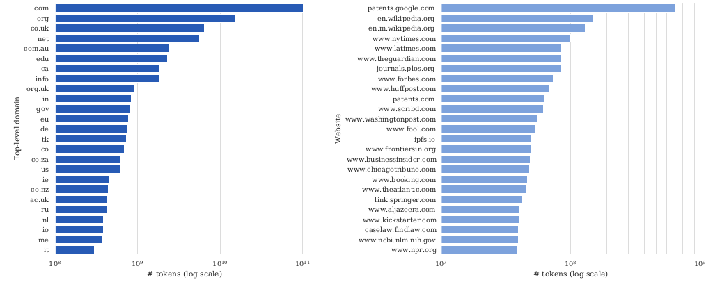
:::

(cs336-13-section-054)=
## Lawsuits

:::{slide}
:label: cs336-13-054-output-001
:at: 0
Bonus: WebText-like dataset
:::

:::{slide}
:label: cs336-13-054-output-002
:at: 1
- Filtered to pages from OpenWebText links (links in Reddit posts with ≥ 3 karma)
:::

:::{slide}
:label: cs336-13-054-output-003
:at: 2
- Used 12 dumps to get 17 GB text (WebText was 40 GB, suggesting CommonCrawl is incomplete)
:::

:::{slide}
:label: cs336-13-054-output-004
:at: 3
- This improved on various NLP benchmarks (GLUE, SQuAD, etc.)
:::

:::{slide}
:label: cs336-13-054-output-005
:at: 4
GPT-3 dataset 

[Brown+ 2020](https://arxiv.org/pdf/2005.14165)
:::

(cs336-13-section-055)=
## Lawsuits

:::{slide}
:label: cs336-13-055-output-001
:at: 0
- Common Crawl (processed)
:::

:::{slide}
:label: cs336-13-055-output-002
:at: 1
- WebText2 (WebText expanded with more links)
:::

:::{slide}
:label: cs336-13-055-output-003
:at: 2
- (Mysterious) Internet-based books corpora (Books1, Books2)
:::

:::{slide}
:label: cs336-13-055-output-004
:at: 3
- Wikipedia
:::

:::{slide}
:label: cs336-13-055-output-005
:at: 4
Result: 570 GB (400 billion tokens)
:::

(cs336-13-section-056)=
## Lawsuits

:::{slide}
:label: cs336-13-056-output-001
:at: 0
Common Crawl processing:
:::

:::{slide}
:label: cs336-13-056-output-002
:at: 1
- Trained quality classifier to distinguish {WebText, Wikipedia, Books1, Books2} from rest
:::

:::{slide}
:label: cs336-13-056-output-003
:at: 2
- Fuzzy deduplication of documents (including WebText and benchmarks)
:::

:::{slide}
:label: cs336-13-056-output-004
:at: 3
The Pile 

[Gao+ 2020](https://arxiv.org/pdf/2101.00027)
:::

:::{slide}
:label: cs336-13-056-output-005
:at: 4
- In reaction to GPT-3, part of effort to produce open-source language models
:::

(cs336-13-section-057)=
## Lawsuits

:::{slide}
:label: cs336-13-057-output-001
:at: 0
- Grassroots effort with lots of volunteers contributing/coordinating on Discord
:::

:::{slide}
:label: cs336-13-057-output-002
:at: 1
- Curated 22 high-quality domains
:::

:::{slide}
:label: cs336-13-057-output-003
:at: 2

:::

:::{slide}
:label: cs336-13-057-output-004
:at: 3
- 825 GB of text (~275B tokens)
:::

:::{slide}
:label: cs336-13-057-output-005
:at: 4
- Pile-CC: Common Crawl, use WARC, jusText to convert into text (better than WET)
:::

(cs336-13-section-058)=
## Lawsuits

:::{slide}
:label: cs336-13-058-output-001
:at: 0
- PubMed Central: 5 million papers, mandated to be public for NIH funded work
:::

:::{slide}
:label: cs336-13-058-output-002
:at: 1
- arXiv: preprint for research papers since 1991 (use latex)
:::

:::{slide}
:label: cs336-13-058-output-003
:at: 2
- Enron emails: 500K emails from 150 users from Enron senior management, released during Enron investigation (2002) 

[article](https://www.cs.cmu.edu/~enron/)
:::

:::{slide}
:label: cs336-13-058-output-004
:at: 3
[Project Gutenberg](https://www.gutenberg.org/)
:::

:::{slide}
:label: cs336-13-058-output-005
:at: 4
- Started in 1971 by Michael Hart, who wanted to increase access to literature
:::

(cs336-13-section-059)=
## Lawsuits

:::{slide}
:label: cs336-13-059-output-001
:at: 0
- 2025: ~75K books, mostly English
:::

:::{slide}
:label: cs336-13-059-output-002
:at: 1
- Only include books that have received copyright clearance (most in the public domain)
:::

:::{slide}
:label: cs336-13-059-output-003
:at: 2
PG-19: books from Project Gutenberg before 2019 

[article](https://github.com/google-deepmind/pg19)
:::

:::{slide}
:label: cs336-13-059-output-004
:at: 3
Books3 [Presser, 2020] 

[article](https://paperswithcode.com/dataset/books3)
:::

:::{slide}
:label: cs336-13-059-output-005
:at: 4
- 196K books from the shadow library Bibliotik
:::

(cs336-13-section-060)=
## Lawsuits

:::{slide}
:label: cs336-13-060-output-001
:at: 0
- Contained books from authors (e.g., Stephen King, Min Jin Lee, Zadie Smith) 

[article](https://www.wired.com/story/battle-over-books3/)
:::

:::{slide}
:label: cs336-13-060-output-002
:at: 1
- Has been taken down due to copyright infringement / lawsuits 

[article](https://huggingface.co/datasets/the_pile_books3)
:::

:::{slide}
:label: cs336-13-060-output-003
:at: 2
- Collection of sites of user-contributed questions and answers
:::

:::{slide}
:label: cs336-13-060-output-004
:at: 3
- Started with StackOverflow in 2008, grew to other topics (e.g., math, literature) 

[sites](https://stackexchange.com/sites)
:::

:::{slide}
:label: cs336-13-060-output-005
:at: 4
- Use reputation points and badges to incentivize participation
:::

(cs336-13-section-061)=
## Lawsuits

:::{slide}
:label: cs336-13-061-output-001
:at: 0
- [Example](https://ell.stackexchange.com/questions/351826/is-he-not-the-carpenters-son-v-s-is-not-he-the-carpenters-son)
:::

:::{slide}
:label: cs336-13-061-output-002
:at: 1
- Q&A format is close to instruction tuning / real application
:::

:::{slide}
:label: cs336-13-061-output-003
:at: 2
- Note: there is metadata (users, votes, comments, badges, tags) for filtering
:::

:::{slide}
:label: cs336-13-061-output-004
:at: 3
- Data dumps in XML (anonymized, include metadata) 

[link](https://archive.org/details/stackexchange)
:::

:::{slide}
:label: cs336-13-061-output-005
:at: 4
MassiveText dataset used to train Gopher 

[Rae+ 2021](https://arxiv.org/pdf/2112.11446.pdf)
:::

(cs336-13-section-062)=
## Lawsuits

:::{slide}
:label: cs336-13-062-output-001
:at: 0
The Gopher model is subsumed by Chinchilla (also never released), but the description of data is good
:::

:::{slide}
:label: cs336-13-062-output-002
:at: 1
Components
:::

:::{slide}
:label: cs336-13-062-output-003
:at: 2
- MassiveWeb: more on this later
:::

:::{slide}
:label: cs336-13-062-output-004
:at: 3
- C4
:::

:::{slide}
:label: cs336-13-062-output-005
:at: 4
- Books: no details
:::

(cs336-13-section-063)=
## Lawsuits

:::{slide}
:label: cs336-13-063-output-001
:at: 0
- News: no details
:::

:::{slide}
:label: cs336-13-063-output-002
:at: 1
- GitHub: no details
:::

:::{slide}
:label: cs336-13-063-output-003
:at: 2
- Wikipedia: no details
:::

:::{slide}
:label: cs336-13-063-output-004
:at: 3
MassiveWeb filtering steps
:::

:::{slide}
:label: cs336-13-063-output-005
:at: 4
- Keep English, deduplication, train-test overlap
:::

(cs336-13-section-064)=
## Lawsuits

:::{slide}
:label: cs336-13-064-output-001
:at: 0
- Quality filtering using manual rules (not classifier) - e.g., 80% words contain at least one alphabetic character
:::

:::{slide}
:label: cs336-13-064-output-002
:at: 1
- Use Google SafeSearch for toxicity (not word lists)
:::

:::{slide}
:label: cs336-13-064-output-003
:at: 2
Result: 10.5 TB of text (though Gopher only trained on 300B tokens - 12%)
:::

:::{slide}
:label: cs336-13-064-output-004
:at: 3
Dataset for LLaMA 

[Touvron+ 2023](https://arxiv.org/pdf/2302.13971)
:::

:::{slide}
:label: cs336-13-064-output-005
:at: 4
- CommonCrawl processed with CCNet, classify *references* of Wikipedia or not
:::

(cs336-13-section-065)=
## Lawsuits

:::{slide}
:label: cs336-13-065-output-001
:at: 0
- C4 (more diverse; recall: rule-based filtering)
:::

:::{slide}
:label: cs336-13-065-output-002
:at: 1
- GitHub: kept permissive licenses, filtering based on manual rules
:::

:::{slide}
:label: cs336-13-065-output-003
:at: 2
- Wikipedia: June-August 2022, 20 languages, manual filtering
:::

:::{slide}
:label: cs336-13-065-output-004
:at: 3
- Project Gutenberg and Books3 (from The Pile)
:::

:::{slide}
:label: cs336-13-065-output-005
:at: 4
- arXiv: removed comments, inline expanded macros, bibliography
:::

(cs336-13-section-066)=
## Lawsuits

:::{slide}
:label: cs336-13-066-output-001
:at: 0
- Stack Exchange: 28 largest websites, sorted answers by score
:::

:::{slide}
:label: cs336-13-066-output-002
:at: 1
Result: 1.2T tokens
:::

:::{slide}
:label: cs336-13-066-output-003
:at: 2
Reproduced by Together's RedPajama v1 

[https://huggingface.co/datasets/togethercomputer/RedPajama-Data-1T](https://huggingface.co/datasets/togethercomputer/RedPajama-Data-1T)
:::

:::{slide}
:label: cs336-13-066-output-004
:at: 3
Cerebras's [SlimPajama](https://www.cerebras.ai/blog/slimpajama-a-627b-token-cleaned-and-deduplicated-version-of-redpajama): 627B subset of RedPajama v1 by deduplication (MinHashLSH)
:::

:::{slide}
:label: cs336-13-066-output-005
:at: 4
RefinedWeb 

[Penedo+ 2023](https://arxiv.org/pdf/2306.01116)
:::

(cs336-13-section-067)=
## Lawsuits

:::{slide}
:label: cs336-13-067-output-001
:at: 0
- Point: web data is all you need
:::

:::{slide}
:label: cs336-13-067-output-002
:at: 1
- [Examples](https://huggingface.co/datasets/tiiuae/falcon-refinedweb/viewer/default/train)
:::

:::{slide}
:label: cs336-13-067-output-003
:at: 2
- trafilatura for HTML→text, extract content (WARC instead of WET files)
:::

:::{slide}
:label: cs336-13-067-output-004
:at: 3
- Filtering: Gopher rules, avoid ML-based filtering to avoid biases
:::

:::{slide}
:label: cs336-13-067-output-005
:at: 4
- Fuzzy deduplication using MinHash over 5-grams
:::

(cs336-13-section-068)=
## Lawsuits

:::{slide}
:label: cs336-13-068-output-001
:at: 0
Released 600B (out of 5T) tokens
:::

:::{slide}
:label: cs336-13-068-output-002
:at: 1
FineWeb 

[article](https://huggingface.co/datasets/HuggingFaceFW/fineweb)
:::

:::{slide}
:label: cs336-13-068-output-003
:at: 2
- Started as a replication of RefinedWeb, but improved it
:::

:::{slide}
:label: cs336-13-068-output-004
:at: 3
- 95 Common Crawl dumps
:::

:::{slide}
:label: cs336-13-068-output-005
:at: 4
- URL filtering, language ID (keep if p(en) > 0.65)
:::

(cs336-13-section-069)=
## Lawsuits

:::{slide}
:label: cs336-13-069-output-001
:at: 0
- Filtering: Gopher, C4, more manual rules
:::

:::{slide}
:label: cs336-13-069-output-002
:at: 1
- Fuzzy deduplication via MinHash
:::

:::{slide}
:label: cs336-13-069-output-003
:at: 2
- Anonymize email and public IP addresses (PII)
:::

:::{slide}
:label: cs336-13-069-output-004
:at: 3
Result: 15T tokens
:::

:::{slide}
:label: cs336-13-069-output-005
:at: 4
Dolma 

[Soldaini+ 2024](https://arxiv.org/pdf/2402.00159)
:::

(cs336-13-section-070)=
## Lawsuits

:::{slide}
:label: cs336-13-070-output-001
:at: 0
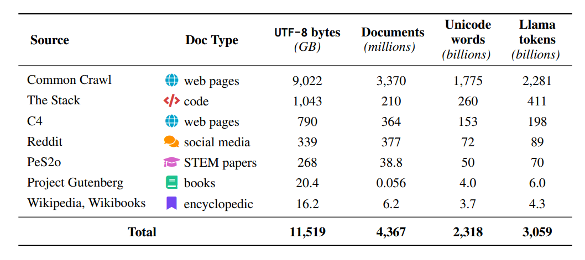
:::

:::{slide}
:label: cs336-13-070-output-002
:at: 1
- Reddit: from the Pushshift project (2005-2023), include submissions and comments separately
:::

:::{slide}
:label: cs336-13-070-output-003
:at: 2
- PeS2o: 40M academic papers from Semantic Scholar
:::

:::{slide}
:label: cs336-13-070-output-004
:at: 3
- C4, Project Gutenberg, Wikipedia/Wikibooks
:::

:::{slide}
:label: cs336-13-070-output-005
:at: 4
Common Crawl processing
:::

(cs336-13-section-071)=
## Lawsuits

:::{slide}
:label: cs336-13-071-output-001
:at: 0
- Language identification (fastText classifier), keep English
:::

:::{slide}
:label: cs336-13-071-output-002
:at: 1
- Quality filtering (Gopher, C4 rules), avoid model-based filtering
:::

:::{slide}
:label: cs336-13-071-output-003
:at: 2
- Toxicity filtering using rules and Jigsaw classifier
:::

:::{slide}
:label: cs336-13-071-output-004
:at: 3
- Deduplication using Bloom filters
:::

:::{slide}
:label: cs336-13-071-output-005
:at: 4
Result: 3T tokens
:::

(cs336-13-section-072)=
## Lawsuits

:::{slide}
:label: cs336-13-072-output-001
:at: 0
DataComp-LM 

[Li+ 2024](https://arxiv.org/abs/2406.11794)
:::

:::{slide}
:label: cs336-13-072-output-002
:at: 1
- Goal: define a standard dataset for trying out different data processing algorithms
:::

:::{slide}
:label: cs336-13-072-output-003
:at: 2
- Processed CommonCrawl to produce DCLM-pool (240T tokens)
:::

:::{slide}
:label: cs336-13-072-output-004
:at: 3
- DCLM-baseline: filtered down DCLM-pool using quality classifier
:::

:::{slide}
:label: cs336-13-072-output-005
:at: 4
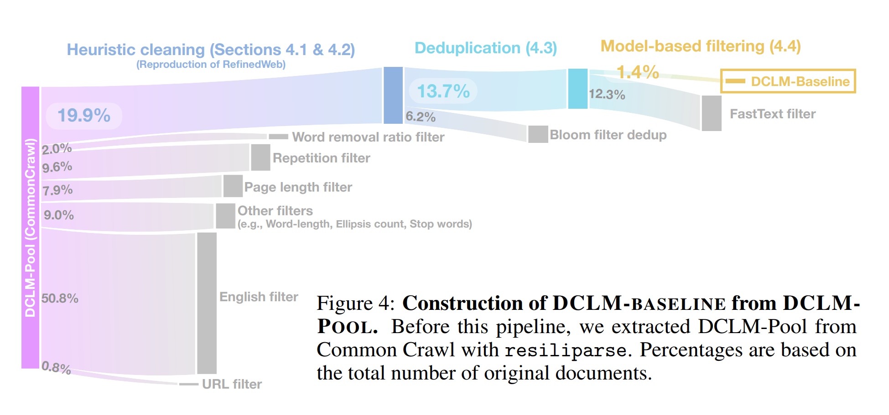
:::

(cs336-13-section-073)=
## Model-based filtering

:::{slide}
:label: cs336-13-073-output-001
:at: 0
Positive examples (200K):
:::

:::{slide}
:label: cs336-13-073-output-002
:at: 1
- [OpenHermes-2.5](https://huggingface.co/datasets/teknium/OpenHermes-2.5): mostly GPT-4 generated instruction data ([examples](https://huggingface.co/datasets/teknium/OpenHermes-2.5/viewer/default/train))
:::

:::{slide}
:label: cs336-13-073-output-003
:at: 2
- [ELI5](https://www.reddit.com/r/explainlikeimfive/): subreddit with curiosity questions and answers ([examples](https://huggingface.co/datasets/sentence-transformers/eli5/viewer/pair/train))
:::

:::{slide}
:label: cs336-13-073-output-004
:at: 3
Negative examples (200K):
:::

(cs336-13-section-074)=
## Model-based filtering

:::{slide}
:label: cs336-13-074-output-001
:at: 0
- [RefinedWeb](https://huggingface.co/datasets/tiiuae/falcon-refinedweb/viewer/default/train)
:::

:::{slide}
:label: cs336-13-074-output-002
:at: 1
Result: 3.8T tokens
:::

:::{slide}
:label: cs336-13-074-output-003
:at: 2
Trained a fastText classifier, run it on all of DCLM-pool
:::

:::{slide}
:label: cs336-13-074-output-004
:at: 3
This quality classifier outperforms other filtering methods:
:::

:::{slide}
:label: cs336-13-074-output-005
:at: 4
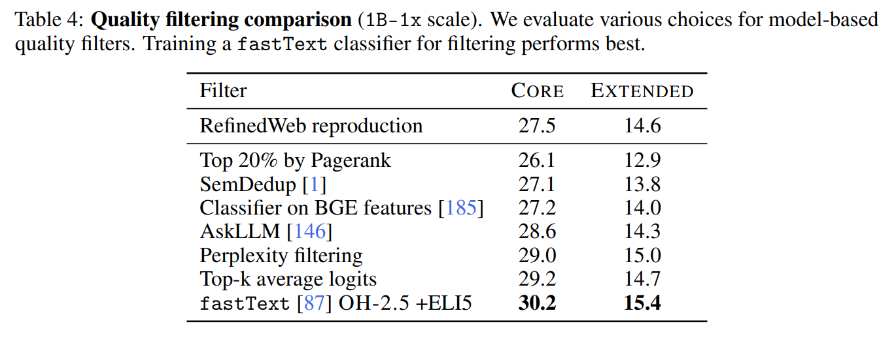
:::

(cs336-13-section-075)=
## Model-based filtering

:::{slide}
:label: cs336-13-075-output-001
:at: 0
Nemotron-CC 

[Su+ 2024](https://arxiv.org/abs/2412.02595)
:::

:::{slide}
:label: cs336-13-075-output-002
:at: 1
- FineWebEdu and DCLM filter too aggressively (remove 90% of data)
:::

:::{slide}
:label: cs336-13-075-output-003
:at: 2
- Need moar tokens (but preserve quality)
:::

:::{slide}
:label: cs336-13-075-output-004
:at: 3
- For HTML→text, used jusText (not trafilatura) because it returned more tokens
:::

:::{slide}
:label: cs336-13-075-output-005
:at: 4
Classifier ensembling
:::

(cs336-13-section-076)=
## Model-based filtering

:::{slide}
:label: cs336-13-076-output-001
:at: 0
- Prompt Nemotron-340B-instruct to score FineWeb documents based on educational value, distill into faster model
:::

:::{slide}
:label: cs336-13-076-output-002
:at: 1
- DCLM classifier
:::

:::{slide}
:label: cs336-13-076-output-003
:at: 2
Synthetic data rephrasing
:::

:::{slide}
:label: cs336-13-076-output-004
:at: 3
- For low-quality data, use LM to rephrase
:::

:::{slide}
:label: cs336-13-076-output-005
:at: 4
- For high-quality data, use LM to generate tasks (QA pairs, extract key information, etc.)
:::

(cs336-13-section-077)=
## Model-based filtering

:::{slide}
:label: cs336-13-077-output-001
:at: 0
Result: 6.3T tokens (HQ subset is 1.1T)
:::

:::{slide}
:label: cs336-13-077-output-002
:at: 1
For reference, Llama 3 trained on 15T, Qwen3 trained on 36T
:::

:::{slide}
:label: cs336-13-077-output-003
:at: 2
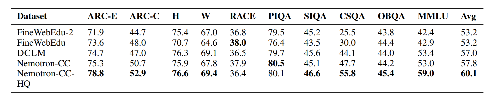
:::

:::{slide}
:label: cs336-13-077-output-004
:at: 3
The Stack 

[Kocetkov+ 2022](https://arxiv.org/pdf/2211.15533)
:::

:::{slide}
:label: cs336-13-077-output-005
:at: 4
- Took repository names from GitHub Archive (2015-2022)
:::

(cs336-13-section-078)=
## Model-based filtering

:::{slide}
:label: cs336-13-078-output-001
:at: 0
- git clone'd 137M repositories, 51B files (5B unique!)
:::

:::{slide}
:label: cs336-13-078-output-002
:at: 1
- Kept only permissively licensed (MIT, Apache) using go-license-detector
:::

:::{slide}
:label: cs336-13-078-output-003
:at: 2
- Remove near-duplicates using minhash and Jaccard similarity
:::

:::{slide}
:label: cs336-13-078-output-004
:at: 3
- Result: 3.1 TB of code
:::

:::{slide}
:label: cs336-13-078-output-005
:at: 4
Stack v2 

[Lozhkov+ 2024](https://arxiv.org/abs/2402.19173)
:::

(cs336-13-section-079)=
## Model-based filtering

:::{slide}
:label: cs336-13-079-output-001
:at: 0
- Issues, comments, PRs from GitHub Archive
:::

:::{slide}
:label: cs336-13-079-output-002
:at: 1
- Repositories from the Software Heritage
:::

:::{slide}
:label: cs336-13-079-output-003
:at: 2
- Documentation from crawling websites (e.g., PyPI, npm, devdocs.io)
:::

:::{slide}
:label: cs336-13-079-output-004
:at: 3
- Processing: remove binary files, malware, bot activity, deduplication, PII redaction, subsample PRs
:::

:::{slide}
:label: cs336-13-079-output-005
:at: 4
- Pair source code (especially low-resource languages like Nim) with shared low-level intermediate language (LLVM)
:::

(cs336-13-section-080)=
## Model-based filtering

:::{slide}
:label: cs336-13-080-output-001
:at: 0
- Include existing datasets (GSM8K, code contests, StackOverflow, arXiv, Wikipedia, OpenWebMath)
:::

:::{slide}
:label: cs336-13-080-output-002
:at: 1
Pull requests:
:::

:::{slide}
:label: cs336-13-080-output-003
:at: 2
- Linearize structured object to token sequence
:::

:::{slide}
:label: cs336-13-080-output-004
:at: 3
- Add some inline context (e.g., file surrounding diff), subsample
:::

:::{slide}
:label: cs336-13-080-output-005
:at: 4
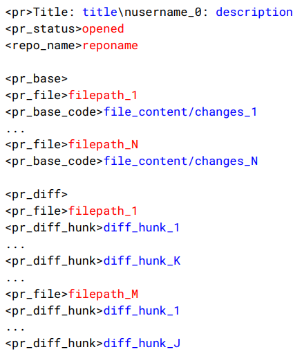

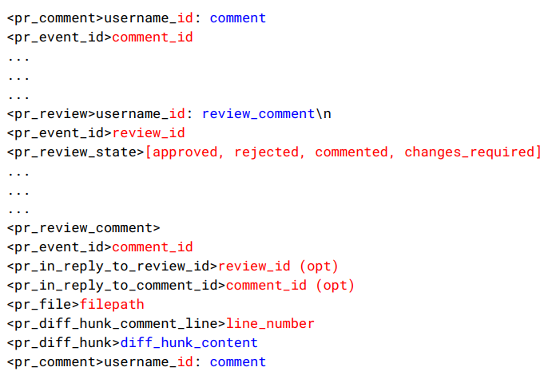
:::

(cs336-13-section-081)=
## Model-based filtering

:::{slide}
:label: cs336-13-081-output-001
:at: 0
Recall:
:::

:::{slide}
:label: cs336-13-081-output-002
:at: 1
- Almost all data on the Internet is copyrighted.
:::

:::{slide}
:label: cs336-13-081-output-003
:at: 2
- Some of it is permissively licensed.
:::

:::{slide}
:label: cs336-13-081-output-004
:at: 3
- Fair use of copyrighted content is not settled.
:::

:::{slide}
:label: cs336-13-081-output-005
:at: 4
Key question: can you train a good model using only permissively-licensed data?
:::

(cs336-13-section-082)=
## Model-based filtering

:::{slide}
:label: cs336-13-082-output-001
:at: 0
CommonPile 

[Kandpal+ 2025](https://arxiv.org/pdf/2506.05209)
:::

:::{slide}
:label: cs336-13-082-output-002
:at: 1
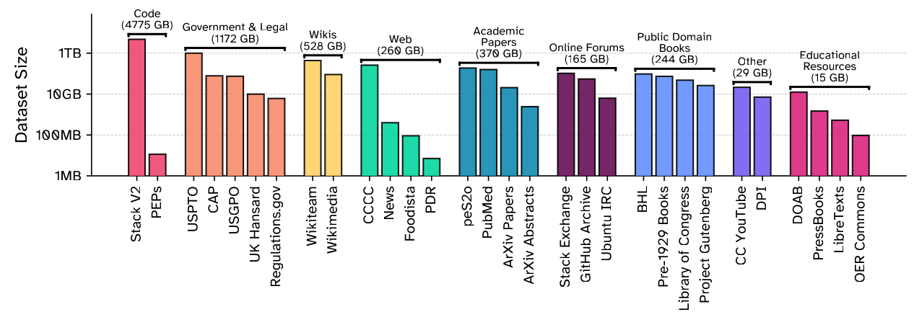
:::

:::{slide}
:label: cs336-13-082-output-003
:at: 2
- Collected 8TB dataset of permissively licensed data
:::

:::{slide}
:label: cs336-13-082-output-004
:at: 3
Subtleties:
:::

:::{slide}
:label: cs336-13-082-output-005
:at: 4
- License laundering: redistribute copyrighted work under permissive license (hard to detect)
:::

(cs336-13-section-083)=
## Model-based filtering

:::{slide}
:label: cs336-13-083-output-001
:at: 0
- Collection licenses (Dolma is ODC-By) doesn't extend to individual
:::

:::{slide}
:label: cs336-13-083-output-002
:at: 1
- Synthetic data from LMs trained on unlicensed data is unclear
:::

:::{slide}
:label: cs336-13-083-output-003
:at: 2
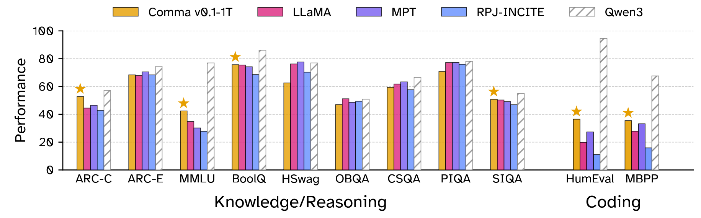
:::

:::{slide}
:label: cs336-13-083-output-004
:at: 3
- Can do decently, but tough to compete without more tokens
:::

(cs336-13-section-084)=
## Summary

:::{slide}
:label: cs336-13-084-output-001
:at: 0
- Key lesson: Data does not fall from the sky. You have to work to get it.
:::

:::{slide}
:label: cs336-13-084-output-002
:at: 1
- Live service → raw data → processed data (transformation, filtering, deduplication)
:::

:::{slide}
:label: cs336-13-084-output-003
:at: 2
- Data is the key ingredient that differentiates language models
:::

:::{slide}
:label: cs336-13-084-output-004
:at: 3
- Legal and ethical issues (e.g., copyright and privacy)
:::

(cs336-13-section-085)=
## Summary

:::{slide}
:label: cs336-13-085-output-001
:at: 0
- Much of this pipeline is heuristic, many opportunities to improve!
:::

