(cs336-14-cover)=
# Lecture 14: Data II

Stanford CS336 · Language Modeling from Scratch · Spring 2026.


(cs336-14-section-001)=
## Lecture 14: Data II

:::{slide}
:label: cs336-14-001-output-001
:at: 0
Last lecture:
:::

:::{slide}
:label: cs336-14-001-output-002
:at: 1
- Live service (e.g., GitHub) → dump/crawl (e.g., GitHub Archive) → processed data (e.g., The Stack)
:::

:::{slide}
:label: cs336-14-001-output-003
:at: 2
- Considerations: terms of service, copyright (licenses or fair use)
:::

:::{slide}
:label: cs336-14-001-output-004
:at: 3
This lecture:
:::


(cs336-14-section-002)=
## Lecture 14: Data II

:::{slide}
:label: cs336-14-002-output-001
:at: 0
- Data pipeline: transformation, filtering, deduplication, mixing
:::

:::{slide}
:label: cs336-14-002-output-002
:at: 1
- Mid-training + SFT: synthetic data
:::

:::{slide}
:label: cs336-14-002-output-003
:at: 2
Raw data does not come as text.
:::

:::{slide}
:label: cs336-14-002-output-004
:at: 3
It is HTML, PDF (arxiv), or directories (code repositories).
:::

:::{slide}
:label: cs336-14-002-output-005
:at: 4
HTML to text (main one):
:::


(cs336-14-section-003)=
## Lecture 14: Data II

:::{slide}
:label: cs336-14-003-output-001
:at: 0
- Remove boilerplate (e.g., navigation, ads) and extract content
:::

:::{slide}
:label: cs336-14-003-output-002
:at: 1
- What about images, tables, etc.?
:::

:::{slide}
:label: cs336-14-003-output-003
:at: 2
- Inherently lossy (need to linearize)
:::

:::{slide}
:label: cs336-14-003-output-004
:at: 3
- Tools (rule-based): trafilatura, resiliparse, jusText, lynx, etc.
:::

:::{slide}
:label: cs336-14-003-output-005
:at: 4
- Accuracy matters: 

[Li+ 2024](https://arxiv.org/abs/2406.11794)
:::


(cs336-14-section-004)=
## Lecture 14: Data II

:::{slide}
:label: cs336-14-004-output-001
:at: 0
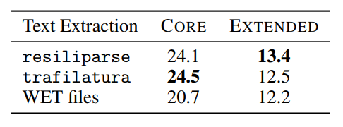
:::

:::{slide}
:label: cs336-14-004-output-002
:at: 1
FinePDFs 

[post](https://huggingface.co/spaces/HuggingFaceFW/FinePDFsBlog)
:::

:::{slide}
:label: cs336-14-004-output-003
:at: 2
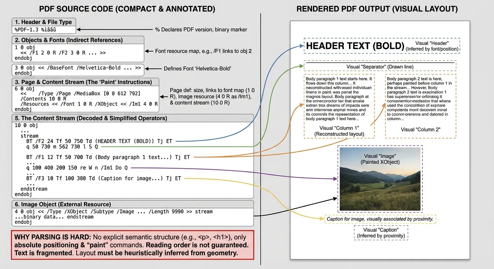
:::

:::{slide}
:label: cs336-14-004-output-004
:at: 3
- Source: Common Crawl
:::

:::{slide}
:label: cs336-14-004-output-005
:at: 4
- Recrawl truncated PDFs (since they are big)
:::


(cs336-14-section-005)=
## Lecture 14: Data II

:::{slide}
:label: cs336-14-005-output-001
:at: 0
- OCR (RolmOCR) using a VLM or Docling (make these run fast)
:::

:::{slide}
:label: cs336-14-005-output-002
:at: 1
- Lots of cleanup and filtering
:::

:::{slide}
:label: cs336-14-005-output-003
:at: 2
- A lot of layout information is missing
:::

:::{slide}
:label: cs336-14-005-output-004
:at: 3
Algorithmic building block:
:::

:::{slide}
:label: cs336-14-005-output-005
:at: 4
- Given some **target data** T and lots of **raw data** R, find subset T' of R similar to T.
:::


(cs336-14-section-006)=
## Lecture 14: Data II

:::{slide}
:label: cs336-14-006-output-001
:at: 0
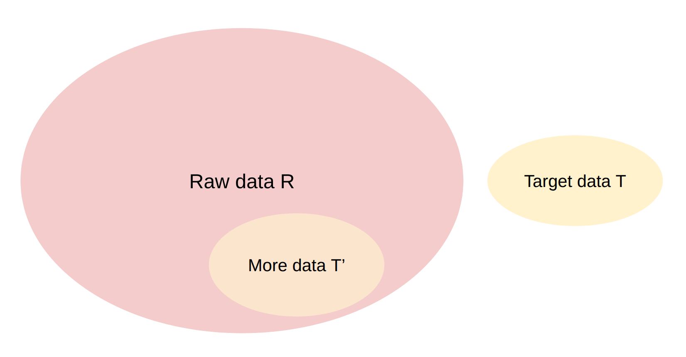
:::

:::{slide}
:label: cs336-14-006-output-002
:at: 1
Applications:
:::

:::{slide}
:label: cs336-14-006-output-003
:at: 2
- Language identification (English versus rest)
:::

:::{slide}
:label: cs336-14-006-output-004
:at: 3
- Quality filtering (high quality versus low quality)
:::

:::{slide}
:label: cs336-14-006-output-005
:at: 4
- Toxicity filtering (non-toxic versus toxic)
:::


(cs336-14-section-007)=
## Lecture 14: Data II

:::{slide}
:label: cs336-14-007-output-001
:at: 0
Desiderata for filtering algorithm:
:::

:::{slide}
:label: cs336-14-007-output-002
:at: 1
- Generalize from the target data (want T and T' to be different)
:::

:::{slide}
:label: cs336-14-007-output-003
:at: 2
- Extremely fast (have to run it on R, which is huge)
:::

:::{slide}
:label: cs336-14-007-output-004
:at: 3
Survey paper on data selection 

[Albalak+ 2024](https://arxiv.org/abs/2402.16827)
:::

:::{slide}
:label: cs336-14-007-output-005
:at: 4
General framework: Given target T and raw R, find subset of R similar to T
:::


(cs336-14-section-008)=
## Lecture 14: Data II

:::{slide}
:label: cs336-14-008-output-001
:at: 0
1. Estimate some model based on R and T and derive a scoring function
:::

:::{slide}
:label: cs336-14-008-output-002
:at: 1
2. Keep examples in R based on their score
:::

:::{slide}
:label: cs336-14-008-output-003
:at: 2
Types of classifiers:
:::

:::{slide}
:label: cs336-14-008-output-004
:at: 3
- Generative model of T (KenLM): score(x) = p_T(x)
:::

:::{slide}
:label: cs336-14-008-output-005
:at: 4
- Simple classifier (fastText): score(x) = p(T | x)
:::


(cs336-14-section-009)=
## Lecture 14: Data II

:::{slide}
:label: cs336-14-009-output-001
:at: 0
To use: keep examples x with score(x) >= threshold (stochastically)
:::

:::{slide}
:label: cs336-14-009-output-002
:at: 1
Model-based filtering?
:::

:::{slide}
:label: cs336-14-009-output-003
:at: 2
- Some deliberately do not use model-based filtering (C4, Gopher, RefinedWeb, FineWeb, Dolma)
:::

:::{slide}
:label: cs336-14-009-output-004
:at: 3
- Some use model-based filtering (GPT-3, LLaMA, DCLM) [becoming the norm]
:::

:::{slide}
:label: cs336-14-009-output-005
:at: 4
Language identification:
:::


(cs336-14-section-010)=
## Lecture 14: Data II

:::{slide}
:label: cs336-14-010-output-001
:at: 0
- Goal: find text of a specific language (e.g., English)
:::

:::{slide}
:label: cs336-14-010-output-002
:at: 1
- fastText language identification 

[article](https://fasttext.cc/docs/en/language-identification.html)
:::

:::{slide}
:label: cs336-14-010-output-003
:at: 2
- Off-the-shelf classifier
:::

:::{slide}
:label: cs336-14-010-output-004
:at: 3
- Supports 176 languages
:::

:::{slide}
:label: cs336-14-010-output-005
:at: 4
- Trained on multilingual sites: Wikipedia, Tatoeba (translation site) and SETimes (Southeast European news)
:::


(cs336-14-section-011)=
## Lecture 14: Data II

:::{slide}
:label: cs336-14-011-output-001
:at: 0
- Dolma keeps pages with p(English) >= 0.5 

[Soldaini+ 2024](https://arxiv.org/abs/2402.00159)
:::

:::{slide}
:label: cs336-14-011-output-002
:at: 1
OpenMathText 

[Paster+ 2023](https://arxiv.org/pdf/2310.06786)
:::

:::{slide}
:label: cs336-14-011-output-003
:at: 2
- Goal: curate large corpus of mathematical text from CommonCrawl
:::

:::{slide}
:label: cs336-14-011-output-004
:at: 3
- Use rules to filter (e.g., contains latex commands)
:::

:::{slide}
:label: cs336-14-011-output-005
:at: 4
- KenLM trained on ProofPile, keep if perplexity < 15000
:::


(cs336-14-section-012)=
## Lecture 14: Data II

:::{slide}
:label: cs336-14-012-output-001
:at: 0
- Trained fastText classifier to predict mathematical writing, threshold is 0.17 if math, 0.8 if no math
:::

:::{slide}
:label: cs336-14-012-output-002
:at: 1
- Result: produced 14.7B tokens, used to train 1.4B models that do better than models trained on 20x data
:::

:::{slide}
:label: cs336-14-012-output-003
:at: 2
GPT-3 

[Brown+ 2020](https://arxiv.org/pdf/2005.14165)
:::

:::{slide}
:label: cs336-14-012-output-004
:at: 3
- Positives: samples from {Wikipedia, WebText2, Books1, Books2}
:::

:::{slide}
:label: cs336-14-012-output-005
:at: 4
- Negatives: samples from CommonCrawl
:::


(cs336-14-section-013)=
## Lecture 14: Data II

:::{slide}
:label: cs336-14-013-output-001
:at: 0
Train linear classifier based on word features 

[article](https://spark.apache.org/docs/latest/ml-features#tokenizer)
:::

:::{slide}
:label: cs336-14-013-output-002
:at: 1
Keep documents stochastically based on score
:::

:::{slide}
:label: cs336-14-013-output-003
:at: 2
LLaMA/RedPajama 

[Touvron+ 2023](https://arxiv.org/pdf/2302.13971)
:::

:::{slide}
:label: cs336-14-013-output-004
:at: 3
- Positives: samples from pages **referenced** by Wikipedia
:::

:::{slide}
:label: cs336-14-013-output-005
:at: 4
- Negatives: samples from CommonCrawl
:::


(cs336-14-section-014)=
## Lecture 14: Data II

:::{slide}
:label: cs336-14-014-output-001
:at: 0
- Keep documents that are classified positive
:::

:::{slide}
:label: cs336-14-014-output-002
:at: 1
phi-1 

[Gunasekar+ 2023](https://arxiv.org/pdf/2306.11644)
:::

:::{slide}
:label: cs336-14-014-output-003
:at: 2
- Philosophy: really high quality data (textbooks) to train a small model (1.5B)
:::

:::{slide}
:label: cs336-14-014-output-004
:at: 3
- Includes synthetic data from GPT 3.5 (later: GPT-4) and filtered data
:::

:::{slide}
:label: cs336-14-014-output-005
:at: 4
- Train random forest classifier on T using output embedding from pretrained codegen model
:::


(cs336-14-section-015)=
## Lecture 14: Data II

:::{slide}
:label: cs336-14-015-output-001
:at: 0
- Select data from R that is classified positive by the classifier
:::

:::{slide}
:label: cs336-14-015-output-002
:at: 1
Result on [HumanEval](https://huggingface.co/datasets/openai_humaneval):
:::

:::{slide}
:label: cs336-14-015-output-003
:at: 2
- Train 1.3B LM on Python subset of The Stack (performance: 12.19% after 96K steps)
:::

:::{slide}
:label: cs336-14-015-output-004
:at: 3
- Train 1.3B LM on new filtered subset (performance: 17.68% after 36K steps) - better!
:::

:::{slide}
:label: cs336-14-015-output-005
:at: 4
Toxicity filtering in Dolma 

[Soldaini+ 2024](https://arxiv.org/abs/2402.00159)
:::


(cs336-14-section-016)=
## Lecture 14: Data II

:::{slide}
:label: cs336-14-016-output-001
:at: 0
- Dataset: Jigsaw Toxic Comments dataset (2018) 

[dataset](https://www.kaggle.com/datasets/julian3833/jigsaw-toxic-comment-classification-challenge)
:::

:::{slide}
:label: cs336-14-016-output-002
:at: 1
- Project goal: help people have better discussions online 

[article](https://www.kaggle.com/competitions/jigsaw-toxic-comment-classification-challenge/discussion/46064)
:::

:::{slide}
:label: cs336-14-016-output-003
:at: 2
- Data: comments on Wikipedia talk page annotated with {toxic, severe_toxic, obscene, threat, insult, identity_hate}
:::

:::{slide}
:label: cs336-14-016-output-004
:at: 3
Scale-dependent effects of filtering:
:::

:::{slide}
:label: cs336-14-016-output-005
:at: 4
- No single optimal threshold for filtering
:::


(cs336-14-section-017)=
## Lecture 14: Data II

:::{slide}
:label: cs336-14-017-output-001
:at: 0
- If training for longer, want more (lower quality) data
:::

:::{slide}
:label: cs336-14-017-output-002
:at: 1
- If training for shorter, want less (higher quality) data
:::

:::{slide}
:label: cs336-14-017-output-003
:at: 2
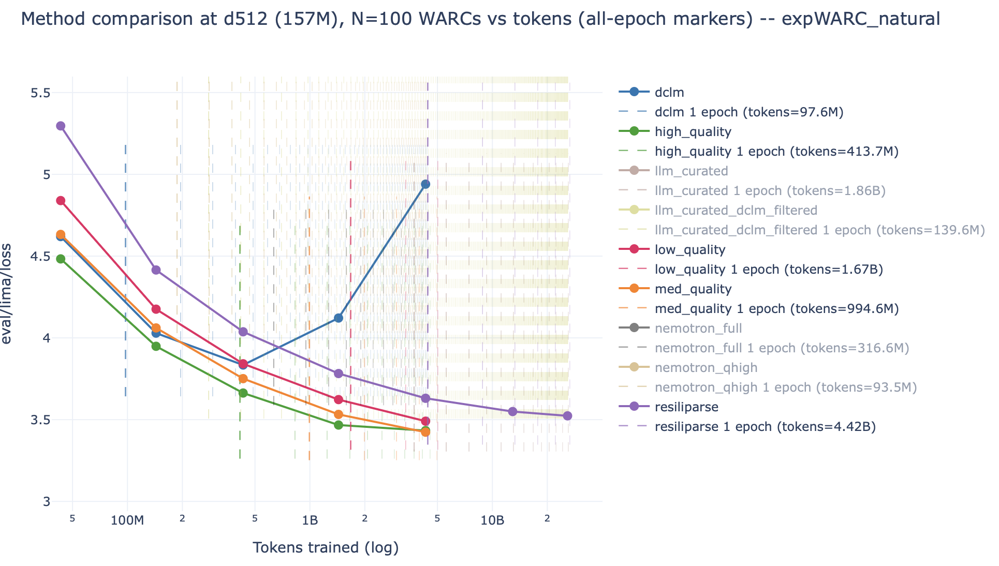
:::

:::{slide}
:label: cs336-14-017-output-004
:at: 3
Summary:
:::

:::{slide}
:label: cs336-14-017-output-005
:at: 4
- Filtering is critical for building a good model
:::


(cs336-14-section-018)=
## Lecture 14: Data II

:::{slide}
:label: cs336-14-018-output-001
:at: 0
- Recipe: define target data (what good looks like), extrapolate to raw data
:::

:::{slide}
:label: cs336-14-018-output-002
:at: 1
Two types of duplicates:
:::

:::{slide}
:label: cs336-14-018-output-003
:at: 2
- Exact duplicates (mirror sites, GitHub forks) 

[Gutenberg mirrors](https://www.gutenberg.org/MIRRORS.ALL)
:::

:::{slide}
:label: cs336-14-018-output-004
:at: 3
- Near duplicates: same text differing by a few tokens
:::

:::{slide}
:label: cs336-14-018-output-005
:at: 4
Examples of near duplicates:
:::


(cs336-14-section-019)=
## Lecture 14: Data II

:::{slide}
:label: cs336-14-019-output-001
:at: 0
- Terms of service and licenses 

[MIT license](https://opensource.org/license/mit)
:::

:::{slide}
:label: cs336-14-019-output-002
:at: 1
- Formulaic writing (copy/pasted or generated from a template) 

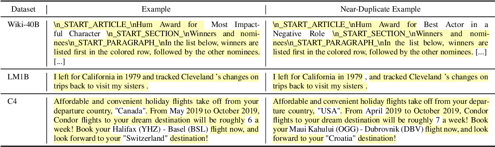
:::

:::{slide}
:label: cs336-14-019-output-003
:at: 2
- Minor formatting differences in copy/pasting
:::

:::{slide}
:label: cs336-14-019-output-004
:at: 3
Product description repeated 61,036 times in C4
:::

:::{slide}
:label: cs336-14-019-output-005
:at: 4
'“by combining fantastic ideas, interesting arrangements, and follow the current trends in the field of that make you more inspired and give artistic touches. We’d be honored if you can apply some or all of these design in your wedding.  believe me, brilliant ideas would be perfect if it can be applied in real and make the people around you amazed!
:::


(cs336-14-section-020)=
## Lecture 14: Data II

:::{slide}
:label: cs336-14-020-output-001
:at: 0
[example page](https://www.amazon.co.uk/suryagede-100-Graffiti-Gas-Mask/dp/B07CRHT3RG)
:::

:::{slide}
:label: cs336-14-020-output-002
:at: 1
Deduplication training data makes language models better 

[Lee+ 2021](https://arxiv.org/pdf/2107.06499)
:::

:::{slide}
:label: cs336-14-020-output-003
:at: 2
- Train more efficiently (because have fewer tokens)
:::

:::{slide}
:label: cs336-14-020-output-004
:at: 3
- Avoid memorization (can mitigate copyright, privacy concerns)
:::

:::{slide}
:label: cs336-14-020-output-005
:at: 4
Design space:
:::


(cs336-14-section-021)=
## Lecture 14: Data II

:::{slide}
:label: cs336-14-021-output-001
:at: 0
1. What is an item (sentence, paragraph, document)?
:::

:::{slide}
:label: cs336-14-021-output-002
:at: 1
2. How to match (exact match, existence of common subitem, fraction of common subitems)?
:::

:::{slide}
:label: cs336-14-021-output-003
:at: 2
3. What action to take (remove all, remove all but one)?
:::

:::{slide}
:label: cs336-14-021-output-004
:at: 3
Key challenge:
:::

:::{slide}
:label: cs336-14-021-output-005
:at: 4
- Deduplication is fundamentally about comparing items to other items
:::


(cs336-14-section-022)=
## Lecture 14: Data II

:::{slide}
:label: cs336-14-022-output-001
:at: 0
- Need linear time algorithms to scale
:::

:::{slide}
:label: cs336-14-022-output-002
:at: 1
- Hash function h maps item to a hash value (integer or string)
:::

:::{slide}
:label: cs336-14-022-output-003
:at: 2
- Hash value much smaller than item
:::

:::{slide}
:label: cs336-14-022-output-004
:at: 3
- Hash collision: h(x) = h(y) for x ≠ y
:::

:::{slide}
:label: cs336-14-022-output-005
:at: 4
Tradeoff between efficiency and collision resistance 

[article](https://softwareengineering.stackexchange.com/questions/49550/which-hashing-algorithm-is-best-for-uniqueness-and-speed)
:::


(cs336-14-section-023)=
## Lecture 14: Data II

:::{slide}
:label: cs336-14-023-output-001
:at: 0
- Cryptographic hash functions (SHA-256): collision resistant, slow (used in bitcoin)
:::

:::{slide}
:label: cs336-14-023-output-002
:at: 1
- DJB2, MurmurHash, CityHash: not collision resistant, fast (used for hash tables)
:::

:::{slide}
:label: cs336-14-023-output-003
:at: 2
We will use MurmurHash:
:::

:::{slide}
:label: cs336-14-023-values-004
:at: 3
:until: 4
| Variable | Value |
| --- | --- |
| `h` | 613153351 |
:::

:::{slide}
:label: cs336-14-023-output-005
:at: 5
**Simple example**
:::


(cs336-14-section-024)=
## Lecture 14: Data II

:::{slide}
:label: cs336-14-024-output-001
:at: 0
1. Item: string
:::

:::{slide}
:label: cs336-14-024-output-002
:at: 1
2. How to match: exact match
:::

:::{slide}
:label: cs336-14-024-output-003
:at: 2
3. Action: remove all but one
:::

:::{slide}
:label: cs336-14-024-values-004
:at: 3
:until: 4
**`items`**

```python
['Hello!', 'hello', 'hello there', 'hello', 'hi', 'bye']
```

:::

:::{slide}
:label: cs336-14-024-values-005
:at: 4
**`items`**

```python
['Hello!', 'hello', 'hello there', 'hello', 'hi', 'bye']
```


**`deduped_items`**

```python
['hi', 'bye', 'hello', 'hello there', 'Hello!']
```

:::


(cs336-14-section-025)=
## Lecture 14: Data II

:::{slide}
:label: cs336-14-025-output-001
:at: 0
- Pro: simple, clear semantics, high precision
:::

:::{slide}
:label: cs336-14-025-values-002
:at: 0
**`items`**

```python
['Hello!', 'hello', 'hello there', 'hello', 'hi', 'bye']
```


**`deduped_items`**

```python
['hi', 'bye', 'hello', 'hello there', 'Hello!']
```

:::

:::{slide}
:label: cs336-14-025-output-003
:at: 1
- Con: does not deduplicate near duplicates
:::

:::{slide}
:label: cs336-14-025-output-004
:at: 2
- This code is written in a MapReduce way, can easily parallelize and scale
:::

:::{slide}
:label: cs336-14-025-output-005
:at: 3
**C4** 

[Raffel+ 2019](https://arxiv.org/pdf/1910.10683v4)
:::

:::{slide}
:label: cs336-14-025-output-006
:at: 4
1. Item: 3-sentence spans
:::


(cs336-14-section-026)=
## Lecture 14: Data II

:::{slide}
:label: cs336-14-026-output-001
:at: 0
2. How to match: use exact match
:::

:::{slide}
:label: cs336-14-026-values-002
:at: 0
:until: 3
**`items`**

```python
['Hello!', 'hello', 'hello there', 'hello', 'hi', 'bye']
```


**`deduped_items`**

```python
['hi', 'bye', 'hello', 'hello there', 'Hello!']
```

:::

:::{slide}
:label: cs336-14-026-output-003
:at: 1
3. Action: remove all but one
:::

:::{slide}
:label: cs336-14-026-output-004
:at: 2
Warning: when a 3-sentence span is removed from the middle of a document, the resulting document might not be coherent
:::

:::{slide}
:label: cs336-14-026-output-005
:at: 4
Let's now look at approximate set membership.
:::

:::{slide}
:label: cs336-14-026-output-006
:at: 5
First we need a similarity measure.
:::


(cs336-14-section-027)=
## Jaccard similarity

:::{slide}
:label: cs336-14-027-output-001
:at: 0
Definition: Jaccard(A, B) = |A intersect B| / |A union B|
:::

:::{slide}
:label: cs336-14-027-values-002
:at: 1
:until: 2
| Variable | Value |
| --- | --- |
| `intersection` | 3 |
:::

:::{slide}
:label: cs336-14-027-values-003
:at: 2
:until: 3
| Variable | Value |
| --- | --- |
| `intersection` | 3 |
| `union` | 5 |
:::

:::{slide}
:label: cs336-14-027-values-004
:at: 3
| Variable | Value |
| --- | --- |
| `jaccard` | 0.6 |
:::


(cs336-14-section-028)=
## Jaccard similarity

:::{slide}
:label: cs336-14-028-output-001
:at: 0
Definition: two documents are **near duplicates** if their Jaccard similarity >= threshold
:::

:::{slide}
:label: cs336-14-028-values-002
:at: 0
| Variable | Value |
| --- | --- |
| `jaccard` | 0.6 |
:::

:::{slide}
:label: cs336-14-028-output-003
:at: 1
Algorithmic challenge: find near duplicates in linear time
:::


(cs336-14-section-029)=
## MinHash

:::{slide}
:label: cs336-14-029-values-001
:at: 0
| Variable | Value |
| --- | --- |
| `jaccard` | 0.6 |
:::

:::{slide}
:label: cs336-14-029-output-002
:at: 1
MinHash: a random hash function h so that Pr[h(A) = h(B)] = Jaccard(A, B)
:::

:::{slide}
:label: cs336-14-029-output-003
:at: 2
Normally, you want different items to hash to different hashes
:::

:::{slide}
:label: cs336-14-029-output-004
:at: 3
...but here, you want collision probability to depend on similarity
:::

:::{slide}
:label: cs336-14-029-output-005
:at: 4
Characteristic matrix representation:
:::


(cs336-14-section-030)=
## MinHash

:::{slide}
:label: cs336-14-030-output-001
:at: 0
```text
item | A | B
```
:::

:::{slide}
:label: cs336-14-030-values-002
:at: 0
| Variable | Value |
| --- | --- |
| `jaccard` | 0.6 |
:::

:::{slide}
:label: cs336-14-030-output-003
:at: 1
```text
1    | 1 | 1
```
:::

:::{slide}
:label: cs336-14-030-output-004
:at: 2
```text
2    | 1 | 1
```
:::

:::{slide}
:label: cs336-14-030-output-005
:at: 3
```text
3    | 1 | 1
```
:::

:::{slide}
:label: cs336-14-030-output-006
:at: 4
```text
4    | 1 | 0
```
:::


(cs336-14-section-031)=
## MinHash

:::{slide}
:label: cs336-14-031-output-001
:at: 0
```text
5    | 0 | 1
```
:::

:::{slide}
:label: cs336-14-031-values-002
:at: 0
| Variable | Value |
| --- | --- |
| `jaccard` | 0.6 |
:::

:::{slide}
:label: cs336-14-031-output-003
:at: 1
Random hash function induces a permutation over items
:::

:::{slide}
:label: cs336-14-031-output-004
:at: 2
Look at which item is first in A and which item is first in B.
:::

:::{slide}
:label: cs336-14-031-output-005
:at: 3
Each item has the same probability as being first (min)
:::

:::{slide}
:label: cs336-14-031-output-006
:at: 4
- If 1, 2, 3 is first, then first in A = first in B.
:::


(cs336-14-section-032)=
## MinHash

:::{slide}
:label: cs336-14-032-output-001
:at: 0
- If 4, 5 is first, then first in A ≠ first in B.
:::

:::{slide}
:label: cs336-14-032-values-002
:at: 0
:until: 1
| Variable | Value |
| --- | --- |
| `jaccard` | 0.6 |
:::

:::{slide}
:label: cs336-14-032-values-003
:at: 1
:until: 3
| Variable | Value |
| --- | --- |
| `jaccard` | 0.6 |
| `estimated_jaccard` | 0.6 |
:::

:::{slide}
:label: cs336-14-032-output-004
:at: 2
Now we can hash our items, but a collision doesn't tell us Jaccard(A, B) > threshold.
:::

:::{slide}
:label: cs336-14-032-output-005
:at: 4
Locality sensitive hashing (LSH) 

[book chapter](http://infolab.stanford.edu/~ullman/mmds/ch3n.pdf)
:::

:::{slide}
:label: cs336-14-032-output-006
:at: 5
Suppose we hash examples with just one MinHash function
:::


(cs336-14-section-033)=
## MinHash

:::{slide}
:label: cs336-14-033-output-001
:at: 0
P[A and B collide] = Jaccard(A, B)
:::

:::{slide}
:label: cs336-14-033-output-002
:at: 1
On average, more similar items will collide, but very stochastic...
:::

:::{slide}
:label: cs336-14-033-output-003
:at: 2
Goal: have A and B collide if Jaccard(A, B) > threshold
:::

:::{slide}
:label: cs336-14-033-output-004
:at: 3
We have to somehow sharpen the probabilities...
:::

:::{slide}
:label: cs336-14-033-output-005
:at: 4
Solution: use n hash functions
:::


(cs336-14-section-034)=
## MinHash

:::{slide}
:label: cs336-14-034-output-001
:at: 0
Break up into b bands of r hash functions each (n = b * r)
:::

:::{slide}
:label: cs336-14-034-output-002
:at: 1
Hash functions:
:::

:::{slide}
:label: cs336-14-034-output-003
:at: 2
```text
h1 h2 h3 h4  |  h5 h6 h7 h8  |  h9 h10 h11 h12
```
:::

:::{slide}
:label: cs336-14-034-output-004
:at: 3
Key: A and B collide if for *some* band, *all* its hash functions return same value
:::

:::{slide}
:label: cs336-14-034-output-005
:at: 4
As we will see, the and-or structure of the bands sharpens the threshold
:::


(cs336-14-section-035)=
## MinHash

:::{slide}
:label: cs336-14-035-output-001
:at: 0
Given Jaccard(A, B), what is the probability that A and B collide?
:::

:::{slide}
:label: cs336-14-035-values-002
:at: 1
:until: 3
| Variable | Value |
| --- | --- |
| `b` | 3 |
| `r` | 4 |
:::

:::{slide}
:label: cs336-14-035-output-003
:at: 2
**Example**
:::

:::{slide}
:label: cs336-14-035-values-004
:at: 3
:until: 4
| Variable | Value |
| --- | --- |
| `sim` | 0.8 |
| `b` | 5 |
| `r` | 10 |
:::

:::{slide}
:label: cs336-14-035-values-005
:at: 4
| Variable | Value |
| --- | --- |
| `sim` | 0.8 |
| `b` | 5 |
| `r` | 10 |
| `prob_match` | 0.10737418240000006 |
:::


(cs336-14-section-036)=
## MinHash

:::{slide}
:label: cs336-14-036-values-001
:at: 0
:until: 1
| Variable | Value |
| --- | --- |
| `sim` | 0.8 |
| `b` | 5 |
| `r` | 10 |
| `prob_match` | 0.10737418240000006 |
| `prob_collision` | 0.43330782041120397 |
:::

:::{slide}
:label: cs336-14-036-values-002
:at: 1
:until: 3
| Variable | Value |
| --- | --- |
| `b` | 3 |
| `r` | 4 |
| `prob_collision` | 0.43330782041120397 |
:::

:::{slide}
:label: cs336-14-036-output-003
:at: 2
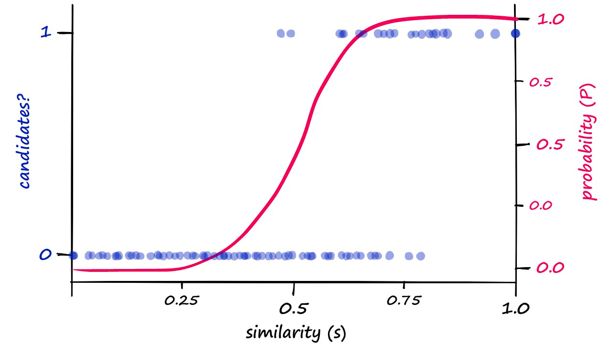
:::

:::{slide}
:label: cs336-14-036-values-004
:at: 4
:until: 5
| Variable | Value |
| --- | --- |
| `sim` | 0.75 |
| `b` | 10 |
| `r` | 10 |
:::

:::{slide}
:label: cs336-14-036-values-005
:at: 5
:until: 6
| Variable | Value |
| --- | --- |
| `sim` | 0.75 |
| `b` | 10 |
| `r` | 10 |
| `prob_match` | 0.056313514709472656 |
:::

:::{slide}
:label: cs336-14-036-values-006
:at: 6
:until: 7
| Variable | Value |
| --- | --- |
| `sim` | 0.75 |
| `b` | 10 |
| `r` | 10 |
| `prob_match` | 0.056313514709472656 |
| `prob_collision` | 0.4398848046250401 |
:::


(cs336-14-section-037)=
## MinHash

:::{slide}
:label: cs336-14-037-values-001
:at: 0
:until: 1
| Variable | Value |
| --- | --- |
| `sim` | 0.85 |
| `b` | 10 |
| `r` | 10 |
:::

:::{slide}
:label: cs336-14-037-values-002
:at: 1
:until: 2
| Variable | Value |
| --- | --- |
| `sim` | 0.85 |
| `b` | 10 |
| `r` | 10 |
| `prob_match` | 0.1968744043407226 |
:::

:::{slide}
:label: cs336-14-037-values-003
:at: 2
:until: 3
| Variable | Value |
| --- | --- |
| `sim` | 0.85 |
| `b` | 10 |
| `r` | 10 |
| `prob_match` | 0.1968744043407226 |
| `prob_collision` | 0.8883561842922729 |
:::

:::{slide}
:label: cs336-14-037-values-004
:at: 4
:until: 5
| Variable | Value |
| --- | --- |
| `sim` | 0.95 |
| `b` | 10 |
| `r` | 10 |
:::

:::{slide}
:label: cs336-14-037-values-005
:at: 5
| Variable | Value |
| --- | --- |
| `sim` | 0.95 |
| `b` | 10 |
| `r` | 10 |
| `prob_match` | 0.5987369392383787 |
:::


(cs336-14-section-038)=
## MinHash

:::{slide}
:label: cs336-14-038-values-001
:at: 0
:until: 1
| Variable | Value |
| --- | --- |
| `sim` | 0.95 |
| `b` | 10 |
| `r` | 10 |
| `prob_match` | 0.5987369392383787 |
| `prob_collision` | 0.999891783915662 |
:::

:::{slide}
:label: cs336-14-038-values-002
:at: 2
:until: 4
| Variable | Value |
| --- | --- |
| `b` | 3 |
| `r` | 4 |
| `prob_collision` | 0.43330782041120397 |

**`probs`**

```python
{'0.7': 0.24914417423121082,
 '0.75': 0.4398848046250401,
 '0.8': 0.6788599735928997,
 '0.85': 0.8883561842922729,
 '0.9': 0.9862610183556292,
 '0.95': 0.999891783915662,
 '0.98': 0.9999999580450986}
```

:::

:::{slide}
:label: cs336-14-038-output-003
:at: 3
Increasing r sharpens the threshold and moves the curve to the right (harder to match)
:::

:::{slide}
:label: cs336-14-038-values-004
:at: 5
:until: 6
| Variable | Value |
| --- | --- |
| `sim` | 0.75 |
| `b` | 10 |
| `r` | 20 |
:::

:::{slide}
:label: cs336-14-038-values-005
:at: 6
| Variable | Value |
| --- | --- |
| `sim` | 0.75 |
| `b` | 10 |
| `r` | 20 |
| `prob_match` | 0.0031712119389339932 |
:::


(cs336-14-section-039)=
## MinHash

:::{slide}
:label: cs336-14-039-values-001
:at: 0
:until: 1
| Variable | Value |
| --- | --- |
| `sim` | 0.75 |
| `b` | 10 |
| `r` | 20 |
| `prob_match` | 0.0031712119389339932 |
| `prob_collision` | 0.03126337888689601 |
:::

:::{slide}
:label: cs336-14-039-values-002
:at: 2
:until: 3
| Variable | Value |
| --- | --- |
| `sim` | 0.85 |
| `b` | 10 |
| `r` | 20 |
:::

:::{slide}
:label: cs336-14-039-values-003
:at: 3
:until: 4
| Variable | Value |
| --- | --- |
| `sim` | 0.85 |
| `b` | 10 |
| `r` | 20 |
| `prob_match` | 0.03875953108451433 |
:::

:::{slide}
:label: cs336-14-039-values-004
:at: 4
:until: 5
| Variable | Value |
| --- | --- |
| `sim` | 0.85 |
| `b` | 10 |
| `r` | 20 |
| `prob_match` | 0.03875953108451433 |
| `prob_collision` | 0.3265265704029475 |
:::

:::{slide}
:label: cs336-14-039-values-005
:at: 6
| Variable | Value |
| --- | --- |
| `sim` | 0.95 |
| `b` | 10 |
| `r` | 20 |
:::


(cs336-14-section-040)=
## MinHash

:::{slide}
:label: cs336-14-040-values-001
:at: 0
:until: 1
| Variable | Value |
| --- | --- |
| `sim` | 0.95 |
| `b` | 10 |
| `r` | 20 |
| `prob_match` | 0.3584859224085419 |
:::

:::{slide}
:label: cs336-14-040-values-002
:at: 1
:until: 2
| Variable | Value |
| --- | --- |
| `sim` | 0.95 |
| `b` | 10 |
| `r` | 20 |
| `prob_match` | 0.3584859224085419 |
| `prob_collision` | 0.9881951109097257 |
:::

:::{slide}
:label: cs336-14-040-values-003
:at: 3
:until: 5
| Variable | Value |
| --- | --- |
| `b` | 3 |
| `r` | 4 |
| `prob_collision` | 0.43330782041120397 |

**`probs`**

```python
{'0.7': 0.007950636881415285,
 '0.75': 0.03126337888689601,
 '0.8': 0.10949086440906874,
 '0.85': 0.3265265704029475,
 '0.9': 0.7264487568116678,
 '0.95': 0.9881951109097257,
 '0.98': 0.9999835371130633}
```

:::

:::{slide}
:label: cs336-14-040-output-004
:at: 4
Increasing b moves the curve to the left (easier to match)
:::

:::{slide}
:label: cs336-14-040-values-005
:at: 6
| Variable | Value |
| --- | --- |
| `sim` | 0.75 |
| `b` | 20 |
| `r` | 20 |
:::


(cs336-14-section-041)=
## MinHash

:::{slide}
:label: cs336-14-041-values-001
:at: 0
:until: 1
| Variable | Value |
| --- | --- |
| `sim` | 0.75 |
| `b` | 20 |
| `r` | 20 |
| `prob_match` | 0.0031712119389339932 |
:::

:::{slide}
:label: cs336-14-041-values-002
:at: 1
:until: 2
| Variable | Value |
| --- | --- |
| `sim` | 0.75 |
| `b` | 20 |
| `r` | 20 |
| `prob_match` | 0.0031712119389339932 |
| `prob_collision` | 0.061549358914366414 |
:::

:::{slide}
:label: cs336-14-041-values-003
:at: 3
:until: 4
| Variable | Value |
| --- | --- |
| `sim` | 0.85 |
| `b` | 20 |
| `r` | 20 |
:::

:::{slide}
:label: cs336-14-041-values-004
:at: 4
:until: 5
| Variable | Value |
| --- | --- |
| `sim` | 0.85 |
| `b` | 20 |
| `r` | 20 |
| `prob_match` | 0.03875953108451433 |
:::

:::{slide}
:label: cs336-14-041-values-005
:at: 5
:until: 6
| Variable | Value |
| --- | --- |
| `sim` | 0.85 |
| `b` | 20 |
| `r` | 20 |
| `prob_match` | 0.03875953108451433 |
| `prob_collision` | 0.546433539626784 |
:::


(cs336-14-section-042)=
## MinHash

:::{slide}
:label: cs336-14-042-values-001
:at: 0
:until: 1
| Variable | Value |
| --- | --- |
| `sim` | 0.95 |
| `b` | 20 |
| `r` | 20 |
:::

:::{slide}
:label: cs336-14-042-values-002
:at: 1
:until: 2
| Variable | Value |
| --- | --- |
| `sim` | 0.95 |
| `b` | 20 |
| `r` | 20 |
| `prob_match` | 0.3584859224085419 |
:::

:::{slide}
:label: cs336-14-042-values-003
:at: 2
:until: 3
| Variable | Value |
| --- | --- |
| `sim` | 0.95 |
| `b` | 20 |
| `r` | 20 |
| `prob_match` | 0.3584859224085419 |
| `prob_collision` | 0.9998606445935663 |
:::

:::{slide}
:label: cs336-14-042-values-004
:at: 4
| Variable | Value |
| --- | --- |
| `b` | 3 |
| `r` | 4 |
| `prob_collision` | 0.43330782041120397 |

**`probs`**

```python
{'0.7': 0.015838061136010495,
 '0.75': 0.061549358914366414,
 '0.8': 0.2069934794290924,
 '0.85': 0.546433539626784,
 '0.9': 0.9251697173501179,
 '0.95': 0.9998606445935663,
 '0.98': 0.9999999997289734}
```

:::

:::{slide}
:label: cs336-14-042-output-005
:at: 5
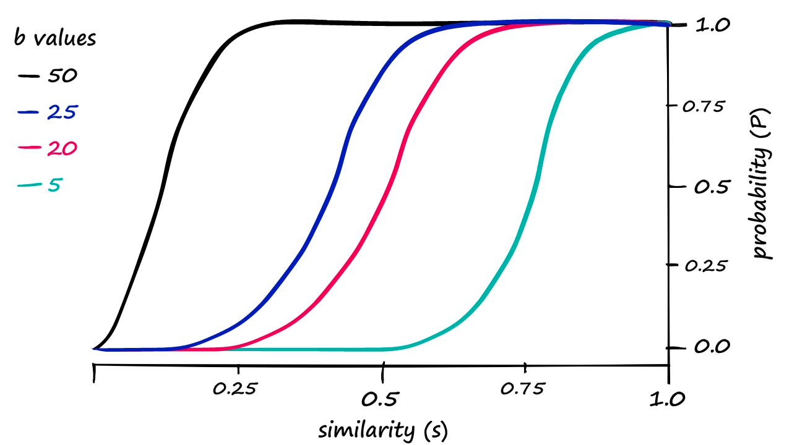
:::


(cs336-14-section-043)=
## MinHash

:::{slide}
:label: cs336-14-043-output-001
:at: 0
Example setting 

[Lee+ 2021](https://arxiv.org/pdf/2107.06499)

: n = 9000, b = 20, r = 450
:::

:::{slide}
:label: cs336-14-043-values-002
:at: 0
:until: 2
| Variable | Value |
| --- | --- |
| `b` | 3 |
| `r` | 4 |
| `prob_collision` | 0.43330782041120397 |

**`probs`**

```python
{'0.7': 0.015838061136010495,
 '0.75': 0.061549358914366414,
 '0.8': 0.2069934794290924,
 '0.85': 0.546433539626784,
 '0.9': 0.9251697173501179,
 '0.95': 0.9998606445935663,
 '0.98': 0.9999999997289734}
```

:::

:::{slide}
:label: cs336-14-043-output-003
:at: 1
What is the threshold (where the phase transition happens)?
:::

:::{slide}
:label: cs336-14-043-values-004
:at: 2
:until: 4
| Variable | Value |
| --- | --- |
| `b` | 3 |
| `r` | 4 |
| `prob_collision` | 0.43330782041120397 |
| `threshold` | 0.9933649271209614 |

**`probs`**

```python
{'0.7': 0.015838061136010495,
 '0.75': 0.061549358914366414,
 '0.8': 0.2069934794290924,
 '0.85': 0.546433539626784,
 '0.9': 0.9251697173501179,
 '0.95': 0.9998606445935663,
 '0.98': 0.9999999997289734}
```

:::

:::{slide}
:label: cs336-14-043-output-005
:at: 3
Probability that a fixed band matches:
:::

:::{slide}
:label: cs336-14-043-values-006
:at: 4
| Variable | Value |
| --- | --- |
| `b` | 3 |
| `r` | 4 |
| `prob_collision` | 0.43330782041120397 |
| `threshold` | 0.9933649271209614 |
| `prob_match` | 0.05 |

**`probs`**

```python
{'0.7': 0.015838061136010495,
 '0.75': 0.061549358914366414,
 '0.8': 0.2069934794290924,
 '0.85': 0.546433539626784,
 '0.9': 0.9251697173501179,
 '0.95': 0.9998606445935663,
 '0.98': 0.9999999997289734}
```

:::


(cs336-14-section-044)=
## MinHash

:::{slide}
:label: cs336-14-044-output-001
:at: 0
Probability that A and B collide is a constant (≈ 1-1/e):
:::

:::{slide}
:label: cs336-14-044-values-002
:at: 0
:until: 1
| Variable | Value |
| --- | --- |
| `b` | 3 |
| `r` | 4 |
| `prob_collision` | 0.43330782041120397 |
| `threshold` | 0.9933649271209614 |
| `prob_match` | 0.05 |

**`probs`**

```python
{'0.7': 0.015838061136010495,
 '0.75': 0.061549358914366414,
 '0.8': 0.2069934794290924,
 '0.85': 0.546433539626784,
 '0.9': 0.9251697173501179,
 '0.95': 0.9998606445935663,
 '0.98': 0.9999999997289734}
```

:::

:::{slide}
:label: cs336-14-044-values-003
:at: 1
:until: 2
| Variable | Value |
| --- | --- |
| `b` | 3 |
| `r` | 4 |
| `prob_collision` | 0.6415140775914581 |
| `threshold` | 0.9933649271209614 |
| `prob_match` | 0.05 |

**`probs`**

```python
{'0.7': 0.015838061136010495,
 '0.75': 0.061549358914366414,
 '0.8': 0.2069934794290924,
 '0.85': 0.546433539626784,
 '0.9': 0.9251697173501179,
 '0.95': 0.9998606445935663,
 '0.98': 0.9999999997289734}
```

:::

:::{slide}
:label: cs336-14-044-output-004
:at: 3
Recall that language models are trained on multiple data sources.
:::

:::{slide}
:label: cs336-14-044-output-005
:at: 4
Datasets in Marin: 

[token viewer](https://huggingface.co/spaces/marin-community/token-count-viewer)
:::

:::{slide}
:label: cs336-14-044-output-006
:at: 5
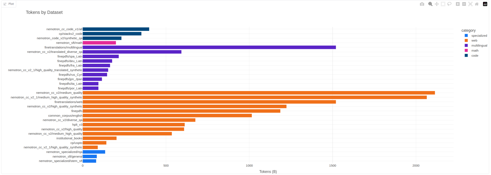
:::


(cs336-14-section-045)=
## MinHash

:::{slide}
:label: cs336-14-045-output-001
:at: 0
The Pile 

[Gao+ 2020](https://arxiv.org/pdf/2101.00027.pdf)
:::

:::{slide}
:label: cs336-14-045-output-002
:at: 1
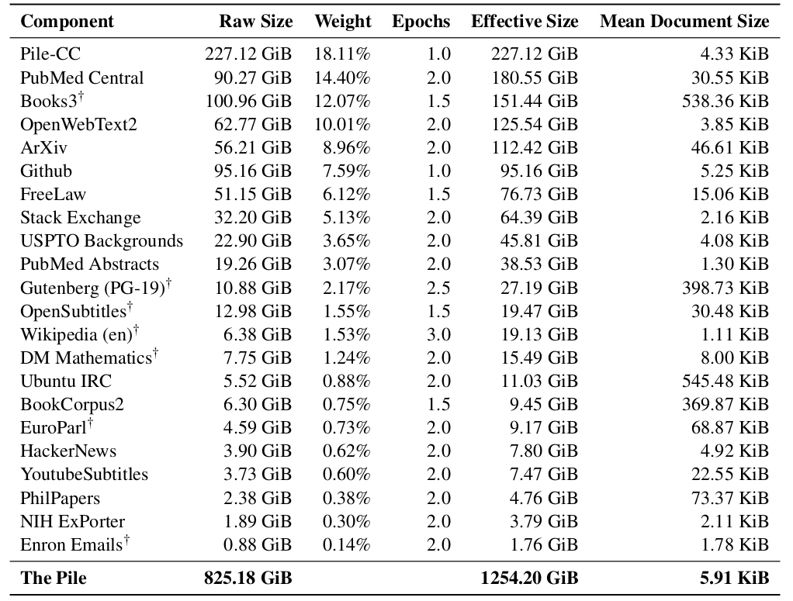
:::

:::{slide}
:label: cs336-14-045-output-003
:at: 2
Key question: what distribution over the data sources should we use?
:::

:::{slide}
:label: cs336-14-045-output-004
:at: 3
Example:
:::

:::{slide}
:label: cs336-14-045-output-005
:at: 4
Baselines:
:::


(cs336-14-section-046)=
## MinHash

:::{slide}
:label: cs336-14-046-output-001
:at: 0
- Vibes: set p(s) manually based on intuition (quite common)
:::

:::{slide}
:label: cs336-14-046-output-002
:at: 1
- Uniform sampling: sample uniformly (p(s) ∝ 1)
:::

:::{slide}
:label: cs336-14-046-output-003
:at: 2
- Proportional mixing: sample proportional to the number of tokens in a source (p(s) ∝ num_tokens(s))
:::

:::{slide}
:label: cs336-14-046-output-004
:at: 3
Intuition: should upweight higher quality sources
:::

:::{slide}
:label: cs336-14-046-output-005
:at: 4
However...
:::


(cs336-14-section-047)=
## MinHash

:::{slide}
:label: cs336-14-047-output-001
:at: 0
1. We want to ensure diversity (e.g., across incomparable sources: literature, code, papers)
:::

:::{slide}
:label: cs336-14-047-output-002
:at: 1
2. Each source is finite, so if put too much weight on a small source, then need to epoch over it
:::

:::{slide}
:label: cs336-14-047-output-003
:at: 2
This last point is important and a bit subtle.
:::

:::{slide}
:label: cs336-14-047-output-004
:at: 3
Example:
:::

:::{slide}
:label: cs336-14-047-values-005
:at: 4
| Variable | Value |
| --- | --- |
| `low_num_epochs` | 0.05 |
:::


(cs336-14-section-048)=
## MinHash

:::{slide}
:label: cs336-14-048-values-001
:at: 0
| Variable | Value |
| --- | --- |
| `low_num_epochs` | 0.05 |
| `high_num_epochs` | 50.0 |
:::

:::{slide}
:label: cs336-14-048-output-002
:at: 1
50x epochs on high quality data...can lead to overfitting!
:::

:::{slide}
:label: cs336-14-048-output-003
:at: 2
UniMax 

[Chung+ 2023](https://arxiv.org/abs/2304.09151)
:::

:::{slide}
:label: cs336-14-048-output-004
:at: 3
- Setting: balancing different languages for multilingual models
:::

:::{slide}
:label: cs336-14-048-output-005
:at: 4
- Previous work: between uniform and proportional mixing (p(s) ∝ num_tokens(s)^α for α in [0, 1])
:::


(cs336-14-section-049)=
## MinHash

:::{slide}
:label: cs336-14-049-output-001
:at: 0
- Idea: sample sources uniformly but with a hard **cap** C on number of epochs for any source
:::

:::{slide}
:label: cs336-14-049-values-002
:at: 0
| Variable | Value |
| --- | --- |
| `low_num_epochs` | 0.05 |
| `high_num_epochs` | 50.0 |
:::

:::{slide}
:label: cs336-14-049-output-003
:at: 1
- Specifically, p(s) * num_training_tokens ≤ C for all sources s
:::

:::{slide}
:label: cs336-14-049-output-004
:at: 2
Regression-based mixing 

[Liu+ 2024](https://arxiv.org/abs/2407.01492)

[Chen+ 2026](https://arxiv.org/pdf/2602.12237)
:::

:::{slide}
:label: cs336-14-049-output-005
:at: 3
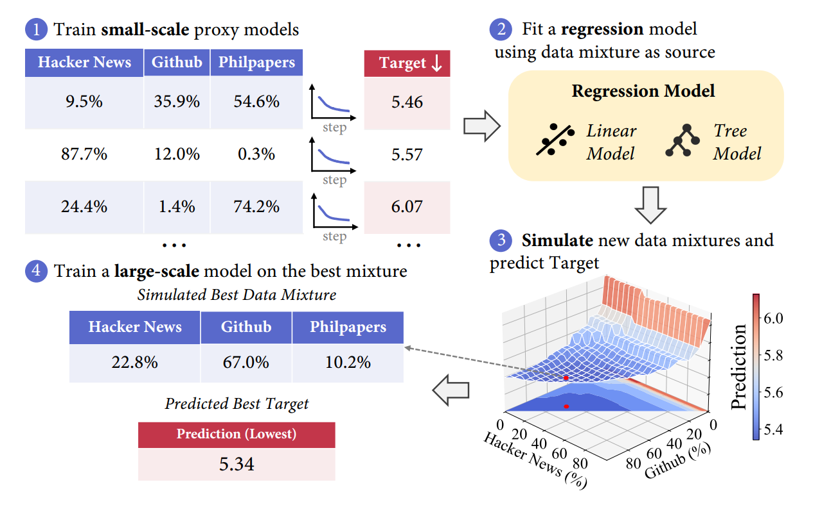
:::

:::{slide}
:label: cs336-14-049-output-006
:at: 4
- Define distribution over mixtures `p` (e.g., Dirichlet)
:::


(cs336-14-section-050)=
## MinHash

:::{slide}
:label: cs336-14-050-output-001
:at: 0
- Define regression method (e.g., linear, gradient boosted trees)
:::

:::{slide}
:label: cs336-14-050-values-002
:at: 0
| Variable | Value |
| --- | --- |
| `low_num_epochs` | 0.05 |
| `high_num_epochs` | 50.0 |
:::

:::{slide}
:label: cs336-14-050-output-003
:at: 1
- Define target based on downstream evals (careful not to overfit!)
:::

:::{slide}
:label: cs336-14-050-output-004
:at: 2
- Discrepancy between small and large scale (tradeoff cost and accuracy)
:::

:::{slide}
:label: cs336-14-050-output-005
:at: 3
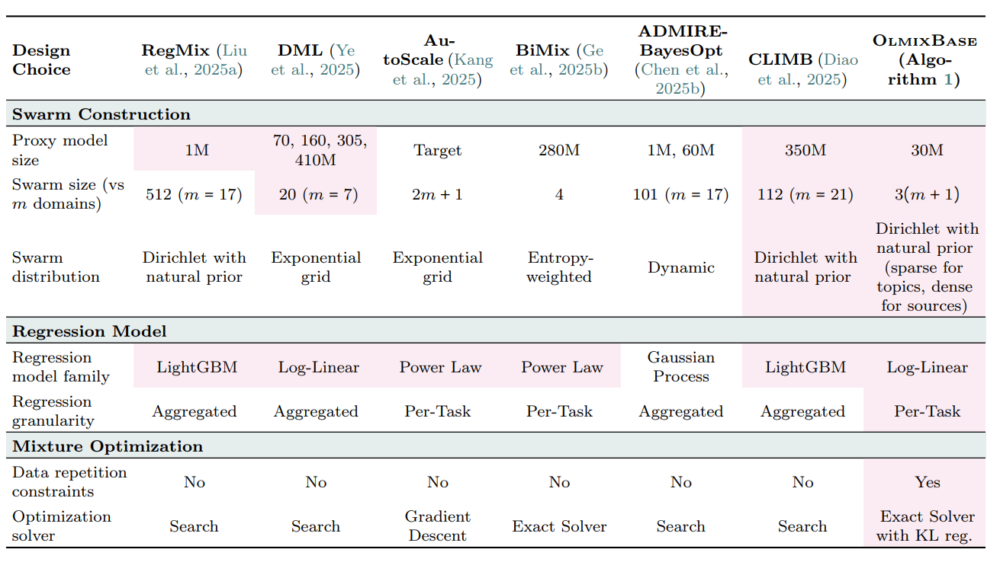
:::

:::{slide}
:label: cs336-14-050-output-006
:at: 4
Hope 1: regression model is accurate at minimizer 🙏
:::


(cs336-14-section-051)=
## MinHash

:::{slide}
:label: cs336-14-051-output-001
:at: 0
Hope 2: optimal data mixtures transfer from small to large scale 🙏
:::

:::{slide}
:label: cs336-14-051-values-002
:at: 0
| Variable | Value |
| --- | --- |
| `low_num_epochs` | 0.05 |
| `high_num_epochs` | 50.0 |
:::

:::{slide}
:label: cs336-14-051-output-003
:at: 1
Hold on. There's at least one scale-dependent effect:
:::

:::{slide}
:label: cs336-14-051-output-004
:at: 2
- If train small models on low token counts:
:::

:::{slide}
:label: cs336-14-051-output-005
:at: 3
- But if train large model on this mixture, we will epoch a ton on high quality data and overfit!
:::

:::{slide}
:label: cs336-14-051-output-006
:at: 4
Simulated epoching 

[Held+ 2025](https://arxiv.org/pdf/2501.11747)
:::


(cs336-14-section-052)=
## MinHash

:::{slide}
:label: cs336-14-052-output-001
:at: 0
- General idea: make small scale look like large scale (general theme of this course)
:::

:::{slide}
:label: cs336-14-052-values-002
:at: 0
:until: 2
| Variable | Value |
| --- | --- |
| `low_num_epochs` | 0.05 |
| `high_num_epochs` | 50.0 |
:::

:::{slide}
:label: cs336-14-052-output-003
:at: 1
- Instantiation: downsample all sources proportionally
:::

:::{slide}
:label: cs336-14-052-values-004
:at: 2
:until: 3
| Variable | Value |
| --- | --- |
| `low_num_epochs` | 0.05 |
| `high_num_epochs` | 50.0 |
| `ratio` | 0.01 |
:::

:::{slide}
:label: cs336-14-052-values-005
:at: 4
| Variable | Value |
| --- | --- |
| `low_num_epochs` | 0.05 |
| `high_num_epochs` | 50.0 |
| `ratio` | 0.01 |

**`downsampled_source_token_counts`**

```python
{'low': 100000000000.0, 'high': 100000000.0}
```

:::

:::{slide}
:label: cs336-14-052-output-006
:at: 5
- In this downsampled mixture, models that epoch too much won't look good.
:::


(cs336-14-section-053)=
## MinHash

:::{slide}
:label: cs336-14-053-output-001
:at: 0
- So the optimum will be more balanced.
:::

:::{slide}
:label: cs336-14-053-values-002
:at: 0
:until: 5
| Variable | Value |
| --- | --- |
| `low_num_epochs` | 0.05 |
| `high_num_epochs` | 50.0 |
| `ratio` | 0.01 |

**`downsampled_source_token_counts`**

```python
{'low': 100000000000.0, 'high': 100000000.0}
```

:::

:::{slide}
:label: cs336-14-053-output-003
:at: 1
Summary:
:::

:::{slide}
:label: cs336-14-053-output-004
:at: 2
- Problem: how to weight different data sources (e.g., Wikipedia, general, code)
:::

:::{slide}
:label: cs336-14-053-output-005
:at: 3
- Regression-based mixing: estimate mixture → loss at small scale, optimize (analogous to scaling laws)
:::

:::{slide}
:label: cs336-14-053-output-006
:at: 4
- Important consideration: epoching and overfitting (solution: cap or simulated)
:::


(cs336-14-section-054)=
## MinHash

:::{slide}
:label: cs336-14-054-output-001
:at: 0
Recipe:
:::

:::{slide}
:label: cs336-14-054-output-002
:at: 1
1. Define a set of environments
:::

:::{slide}
:label: cs336-14-054-output-003
:at: 2
2. Define a set of tasks / prompts
:::

:::{slide}
:label: cs336-14-054-output-004
:at: 3
3. Collect responses from a strong model (teacher)
:::

:::{slide}
:label: cs336-14-054-output-005
:at: 4
OpenThoughts 

[Guha+ 2025](https://arxiv.org/abs/2506.04178)
:::


(cs336-14-section-055)=
## MinHash

:::{slide}
:label: cs336-14-055-output-001
:at: 0
- 1.2M examples using QwQ-32B as a teacher
:::

:::{slide}
:label: cs336-14-055-output-002
:at: 1
- Questions come from 27 human and synthetic sources (e.g., StackExchange, NuminaMath, Chemistry)
:::

:::{slide}
:label: cs336-14-055-output-003
:at: 2
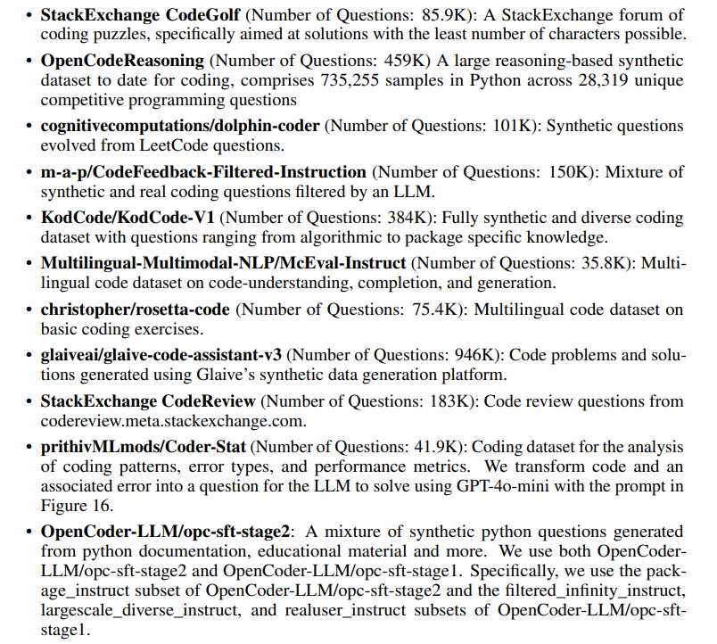
:::

:::{slide}
:label: cs336-14-055-output-004
:at: 3
- Sampling multiple (16) responses per prompt is helpful
:::

:::{slide}
:label: cs336-14-055-output-005
:at: 4
- Better models aren't necessarily better teachers: QwQ-32B is a better teacher than DeepSeek-R1
:::


(cs336-14-section-056)=
## MinHash

:::{slide}
:label: cs336-14-056-output-001
:at: 0
- Answer filtering wasn't helpful
:::

:::{slide}
:label: cs336-14-056-output-002
:at: 1
- Smaller high quality sources (e.g., OpenMath-2-Math) is better than large diverse sources
:::

:::{slide}
:label: cs336-14-056-output-003
:at: 2
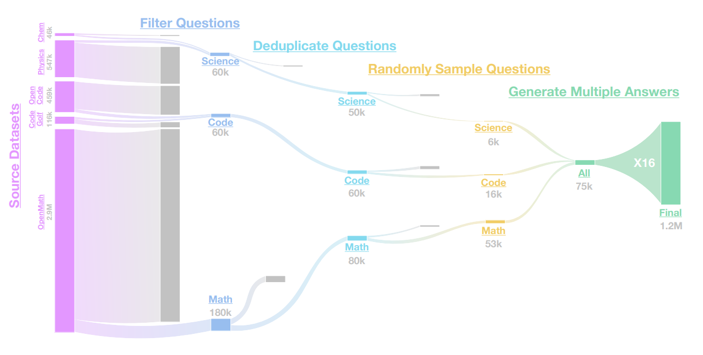
:::

:::{slide}
:label: cs336-14-056-output-004
:at: 3
SWE-smith 

[Yang+ 2025](https://arxiv.org/abs/2504.21798)
:::

:::{slide}
:label: cs336-14-056-output-005
:at: 4
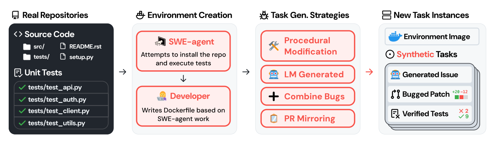
:::


(cs336-14-section-057)=
## MinHash

:::{slide}
:label: cs336-14-057-output-001
:at: 0
- Given a repository, use LM to generate tasks (introduce bugs with LM)
:::

:::{slide}
:label: cs336-14-057-output-002
:at: 1
- 128 GitHub repositories yields 50K tasks
:::

:::{slide}
:label: cs336-14-057-output-003
:at: 2
SWE-Zero

[Ludwig+ 2026](https://arxiv.org/abs/2604.01496)
:::

:::{slide}
:label: cs336-14-057-output-004
:at: 3
- SWE tasks have heavy dependencies (unlike math or coding contests)
:::

:::{slide}
:label: cs336-14-057-output-005
:at: 4
- Setting up thousands of Docker images is an infrastructural nightmare
:::


(cs336-14-section-058)=
## MinHash

:::{slide}
:label: cs336-14-058-output-001
:at: 0
- Observation: strong models can solve many tasks without execution feedback
:::

:::{slide}
:label: cs336-14-058-output-002
:at: 1
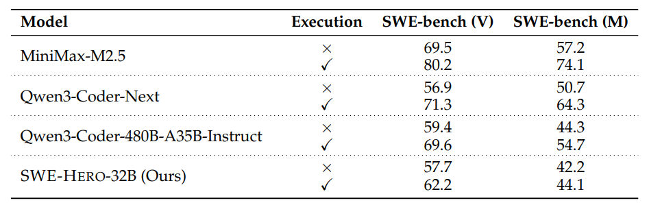
:::

:::{slide}
:label: cs336-14-058-output-003
:at: 2
Key: strong models have internal "world model" of code semantics
:::

:::{slide}
:label: cs336-14-058-output-004
:at: 3
- SWE-Zero: 300K agent trajectories that don't require repository-specific execution
:::

:::{slide}
:label: cs336-14-058-output-005
:at: 4
- 150K GitHub PRs
:::


(cs336-14-section-059)=
## MinHash

:::{slide}
:label: cs336-14-059-output-001
:at: 0
- OpenHands scaffold, remove future git commits to prevent "git hacking" by agent
:::

:::{slide}
:label: cs336-14-059-output-002
:at: 1
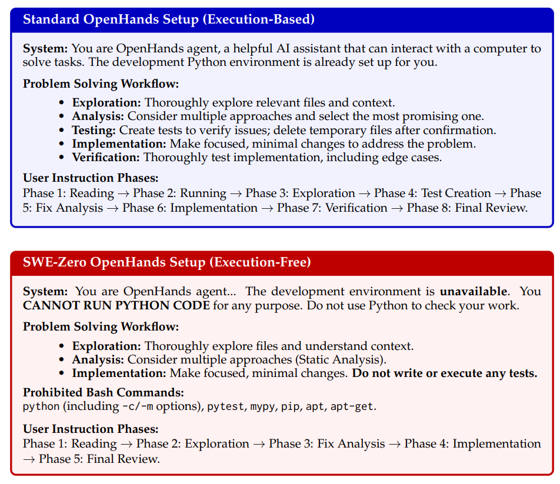
:::

:::{slide}
:label: cs336-14-059-output-003
:at: 2
- Distilled from Qwen3-Coder-480B + filtering (try to execute anyway)
:::

:::{slide}
:label: cs336-14-059-output-004
:at: 3
- SWE-Hero: 13K agent trajectories that do require execution feedback
:::

:::{slide}
:label: cs336-14-059-output-005
:at: 4
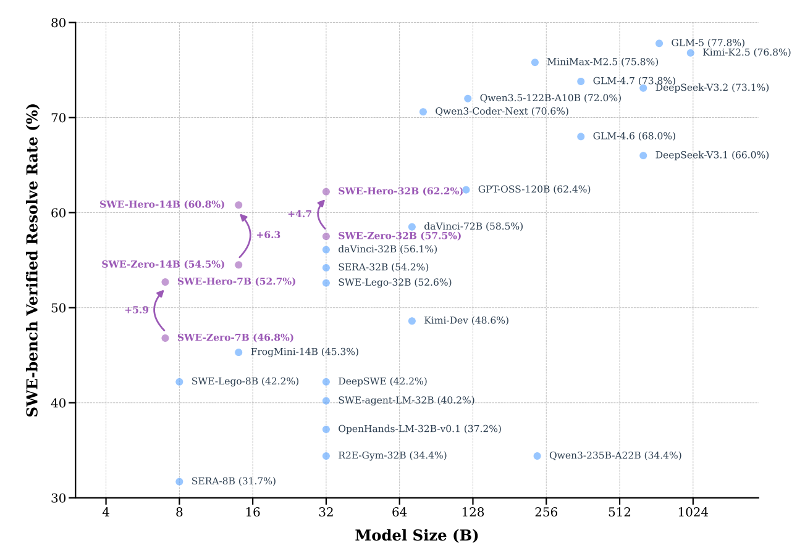
:::


(cs336-14-section-060)=
## MinHash

:::{slide}
:label: cs336-14-060-output-001
:at: 0
SWE-rebench 

[Badertdinov+ 2025](https://arxiv.org/pdf/2505.20411)
:::

:::{slide}
:label: cs336-14-060-output-002
:at: 1
- 21K interactive Python SWE tasks from 3.4K GitHub repositories
:::

:::{slide}
:label: cs336-14-060-output-003
:at: 2
- 450K PRs from GitHub and GitHub Archive
:::

:::{slide}
:label: cs336-14-060-output-004
:at: 3
- Used Qwen 2.5-72B-Instruct to install dependencies and assess PR quality
:::

:::{slide}
:label: cs336-14-060-output-005
:at: 4
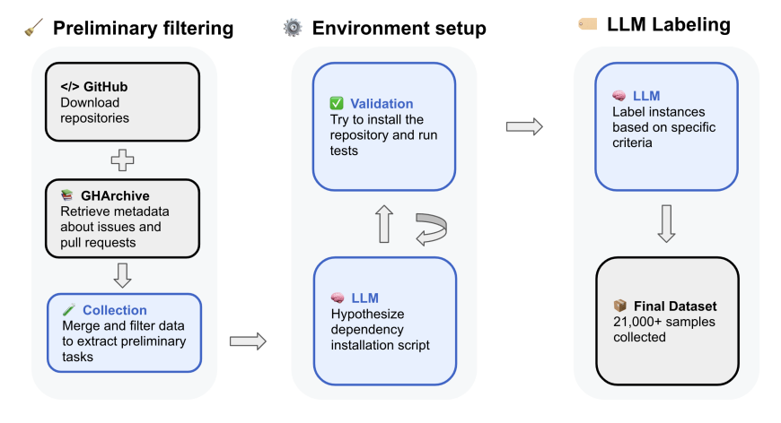
:::


(cs336-14-section-061)=
## MinHash

:::{slide}
:label: cs336-14-061-output-001
:at: 0
SWE-ZERO-12M-trajectories 

[data](https://huggingface.co/datasets/AlienKevin/SWE-ZERO-12M-trajectories)
:::

:::{slide}
:label: cs336-14-061-output-002
:at: 1
- Scale SWE-Zero up to 12M agent trajectories
:::

:::{slide}
:label: cs336-14-061-output-003
:at: 2
- Used the SWE-rebench-v2 tasks (32K executable tasks + 120K nonexecutable tasks)
:::

:::{slide}
:label: cs336-14-061-output-004
:at: 3
- Ran mini-coder-1.7b (very small model, 50.4 pass@100), mini-swe-agent scaffold
:::

:::{slide}
:label: cs336-14-061-output-005
:at: 4
- [Example](https://huggingface.co/datasets/AlienKevin/SWE-ZERO-12M-trajectories/viewer/default/train?row=5&conversation-viewer=0)
:::


(cs336-14-section-062)=
## MinHash

:::{slide}
:label: cs336-14-062-output-001
:at: 0
Summary:
:::

:::{slide}
:label: cs336-14-062-output-002
:at: 1
- Generating prompts: fully-synthetic, semi-synthetic (real environment + synthetic tasks), real (GitHub PRs)
:::

:::{slide}
:label: cs336-14-062-output-003
:at: 2
- Responses: from capable models (that are also good teachers)
:::

:::{slide}
:label: cs336-14-062-output-004
:at: 3
- Code environments are painful
:::

:::{slide}
:label: cs336-14-062-output-005
:at: 4
- Lots of filtering and other details
:::


(cs336-14-section-063)=
## MinHash

:::{slide}
:label: cs336-14-063-output-001
:at: 0
Summary:
:::

:::{slide}
:label: cs336-14-063-output-002
:at: 1
- Filtering: train classifier (language id, quality, toxicity) for what good looks like
:::

:::{slide}
:label: cs336-14-063-output-003
:at: 2
- Deduplication: hashing scales to large datasets for fuzzy matching
:::

:::{slide}
:label: cs336-14-063-output-004
:at: 3
- Mixing: try mixtures at small scale, extrapolate to optimal mixture and large scale
:::

:::{slide}
:label: cs336-14-063-output-005
:at: 4
- Applications: language identification, quality filtering, toxicity filtering
:::


(cs336-14-section-064)=
## MinHash

:::{slide}
:label: cs336-14-064-output-001
:at: 0
- Post-training data: looks like evaluations, use of synthetic data
:::

:::{slide}
:label: cs336-14-064-output-002
:at: 1
- A lot of data work is domain-specific, looking at examples, etc.
:::

