(cs336-16-cover)=
# Lecture 16: Post-training II: reinforcement learning from verifiable rewards

Stanford CS336 · Language Modeling from Scratch · Spring 2026.

(cs336-16-page-001)=

## Lecture 16

- P O ST T R A ININ G 2 R E INFO R C E ME NT LE A R NIN G FRO M V ER I FIA BLE R E WA R D S

CS336

(cs336-16-page-002)=

## The class thus far

Pre-training + RLHF gets you to ~ GPT3.5… **Today we’ll get all the way to o1/r1**

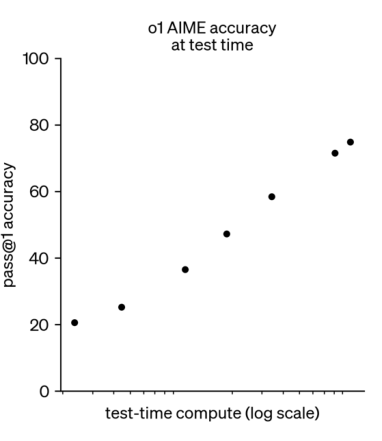

(cs336-16-page-003)=

## The goal – expand the scope and power of RL

With RLHF: we can’t cleanly scale out due to overoptimization

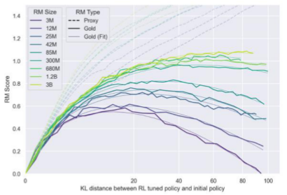

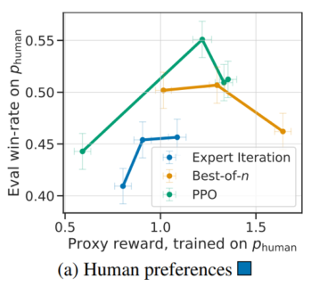

Can we work in domains where RL excels? Where we optimize _exactly_ what we want

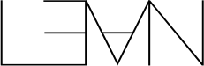

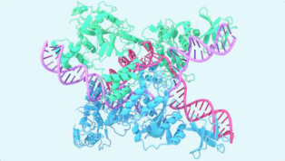

(cs336-16-page-004)=

## The lecture today

**1. Core algorithms..**

PPO → GRPO GRPO variants

**2. Case studies**

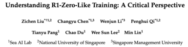

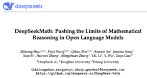

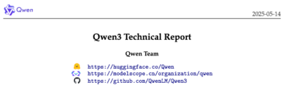

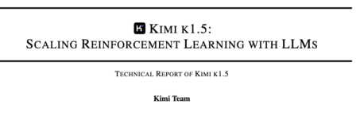

(cs336-16-page-005)=

## Recap: PPO in theory

**A brief (and high level) intro to the various ideas in PPO..**

**Attempt 1** : Policy gradients (variances are too high)

∇ 𝐸 𝑅𝑧 = 𝐸
𝜃 𝑝 𝜃 𝑝 𝜃 [R(z)∇ 𝜃 log 𝑝 𝜃 𝑧]

**Attempt 2** : TRPO (Linearize the problem around the current policy)

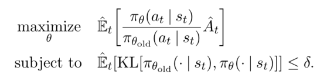

**Attempt 3:** PPO (Clip the ratios at some eps)

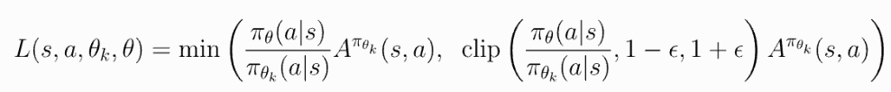

(cs336-16-page-006)=

## PPO

Policy gradient method for optimizing rewards in actual RL tasks..

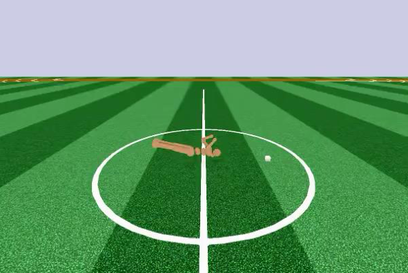

From the PPO announcement blog (2017) OpenAI Five (2019)

(cs336-16-page-007)=

## PPO – at a conceptual level

The objective is basically all there is to it at a conceptual level

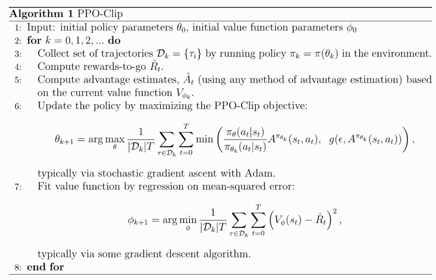

[From - https://spinningup.openai.com/en/latest/algorithms/ppo.html]

(cs336-16-page-008)=

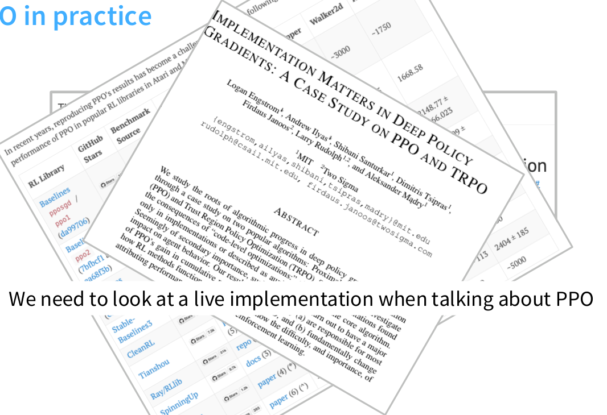

(cs336-16-page-009)=

## PPO – idealization (?) for language models

In the language model setting..

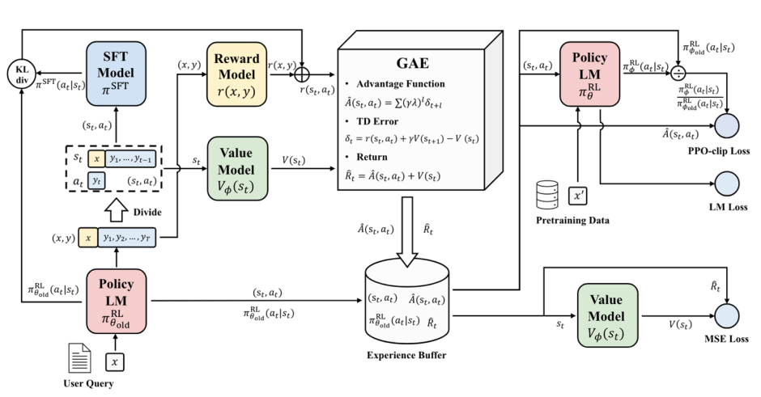

Pretty similar to the RL formulation. Actions operate over tokens, big dense reward at the very end operating on full sequence

[From Zheng et al 2023]

(cs336-16-page-010)=

## PPO – let’s look at an implementation

Implementation – AlpacaFarm’s PPO

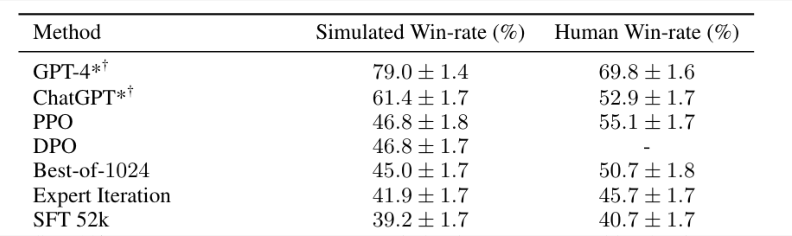

Used by several others to reasonable success

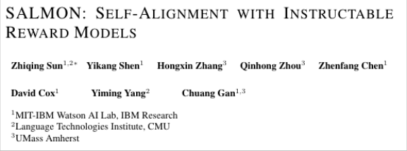

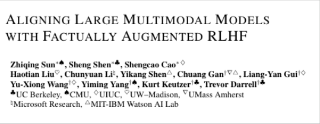

(cs336-16-page-011)=

## PPO in practice

PPO outer loop. Invoke an inner loop to optimize the loss over some rollouts.

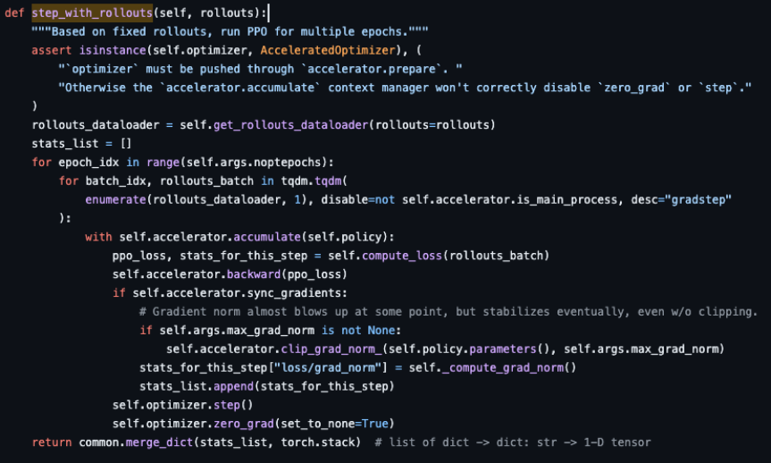

https://github.com/tatsu-lab/alpaca_farm/blob/30717ddae735365de756ee2085191b491a71788d/src/alpaca_farm/rl/ppo_trainer.py

(cs336-16-page-012)=

## PPO in practice – loss computation

AlpacaFarm code – loss computation. Pretty standard stuff.

Cliprange=0.2

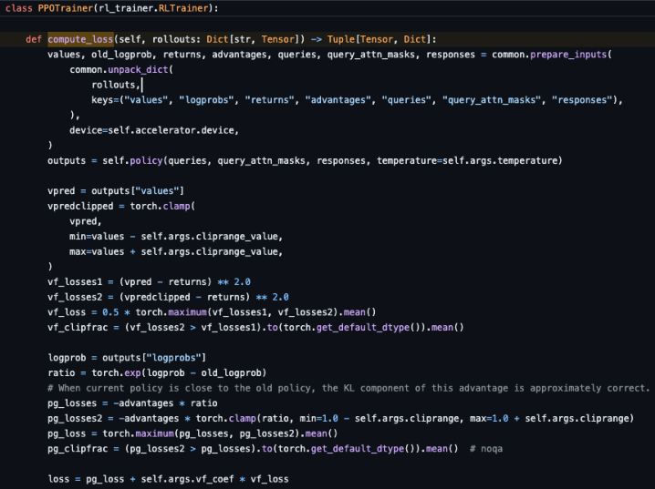

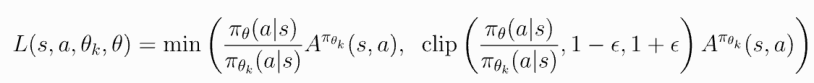

(cs336-16-page-013)=

## PPO in practice – rollouts.

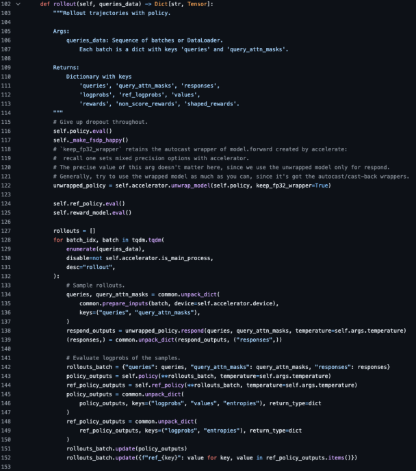

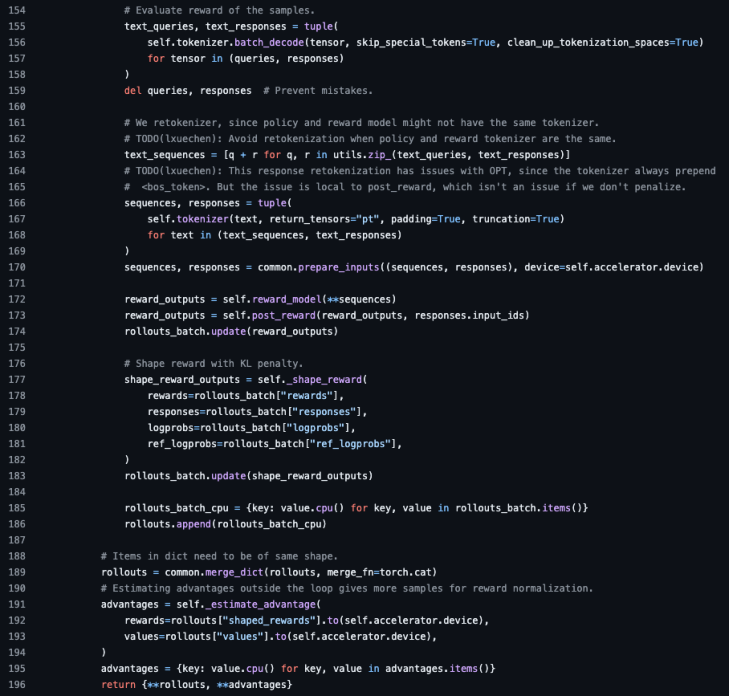

(cs336-16-page-014)=

## PPO in practice – reward shaping

**High level** – add per-token KL penalty, last-token full reward

**In practice?** Clip KL for sequences where new policy logp < reference logp

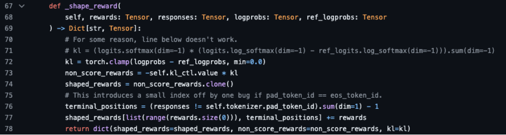

Helps with stability? If we blow up our model, this prevents kl from diverging

(cs336-16-page-015)=

## PPO in practice – generalized advantage estimate

Instead of reward, we use advantages

where

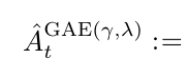

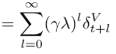

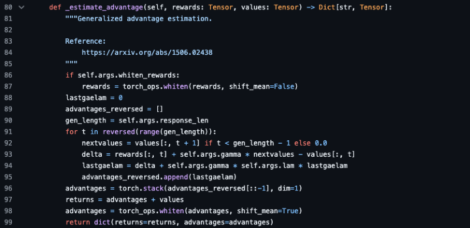

Funny detail – this is a bandit problem and gamma=lambda=1 works – this is the reward-to-go vs the value

(cs336-16-page-016)=

## What do you expect to see in PPO?

Increasing overall rewards Incl. reward model Negative KL rewards

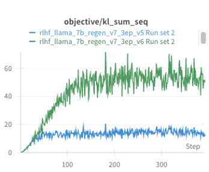

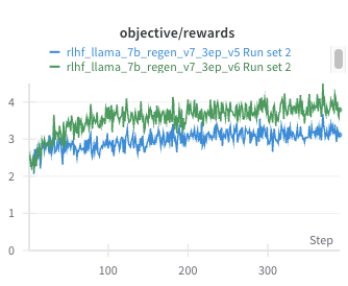

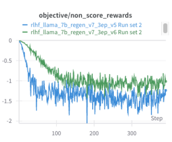

This is a bandit setting, you expect reasonable training curves

(cs336-16-page-017)=

## Why do we need yet another RL algorithm..?

**Why not PPO?**

In practice, complicated implementation

Value model (memory hungry, involves additional tuning for training)

**Why not DPO?**

Data not inherently pairwise (or in the form of Bradley-terry comparisons)

Offline (though could be made online by iterating)

(cs336-16-page-018)=

## New kid on the block: GRPO

**What’s GRPO?**

Start with PPO (many parts are similar)

Remove the value function / advantage computation

Calculate the advantage as “z-score within group”

(PPO for reference)

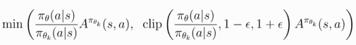

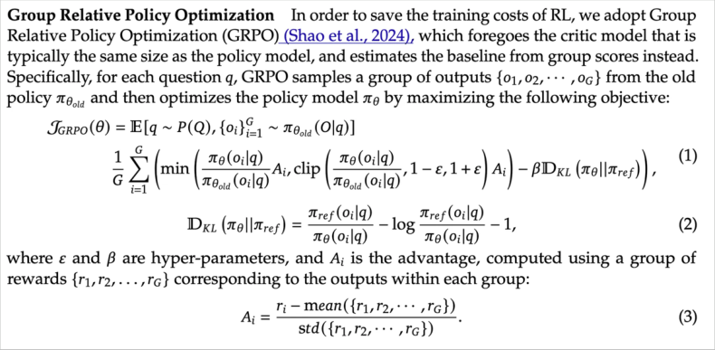

**In the** _**online**_ **case (rollout+immediate update), this is just policy gradient with group normalized rewards**

(cs336-16-page-019)=

## GRPO is very simple (thanks to lack of value function..)

**You can** (and people do) write tiny GRPO

implementations

Compute reward for each rollout

Mean/Var normalization per group

Compute KL term

Gradient updates on the loss

We can walk through this example from

https://github.com/McGill-NLP/nano-aha-moment

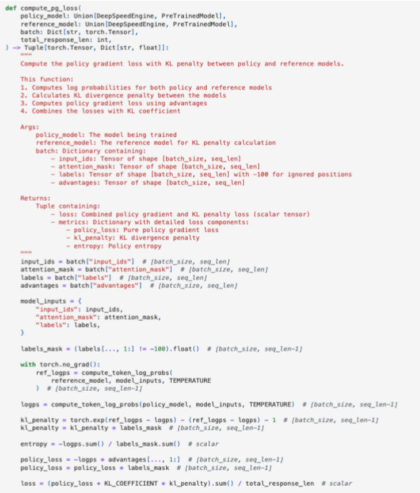

(cs336-16-page-020)=

## Advantage computation is also very simple..

Basically just the ‘vanilla’ GRPO setup.

Main difference here is just the 1e-4

stability factor in the std calculation

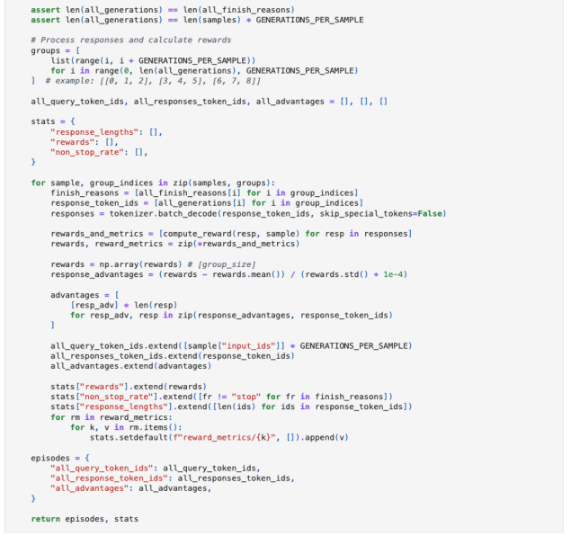

(cs336-16-page-021)=

## How well does it work?

**GRPO from the original paper**

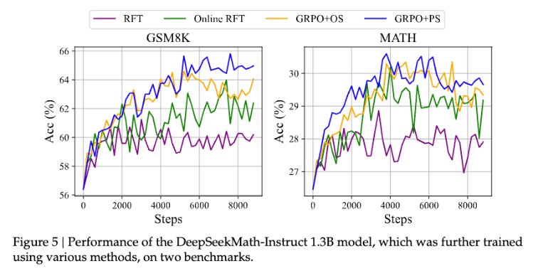

Outperforms RFT (reinforcing correct answers),

with some gains from process supervision

We will get back to this later..

(cs336-16-page-022)=

## Thinking carefully about the GRPO objective..

The key difference in GRPO vs PPO: the advantage

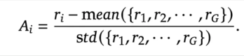

Is this good? A minor RL detour..

**Baselining** : We can

subtract any statedependent term from our

rewards

Sutton and Barto

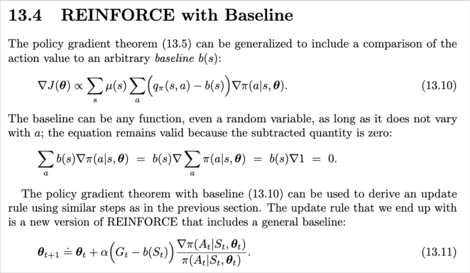

(cs336-16-page-023)=

## GRPO doesn’t use a “valid” baseline

The division by the stdev term is not a valid baseline that preserves unbiasedness.

What is an unbiased-gradient version of GRPO?

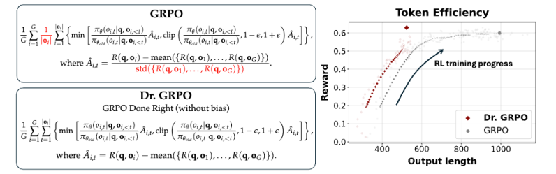

Also note the modification on the length-normalizer term on the left..

Liu et al 2025. (this gets pretty close to reinforce w/ leave-one-out)

(cs336-16-page-024)=

## Length biases of GRPO

What do these terms do? **Stdev** – upweights too easy or hard questions.

**Length normalization:**

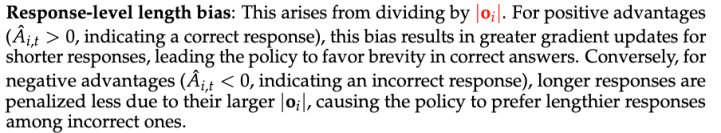

**What does the fix do?**

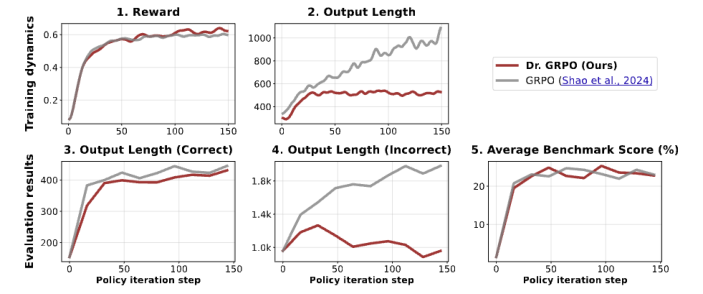

(cs336-16-page-025)=

## Case studies

Let’s look at a few representative open models with RLVR.

Deepseek R1
Central to many recent RLVR efforts
Lots of interesting details

Kimi K1.5

Contemporaneous to R1, RLVR
Complementary details to R1

Qwen 3
Most recent open reasoning model attempt
Low-data RLVR

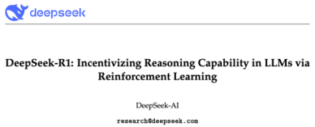

(cs336-16-page-026)=

## Deepseek R1

The paper that launched a bit of a social phenomenon..

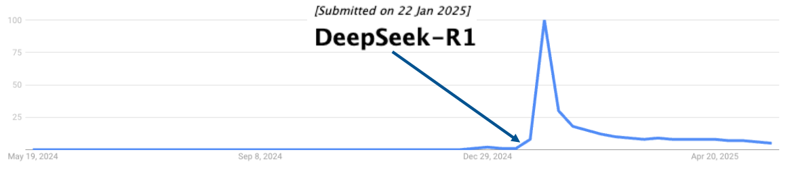

**What’s remarkable about R1?**

Performance exceeding OpenAI O1

Open RL recipe (that is also pretty simple)

Ended speculations on the necessity of MCTS/PRMs

SFT insights (both R1-zero and distil-r1)

(cs336-16-page-027)=

## Algorithm - GRPO

They build on the results of GRPO from DeepSeekMath..

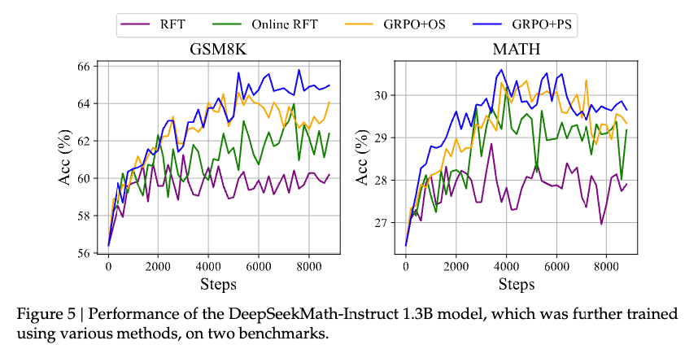

But they do not use process supervision in R1 (more on this later..)

(cs336-16-page-028)=

## Controlled setting – R1 zero.

**Setup:**

**Rewards**

Accuracy rewards (is it correct?)

Format rewards (use thinking tags)

**Data** (not public)

**Base model** : Deepseek-V3

**Results:** a bit worse than Openai O1

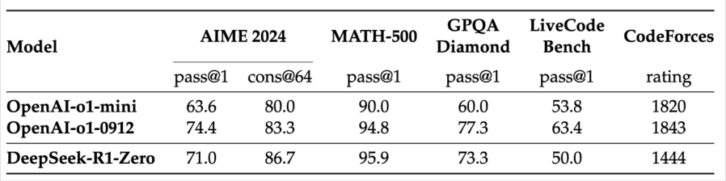

(cs336-16-page-029)=

## Interesting phenomena (?)

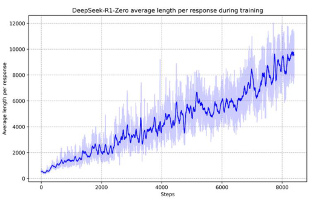

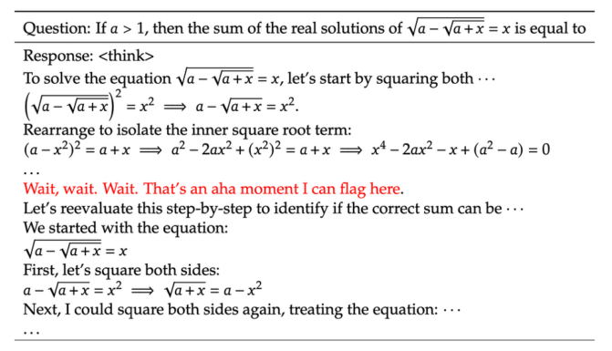

**Longer CoTs during training** **‘aha’ moment?**

(cs336-16-page-030)=

## But maybe a bit overstated

From some follow-up analyses in Dr. GRPO..

Length due to biased objective? Base model already has ‘aha’

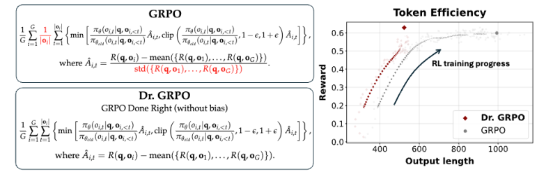

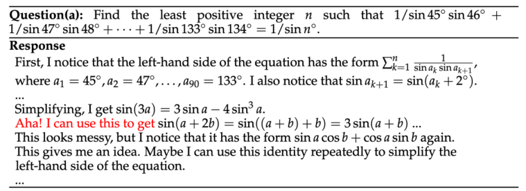

(cs336-16-page-031)=

## Pushing performance further – R1

**R1 vs R1-zero**

**Key differences:**

SFT initialization

Language consistency reward for CoT

Non-verifiable rewards (in stage 2)

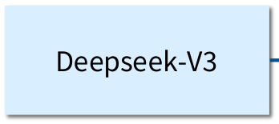

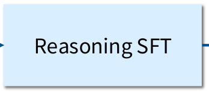

(cs336-16-page-032)=

## SFT initialization..

Start with plain ol (long) CoT, then maybe additional verification (vague) 
- Claimed Benefit : interpretability 
- Note : Origins on the data not quite clear..

(cs336-16-page-033)=

## SFT for reasoning / math..

Even a small number of samples is effective for bootstrapping reasoning from LMs

1k Math and science questions + Long CoTs from Gemini / r1

(cs336-16-page-034)=

## RL step

**The RL part is basically the same..**

Minor difference: additional language consistency loss

The note on language switching is interesting.. RL naturally leads to mixed languages?

(cs336-16-page-035)=

## SFT/RLHF

The usual post-training process happens _after_ RLVR / reasoning RL.

**SFT step, 2 epochs.**

Reasoning data – non-verifiable tasks (‘write a proof of X’), use V3 as a judge (600k)

Non-reasoning data – V3 SFT dataset (200k)

**RLHF step**

Re-use R1-zero style reasoning RLHF in here

Non-verifiable tasks - V3 RLHF pipeline. Still uses GRPO (for RLHF)

(cs336-16-page-036)=

## How well does R1 work?

It’s pretty good (but you knew that)

(cs336-16-page-037)=

## Distillation – can we get non-reasoning models to reason?

**Pipeline**

Have R1 generate CoT traces (800k!)

Teach Qwen 2.5 via distillation

(cs336-16-page-038)=

## Other, relevant observations

**There is a whole unsuccessful attempts section**

PRMs** (PRM800k, DeepseekMath) **MCTS

(cs336-16-page-039)=

## Kimi K1.5

**Why do we study this one?**

Released at the same time as R1

Also beats o1 using RL

(cs336-16-page-040)=

## Long COT reasoning strategy

**Key steps**

Dataset construction (difficulty filtering)

SFT (for long COT)

RL (with their own policy gradient loss)

(cs336-16-page-041)=

## Data curation + SFT

**Data curation**

Standard curation across math-style settings, balancing topics

Exclude multiple choice / true false (false positives)

Select only examples that models fail on best-of-8

**SFT –** little description, just described as ‘prompt engineering’ (distillation?)

(cs336-16-page-042)=

## Kimi RL

**In kimi –** reference based reward model, so the optimization problem is

**RL algorithm** inspired by DPO-type derivation.

(Nonparametric assumption + solve for r)

Use squared loss as a surrogate
**Baselined policy gradient w/ regularization**

(cs336-16-page-043)=

## Length control in Kimi

**The kimi objective doesn’t have the same GRPO length bias problem.**

.. But they want to further compress the CoTs.

For each batch, they have a _length reward_

**How should I interpret this?**

The lambda is in [0.5, -0.5], with longer sequences in a group being negative

Correct answers are incentivized to be short

Incorrect answers are incentivized to be shorter than the center of the range of rollouts

(They also only enable this later on in traning, due to its effects on perf)

(cs336-16-page-044)=

## Additional details

**Curriculum**

Assign difficulty labels to dataset, go from easy to hard

Sample problems proportional to (1-success_rate) to avoid repeating solved ones

**Rewards**

For code – take problems with ground truth solutions, generate new test cases

For math – 800k samples to train a CoT reward model for answer equivalence checks

(cs336-16-page-045)=

## RL Infra

Systems and utilization aspects of RL are very important.

**Why is RL hard to make efficient?**

On policy = rollouts, which means (slow) inference

Switching from training to rollouts often means different frameworks

Long CoTs can make batches very uneven.

(cs336-16-page-046)=

## Kimi’s RL setup in detail

(cs336-16-page-047)=

## Scaling results

We already know this roughly matches / beats o1. Other interesting results..

For a small model on just the math data

(cs336-16-page-048)=

## Ablation / comparison to expert iteration

Could we avoid RL-style negative gradients and just learn from positives?

(cs336-16-page-049)=

## Final case study – Qwen 3

Better than o1 and R1 (though comes later)

.. But interesting scaling and data results

(cs336-16-page-050)=

## Overall picture

RLHF comes _after_ reasoning RL (like r1), distillation after that.

(cs336-16-page-051)=

## SFT + Reasoning RL

We know the playbook by now, and Qwen uses a lot of this..

Filtering for difficulty (by best-of-n, like kimi)

-
Remove things that the model gets right w/o CoT

-
Remove things too similar to validation data

Manual filtering for the quality of CoTs (guessing vs getting it right)

RL with GRPO on **only 3995 examples**

(cs336-16-page-052)=

## Qwen 3 specific new stuff.

**Thinking mode fusion –** controlling the length of the CoT.

1. Mix non-thinking and thinking data with tags

2. Early stopping termination via a special string

(cs336-16-page-053)=

## Test time scaling

(cs336-16-page-054)=

## Composition of the different stages

Note that math/stem abilities go down (a bit) with general purpose RLHF

(cs336-16-page-055)=

## Agentic RL

**Qwen 3 Coder Next** – Built on Qwen 3 Next, posttrained for agentic abilities

(cs336-16-page-056)=

## Midtraining

Coding and other mid-training data sources

**Github**

Long-context “repository level” data (concat files) – 600 Billion tokens
Pull request (w/ RAG retrieved context of the repository state)

**Common crawl**

Joint text+code documents + LLM based parsing of HTML

**Synthetic data**
LM prompted QA for web documents about coding
Trajectories generated by running coding agents on various environments

**Instruction following / Fill-in-the-middle data**

(cs336-16-page-057)=

## Expert models

**Qwen 3 Next**

**Web dev expert**

**UX expert**

**Single-turn QA expert**

**SWE expert**

**Qwen 3 Next Coder**

Distillation

(cs336-16-page-058)=

## Web dev / UX / QA expert

**Web dev expert**

SFT on “valid web code” based on checks (VLM + agent actions)

**UX expert** (train on many tool formats)

**QA** (standard single turn code synthesis – just more data)

(cs336-16-page-059)=

## Agent environment construction

Automated SWE-bench style environment construction (800k tasks)

(cs336-16-page-060)=

## Agent RL

(cs336-16-page-061)=

## Recap for today

Overoptimization is a problem.. RL in narrow domains is one solution

GRPO is simple (but with some flaws), and enables RLVR

Lots of successful recipes in the wild (R1, Kimi 1.5, Qwen3)
