(cs336-17-cover)=
# Lecture 17: Multimodal models

Stanford CS336 · Language Modeling from Scratch · Spring 2026.

(cs336-17-topic-002)=
## Lecture 17: multimodal models

So far: language models

> text ⇒ text

The world is multimodal:

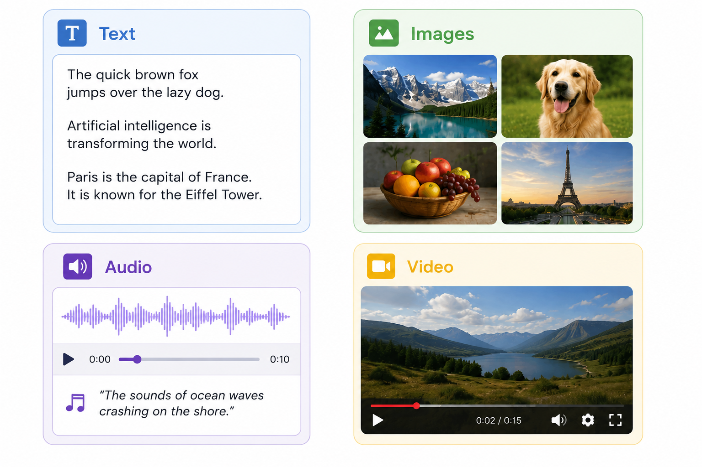

Ultimate goal: **omni model**

- Input any combination of modalities (understanding)
- Output any combination of modalities (generation)

Where we are today:

- Transformers work really well. So we gotta use them.
- Transformers speak tokens (discrete or continuous), where a token represents some ~semantic unit of information.
- Therefore, we must convert everything into tokens.
- Note: we had to do this with text (recall the tokenization lecture).
- For non-text modalities, this is more challenging...

Questions:

1. How do we input non-text data (e.g., understand images)?
2. How do we output non-text data (e.g., generate audio)?

(cs336-17-topic-003)=
## CLIP

CLIP (Contrastive Language-Image Pretraining) [Radford+ 2021](https://arxiv.org/abs/2103.00020)

Context:

- Computer vision models were trained on annotated images.
- Question: is it possible to leverage the much larger amount of (image, caption) pairs?

Method:

- Get a batch of (image, text) examples (e.g., 32768)
- Encode each image and each text
- For each image, prefer its aligned text over other texts
- For each text, prefer its aligned image over other images

Data:

- Searched for 500K queries, get ~20K (image, text) pairs per query
- Trained on 400M image-text pairs
- Didn't release the dataset
- Reproduced in OpenCLIP (using LAION-5B dataset, which used CLIP for filtering) [Cherti+ 2022](https://arxiv.org/abs/2212.07143)

Data processing [code](https://github.com/openai/CLIP/blob/main/clip/clip.py#L79)

- Images come in all resolutions (arbitrary W x H)
- Resize using bicubic interpolation so shorter side is 336 pixels
- Center crop (cuts off borders to get 336 x 336)

Vision encoder:

- Experimented with ResNet-50 and Vision Transformers [Dosovitskiy+ 2020](https://arxiv.org/pdf/2010.11929)

- Attention pooling: do QKV with query = global average of activations
- Best model: ViT-L/14@336px (L = large, 14x14 patches, 3 channels, trained on 336x336 resolution images)

Text encoder:

- GPT-2 Transformer (63M parameters, 12 layers)
- Encode [BOS] ... [EOS], return [EOS] activation at highest layer

Headline result:

- On ImageNet, zero-shot CLIP outperformed ResNet-50 trained on 1.2M ImageNet images

Ablation:

- Alternative: predict text from images directly
- Much less compute efficient compared to CLIP-style ranking

Summary:

- Encoding of images captures semantics given by (noisy) text
- Design decisions chosen based on image classification (not very fine-grained)
- Technical: requires large batch sizes, softmax operation over full batch

(cs336-17-topic-004)=
## SigLIP

SigLIP (Sigmoid Loss for Language Image Pre-Training) [Zhai+ 2023](https://arxiv.org/abs/2303.15343)

Objective:

- CLIP: multiclass classification for (text, image) versus (text, image') for all image'
- SigLIP: binary classification for (text, image) - aligned or not?

Data:

- WebLI dataset: O(billion) (image, text) pairs [Chen+ 2022](https://arxiv.org/pdf/2209.06794)
- Scraped from the Internet
- Used automatic OCR to extract text from images
- Keep 10% highest quality
- Supports 100 languages

Efficiency:

- CLIP: 10 days on 256 TPUv3
- SigLIP: 5 days on 32 TPUv4 (lower FLOP/s than TPUv3) - much faster!

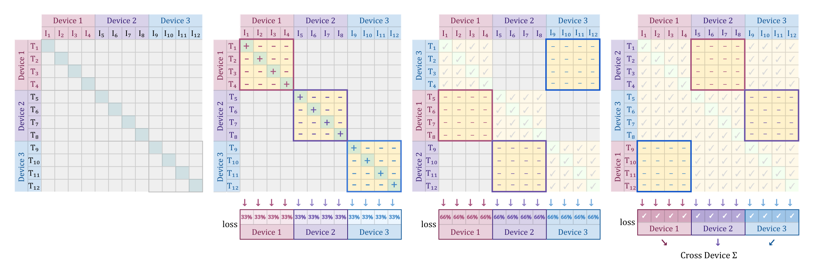

Batch size:

- Decouple batch size from loss
- Better than CLIP for <16K batch sizes
- Go up to 1M batch size, but 32K is enough

(cs336-17-topic-005)=
## LLaVA

LLaVA (Large Language and Vision Assistant) [Liu+ 2023](https://arxiv.org/abs/2304.08485)

Vision encoder: CLIP

Text decoder: Vicuna (LLaMA fine-tuned on ShareGPT conversations) [post](https://www.lmsys.org/blog/2023-03-30-vicuna/)

Data:

- MS COCO has images annotated with bounding boxes and Mechanical Turk captions
- Prompt GPT-4 with captions or detected objects and generate questions or conversations
- Pair generations with original images
- 158K examples

Model:

- Encode images with CLIP (ViT-L/14)
- Linear projection (W) into embedding space (Flamingo and Q-former are more complex)

Training:

- Stage 1 (alignment): freeze vision encoder and language model, only train W
- Stage 2 (fine-tuning): freeze vision encoder and train W and language model

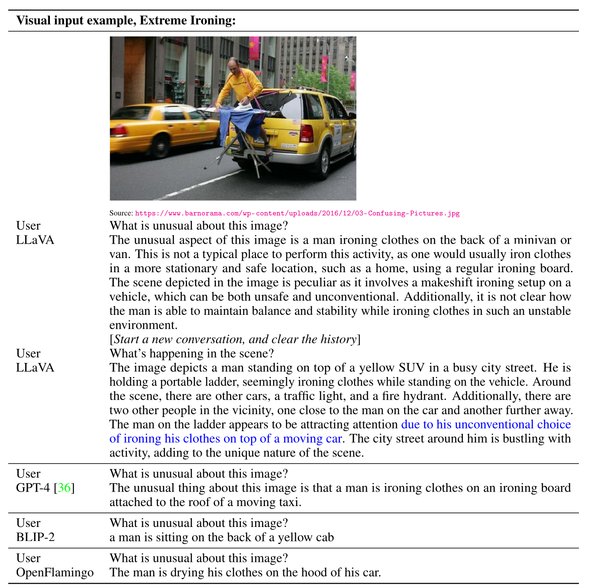

(cs336-17-topic-006)=
## LLaVA onevision

LLaVA OneVision [Li+ 2024](https://arxiv.org/pdf/2408.03326)

- Latest version in the LLaVA series (after LLaVA 1.5, LLaVA-Next)
- Handle multiple images, video

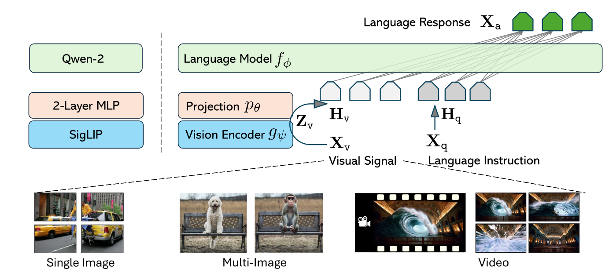

- Vision encoder: SigLIP (use grid features before and after last Transformer layer)
- Text decoder: Qwen-2 72B
- Projector: 2-layer MLP

Data processing:

- Preserving high resolution is important (e.g., for OCR)
- CLIP resizes and crops to 336x336, which loses information
- Solution: AnyRes, introduced in LLaVA 1.5 [paper](https://static.hliu.cc/files/llava/improved_llava.pdf)
- Break up image into a x b pieces (matching resolution of vision encoder), encode, concatenate
- If too many tokens (original image is too high resolution), then use bilinear interpolation

Handle 3 types of input (single image, multiple images, video):

- Goal: make all of the modalities produce roughly the same length

- Single image: use higher resolution
- Multiple images: use base resolution for each image
- Video: use lower resolution for each frame

Data:

- Philosophy: quality over quantity

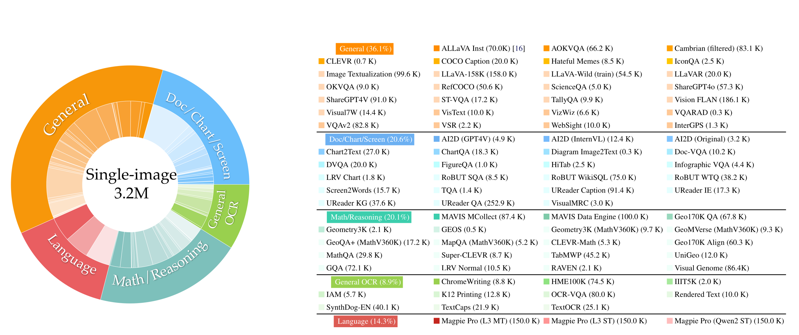

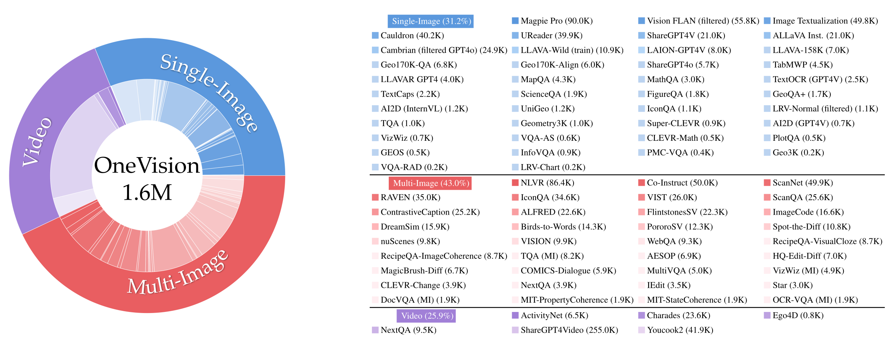

Training:

- Philosophy: easier to harder

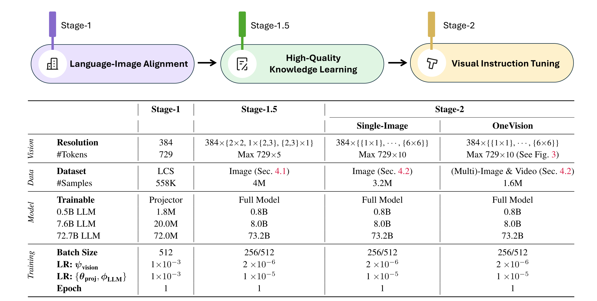

Transfer between modalities:

- Single image data for diagrams and charts, but generalize to multi-image

- OCR on single image data, relational reasoning from multi-image data, generalize to GUI-based agents

- Visual prompting (circle) in single images, generalize to videos

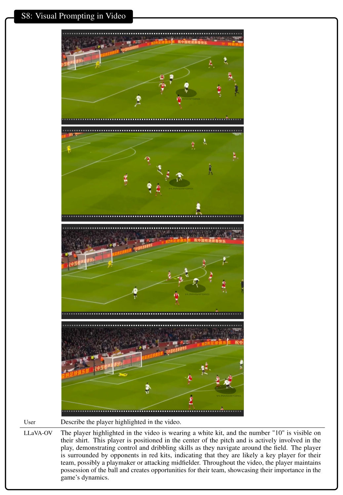

Summary:

- Standard VLM template: vision encoder + projector + LM
- Most work goes into data curation (heavy on synthesized, task-specific data)
- Open-source (released model weights and data)

(cs336-17-topic-007)=
## Qwen VL

Qwen-VL [Bai+ 2023](https://arxiv.org/abs/2308.12966)

Architecture:

- Vision encoder: OpenCLIP's ViT-bigC (14x14 patches) [Cherti+ 2022](https://arxiv.org/abs/2212.07143)
- Adaptor: one layer cross-attention, incorporate 2D positional encodings, maps to fixed length of 256
- Special tokens: &lt;img>, &lt;box>, &lt;ref>

Training:

- Stage 1: large-scale low quality data; freeze LM, train vision encoder + adaptor

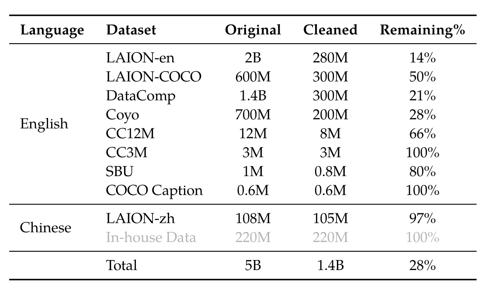

- Stage 2: higher quality task-specific data, increase resolution; train all parameters

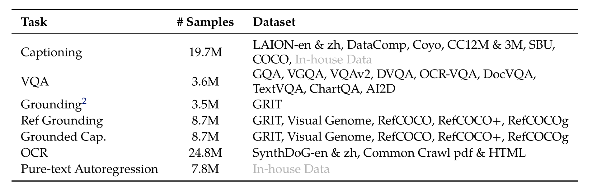

- Stage 3: instruction tuning data; freeze visual encoder, train adaptor + LM

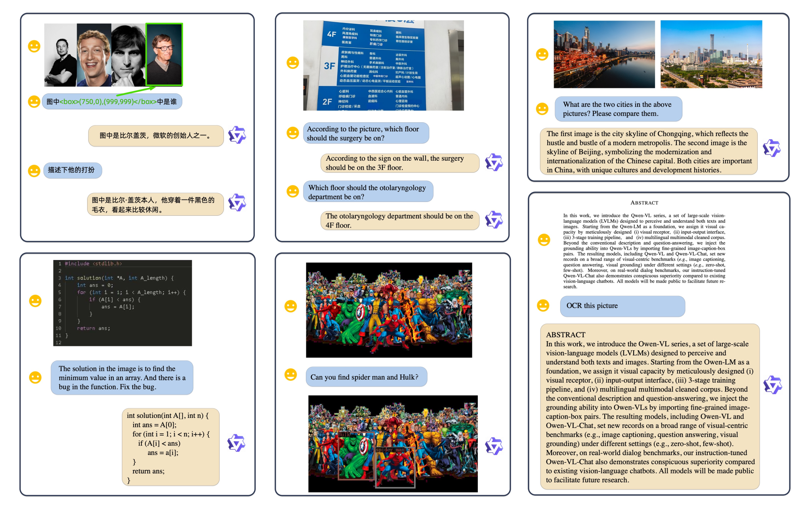

(cs336-17-topic-008)=
## Qwen2 VL

Qwen2-VL [Wang+ 2024](https://arxiv.org/abs/2409.12191)

Visual encoder: larger ViT (675M)

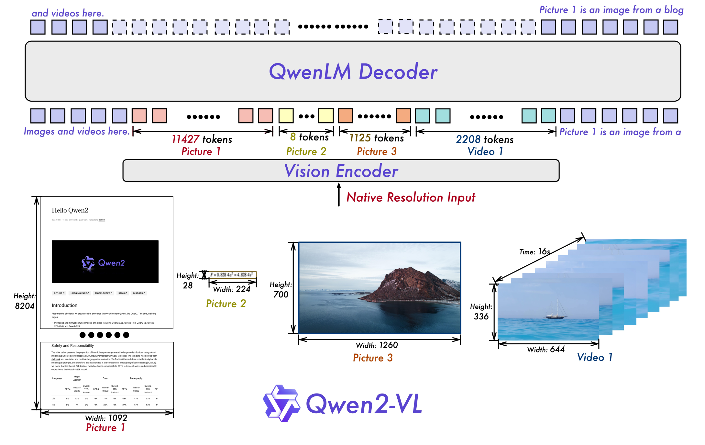

- Key: dynamic resolution to handle varying resolutions
- Each 224 x 224 patch encoded with ViT/14, compress every 2x2 => 66 tokens
- Video: sample 2 frames/sec, max 16384 tokens

Multimodal Rotary Position Embedding (MRoPE):

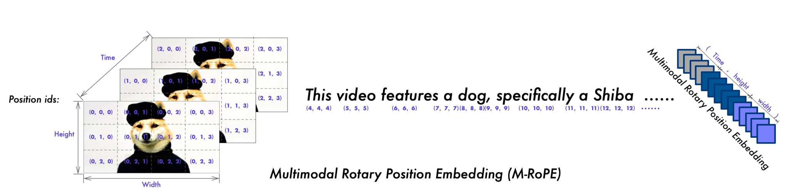

Initialize LM with Qwen2 and vision encoder from DFN [Fang+ 2023](https://arxiv.org/abs/2309.17425)

Training (similar to Qwen-VL):

- Stage 1: train only visual encoder
- Stage 2: train all parameters
- Stage 3: train language model on instruction following datasets

Many capabilities:

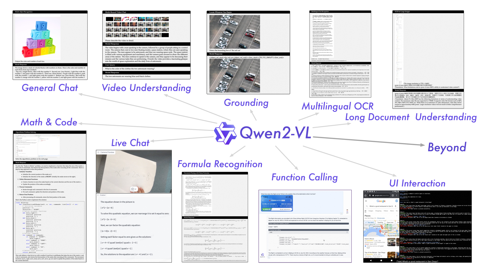

(cs336-17-topic-009)=
## Qwen3 VL

Qwen3-VL [Bai+ 2025](https://arxiv.org/abs/2511.21631)

Language model:

- Qwen-3 models (dense and MoE models up to 235B-A22B)
- Long context understanding (256K)

Vision encoder:

- SigLIP-2 (same architecture as SigLIP) [Tschannen+ 2025](https://arxiv.org/pdf/2502.14786)
- Interleaved MRoPE: distribute all axes (temporal, width, height) to low- and high-frequency bands

... [t w h t w h t w h t w h] rather than [t t t t w w w w h h h h]

- Add explicit video timestamps (as separate tokens rather in positional embeddings)
- Square-root-normalized per-token loss: balance text and multimodal data (video examples are long, don't want to dominate)

Adapter:

- DeepStack: cross-layer fusion to inject visual information into multiple layers [Meng+ 2024](https://arxiv.org/abs/2406.04334)

Training:

- Pre-training has 4 stages (train adapter, train all parameters on 8K, 32K, 256K lengths)

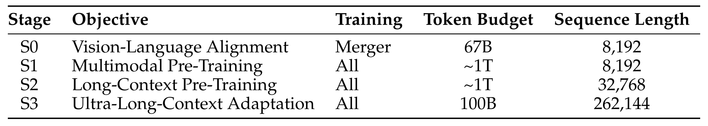

- Post-training: SFT on long CoT data, knowledge distillation, RL

Summary:

- SOTA performance
- Lots of data work, but not many details
- Minor but potentially important architectural improvements
- Scale up

(cs336-17-topic-010)=
## Chameleon

Chameleon [Chameleon Team 2024](https://arxiv.org/pdf/2405.09818)

So far: VLMs encode images (via CLIP or SigLIP), inject into LM

Disadvantage: can't generate images (need diffusion)

Chameleon: map everything into discrete tokens

Advantage: can analyze and generate images in a uniform way

Vision encoder [Gafni+ 2022](https://arxiv.org/pdf/2203.13131)

- Key difference: encoder needs to map to discrete tokens (so we can generate them)
- VQ-VAE (Vector Quantized Variational Autoencoder) [Oord+ 2017](https://arxiv.org/pdf/1711.00937)
- Idea: map image to a discrete codebook, decode back to image and minimize reconstruction loss

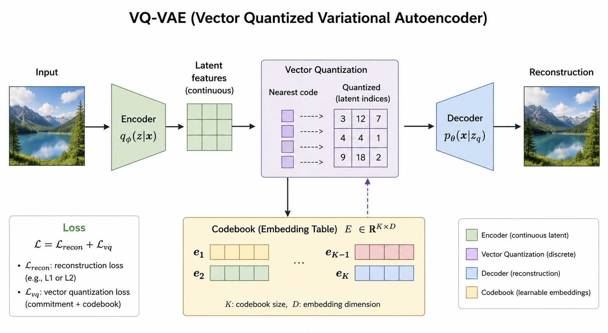

- Encodes 512 x 512 image into 1024 tokens (codebook of size 8192)
- Train a new BPE tokenizer

Training:

- Stage 1 (80%): large-scale, unsupervised (2.9T text tokens, 1.5T text/image tokens, 400B text/image interleaved tokens)
- Stage 2 (20%): 50% of stage 1 data, 50% of high quality data

Training stability

- Text tokens have low entropy, image tokens have high entropy, leads to norm growth, logit drift problem
- Fixes: QK norm, z-loss regularization

Summary:

- Elegant (just autoregressive modeling of discrete tokens)
- Not as performant (discretization loses information - think OCR)
- Training with multiple modalities is tricky

Summary:

- Frontier models are expected to be multimodal (natively multimodal, omni)
- Fundamental challenge: how to encode non-text modalities?
- Comprehension and generation might demand different things (semantics versus finer-grained details)
- Balance images + video (lower information density) and text for training stability
- Continuous encoders + Transformer + diffusion models for generation
