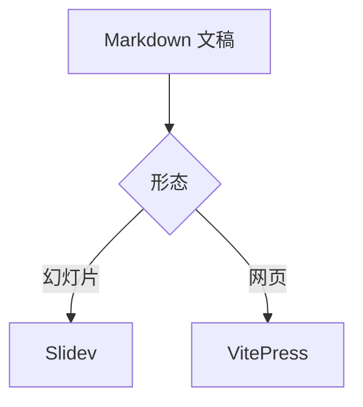
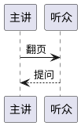

# 公式与图表

<div class="grid grid-cols-3 gap-8 mt-6">
<div>

**公式**（KaTeX）

行内公式 $e^{i\pi} + 1 = 0$；块级公式：

$$
\sum_{k=1}^{n} k = \frac{n(n+1)}{2}
$$

</div>
<div>

**流程图**（Mermaid）



</div>
<div>

**时序图**（PlantUML）



</div>
</div>

<!--
公式用 `$…$` 与 `$$…$$` 书写，由 KaTeX 渲染。`mermaid` 与 `plantuml` 代码块由宿主渲染为图：Mermaid 在浏览器中绘制，PlantUML 交给 `plantUmlServer` 指定的服务生成图片。
-->

---
class: pm-content-mindmap
routeAlias: content-mindmap
---

# 思维导图

```markmap
---
markmap:
  colorFreezeLevel: 2
---
# 富内容
## 公式
- 行内与块级
- KaTeX
## 图表
- Mermaid
- PlantUML
## 媒体
- 视频
- 音频
- 动图
## Web 组件
- 自定义元素
```

<!--
`markmap` 代码块里写 Markdown 标题与列表，渲染为思维导图。代码块自己的 frontmatter 中 `markmap` 一项是 markmap 的选项；高度可用 CSS 变量 `--pm-markmap-height` 调整。
-->

---
class: pm-content-media
routeAlias: content-media
---

# 音视频与动图

<div class="grid grid-cols-3 gap-8 mt-6 items-start">
<figure>
  <video src="@presmium/slidev-addon-content/media/clip.webm" controls muted loop width="280"></video>
  <figcaption>视频：<code>controls</code> 显示播放控制，<code>width</code> 设定尺寸</figcaption>
</figure>
<figure>
  <audio controls style="width: 240px">
    <source src="@presmium/slidev-addon-content/media/tone.ogg" type="audio/ogg">
  </audio>
  <figcaption>音频：同样用 <code>controls</code> 播放</figcaption>
</figure>
<figure>
  <picture>
    <source srcset="@presmium/slidev-addon-content/media/spinner.png" media="(prefers-reduced-motion: reduce)">
    
  </picture>
  <figcaption>动图：减少动态效果时换成静止图片</figcaption>
</figure>
</div>

<!--
音视频与图片直接用 HTML 元素，两种形态都能显示。文件写成相对路径或包路径时会随构建一起打包。
-->

---
class: pm-content-element
routeAlias: content-element
---

# Web 组件

自定义元素直接写进页面，属性传入初值，每个元素保留自己的交互状态。

<div class="flex gap-6 mt-8">
<presmium-demo-counter label="甲"></presmium-demo-counter>
<presmium-demo-counter label="乙" start="10"></presmium-demo-counter>
</div>

<!--
`presmium-demo-counter` 是用 Vue 的 `defineCustomElement` 写成的 Web 组件，由 `presmium.content` 插件启动时注册。以 `presmium-` 开头的标签由浏览器当作自定义元素处理；其他第三方 Web 组件注册后同样可以嵌入。
-->
